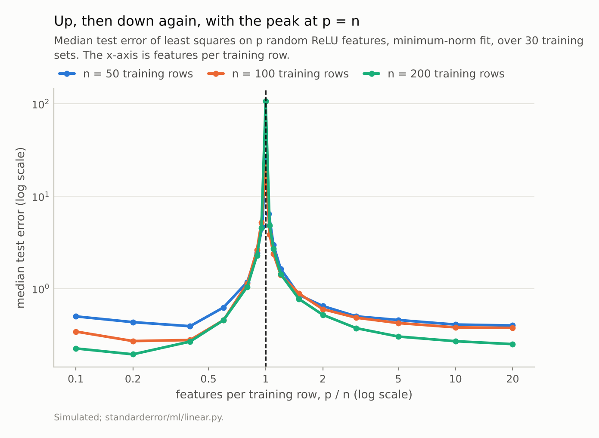
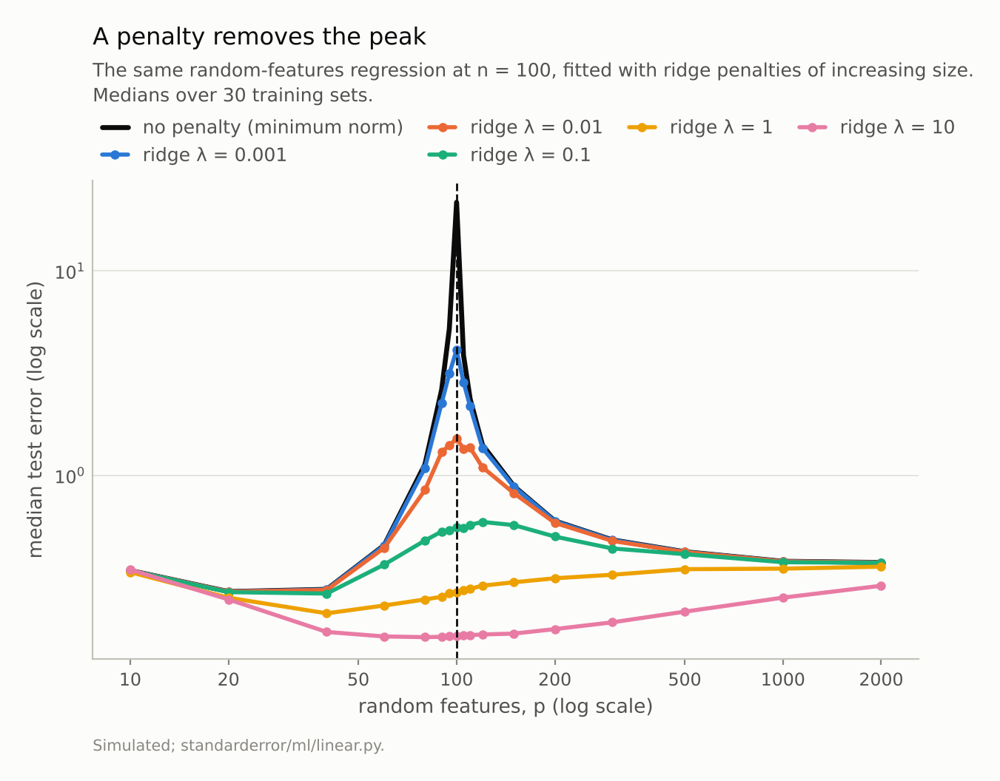
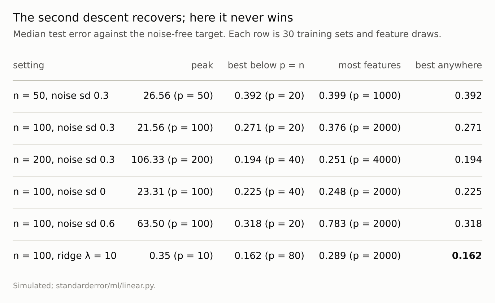

Disclosure: this post was written with the assistance of an AI system (Claude), which wrote the analysis code, ran the experiments and drafted the text. The topic, the constraints, the data choices and the final review are the author's.

*Least squares on p random ReLU features of a 10-dimensional input, 100 training rows, minimum-norm fit. Median test error is 0.271 at p = 20, peaks at 21.6 at p = 100, and falls again to 0.376 at p = 2000 — double descent, with the peak at p = n for n = 50, 100 and 200 alike. The peak appears even without label noise (23.3), because the part of the target the features cannot represent acts as noise. In no setting does the overparameterised model beat the best small one. A ridge penalty removes the peak: with λ = 10 the best model is at p = 80, error 0.162, in a flat bottom around p = n and better than either side of the unpenalised curve.*

Episode 10 of *Machine Learning, Taught Through What Breaks*. The syllabus and the other episodes: https://jongha-jeon-dev.github.io/standarderror/lectures/

## Past the bottom of the U

Episode 9 measured the U: for a knob that trades bias for variance, test error falls, bottoms out and rises. The classical advice is to stop at the bottom. Modern models do not; they have far more parameters than training rows, fit the training data exactly, and generalise anyway. *Double descent* (Belkin et al., 2019) is the curve that reconciles the two: keep adding parameters past the point of exact fit and the error comes down again.

The cleanest place to see it is least squares on random features. Draw p random directions, pass the inputs through a ReLU along each, and regress the target on those p features. Below p = n there is a unique least-squares fit. Above it there are infinitely many exact fits, and the pseudo-inverse picks the one with the smallest weights. Here n = 100 rows, 10 inputs, a nonlinear target and label noise of standard deviation 0.3:

```python
from standarderror.ml import linear as ln

# n = 100 rows, d = 10 inputs, p random ReLU features, min-norm fit
c = ln.random_features(n=100)
for p in (20, 60, 90, 100, 110, 150, 500, 2000):
    print(f"p {p:>4}  test {c['test'][p]:7.3f}  "
          f"train {c['train'][p]:.3f}  |w| {c['norm'][p]:8.1f}")
```

```text
p   20  test   0.271  train 0.223  |w|      1.5
p   60  test   0.456  train 0.076  |w|      3.6
p   90  test   2.623  train 0.018  |w|     11.4
p  100  test  21.562  train 0.000  |w|     39.6
p  110  test   2.367  train 0.000  |w|     10.6
p  150  test   0.884  train 0.000  |w|      5.2
p  500  test   0.424  train 0.000  |w|      1.8
p 2000  test   0.376  train 0.000  |w|      0.8
```

All three phases are there. Error falls to 0.271 at p = 20, climbs to **21.6 at p = 100** — about 80 times worse — and comes back down to 0.376 at p = 2000. Training error is zero from p = 100 on. The weight norm explains the peak: at p = n there is exactly one way to pass through every training point, and it needs enormous weights (40, against 0.8 at p = 2000) to bend the fit through the noise. With more features there are many interpolators, and the smallest of them is smooth.



*At n = 100 the error is 0.271 with 20 features, **21.6** with 100, and 0.376 with 2000. The peak is where the fit must pass through every training point with barely enough features to do it.*

## Where the peak sits, and what feeds it

The peak tracks the number of rows, not the number of features. With 50 rows it sits at p = 50, with 200 at p = 200; on a features-per-row axis the three curves line up. That is the *interpolation threshold*: the first p at which an exact fit exists.

What makes the peak tall is anything the fit cannot represent but must still pass through. Label noise is the obvious candidate. It is not the only one:

```python
for sigma in (0.0, 0.6):
    c = ln.random_features(n=100, sigma=sigma)
    p, e = ln.best_under(c)
    print(f"noise sd {sigma}: peak {c['test'][ln.peak(c)]:.2f}"
          f" at p = {ln.peak(c)}; best below {e:.3f} (p = {p});"
          f" at p = 2000 {c['test'][2000]:.3f}")
```

```text
noise sd 0.0: peak 23.31 at p = 100; best below 0.225 (p = 40); at p = 2000 0.248
noise sd 0.6: peak 63.50 at p = 100; best below 0.318 (p = 20); at p = 2000 0.783
```

With no label noise at all the peak is still 23.3. A finite set of random ReLU features cannot express this target exactly, and the part it misses looks to the fit exactly like noise. Doubling the noise makes the peak taller (63.5) and moves every other point up with it. In both cases the best model below the threshold beats the model with 2,000 features: 0.225 against 0.248 without noise, 0.318 against 0.783 with double.

So the second descent here is a *recovery*, not an improvement. Going far past the threshold undoes the damage the threshold did; it does not reach the bottom of the first U.

## A penalty removes the peak

The minimum-norm fit has no penalty: it insists on interpolating. Ridge regression trades fit for smaller weights, and the size of the trade is λ.

```python
for lam in (1e-3, 1e-2, 0.1, 1.0, 10.0):
    c = ln.random_features(n=100, ridge=lam)
    print(f"ridge {lam:<6g} worst {max(c['test'].values()):.3f}"
          f"  p=20 {c['test'][20]:.3f}  p=100 {c['test'][100]:.3f}"
          f"  p=2000 {c['test'][2000]:.3f}")
```

```text
ridge 0.001  worst 4.104  p=20 0.271  p=100 4.104  p=2000 0.376
ridge 0.01   worst 1.510  p=20 0.271  p=100 1.510  p=2000 0.375
ridge 0.1    worst 0.592  p=20 0.269  p=100 0.557  p=2000 0.374
ridge 1      worst 0.358  p=20 0.253  p=100 0.268  p=2000 0.358
ridge 10     worst 0.346  p=20 0.248  p=100 0.165  p=2000 0.289
```

Each penalty shrinks the peak, from 4.10 at λ = 0.001 to 0.346 at λ = 10. At λ = 10 there is no peak to speak of, and the best model is at **p = 80, error 0.162**. The curve is flat around it: every p from 40 to 150 is within 0.01, p = 100 included (0.165). The region where the unpenalised fit was worst has become the region where the penalised fit is best, and it is better than the best of either unpenalised descent (0.271 and 0.376). Nakkiran et al. (2021) proved a general version for certain linear regression settings: with the penalty optimally tuned, test error does not peak, and more data never hurts.

The minimum-norm fit at very large p is itself an implicitly regularised fit — among all interpolators it picks the smallest — which is why the second descent happens at all. An explicit penalty does the same job without needing thousands of extra features.



*Every penalty shrinks the peak; with λ = 10 it is gone. The best model, 0.162 at **p = 80**, sits in the flat bottom of a curve that is lowest around where the unpenalised fit was worst (0.165 at p = 100).*



*In every unpenalised row the best below the threshold beats the model with twenty times as many features as rows. The ridge row beats them all.*

## Where this breaks

**The penalty was picked from a grid, not tuned.** Five values of λ, the largest 10. Where each is best moves with it: λ = 1 does best at p = 40 (0.212), λ = 10 around p = n. A larger λ, or one chosen by cross-validation for each p, might do better still and put its best elsewhere. The claim needs only one penalty that beats both descents, and λ = 10 is one.

**Random features, not trained networks.** Here the features are fixed and only the last layer is fitted, which is what makes the minimum-norm solution computable. In trained networks double descent has been reported in width, in training time and in the number of samples, with the same role for label noise, but the implicit regularisation of gradient descent is harder to pin down than a pseudo-inverse.

**"Never wins" is about these settings.** Theory gives cases where the overparameterised minimum-norm fit beats every underparameterised one — when the signal is spread over many weak directions, for instance, and the extra features add regularisation the small model lacks. The claim here is narrower: on this target, at these sizes and noise levels, it did not.

**Medians, not means.** Near the threshold some training sets give errors far above the median, because the smallest singular value of the feature matrix is nearly zero. A mean would make the peak taller still; the median is the more conservative summary.

**One kind of input.** Gaussian inputs, ReLU features, a smooth target. The threshold at p = n is general for linear fits on fixed features; the heights are not.

## What to keep

1. For least squares on random features, test error peaked at p = n — for 50, 100 and 200 rows — and fell again beyond it.

2. The peak needs something the fit must interpolate but cannot represent. Label noise is one source; a target outside the features' reach is another. Without any label noise the peak was still 23.3.

3. In every setting measured, the best model below the threshold beat the model with twenty times as many features as rows.

4. A ridge penalty removed the peak; at λ = 10 the best models sat around p = n, from 40 to 150 features, with error down to 0.162, better than anything the unpenalised fit reached.

5. Double descent is a reason not to fear large models that are regularised, implicitly or explicitly. It is not a reason to expect that adding parameters to an unregularised fit will help.

## Exercise

Run the random-features experiment on your own problem: take your inputs, draw p random ReLU features for a range of p around your number of rows, and fit with the pseudo-inverse. Find the peak. Then refit with ridge at a few values of λ chosen by cross-validation and compare the best penalised model with the best of each descent.

If your production model interpolates its training data, ask which side of a threshold it sits on, and whether a penalty would do the same job with less capacity. Record the weight norm alongside the error: a peak in one without the other means something else is going on.

## Next

Arc II ends here: separability, units, selection, the U and its second descent were all properties of linear models and the averages built from them. Arc III turns to trees and ensembles, starting with the claim that makes a single decision tree popular: that it is interpretable. Episode 11 bootstraps the rows and counts how often the root split, and the shape of the tree beneath it, survive.

---

### Data

- Simulated: 10 standard-normal inputs; target tanh(2x·β) + 0.3 sin(2x₁) with a fixed random β; label noise of sd 0.3 unless stated; p ReLU features max(0, x·W) with W random normal; test error against the noise-free target on 5,000 fixed points; 30 training sets and feature draws per setting.
- Machinery: `standarderror/ml/linear.py`, tested in `tests/test_ml.py`; numpy's pseudo-inverse for the minimum-norm fit.
- Where this stops: Belkin, Hsu, Ma and Mandal, "Reconciling modern machine-learning practice and the classical bias-variance trade-off", *PNAS* (2019); Hastie, Montanari, Rosset and Tibshirani, "Surprises in high-dimensional ridgeless least squares interpolation", *Annals of Statistics* (2022); Nakkiran et al., "Optimal regularization can mitigate double descent", *ICLR* (2021).

### Reproducibility

- **environment**: standarderror=0.1.0, python=3.13.16, numpy=2.4.4
- **code blocks**: executed at build time; the values the prose quotes are pinned, so drift fails the build
- **determinism**: training sets from seeds 0 to 29, feature weights from seeds 1000 to 1029, test points from seed 99, target coefficients from seed 0

Code: <https://github.com/jongha-jeon-dev/standarderror>
