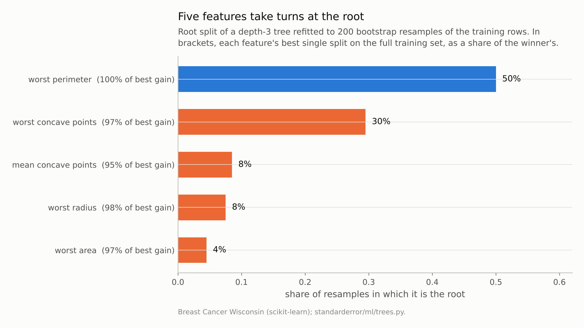
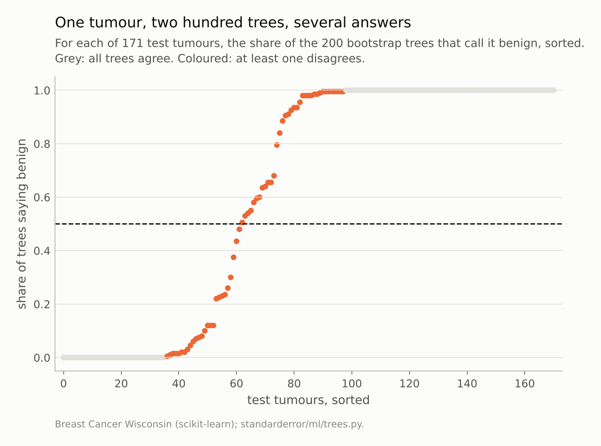
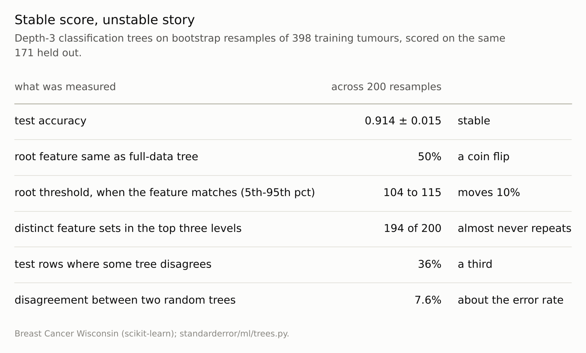

Disclosure: this post was written with the assistance of an AI system (Claude), which wrote the analysis code, ran the experiments and drafted the text. The topic, the constraints, the data choices and the final review are the author's.

*Two hundred depth-3 trees fitted to bootstrap resamples of a breast-cancer training set score 0.914 on the same held-out tumours, with a standard deviation of 0.015. Their structure is another matter. The full-data tree's root feature, worst perimeter, is the root in 50% of resamples; four other features take the rest, and all five have best splits within 5% of each other. The set of features in the top three levels differs in 194 of 200 resamples, and 36% of test tumours get a different diagnosis from at least one tree.*

Episode 11 of *Machine Learning, Taught Through What Breaks*. The syllabus and the other episodes: https://jongha-jeon-dev.github.io/standarderror/lectures/

## The case for trees

Arc II pushed linear models past their textbook conditions. Arc III does the same for trees and the ensembles built from them, and starts with the reason a single tree is chosen at all: it can be read. A depth-3 tree is at most eight rules a clinician could check by hand — *if the largest nuclei have a perimeter above about 107, call it suspicious and look further down the tree* — and that readability is often the whole argument for using one instead of something more accurate.

Reading a tree as an account of the data assumes the tree is a property of the data. A different sample from the same population should give roughly the same tree. That is checkable: draw bootstrap resamples of the training rows, refit, and compare.

The data are the Wisconsin breast-cancer measurements: 398 training tumours, 171 held out, 30 features describing cell nuclei. The tree is depth 3, the size people actually draw on a slide.

```python
from standarderror.ml import trees as tr

b = tr.tree_bootstrap(boots=200, depth=3)
print(f"full-data root: {b['full_root']}")
for name, k in b["roots"]:
    print(f"  root in {k:3d} of 200 resamples: {name}")
acc = b["accuracy"]
print(f"test accuracy {sum(acc) / len(acc):.3f}, sd {b['accuracy_sd']:.3f}")
```

```text
full-data root: worst perimeter
  root in 100 of 200 resamples: worst perimeter
  root in  59 of 200 resamples: worst concave points
  root in  17 of 200 resamples: mean concave points
  root in  15 of 200 resamples: worst radius
  root in   9 of 200 resamples: worst area
test accuracy 0.914, sd 0.015
```

The accuracy is what a model-selection report would show, and it is steady: 0.914, give or take 0.015. The root is not. The tree fitted to all 398 rows splits first on worst perimeter; a resample agrees **50%** of the time. Worst concave points wins 59 times, and three more features take the rest.



*The full-data tree splits on worst perimeter first. A resample agrees **50%** of the time. The five contenders' best splits are within 5% of one another, so which one wins is decided by which rows were drawn.*

## Why the root moves

A tree is grown greedily: at each node it tries every feature and threshold and keeps the single split that reduces impurity most. When several splits are nearly as good, the winner is decided by the details of the sample. Here is how close the contest at the root is on the full training set:

```python
for c in b["candidates"]:
    print(f"{c['feature']:22s} best split gain {c['gain']:.4f}"
          f"  ({c['relative']:.1%} of the best)")
```

```text
worst perimeter        best split gain 0.3435  (100.0% of the best)
worst radius           best split gain 0.3365  (97.9% of the best)
worst area             best split gain 0.3328  (96.9% of the best)
worst concave points   best split gain 0.3325  (96.8% of the best)
mean concave points    best split gain 0.3278  (95.4% of the best)
```

All five are within 5% of the best. That is not a coincidence of this dataset; they measure overlapping things. Perimeter, radius and area of the largest nuclei are almost deterministic functions of one another, and concavity tracks size in malignant cells. A resample that shifts a handful of borderline tumours is enough to change which one edges ahead.

The instability then propagates. Every split below the root is chosen on the rows the root sent down, so a different root means different subsets and a different contest at every node beneath. The threshold moves too: even when the root feature matches, its cut point ranges from 104 to 115 between the 5th and 95th percentiles of resamples.

```python
print(f"distinct top-3-level feature sets: {b['distinct_sets']} of 200")
print(f"test rows where some tree disagrees: {b['any_disagree']:.1%}")
print(f"two random trees disagree on: {b['pair_disagreement']:.1%}")
```

```text
distinct top-3-level feature sets: 194 of 200
test rows where some tree disagrees: 36.3%
two random trees disagree on: 7.6%
```

The features used in the first three levels come out as a different set in 194 of 200 resamples. A reader who took any one of these trees as *the* structure of the data would be reading one draw from a wide distribution.



***36%** of test tumours get a different diagnosis from at least one of the trees; any two trees disagree on 7.6% of them. Each tree, read on its own, explains its answer with confidence.*

## Different rules, different diagnoses

Structure could move while predictions stayed put; two trees can encode the same decision with different rules. They do not. Any two of these trees disagree on 7.6% of test tumours, about the size of their own error rate (8.6%), and across all two hundred, **36% of tumours get a different diagnosis from at least one tree**.

Those tumours are not random. They are the ones near the boundary, where several rules of similar quality draw the line in slightly different places. That is also where a diagnosis matters most, and where a tree's printed path — "malignant because worst perimeter > 107" — is least an account of the data and most an account of the sample.

The accuracy hides all this because it is an average over tumours, most of which are easy. It is the same lesson as episode 1's error bar, one level down: the number is stable because it averages over exactly the cases where the model is not.



*Everything a reader would read off the tree moves; the number a model selection would look at does not.*

## What does survive

Not everything moves. Every one of the 200 roots is one of 5 features, and all of them describe either the size or the concavity of the largest, most irregular nuclei. A statement at that level — *the first thing that separates these tumours is how large and how irregular the worst nuclei are* — holds in every resample. A statement at the level of the printed tree — *worst perimeter, cut at 107* — holds in about half.

That suggests how to present a tree honestly. Report the set of features that compete for each of the top splits and how often each wins, not the single winner; quote thresholds as ranges across resamples; and say which statements about the data are stable and which are a property of one fit. It is more work than printing the tree, and it is what the tree's readability was supposed to buy in the first place: a claim about the data that a reader can check.

It also says what not to do. A tree is not evidence that its root feature is *the* most important variable, and a feature absent from the tree is not evidence that it is irrelevant: in half these resamples worst perimeter is not the root, and in 26% it does not appear anywhere in the top three levels.

## Where this breaks

**Deeper trees are worse, not better.** Depth 3 is the readable case. Fully grown trees on this data have dozens of leaves, and every leaf below the top inherits the instability above it.

**Some data have one dominant split.** When one feature separates the classes far better than any other, the root is stable and the instability starts further down. The size of the gap between the best and second-best split at the root is the thing to check, and on data with many correlated measurements it is usually small.

**Bagging is the fix for prediction, not for reading.** Averaging these two hundred trees gives a forest whose predictions are stable, which was Breiman's point in 1996. It also gives up the single readable tree. Episodes 12 and 16 measure what is left of the reading once trees are averaged.

**Unbiased split selection changes which features win, not how often.** Conditional inference trees choose the root by a significance test instead of a raw impurity decrease. That corrects a bias episode 12 measures, but with five near-equivalent candidates the resample still decides.

## What to keep

1. Two hundred bootstrap refits of a depth-3 tree scored 0.914 ± 0.015: the accuracy is a property of the data.

2. The root feature matched the full-data tree's in 50% of them, and the top three levels used a different feature set in 194 of 200: the structure is a property of the sample.

3. The root moves because the candidates are close. Here the best five splits were within 5% of one another.

4. 36% of test tumours got a different diagnosis from at least one tree. Instability in the rules is instability in the predictions near the boundary.

5. Before reading a tree, refit it on a few dozen bootstrap resamples and report how often its root and its top-level features recur.

## Exercise

Take a tree you have shown to someone as an explanation. Refit it on 50 bootstrap resamples of its training data and count how often its root feature, its root threshold (to the precision you quoted) and its second-level features reappear. Then compute, for your held-out rows, the share of resampled trees that agree with the original tree's prediction.

If the root survives in fewer than four resamples out of five, say so when you present the tree — or present the set of competing roots instead of one.

## Next

Episode 12 takes the forest that averaging produces and asks the question people put to it in place of reading a tree: which features does it rely on? The default answer, impurity importance, is measured on data where the right answer is known to be nothing at all.

---

### Data

- Breast Cancer Wisconsin (Diagnostic), as bundled with scikit-learn, CC BY 4.0; one stratified 70/30 split; 200 bootstrap resamples of the 398 training rows.
- Machinery: `standarderror/ml/trees.py`, tested in `tests/test_ml.py`; scikit-learn's DecisionTreeClassifier with max_depth=3.
- Where this stops: Breiman, "Bagging predictors", *Machine Learning* (1996), on unstable procedures; Breiman, "Statistical modeling: the two cultures", *Statistical Science* (2001), for the Rashomon effect; Hothorn, Hornik and Zeileis, "Unbiased recursive partitioning", *JCGS* (2006), for split selection with a significance test.

### Reproducibility

- **environment**: standarderror=0.1.0, python=3.13.16, numpy=2.4.4
- **code blocks**: executed at build time; the values the prose quotes are pinned, so drift fails the build
- **determinism**: split seed 0; bootstrap resamples from one generator with seed 0; trees with random_state 0

Code: <https://github.com/jongha-jeon-dev/standarderror>
