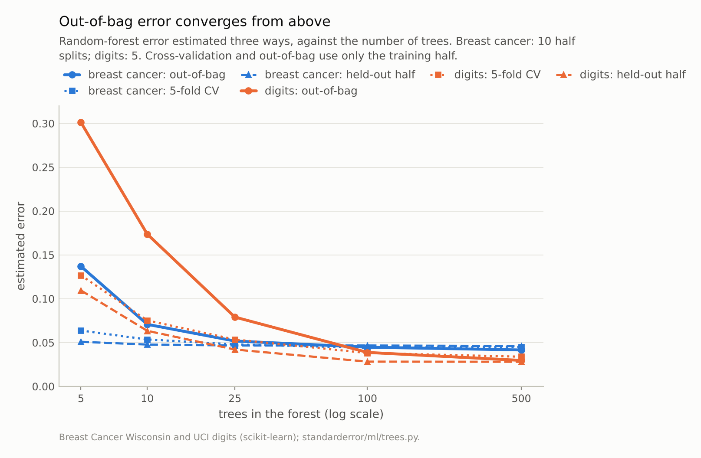
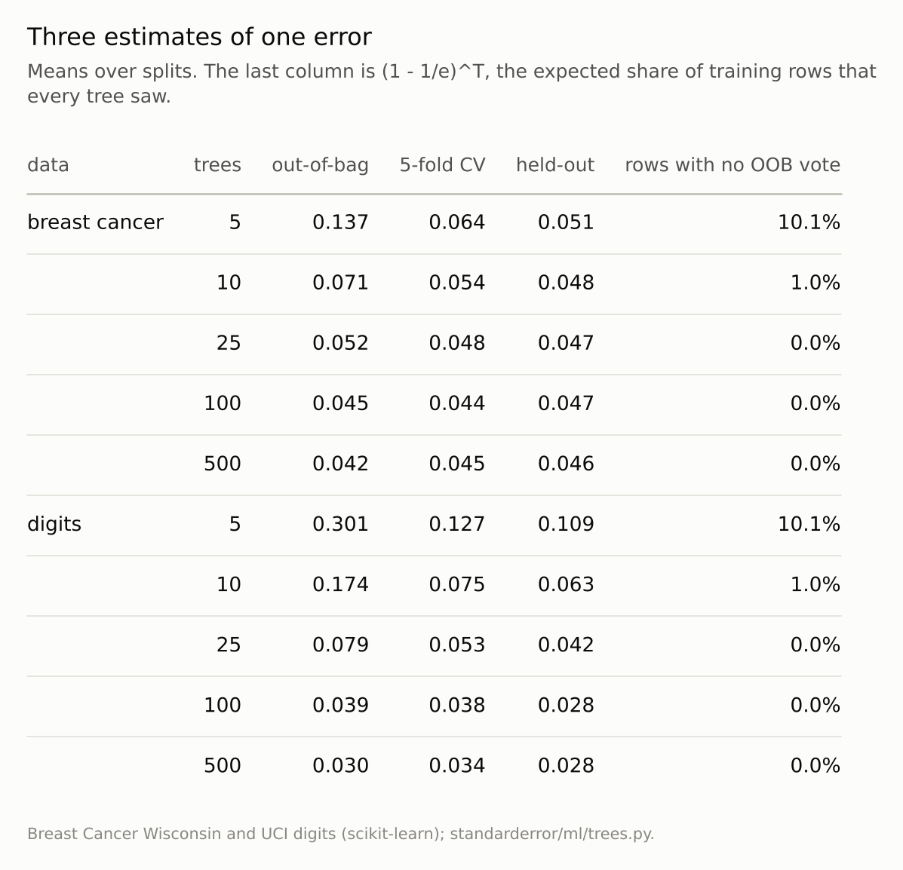
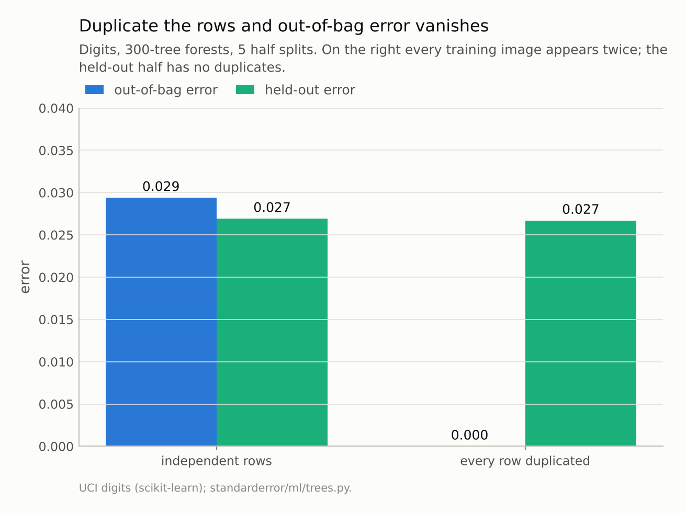

Disclosure: this post was written with the assistance of an AI system (Claude), which wrote the analysis code, ran the experiments and drafted the text. The topic, the constraints, the data choices and the final review are the author's.

*Out-of-bag error against five-fold cross-validation and a held-out half. With 500 trees it lands within 0.004 of the held-out error on breast cancer and 0.002 on digits, about as close as cross-validation, from a single fit. With 5 trees it is 2.7 and 2.8 times the held-out error, because each row is judged by the third of the forest that did not see it. With every digit image duplicated in the training data, out-of-bag error is exactly 0 while the held-out error is 0.027.*

Episode 13 of *Machine Learning, Taught Through What Breaks*. The syllabus and the other episodes: https://jongha-jeon-dev.github.io/standarderror/lectures/

## An error estimate in the box

A random forest grows each tree on a bootstrap sample of the training rows. A bootstrap sample of n rows leaves out each row with probability (1 − 1/n)ⁿ, about 1/e or 37%. So every training row has a set of trees that never saw it, and those trees can predict it as if it were new. Collect those predictions for every row and you have the *out-of-bag* (OOB) error: an estimate of test error that needs no held-out data and no refitting. Breiman called it free, and in scikit-learn it is one argument.

"Free cross-validation" is a claim that can be checked directly. Here are the OOB error, five-fold cross-validation on the same training half, and the error on the untouched other half, for forests of increasing size:

```python
from standarderror.ml import trees as tr

# breast cancer, 10 half splits; OOB and CV use the training half only
for r in tr.oob_study(data="breast cancer", trees=(5, 10, 25, 100, 500)):
    print(f"{r['trees']:>3} trees  out-of-bag {r['oob']:.3f}"
          f"  5-fold CV {r['cv']:.3f}  held-out {r['test']:.3f}")
```

```text
  5 trees  out-of-bag 0.137  5-fold CV 0.064  held-out 0.051
 10 trees  out-of-bag 0.071  5-fold CV 0.054  held-out 0.048
 25 trees  out-of-bag 0.052  5-fold CV 0.048  held-out 0.047
100 trees  out-of-bag 0.045  5-fold CV 0.044  held-out 0.047
500 trees  out-of-bag 0.042  5-fold CV 0.045  held-out 0.046
```

At 500 trees the claim holds: OOB 0.042, cross-validation 0.045, held-out 0.046. Both estimates are within half a point of the held-out number — cross-validation a little closer here, out-of-bag closer on digits (0.030 and 0.034 against 0.028) — and cross-validation took five extra forests to get there.

At 5 trees it fails badly: **OOB 0.137 against a held-out 0.051**, 2.7 times too high. Cross-validation, at 0.064, is also pessimistic but by far less.



*At 5 trees the out-of-bag error is **2.7x** the held-out error on breast cancer and 2.8x on digits. At 500 it is within 0.004 and 0.002.*

## Why small forests look worse than they are

The OOB prediction for a row is a vote among the trees that did not see it, not among all of them:

```python
# share of all trees for which a given row is out of bag
print(" ".join(f"{T} trees: {tr.oob_coverage(T):.3f}" for T in (5, 100)))
```

```text
5 trees: 0.367 100 trees: 0.368
```

A row's OOB verdict comes from about 37% of the forest. With 500 trees that is around 185, plenty for a stable vote, so the estimate describes a forest almost as good as the real one. With 5 trees it is one or two, and a forest of one or two trees is far worse than a forest of five. The OOB error at T trees estimates the error of a forest of roughly T/e trees, which matters exactly when the forest is small enough for the difference to matter.

Some rows are worse off still. The chance that a row was drawn into every one of T bootstrap samples is about (1 − 1/e)^T: 10% of rows at 5 trees, 1.0% at 10. Those rows have no OOB prediction at all, and a forest that cannot predict them cannot be right about them.

Pessimism is the safe direction for an error estimate, and by 100 trees it is gone. It still matters in two places: when OOB error is used to choose the number of trees, where it argues for more trees than are needed; and when it is used to compare a forest against a model scored by honest cross-validation, where a small forest is handicapped. Janitza and Hornung (2018) document a further, subtler pessimism in OOB error for small samples, which the two datasets here are too large to show.



*From 100 trees on, out-of-bag and five-fold cross-validation are both within about half a point of the held-out error; out-of-bag costs a sixth of the fitting.*

## When rows are not independent

The OOB argument rests on one assumption: a tree that did not see a row has learned nothing specific to it. That is true when rows are independent draws. It is false when the training data contain copies — augmented images, repeated measurements of one patient, the same customer on many rows, a careless merge that duplicated a table.

Duplicate every digit image in the training half and refit:

```python
d = tr.oob_duplicates()     # digits; each training image twice
print(f"independent rows: OOB {d['oob']:.3f}, held-out {d['test']:.3f}")
print(f"duplicated rows:  OOB {d['oob_dup']:.3f}, "
      f"held-out {d['test_dup']:.3f}")
```

```text
independent rows: OOB 0.029, held-out 0.027
duplicated rows:  OOB 0.000, held-out 0.027
```

Out-of-bag error is **exactly 0**. When one copy of an image is out of a tree's bootstrap sample, the other copy is almost always in it, so the "unseen" row was seen. The held-out error is unchanged at 0.027: the model is no better, only its own estimate of itself is broken.

This is the same failure episode 3 measured for cross-validation with grouped rows, and it has the same remedy, with a cost: the rows must be grouped and the groups held out together. A forest's built-in OOB estimate has no notion of groups, so on grouped data it cannot be used at all. Grouped cross-validation, or a held-out set split by group, has to replace it.



*Whenever a row is out of bag its copy is usually in it, so the forest is scored on what it memorised: OOB error **0.000**, held-out 0.027. The model did not get better; the estimate broke.*

## Using it well

None of this makes out-of-bag error less useful; it says when to use it. The cost argument is real: for a forest of a few hundred trees, OOB error comes with the fit, while five-fold cross-validation fits five more forests. On large data that is the difference between an estimate and no estimate.

Three habits keep it honest. Grow the forest first and read the OOB error last: the curve above settles by 100 trees on both datasets, and below that the number describes a weaker model than the one you have. Keep a held-out set anyway for the final, reported number, because the OOB error of the model you chose after looking at several OOB errors is no longer an independent estimate. And before trusting it at all, ask whether two rows of the training data can be the same thing in disguise. If they can, the bootstrap's notion of "unseen" is wrong, and so is every number built on it, as the duplicated digits show with an error of exactly 0.

## Where this breaks

**OOB is not free for tuning.** Each OOB error is an honest estimate for one forest. Choosing the best of many hyperparameter settings by their OOB errors reuses the same rows to select and to score, and the winner's OOB error is optimistic, as any validation score reused for selection is.

**Gradient boosting has no equivalent.** Its trees are fitted in sequence, each to the residuals of all the earlier ones, so no tree is independent of a row it did not sample. Subsampled boosting reports an "out-of-bag improvement", which is a different and much rougher quantity.

**Two datasets, one model setting.** Both datasets are easy and both forests use scikit-learn's defaults. The crossover to an honest estimate came at about 100 trees here; it depends on how much a single tree's error exceeds the forest's.

**Duplicates are the extreme case.** Near-duplicates, such as augmented copies with small shifts or repeated visits by one patient, leak less than exact copies but leak in the same direction.

## What to keep

1. With 500 trees, out-of-bag error was within 0.004 of the held-out error on both datasets, about as close as five-fold cross-validation, for one fit instead of six.

2. With 5 trees it was 2.7 and 2.8 times the held-out error. Each row's OOB vote comes from about 37% of the forest, so a small forest is judged as an even smaller one.

3. Use OOB error once the forest has at least a hundred or so trees, and never to compare against a smaller forest.

4. With duplicated rows, OOB error was 0 and the held-out error 0.027. On grouped or repeated data, OOB error is not an estimate of anything.

5. Selecting hyperparameters by OOB error makes the winner's OOB error optimistic, like any reused validation score.

## Exercise

Fit your forest with `oob_score=True` at 10, 50 and 500 trees and compare each OOB error with the error on a held-out set. Note where the two meet.

Then look for copies: count exact duplicate rows in your training data, and if there is a grouping variable — a patient, a customer, a device — refit with grouped cross-validation and compare with the OOB error. If the grouped estimate is noticeably higher, the OOB number you have been reporting was measuring memory.

## Next

Episode 14 moves from bagging to boosting and to the warning that comes with it: run boosting for long enough and it will overfit. Whether it does depends on which number you watch.

---

### Data

- Breast Cancer Wisconsin (Diagnostic) and UCI Optical Recognition of Handwritten Digits, as bundled with scikit-learn, CC BY 4.0; stratified half splits, 10 for breast cancer and 5 for digits.
- Machinery: `standarderror/ml/trees.py`, tested in `tests/test_ml.py`; scikit-learn's RandomForestClassifier with oob_score=True and default settings otherwise.
- Where this stops: Breiman, "Out-of-bag estimation", technical report (1996); Breiman, "Random forests", *Machine Learning* (2001); Janitza and Hornung, "On the overestimation of random forest's out-of-bag error", *PLOS ONE* (2018).

### Reproducibility

- **environment**: standarderror=0.1.0, python=3.13.16, numpy=2.4.4
- **code blocks**: executed at build time; the values the prose quotes are pinned, so drift fails the build
- **determinism**: split seeds 0 to 9 (digits 0 to 4); forests and fold assignments seeded with the split seed

Code: <https://github.com/jongha-jeon-dev/standarderror>
