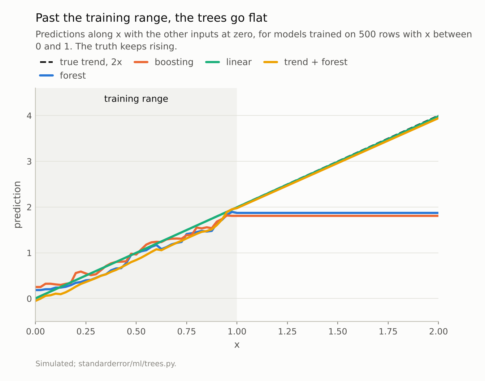
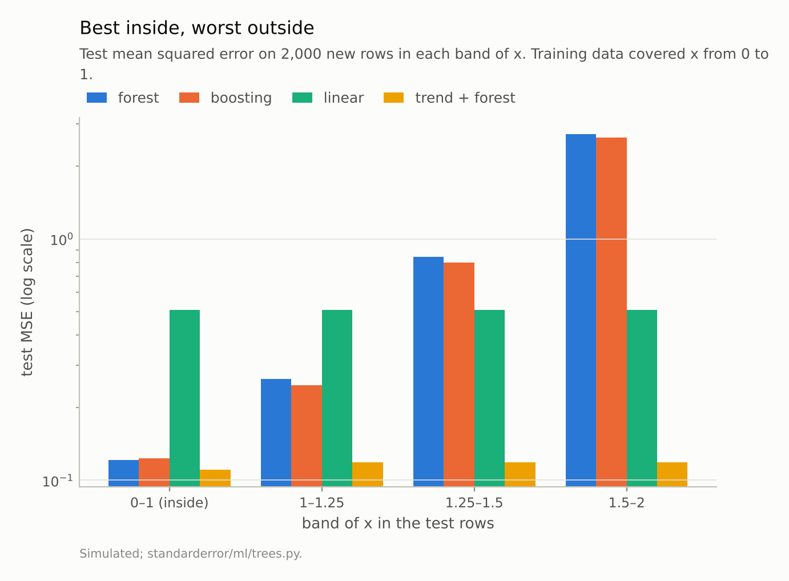
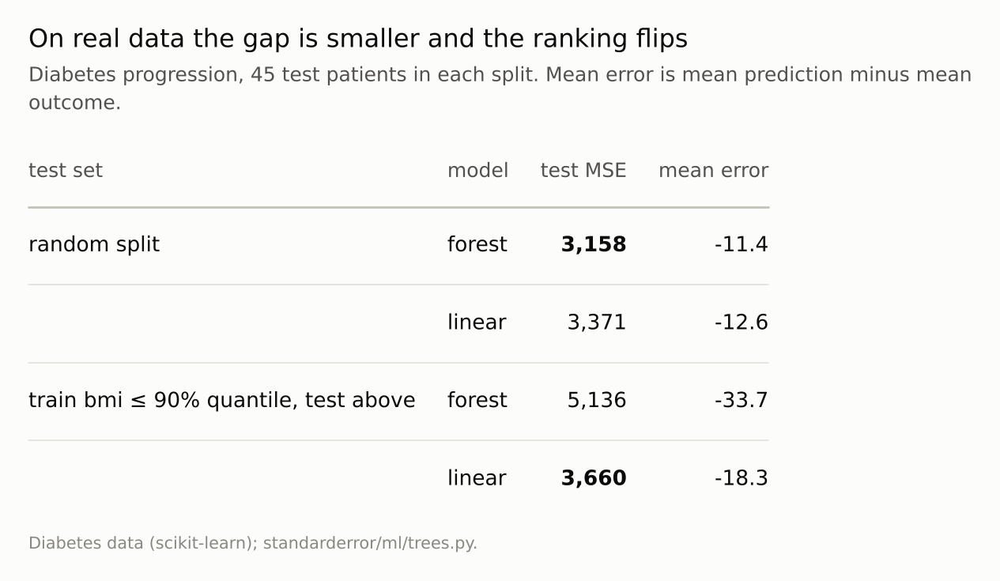

Disclosure: this post was written with the assistance of an AI system (Claude), which wrote the analysis code, ran the experiments and drafted the text. The topic, the constraints, the data choices and the final review are the author's.

*Trained on x between 0 and 1 with y rising as 2x, a random forest has test error 0.12 inside the range, against 0.51 for linear regression, and 2.71 between 1.5 and 2 — 22 times worse — because it never predicts above 2.87. Histogram boosting does the same. Fitting the trend linearly and a forest to the residuals gives 0.11 inside and 0.12 beyond. On the diabetes data a forest beats linear regression on a random split and loses to it by 40% on the highest-bmi patients when trained without them.*

Episode 15 of *Machine Learning, Taught Through What Breaks*. The syllabus and the other episodes: https://jongha-jeon-dev.github.io/standarderror/lectures/

## Universal, inside the box

Trees and the ensembles built from them come with a reassuring theorem attached: with enough trees and enough depth they can approximate any reasonable function. The theorem has a domain. A tree's prediction in a leaf is the mean of the training labels that landed there, and a forest's prediction is an average of those. No average of numbers can be larger than the largest of them. Whatever a forest predicts, it predicts within the range of the labels it was trained on.

Inside the region the training data cover, that costs nothing. Outside it, it is decisive. A simulation shows how much: an outcome that rises as 2x plus a nonlinear effect of a second input, 500 training rows with x between 0 and 1, and test rows in bands of x inside and beyond that range.

```python
from standarderror.ml import trees as tr

# train: 500 rows, x in [0, 1], y = 2x + sin(2z) + noise
ex = tr.extrapolation()
for r in ex["rows"]:
    lo, hi = r["band"]
    print(f"x in [{lo:4.2f}, {hi:4.2f}]  " + "  ".join(
        f"{k} {r[k]:.3f}" for k in
        ("forest", "boosting", "linear", "trend + forest")))
```

```text
x in [0.00, 1.00]  forest 0.122  boosting 0.123  linear 0.508  trend + forest 0.110
x in [1.00, 1.25]  forest 0.263  boosting 0.248  linear 0.508  trend + forest 0.119
x in [1.25, 1.50]  forest 0.841  boosting 0.798  linear 0.508  trend + forest 0.119
x in [1.50, 2.00]  forest 2.713  boosting 2.625  linear 0.508  trend + forest 0.119
```

Inside the range the trees are the best models measured: 0.122 for the forest and 0.123 for boosting, against 0.508 for a linear regression that cannot represent the sine term. In the first band past the edge the forest's error is already 2.2 times larger. Between 1.5 and 2 it is **2.71, 22 times its error inside**, and the linear model, unchanged at 0.508, is 5.3 times better.



*The forest never predicts above 2.87; the training labels peaked at 3.58. At x between 1.5 and 2 the truth averages 3.51.*

## A ceiling, not a mistake

The figure makes the mechanism plain. Along x, the forest and the boosted trees follow the trend to the edge of the training data and then run flat:

```python
print(f"largest training label {ex['train_y_max']:.2f}; "
      f"largest forest prediction at x in [1.5, 2]: "
      f"{ex['rows'][-1]['forest_max']:.2f}")
```

```text
largest training label 3.58; largest forest prediction at x in [1.5, 2]: 2.87
```

Nothing went wrong in fitting. Every split threshold on x lies inside [0, 1], so every test row with x above 1 falls into the same leaves as the training rows with the largest x, and gets their average. The model has no representation of "and it keeps rising"; it has a step function that ends.

Boosting is no exception, despite being a sum rather than an average. Each of its trees is still piecewise constant in x with thresholds inside the training range, so the sum is constant beyond it too.

The fix keeps the trees' strengths and removes the ceiling: fit the trend with a model that can extrapolate it — here a linear regression on x alone — and fit the forest to what is left. The residuals have no trend, so the forest's flat continuation is the right continuation. That hybrid has error 0.110 inside the range and 0.119 between 1.5 and 2: best everywhere. It works because the shape of the trend was known. When it is not, the honest statement is that no model has evidence about what happens past the data, and the trees at least make that visible by refusing to guess.



*Inside the range the forest's error is 0.12 and the linear model's 0.51. Between 1.5 and 2 the forest's is **2.71**. The hybrid stays at 0.12.*

## On real data: smaller, and still there

Real extrapolation is rarely so clean. On the diabetes data, train on the patients with bmi at or below its 90th percentile and test on the 45 above it; compare with a random split of the same sizes:

```python
d = tr.diabetes_extrapolation(quantile=0.9)
for split in ("random", "beyond"):
    print(split, "  ".join(f"{m} MSE {d[split][m]['mse']:,.0f} "
                           f"(mean error {d[split][m]['bias']:+.1f})"
                           for m in ("forest", "linear")))
```

```text
random forest MSE 3,158 (mean error -11.4)  linear MSE 3,371 (mean error -12.6)
beyond forest MSE 5,136 (mean error -33.7)  linear MSE 3,660 (mean error -18.3)
```

On the random split the forest wins, 3,158 against 3,371. On the high-bmi patients it loses by **40%**, and its errors lean one way: it under-predicts their disease progression by 34 on average, against 18 for the linear model. The relationship between bmi and progression keeps rising past the training range, and the forest, as on the simulation, stops.

The effect is much smaller than in the simulation, because bmi is one of ten inputs and the outcome is noisy. That is the realistic version: not a dramatic failure but a quiet, systematic bias on exactly the cases at the edge — the heaviest patients, the largest loans, the newest dates — that are often the ones a model is deployed to judge.



*The forest wins the random split and loses the extrapolation, and its misses on the high-bmi patients are systematically low.*

## How to see it coming

The ceiling is easy to detect before it costs anything, because it is a property of the training data, not of the model's internals. Three checks cover most cases.

Compare each input's range in the data the model will score with its range in the training data. A row whose value of x is beyond the largest training value is a row the trees will treat as if it sat at the edge. In the simulation, every row in the last band is such a row.

Compare the model's predictions with the training labels. A forest's predictions are confined to the label range by construction; if the outcome you expect is outside it — next year's sales, a larger loan, an older patient — the model cannot produce it, and its predictions will pile up just under the old maximum. Here they stop at 2.87, under a training maximum of 3.58.

Score the model on a split by the drifting variable, not only a random one. The diabetes table is that check: the random split rated the forest the better model; the split by bmi reversed the ranking.

## Where this breaks

**Time is the common case.** A forest given a date or a time index as a feature is extrapolating on every future prediction. Trends, inflation and growth all live past the last training date; a forest on raw levels will predict last year's level. Differencing or detrending first is the same fix as above.

**Extrapolation in one feature is not extrapolation in all.** A row can be inside the range of every feature separately and still far from any training row, in a corner of the joint space no one sampled. Trees are flat there too, and no per-feature range check will catch it.

**Linear models extrapolate confidently, not correctly.** The linear model here was right beyond the range because the truth was linear in x. Had the trend bent, it would have extrapolated the wrong line with equal conviction. The trees' ceiling is a known, bounded failure; the line's is not.

**One simulation, one real split.** The size of the ratio depends on how far past the edge one tests and how steep the trend is. The ceiling does not.

## What to keep

1. A tree's prediction is an average of training labels, so a forest cannot predict beyond the range of the labels it saw. This forest's ceiling was 2.87.

2. Inside the training range the trees were the best models measured (0.12 against 0.51 for linear); between 1.5 and 2 the forest's error was 22 times larger.

3. Fitting the trend first and the forest to the residuals was best everywhere: 0.11 inside, 0.12 beyond.

4. On diabetes, a forest that won a random split lost by 40% on the highest-bmi patients and under-predicted them systematically.

5. Before deploying a tree ensemble, check where its inputs will fall relative to the training data — especially any input that drifts, such as time.

## Exercise

Sort your training data by the feature most likely to drift — a date, a size, a price — and train on the first 80%, test on the last 20%. Compare your tree ensemble with a linear model on that split and on a random split of the same sizes. If the ensemble's advantage shrinks or reverses, plot its predictions against that feature on the test rows and look for the flat line.

Then try the hybrid: regress the outcome on the drifting feature alone, fit the ensemble to the residuals, and add the two back together.

## Next

Arc III ends here: the instability of a single tree, the bias of its importance measure, the forest's free error estimate, boosting's long tail and the ceiling on its predictions. Arc IV turns to reading what a fitted model learned, starting with the importance measure episode 12 recommended — permutation importance — when two features carry the same information.

---

### Data

- Simulated: x uniform on the stated range, three further standard-normal inputs, y = 2x + sin(2z) + 0.3 N(0, 1); 500 training rows on [0, 1], 2,000 test rows per band.
- Diabetes data of Efron et al. (2004), as bundled with scikit-learn: trained on the patients at or below the 90th percentile of bmi, tested on the 45 above; a random split of the same sizes as control.
- Machinery: `standarderror/ml/trees.py`, tested in `tests/test_ml.py`; scikit-learn's RandomForestRegressor, HistGradientBoostingRegressor and LinearRegression.
- Where this stops: Hastie, Tibshirani and Friedman, *The Elements of Statistical Learning* (2009), section 9.2, on trees as piecewise-constant fits; Zhang et al., "Regression-enhanced random forests" (2019), for the trend-plus-forest construction.

### Reproducibility

- **environment**: standarderror=0.1.0, python=3.13.16, numpy=2.4.4
- **code blocks**: executed at build time; the values the prose quotes are pinned, so drift fails the build
- **determinism**: training rows from seed 0, test rows from seed 1; models with random_state 0; the diabetes control split from seed 0

Code: <https://github.com/jongha-jeon-dev/standarderror>
