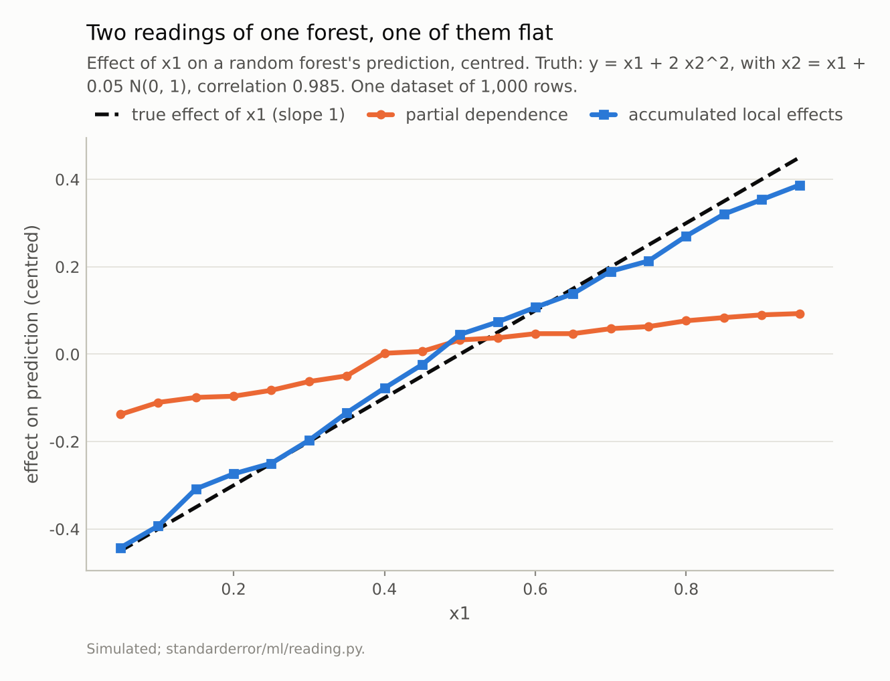
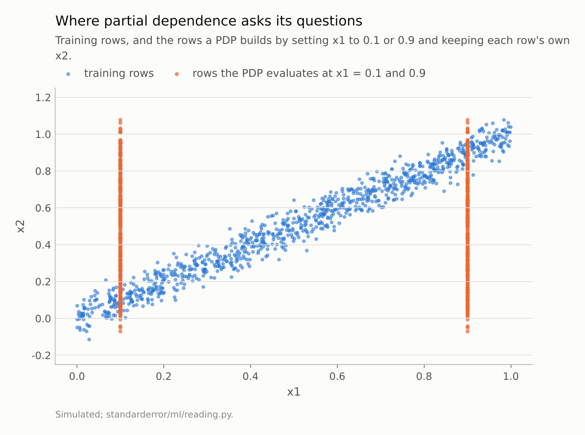
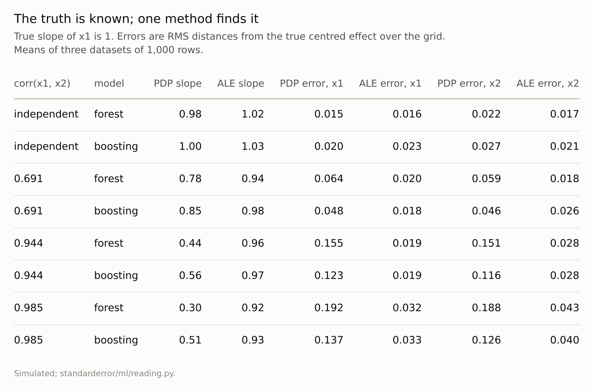

Disclosure: this post was written with the assistance of an AI system (Claude), which wrote the analysis code, ran the experiments and drafted the text. The topic, the constraints, the data choices and the final review are the author's.

*With y = x1 + 2 x2² and x2 a noisy copy of x1, the true effect of x1 is a straight line of slope 1. With independent inputs, the partial dependence plot of a random forest has slope 0.98 and accumulated local effects (ALE) 1.02. At a correlation of 0.985 the PDP's slope is 0.30 and the ALE's 0.92; the PDP's error against the true effect is 6 times the ALE's. Gradient boosting shows the same pattern. The PDP averages the model's predictions over pairs of inputs that never occur together in the data.*

Episode 17 of *Machine Learning, Taught Through What Breaks*. The syllabus and the other episodes: https://jongha-jeon-dev.github.io/standarderror/lectures/

## What the plot computes

Episode 16 measured how much a model *needs* a feature. The next question is *how* the prediction depends on it, and the standard picture is the partial dependence plot (PDP), introduced by Friedman alongside gradient boosting. For each value v on a grid, set the feature to v in every row of the data, leave everything else as it is, predict, and average. Plot the average against v.

The construction is clean, and it has a hidden assumption. Setting x1 to v *in every row* creates rows that pair v with every row's own value of the other features. If x1 and x2 are independent, those rows look like the data. If they are correlated, many of them look like nothing in the data at all, and the PDP averages the model's predictions there.

A simulation with a known answer shows what that costs. Let y = x1 + 2 x2² plus noise, with x2 a noisy copy of x1. The effect of x1, holding x2 fixed, is a straight line of slope 1. Fit a random forest, and compare its PDP for x1 with *accumulated local effects* (ALE), a method built to avoid exactly this problem:

```python
from standarderror.ml import reading as rd

# y = x1 + 2 x2^2; x2 = x1 + noise * N(0, 1) (None: independent)
for r in rd.pdp_vs_ale(noises=(None, 0.3, 0.1, 0.05)):
    if r["model"] == "forest":
        print(f"corr {r['corr']:5.2f}  PDP slope {r['pdp_slope']:.2f}"
              f"  ALE slope {r['ale_slope']:.2f}   (truth 1.00)")
```

```text
corr -0.02  PDP slope 0.98  ALE slope 1.02   (truth 1.00)
corr  0.69  PDP slope 0.78  ALE slope 0.94   (truth 1.00)
corr  0.94  PDP slope 0.44  ALE slope 0.96   (truth 1.00)
corr  0.98  PDP slope 0.30  ALE slope 0.92   (truth 1.00)
```

With independent inputs both methods find the line: slopes 0.98 and 1.02. As the correlation rises, the PDP's slope falls steadily, to **0.30 at a correlation of 0.985**. ALE stays within a few hundredths of 1 throughout.



*Averaged over three datasets, the PDP's slope is **0.30** and the ALE's 0.92, against a true slope of 1.*

## Where the questions are asked

The scatter of training rows is a narrow diagonal band: x2 is never far from x1. To compute the PDP at x1 = 0.1, every row has its x1 set to 0.1 and keeps its own x2, which ranges from 0 to 1. Most of those rows sit far off the band, in regions where the forest saw no data.

A forest's prediction in such a region is not a guess about the function; it is whatever the nearest leaves on the band say. For a row with x1 = 0.1 and x2 = 0.9, the splits on x2 dominate — they carry most of the signal, since 2x2² varies more than x1 — and send it to leaves trained on rows with both inputs near 0.9. Its prediction is close to what the forest predicts at x1 = 0.9. Averaging such rows flattens the PDP: the curve says x1 barely matters because most of the rows it averages over are answered by x2.

ALE avoids this by never leaving the band. It splits x1 into narrow bins, and within each bin it moves only the rows that are actually there from the bin's lower edge to its upper edge, recording the average change in prediction. Those rows stay close to the data. Accumulating the changes across bins traces the effect:

```python
import numpy as np
from sklearn.ensemble import RandomForestRegressor

X, y = rd.correlated_pair(noise=0.05, seed=0)
f = RandomForestRegressor(300, min_samples_leaf=5, random_state=0)
f.fit(X, y)
edges = np.quantile(X[:, 0], np.linspace(0, 1, 21))   # 20 bins of x1
steps = []
for lo, hi in zip(edges[:-1], edges[1:]):
    rows = X[(X[:, 0] >= lo) & (X[:, 0] <= hi)]        # rows really there
    a, b = rows.copy(), rows.copy()
    a[:, 0], b[:, 0] = lo, hi                         # small move only
    steps.append(np.mean(f.predict(b) - f.predict(a)))
print(f"x1 rises {edges[-1] - edges[0]:.2f}; ALE says the prediction "
      f"rises {sum(steps):.2f}")
```

```text
x1 rises 1.00; ALE says the prediction rises 0.88
```

The truth is a rise equal to x1's, and ALE recovers most of it; the shortfall comes from the end bins, where a forest's predictions flatten for want of data beyond them. The result describes the model where it was trained, and on this simulation that is close to the truth.



*To compute the PDP at x1 = 0.1, the model is asked about rows with x1 = 0.1 and x2 near 1. No training row looks like that, and the forest's answer there is whatever its nearest leaves say.*

## Not wrong, but about the wrong thing

It would be easy to say the PDP is wrong. It is not; it is an exact description of the forest's average prediction over a particular set of artificial rows. The problem is that the reader takes it as a description of the data, and the two come apart precisely when features are correlated — which in real tables, with incomes and house prices, ages and years of experience, doses and body weights, is the rule.

The error is not small. At the highest correlation the PDP's RMS distance from the true effect of x1 is 0.192, against 0.032 for ALE, and for x2, whose true effect is the curve 2x2², it is 0.188 against 0.043. Gradient boosting behaves the same way: its PDP slope falls to 0.51. Both models predict well on the band; both have arbitrary behaviour off it; the PDP reports the arbitrary part.

ALE has a cost too. It needs enough rows per bin to estimate a local difference, it cannot show what the model does off the data (sometimes that is the question), and with exactly collinear features no method can separate their effects, because the data contain no rows in which one moves without the other.



*Both methods are exact descriptions of something. ALE describes the model where the data are; partial dependence describes it everywhere, mostly where they are not.*

## A one-line check

Whether a PDP can be trusted is visible before drawing it. Take the feature and the one it is most correlated with, scatter them, and draw the vertical lines of rows the PDP will build at the lowest and highest grid values. The share of those rows inside the cloud is the share of the curve that describes the data; the rest describes the model somewhere else.

In the simulation at a correlation of 0.985, the rows built at x1 = 0.1 are almost all far above the band, and the rows built at x1 = 0.9 almost all far below it. Nearly the whole PDP is computed off the data, which is why its slope is 0.30. At a correlation of 0.69 the band is wide enough to hold a good share of them, and the PDP's slope, 0.78, is correspondingly closer to the truth. The check costs one plot, and it says in advance which of the two curves to believe.

## Where this breaks

**Individual conditional expectation curves inherit the problem.** ICE plots show each row's curve instead of their average, which reveals heterogeneity but evaluates the same off-band rows.

**Two features is the easy case.** In ten dimensions, "off the data" is the normal state of a modified row, and checking a 2-D scatter will not reveal it. ALE's local moves are the safer default whenever features are correlated at all.

**The truth here is additive.** With an interaction between x1 and x2, the "effect of x1" depends on x2 and no single curve captures it. ALE's second-order plots and the functional-ANOVA decomposition address that; one-dimensional plots do not.

**Three datasets per setting.** The slopes quoted move by a few hundredths between seeds; the ordering never changes.

## What to keep

1. A partial dependence plot sets a feature to each value in every row and averages the predictions, including over combinations the data never contain.

2. With y = x1 + 2x2² and x1, x2 correlated at 0.985, a forest's PDP showed a slope of 0.30 for an effect of slope 1. ALE showed 0.92.

3. With independent inputs both methods were within a few hundredths of the truth. The PDP's failure grows with the correlation.

4. The PDP is an accurate picture of the model in regions with no data; ALE is a picture of the model where the data are.

5. Check the correlation of a feature with the others before reading its PDP. If it is high, use ALE.

## Exercise

Pick a feature whose partial dependence plot you have shown someone. Scatter it against the feature it is most correlated with and draw, on the same axes, the vertical lines of rows the PDP evaluates at the lowest and highest grid values. How many of those rows lie inside the cloud?

Then compute ALE for the same feature — twenty quantile bins are enough — and overlay the two curves. Where they disagree, the PDP was reporting the model off the data.

## Next

Episode 18 moves from effects averaged over the data to a single prediction: SHAP values, which split one prediction among the features. They come with an axiom-backed uniqueness theorem — and with a choice of reference distribution that the theorem does not make for you.

---

### Data

- Simulated: x1 uniform on [0, 1]; x2 = x1 + s N(0, 1) for s = 0.3, 0.1, 0.05, or an independent uniform; y = x1 + 2 x2² + 0.1 N(0, 1); 1,000 rows; three datasets per setting.
- Machinery: `standarderror/ml/reading.py` (partial dependence and ALE implemented directly), tested in `tests/test_ml.py`; scikit-learn's RandomForestRegressor (300 trees, leaves of 5) and HistGradientBoostingRegressor.
- Where this stops: Friedman, "Greedy function approximation", *Annals of Statistics* (2001), for partial dependence; Apley and Zhu, "Visualizing the effects of predictor variables in black box supervised learning models", *JRSS B* (2020), for ALE; Hooker, Mentch and Zhou, "Unrestricted permutation forces extrapolation", *Statistics and Computing* (2021).

### Reproducibility

- **environment**: standarderror=0.1.0, python=3.13.16, numpy=2.4.4
- **code blocks**: executed at build time; the values the prose quotes are pinned, so drift fails the build
- **determinism**: datasets from seeds 0 to 2; models seeded with the dataset seed; a grid of 19 points from 0.05 to 0.95; ALE on 20 quantile bins

Code: <https://github.com/jongha-jeon-dev/standarderror>
