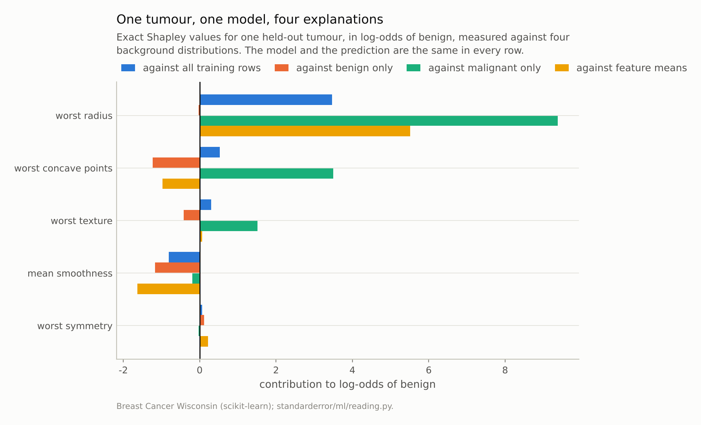
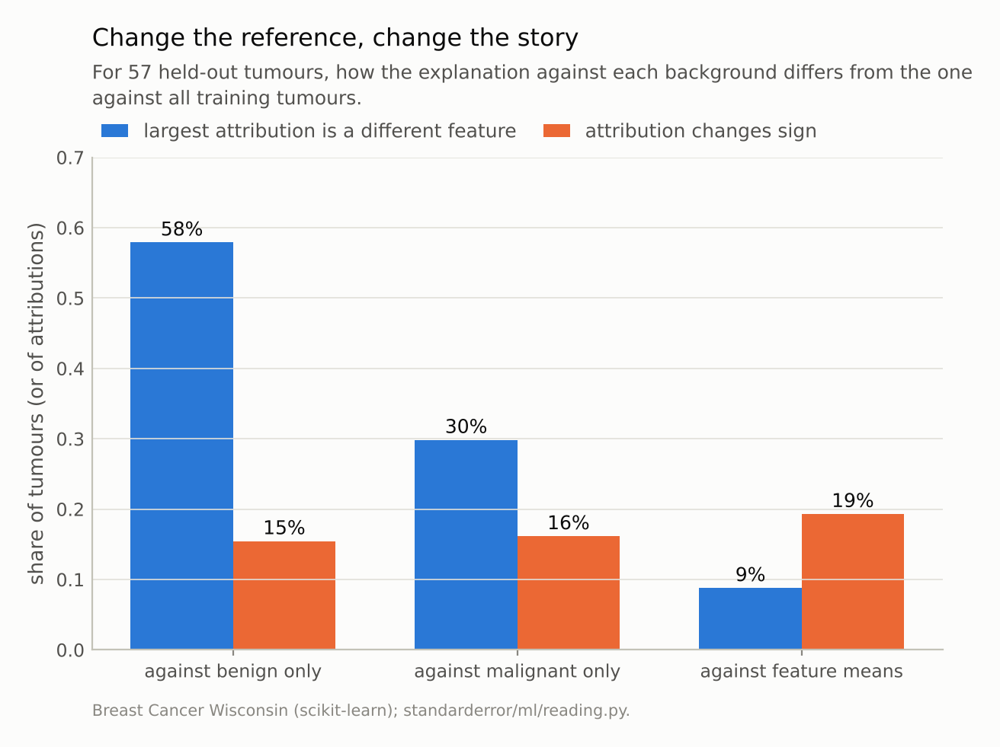
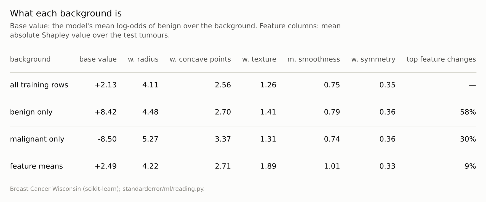

Disclosure: this post was written with the assistance of an AI system (Claude), which wrote the analysis code, ran the experiments and drafted the text. The topic, the constraints, the data choices and the final review are the author's.

*Exact Shapley values, by enumerating all 32 coalitions, for a five-feature gradient-boosted model of the breast-cancer data. Against all training tumours as background, they add up to each prediction minus the mean to within 7e-15. Change the background to benign tumours only and the feature with the largest attribution changes for 58% of the 57 test tumours, and 15% of attributions change sign. Against the feature means, a common shortcut whose base value is almost the same, 19% of attributions change sign.*

Episode 18 of *Machine Learning, Taught Through What Breaks*. The syllabus and the other episodes: https://jongha-jeon-dev.github.io/standarderror/lectures/

## A unique answer to an unasked question

Episodes 16 and 17 dealt with importance and effects averaged over a dataset. SHAP values work on one prediction at a time: they split the gap between this prediction and a baseline into one contribution per feature. Their appeal is a theorem. Shapley showed in 1953 that there is exactly one way to share a total among players that is efficient, symmetric, ignores players who contribute nothing and adds up across games. Lundberg and Lee brought it to model explanation in 2017, and "the unique fair attribution" has been its selling point since.

The theorem is about a game, and a model is not one until someone defines what a coalition of features is worth. The usual definition, the *interventional* one, is: fix the coalition's features at this row's values, draw the rest from a background dataset, and average the model's predictions. The theorem then gives a unique answer — for that background. The background is the question's "compared with what?", and the theorem has nothing to say about it.

With five features there are only 32 coalitions, so the values can be computed exactly, with no sampling or approximation:

```python
import inspect
from standarderror.ml import reading as rd

# interventional Shapley values by enumerating all 2^p coalitions
src = inspect.getsource(rd.exact_shapley).split("\n")
print("\n".join(src[6:22]))
```

```text
    val = {}
    for k in range(p + 1):
        for S in itertools.combinations(range(p), k):
            Z = background.copy()
            Z[:, list(S)] = x[list(S)]
            val[S] = float(np.mean(f(Z)))
    phi = np.zeros(p)
    for i in range(p):
        for S, v in val.items():
            if i in S:
                continue
            w = (math.factorial(len(S)) * math.factorial(p - len(S) - 1) /
                 math.factorial(p))
            phi[i] += w * (val[tuple(sorted(S + (i,)))] - v)
    return phi, val[()], val[tuple(range(p))]
```

Two checks that it is right. For a linear model the answer is known in closed form, coefficient times distance from the background mean. And for any model, the values must add up to the prediction minus the background's mean prediction:

```python
print(f"linear model, exact values vs beta*(x - mean): "
      f"max gap {rd.linear_shapley_check():.1e}")
bg = rd.background_study()
print(f"boosted model, 57 tumours x 4 backgrounds: "
      f"max |sum(phi) - (f(x) - E f)| = {bg['efficiency_error']:.1e}")
```

```text
linear model, exact values vs beta*(x - mean): max gap 2.2e-16
boosted model, 57 tumours x 4 backgrounds: max |sum(phi) - (f(x) - E f)| = 7.1e-15
```



*Each set of four bars explains the same number. They disagree because each answers a different question: why this tumour differs from the average tumour, from a benign one, from a malignant one, or from an average-valued one.*

## Four backgrounds, four explanations

The model is gradient boosting on five breast-cancer features, explained in log-odds of benign. Four backgrounds, each defensible: all training tumours (the default in most tutorials); benign tumours only (*why is this one less benign than a typical benign one?*); malignant only; and a single row of feature means, a shortcut many implementations offer because it is fast.

```python
for name, c in bg["compare"].items():
    print(f"{name:18s} base {c['base']:+6.2f}  top feature changes "
          f"{c['top_differs']:4.0%}  signs flip {c['sign_flips']:4.0%}")
```

```text
all training rows  base  +2.13  top feature changes   0%  signs flip   0%
benign only        base  +8.42  top feature changes  58%  signs flip  15%
malignant only     base  -8.50  top feature changes  30%  signs flip  16%
feature means      base  +2.49  top feature changes   9%  signs flip  19%
```

Against benign tumours only, the feature with the largest attribution is a different feature for **58%** of the tumours explained, and 15% of all individual attributions change sign. Against malignant tumours, 30% and 16%.

The feature-means background is the most instructive. Its base value, +2.49, is close to the all-rows one, +2.13, so it looks like a harmless approximation. It flips the sign of **19%** of attributions — more than either class-specific background. A boosted model is far from linear, and the model's prediction *at* the average tumour is not the average of its predictions *over* tumours. Every coalition is evaluated with the missing features fixed at one artificial point instead of spread across real ones.

None of these explanations is wrong. Each is the unique fair split of a different difference. A clinician asking why a tumour was flagged probably means "compared with tumours we would not flag", which is closest to the benign background, and not to the population average that the default answers.



*Against benign tumours only, the most important feature changes for **58%** of tumours. Even the feature-means shortcut flips 19% of signs.*

## Off the data again

There is a second choice hidden in the interventional definition. Filling in missing features by drawing them from the background *independently* of the features in the coalition builds rows that combine this tumour's worst radius with another tumour's worst concave points. In this data those two features are correlated at 0.79, so many of those rows are tumours that do not exist, the same problem episodes 16 and 17 met in permutation importance and partial dependence.

The alternative, *conditional* Shapley values, draws the missing features from their distribution given the coalition's values, keeping the rows realistic. It changes the answers again, and it has a cost beyond computation: under the conditional definition a feature the model never uses can receive credit, because it is correlated with one the model does use. Janzing and colleagues argue that the interventional version is the right one for asking what the *model* does; Sundararajan and Najmi catalogue how the variants disagree. The choice between them is a second "compared with what?" that the uniqueness theorem leaves open.

What the theorem does guarantee is useful: given a model, a value function and a background, the split is unique and adds up. The table below shows how far apart the backgrounds put the starting point. The skill is in stating the question, and the explanation is only as meaningful as the stated reference.



*The base value is the question's 'compared with'. A background of benign tumours puts it at +8.4, so every explanation becomes an account of why a tumour is less benign than those. The ranking by mean size is the same in every row.*

## Choosing the background on purpose

If the background is a choice, it should be made like one. Three questions decide it.

*Who is asking, and compared with whom?* A patient asking why their tumour was flagged is comparing it with tumours that were not; a regulator asking why the model behaves as it does across a population is comparing with the population. The first calls for a background of unflagged cases, the second for the whole training set. Here those two choices disagreed on the leading feature for 58% of tumours.

*Is the background made of real rows?* A single row of feature means is cheap and not a tumour anyone has; it flipped 19% of signs. A sample of real rows, even a few hundred, costs more and answers a question about real cases.

*Is the background stated?* An explanation without its reference is like an effect size without its baseline. A sentence of the form "this feature added so much to the log-odds, relative to the average benign tumour" can be checked and argued with; "this feature was the most important" cannot.

A useful habit is to show two backgrounds side by side whenever an explanation matters. Where they agree, the explanation is robust to the choice; where they disagree, as for more than half the tumours here, the disagreement is itself the honest answer.

## Where this breaks

**Five features is a toy for enumeration.** Exact computation costs 2^p model evaluations per background row. Real explainers sample coalitions or exploit tree structure; their answers approximate the same quantities and inherit the same dependence on the background.

**Log-odds, not probabilities.** Attributions computed on predicted probabilities instead of log-odds are different numbers, and libraries differ in which they report. Everything here is in log-odds; the dependence on the background is part of the definition on either scale, but its size was measured on this one only.

**One model, one split.** A different model fitted to the same data could rank the features differently for the same tumour even with the background fixed. That was not measured here; episode 20 shows that models of near-equal accuracy can disagree on the predictions themselves, which is a reason to expect it.

**Global summaries average the problem away.** Mean absolute Shapley values, the usual "SHAP importance" bar chart, rank the five features in the same order under all four backgrounds, while their sizes move by up to 49% and the leading feature of individual explanations changes for up to 58% of tumours. That stability of the ranking is real and says nothing about any one prediction.

## What to keep

1. Shapley values are a unique fair split of the difference between a prediction and a reference. The reference is a choice, and the theorem does not make it.

2. Computed exactly, the values added up to within 7e-15, and switching the background from all tumours to benign ones changed the top feature for 58% of tumours.

3. The feature-means shortcut kept the base value almost unchanged and still flipped 19% of attribution signs.

4. Interventional and conditional definitions answer different questions; with correlated features they disagree too.

5. State the background in every explanation you show: "compared with the average benign tumour, this one's concavity added …".

## Exercise

Take one prediction your model made that someone questioned. Compute its SHAP values against your default background, then against a background of rows from the class or group the person had in mind as "normal". Compare the top three features in each.

If they differ, the explanation you gave answered a question the person did not ask. Write down, in one sentence, what the reference was for the explanation you would now give.

## Next

Episode 19 asks whether any of this matters when the model is simply accurate: a shortcut is planted in the digits, and a model that uses it scores better on the test set than one that does not.

---

### Data

- Breast Cancer Wisconsin (Diagnostic), as bundled with scikit-learn, CC BY 4.0: five features (worst radius, worst concave points, worst texture, mean smoothness, worst symmetry); one stratified 70/30 split; every third test tumour explained.
- Machinery: `standarderror/ml/reading.py` (exact interventional Shapley values by enumeration; no SHAP library), tested in `tests/test_ml.py`; scikit-learn's HistGradientBoostingClassifier, explained in log-odds.
- Where this stops: Shapley, "A value for n-person games" (1953); Lundberg and Lee, "A unified approach to interpreting model predictions", *NeurIPS* (2017); Janzing, Minorics and Bloebaum, "Feature relevance quantification in explainable AI: a causal problem", *AISTATS* (2020); Sundararajan and Najmi, "The many Shapley values for model explanation", *ICML* (2020).

### Reproducibility

- **environment**: standarderror=0.1.0, python=3.13.16, numpy=2.4.4
- **code blocks**: executed at build time; the values the prose quotes are pinned, so drift fails the build
- **determinism**: split seed 0; boosting with random_state 0; Shapley values are computed exactly, with no sampling

Code: <https://github.com/jongha-jeon-dev/standarderror>
