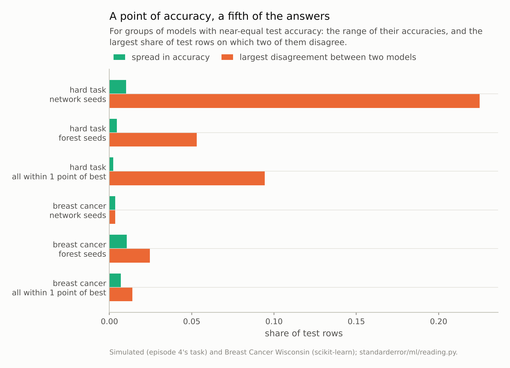
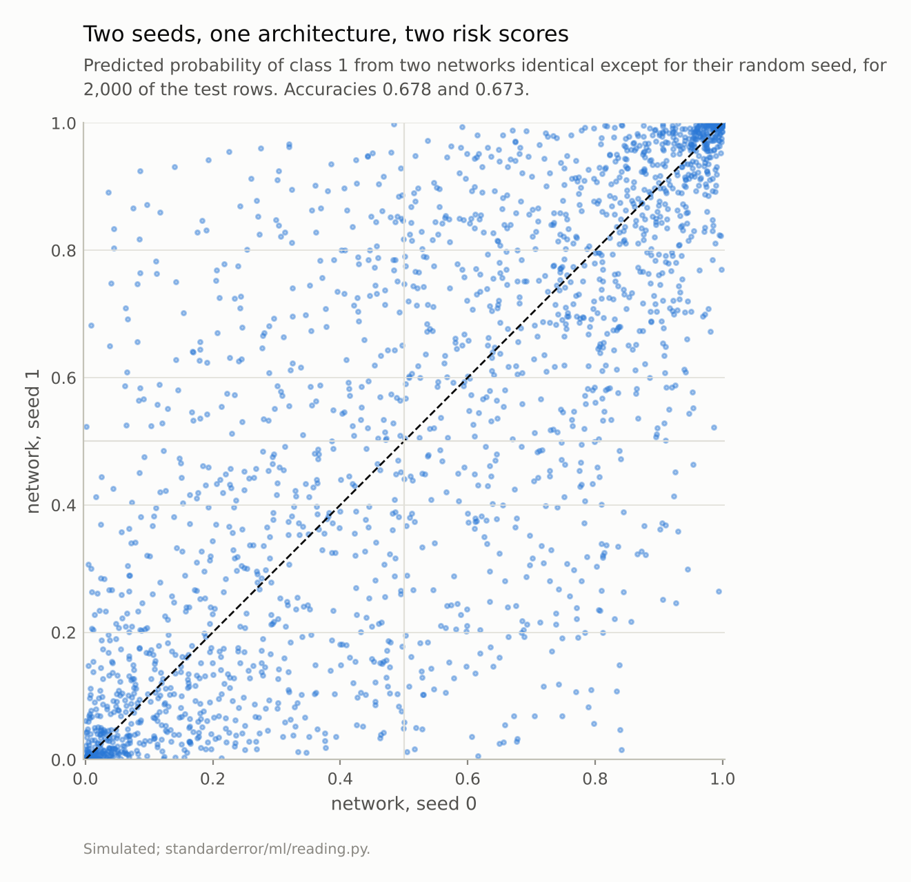
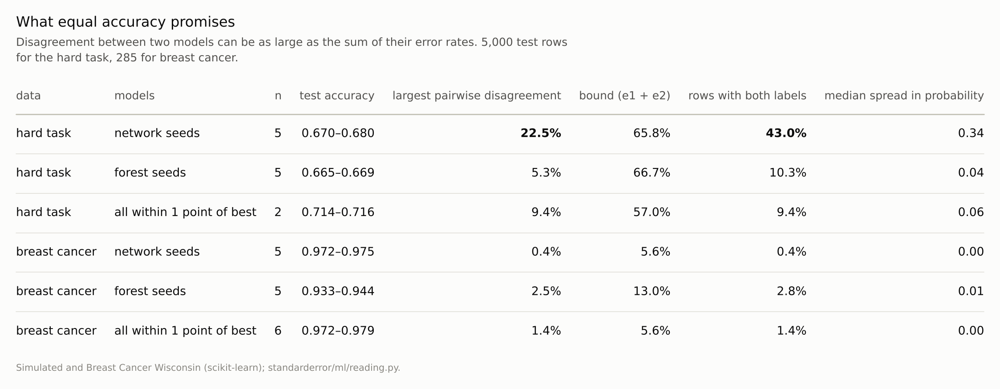

Disclosure: this post was written with the assistance of an AI system (Claude), which wrote the analysis code, ran the experiments and drafted the text. The topic, the constraints, the data choices and the final review are the author's.

*On a simulated task with Bayes error 0.276, five neural networks that differ only in their random seed score between 0.670 and 0.680 on 5,000 test rows. Two of them disagree on 22.5% of the rows, and 43% of rows get both labels from some seed. QDA and an SVM, the two best models, disagree on 9.4%. On breast cancer, where errors are rare, models within a point of the best disagree on 1.4%. Two models can disagree on as many rows as the sum of their error rates: equal accuracy promises agreement only when both are nearly always right.*

Episode 20 of *Machine Learning, Taught Through What Breaks*. The syllabus and the other episodes: https://jongha-jeon-dev.github.io/standarderror/lectures/

## Interchangeable by the numbers

Episode 19 showed a test score that could not tell a shortcut from the task. This episode asks something more modest: when two models have the same test score, are they the same model, for practical purposes? Model selection usually acts as if they were. Of two models within noise of each other, pick either.

Breiman called the phenomenon the *Rashomon effect*: many different models fit the same data equally well. Episode 11 met it in a single tree's structure. Here it is measured where it matters most, in the predictions.

The task is episode 4's: two overlapping Gaussian classes in ten dimensions, Bayes error 0.276, so even the best possible classifier is wrong on more than a quarter of rows. Train the same small neural network five times, changing nothing but the random seed:

```python
from standarderror.ml import reading as rd

r = rd.rashomon(task="gaussian")     # episode 4's task, 2,000 rows
f = r["families"]["MLP seed"]         # same network, seeds 0-4
print("accuracy by seed: " + " ".join(f"{a:.3f}" for a in f["accuracy"]))
print(f"largest disagreement between two seeds: {f['max_pair']:.1%}")
print(f"rows given both labels by some seed:    {f['ambiguity']:.1%}")
```

```text
accuracy by seed: 0.678 0.673 0.680 0.677 0.670
largest disagreement between two seeds: 22.5%
rows given both labels by some seed:    43.0%
```

The accuracies span **0.010** — a single point. By any significance test they are the same model. Two of them disagree on **22.5%** of the rows, and across the five, 43% of test rows receive both labels from some seed. For more than two in five cases, which answer a person gets depends on a random number chosen at training time.



*Five networks differing only in their seed span 0.010 in accuracy and disagree on up to **22.5%** of rows.*

## Why accuracy cannot see it

Accuracy counts how many rows a model gets right, not which. Two models with error rates e₁ and e₂ can disagree on as few rows as |e₁ − e₂| — when one's mistakes are a subset of the other's — and on as many as e₁ + e₂, when their mistakes never overlap. Equal accuracy pins down only the first bound. The second is set by how often the models are wrong.

Here each network is wrong on about a third of the rows, so two of them could in principle disagree on two-thirds. They use a third of that room. The probabilities show how differently they see the same row. The scatter plot below puts one seed's predicted probability against another's. A row the first network calls 0.2 the second may call 0.8. Both are equally accurate; they have simply drawn different boundaries through a region where the data cannot decide between them.

Different model families do the same. Among all fifteen models, the best two are QDA and an SVM:

```python
for k, v in sorted(r["accuracy"].items(), key=lambda kv: -kv[1])[:4]:
    print(f"{k:16s} {v:.3f}")
g = r["good"]
print(f"within 1 point of best: {g['models']}, disagree on "
      f"{g['max_pair']:.1%}")
```

```text
QDA              0.716
SVM              0.714
MLP seed 2       0.680
MLP seed 0       0.678
within 1 point of best: ['QDA', 'SVM'], disagree on 9.4%
```

They differ by 0.002 in accuracy and disagree on 9.4% of rows. Forests trained with different seeds disagree less (5.3% at most) because averaging 300 trees damps the effect of the seed — the same averaging that stabilised episode 11's trees.



*The off-diagonal quadrants hold the 19.5% of rows on which the two disagree. Many rows the first network puts near 0.2 the second puts near 0.8.*

## When errors are rare

The bound also says when this does not matter. On the breast-cancer data, where good models are wrong on two or three tumours in a hundred:

```python
b = rd.rashomon(task="breast cancer")
g = b["good"]
print(f"{len(g['models'])} models within 1 point of {b['best']:.3f}; "
      f"largest disagreement {g['max_pair']:.1%}, "
      f"rows with both labels {g['ambiguity']:.1%}")
```

```text
6 models within 1 point of 0.979; largest disagreement 1.4%, rows with both labels 1.4%
```

There is no room to disagree. When both models are almost always right they must almost always agree, and here 6 models within a point of the best disagree on at most 1.4% of tumours.

So "same accuracy, same predictions" is a statement about easy problems. On hard ones — credit default, readmission, churn, anything with a large irreducible error — models of equal accuracy are different models, and the choice between them is a choice about *who* gets which answer. That is the setting Marx, Calmon and Ustun call predictive multiplicity, and D'Amour and colleagues call underspecification: the training procedure and the test score jointly fail to pin down the predictions, and something arbitrary — a seed, an architecture, a library default — fills the gap.



*On the hard task the networks use a third of the room the bound allows. On breast cancer there is almost no room.*

## What to do with a disputed row

Disagreement among equally good models is information, not only a nuisance. A row on which five seeds split is a row on which the data do not determine the answer, and the people behind those rows deserve to know that their case is close.

Three practical responses follow. Measure it: train a handful of seeds or a handful of near-equal models and report the share of rows on which they disagree, alongside the accuracy. Here that share — 43% of rows for five seeds — says far more about the reliability of an individual prediction than the accuracy's spread of 0.010. Average: an ensemble of the near-equal models gives one prediction that no longer depends on which seed was drawn, and its probabilities on the disputed rows move towards the middle, which is the truthful position. Escalate: for decisions about individuals, route the disputed rows to a slower process — a second model, a human review, a request for more information — instead of letting a random number decide.

What does not work is picking one model by a tie-break on the test score, or by whichever happened to be trained first. The models are tied within noise, and whichever one is picked, a different fifth of the people get the other answer — and nobody downstream can tell which fifth.

## Where this breaks

**Ensembling reduces it.** Averaging the five networks would give one set of predictions that changes less with any one seed, as the forests show. It does not choose between the boundaries; it blurs them. On a disputed row the members' probabilities straddle 0.5, so their average is closer to 0.5 than the more confident of them, which is honest.

**One hard task, simulated.** The networks are small, with light regularisation and at most 1,500 training iterations. Larger networks, more data or stronger regularisation all change the amount of disagreement; none removes the bound.

**Disagreement is not error.** On rows where two models disagree, one of them is right. The point is not that both are bad but that the test score cannot say which to trust on those rows, and the person affected cannot either.

**The 1-point tolerance is a choice.** With a tolerance of zero, no two models qualify; with five points, many more do and the disagreement grows. One point is roughly the noise in an accuracy measured on 5,000 rows.

## What to keep

1. Accuracy says how many rows a model gets right, not which. Two models can disagree on as many rows as the sum of their error rates.

2. On a task with Bayes error 0.28, five networks differing only in seed spanned 0.010 in accuracy and disagreed on up to 22.5% of rows; 43% of rows got both labels from some seed.

3. The two best model families, 0.002 apart in accuracy, disagreed on 9.4%.

4. On breast cancer, with errors near 2%, near-equal models disagreed on 1.4%: rare errors leave no room.

5. On hard problems, report how much near-equal models disagree, and for decisions about individuals, consider averaging them or flagging the disputed rows.

## Exercise

Retrain your model five times with different seeds, changing nothing else, and score each on your test set. Then count the test rows on which at least two of the five disagree, and the largest disagreement between any pair.

If that count is more than a few percent, look at who those rows are. They are the cases where your model's answer is an accident of training, and they are often the cases where the decision matters most.

## Next

Arc IV ends here. Importance, effects, attributions, shortcuts and the multiplicity of equally good models all said the same thing from different directions: what a model learned is not pinned down by how well it scores. Arc V turns to training a network, starting with what happens before the first step: the claim that initialisation only needs to break symmetry.

---

### Data

- Simulated: episode 4's two-class Gaussian task in 10 dimensions with unequal covariances, Bayes error computed from the true densities; 2,000 training rows, 5,000 test rows.
- Breast Cancer Wisconsin (Diagnostic), as bundled with scikit-learn, CC BY 4.0; one stratified half split.
- Machinery: `standarderror/ml/reading.py`, tested in `tests/test_ml.py`; scikit-learn's logistic regression, QDA, SVC, HistGradientBoosting, 25-nearest neighbours, random forests and MLPClassifier (one hidden layer of 64, five seeds each for forests and networks).
- Where this stops: Breiman, "Statistical modeling: the two cultures", *Statistical Science* (2001); Marx, Calmon and Ustun, "Predictive multiplicity in classification", *ICML* (2020); D'Amour et al., "Underspecification presents challenges for credibility in modern machine learning", *JMLR* (2022).

### Reproducibility

- **environment**: standarderror=0.1.0, python=3.13.16, numpy=2.4.4
- **code blocks**: executed at build time; the values the prose quotes are pinned, so drift fails the build
- **determinism**: training rows from seed 0, test rows from seed 99; forests and networks with seeds 0 to 4; other models with random_state 0

Code: <https://github.com/jongha-jeon-dev/standarderror>
