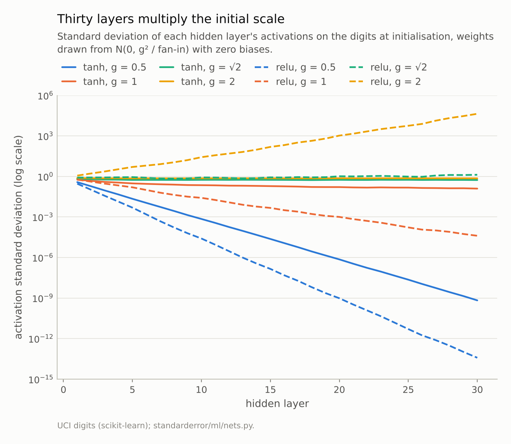
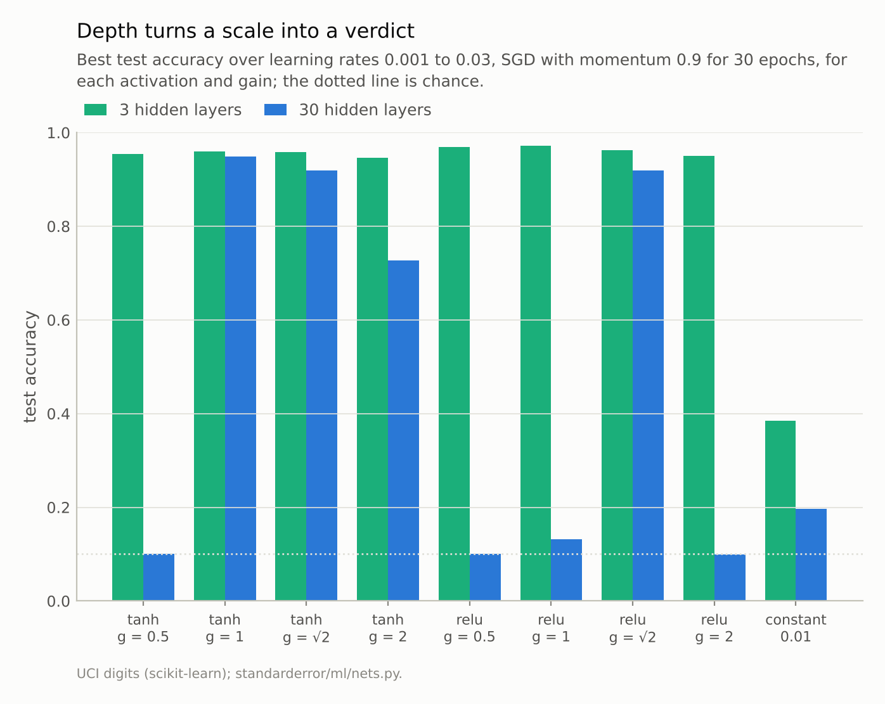
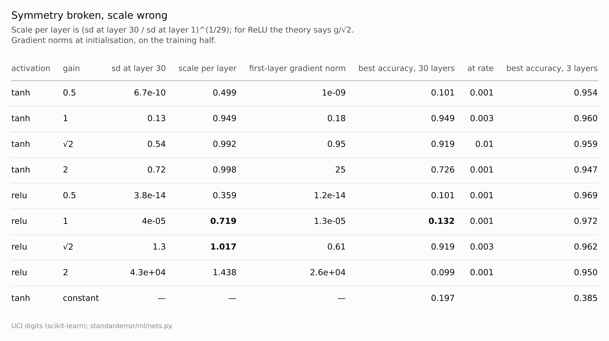

Disclosure: this post was written with the assistance of an AI system (Claude), which wrote the analysis code, ran the experiments and drafted the text. The topic, the constraints, the data choices and the final review are the author's.

*A network of 30 hidden layers of 128 units was trained on the digits from weights drawn with standard deviation g / sqrt(fan-in). Constant weights never broke symmetry: after training all first-layer units were identical and accuracy was 0.197. Random weights broke it but did not always train. With ReLU each layer multiplied the activations' scale by 0.719 at g = 1 (theory 0.707) and 1.438 at g = 2 (theory 1.414); those networks scored 0.132 and 0.099, against 0.919 at g = sqrt(2). With tanh, g = 0.5 left gradients near 1e-9 and scored 0.101. With 3 hidden layers every random scale trained above 0.9.*

Episode 21 of *Machine Learning, Taught Through What Breaks*. The syllabus and the other episodes: https://jongha-jeon-dev.github.io/standarderror/lectures/

## Why the weights start random

Arc IV ended with networks that differed only in their random seed and disagreed on a fifth of their answers. Arc V is about training a network, and it starts before the first step, with the numbers the weights start from. The textbook's reason for starting them at random is symmetry. If every weight in a layer starts at the same value, every unit in that layer computes the same function, receives the same gradient and makes the same update, and the layer stays a single unit copied 128 times however long it trains. Random weights break the tie. The sentence under test is the conclusion often drawn from that argument: *initialisation only needs to break symmetry*.

The first half of the argument is easy to confirm. A network with 30 hidden layers of 128 units, every weight set to 0.01, trained on the digits with the best of four learning rates, scores 0.197, and after training the 128 units of its first layer are still exactly identical: the count of distinct units is 1. Symmetry is never broken by training alone.

The second half, *only*, is the claim to test. Draw the weights from a normal distribution with standard deviation g / √fan-in, the form every standard initialiser takes, and vary the gain g. Every one of these breaks symmetry. Here is what each does to the activations of the same 30-layer network before any training:

```python
from standarderror.ml import nets

r = nets.init_depth()          # 30 hidden layers of 128 units
for row in r["rows"]:
    sd = row["stds"]
    print(f"{row['act']:4s} g = {row['gain']:.2f}: activation sd at "
          f"layers 1, 10, 30 = {sd[0]:.2g}, {sd[9]:.2g}, {sd[29]:.2g}")
```

```text
tanh g = 0.50: activation sd at layers 1, 10, 30 = 0.38, 0.00071, 6.7e-10
tanh g = 1.00: activation sd at layers 1, 10, 30 = 0.58, 0.22, 0.13
tanh g = 1.41: activation sd at layers 1, 10, 30 = 0.68, 0.56, 0.54
tanh g = 2.00: activation sd at layers 1, 10, 30 = 0.76, 0.73, 0.72
relu g = 0.50: activation sd at layers 1, 10, 30 = 0.29, 2.5e-05, 3.8e-14
relu g = 1.00: activation sd at layers 1, 10, 30 = 0.58, 0.026, 4e-05
relu g = 1.41: activation sd at layers 1, 10, 30 = 0.82, 0.83, 1.3
relu g = 2.00: activation sd at layers 1, 10, 30 = 1.2, 27, 4.3e+04
```



*With ReLU each layer multiplies the scale by about g/√2. At g = √2 the thirtieth layer's activations have standard deviation 1.33; at g = 1, 4e-05.*

## Thirty multiplications

Each layer multiplies the scale of its input by a roughly constant factor, and thirty layers multiply it thirty times. For a ReLU layer the factor can be worked out: a weight variance of g² / fan-in multiplies the second moment of the input by g², and the ReLU, which zeroes half its inputs, halves it. The standard deviation therefore changes by about g / √2 per layer. Measured over 29 steps, the factor is **0.719** at g = 1 (theory 0.707), **1.017** at g = √2 (theory 1) and **1.438** at g = 2 (theory 1.414).

Small factors compound into enormous ones. At g = 1 the thirtieth layer's activations are 7e-05 times the first layer's; at g = 2, 4e+04 times. Only g = √2, the value He and colleagues derived for ReLU in 2015, keeps the scale level.

Tanh behaves differently because it saturates. At g = 0.5 its activations shrink geometrically, to 7e-10 by layer 30, and the gradient reaching the first layer has norm 1e-09. At g = 2 the activations cannot grow past ±1, so they stay at a standard deviation of 0.72, but the gradient flowing back grows instead: the first layer's gradient norm is 25.4, the last layer's 0.62. At g = 1, the value Glorot and Bengio's analysis points to for tanh, the activations fade slowly, to 0.13.

## What the scale does to training

Then train each network, giving it the best of four learning rates so that no initialisation loses merely for want of the right step size:

```python
for row in r["rows"]:
    print(f"{row['act']:4s} g = {row['gain']:.2f}: best test accuracy "
          f"{row['best']:.3f} at learning rate {row['best_lr']}")
print(f"all weights 0.01: {r['const_best']:.3f}; distinct units in "
      f"layer 1 after training: {r['const_distinct_units']}")
```

```text
tanh g = 0.50: best test accuracy 0.101 at learning rate 0.001
tanh g = 1.00: best test accuracy 0.949 at learning rate 0.003
tanh g = 1.41: best test accuracy 0.919 at learning rate 0.01
tanh g = 2.00: best test accuracy 0.726 at learning rate 0.001
relu g = 0.50: best test accuracy 0.101 at learning rate 0.001
relu g = 1.00: best test accuracy 0.132 at learning rate 0.001
relu g = 1.41: best test accuracy 0.919 at learning rate 0.003
relu g = 2.00: best test accuracy 0.099 at learning rate 0.001
all weights 0.01: 0.197; distinct units in layer 1 after training: 1
```

Four of the eight random initialisations do not train at all in thirty epochs. ReLU at g = 1 scores **0.132**; its signal reaches the last hidden layer at less than a ten-thousandth of its size, and the gradients reaching the early layers are of order 1e-05. ReLU at g = 2 scores 0.099, its activations and gradients tens of thousands of times too large for any of the learning rates tried. Tanh at g = 0.5 and ReLU at g = 0.5 score chance. The two ReLU networks that fail sit either side of the one that succeeds, g = √2, which scores **0.919**, by a factor of √2 in the standard deviation of the weights.

Tanh at g = 1 and g = √2 both train, to 0.949 and 0.919; tanh at g = 2 reaches 0.726, at the smallest learning rate tried, where the exploding gradient is least harmful. With one seed and a coarse grid of learning rates, the ordering among the networks that train is not the point. The point is the gap between the ones that train and the ones that cannot.



*The same gains that fail at thirty layers all train at three. The constant initialisation fails at both.*

## Depth is what makes it matter

The same experiment with three hidden layers instead of thirty is the control:

```python
r3 = nets.init_depth(depth=3)  # the same, with 3 hidden layers
print("  ".join(f"{row['act']} {row['gain']:.2f}: {row['best']:.3f}"
                for row in r3["rows"][:4]))
print("  ".join(f"{row['act']} {row['gain']:.2f}: {row['best']:.3f}"
                for row in r3["rows"][4:]))
print(f"constant: {r3['const_best']:.3f}")
```

```text
tanh 0.50: 0.954  tanh 1.00: 0.960  tanh 1.41: 0.959  tanh 2.00: 0.947
relu 0.50: 0.969  relu 1.00: 0.972  relu 1.41: 0.962  relu 2.00: 0.950
constant: 0.385
```

Every random initialisation trains above 0.9. Two multiplications by 0.707 halve the signal, which the first few updates can absorb; twenty-nine shrink it to less than a ten-thousandth, which they cannot. The constant initialisation still fails at three layers, scoring 0.385: symmetry does not care about depth.

So the sentence holds in shallow networks, where it was first written, and fails in deep ones. Breaking symmetry is necessary at any depth. In a deep network it is not sufficient: the scale has to be chosen so that each layer passes on a signal of about the same size it received, in both directions. That is the whole content of the initialisers that every deep-learning library now applies by default, and the reason they differ by activation. Glorot's rule targets tanh and sigmoid, He's targets ReLU, and each assumes the other's activation at its peril, as the ReLU network at g = 1 shows.



*Every row but the last breaks symmetry. Only the rows whose scale per layer is close to 1 train at thirty layers.*

## Where this breaks

**Plain stacks of layers.** Residual connections, which add each block's input to its output, and normalisation layers, which rescale activations at every layer (episode 24), both make a network far less sensitive to the initial scale. Most modern deep networks have both, which is why this failure is rarer in practice than the arithmetic suggests.

**One seed, four learning rates.** The verdicts are large enough to survive both limits: the failing networks score chance at every rate tried. The differences between the networks that train are not established here.

**Thirty epochs.** A network whose gradients are 1e-5 might eventually begin to learn with a much larger learning rate or many more epochs. Within any reasonable budget it does not, and a larger rate would overflow the layers whose activations are not small.

**The theory is for the start.** The g/√2 factor describes the network at initialisation. Training changes the weights and the scales with them, which is why the ReLU network at g = √2 can train at all: the initialisation only has to give it a place to start.

## What to keep

1. Symmetry must be broken: with every weight equal, the 128 units of a layer were still identical after training, and the network scored 0.197.

2. Breaking it is not enough in a deep network. Each layer multiplies the signal's scale by a factor set by the initial scale, about g/√2 for ReLU, measured at 0.719 for g = 1 and 1.438 for g = 2.

3. Over thirty layers those factors decided whether training happened at all: ReLU scored 0.132 at g = 1, 0.919 at g = √2 and 0.099 at g = 2.

4. With three layers every random scale trained above 0.9. Depth turns a modest mis-scaling into a failure. Use the initialiser that matches the activation, and check the activations' scale at the last layer before training.

## Exercise

Take a deep network you train without normalisation or residual connections, and before the first update record the standard deviation of each layer's output on one batch. Plot it against depth on a log scale.

If the line is not roughly flat, compute the per-layer factor and compare it with your initialiser's gain and your activation's. Then multiply the initial weights by the factor's inverse and see whether training starts sooner.

## Next

A good initialisation gives training a place to start. How fast it moves from there is set by the learning rate and the batch size, which every training script exposes as two separate settings. Episode 22 asks whether they are.

---

### Data

- Optical Recognition of Handwritten Digits (UCI), as bundled with scikit-learn, CC BY 4.0; one stratified half split, standardised on the training half.
- Machinery: `standarderror/ml/nets.py`, tested in `tests/test_ml.py`; PyTorch networks 64-128x30-10 (and 64-128x3-10), weights N(0, g² / fan-in) and zero biases, SGD with momentum 0.9, minibatches of 32, 30 epochs, best of learning rates 0.001, 0.003, 0.01 and 0.03 on the test half.
- Where this stops: Glorot and Bengio, "Understanding the difficulty of training deep feedforward neural networks", *AISTATS* (2010); He, Zhang, Ren and Sun, "Delving deep into rectifiers", *ICCV* (2015); Saxe, McClelland and Ganguli, "Exact solutions to the nonlinear dynamics of learning in deep linear neural networks", *ICLR* (2014).

### Reproducibility

- **environment**: standarderror=0.1.0, python=3.13.16, numpy=2.4.4
- **code blocks**: executed at build time; the values the prose quotes are pinned, so drift fails the build
- **determinism**: split, network and shuffling seed 0; torch.set_num_threads(1)

Code: <https://github.com/jongha-jeon-dev/standarderror>
