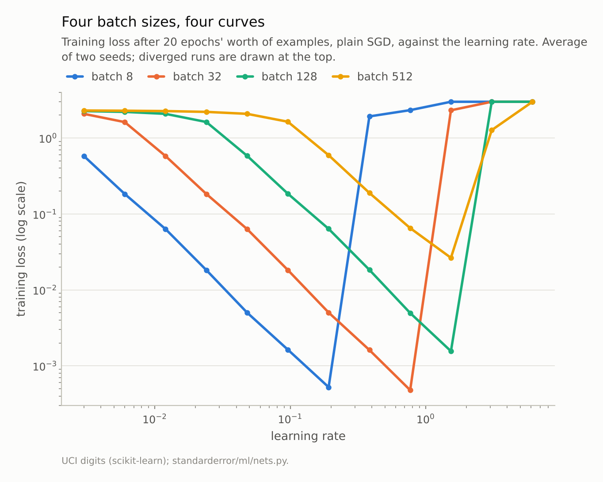
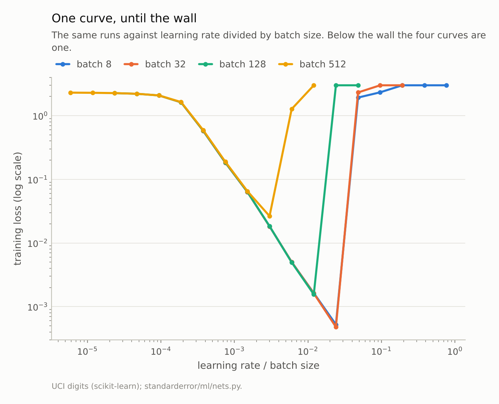
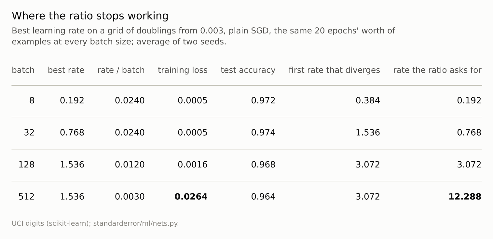

Disclosure: this post was written with the assistance of an AI system (Claude), which wrote the analysis code, ran the experiments and drafted the text. The topic, the constraints, the data choices and the final review are the author's.

*Plain SGD on a two-layer network on the digits, with 20 epochs' worth of examples at every batch size, swept over learning rates from 0.003 to 6.144. Away from divergence, runs with the same ratio of learning rate to batch size reached the same training loss to within 2.3%, from batches of 8 to 512. The best rate grew fourfold from batch 8 (0.192) to 32 (0.768). Above about 1.5, training diverged at batch sizes of 128 and 512 alike, so those stopped at 1.536, where their training loss was 3 and 55 times the batch of 32's and test accuracy 0.968 and 0.964 against 0.974.*

Episode 22 of *Machine Learning, Taught Through What Breaks*. The syllabus and the other episodes: https://jongha-jeon-dev.github.io/standarderror/lectures/

## Two settings on every training script

Episode 21 found that a network's initial scale decides whether it trains at all. The next two settings every training script exposes are the learning rate and the batch size, and they are usually presented as separate choices: the batch size is set by the memory available, the learning rate is then tuned. The sentence under test is that division of labour: *learning rate and batch size are separate knobs*.

The experiment is a grid. A network with two hidden layers of 128 units is trained on half the digits with plain stochastic gradient descent: no momentum, no weight decay, nothing adaptive. Batch sizes are 8, 32, 128 and 512; learning rates double from 0.003 to 6.144. Every run sees the same number of examples, 20 passes' worth, so a batch of 8 takes 2,245 steps and a batch of 512 takes 35. The score is the training loss at the end, averaged over two seeds, because the question is about optimisation.

```python
from standarderror.ml import nets

r = nets.lr_batch()     # plain SGD, 20 epochs of examples, 2 seeds
for B, lr, loss, acc in zip(r["batches"], r["best_lr"], r["best_loss"],
                            r["best_acc"]):
    print(f"batch {B:3d}: best rate {lr:.3f}  training loss {loss:.4f}  "
          f"test {acc:.3f}")
```

```text
batch   8: best rate 0.192  training loss 0.0005  test 0.972
batch  32: best rate 0.768  training loss 0.0005  test 0.974
batch 128: best rate 1.536  training loss 0.0016  test 0.968
batch 512: best rate 1.536  training loss 0.0264  test 0.964
```

The best learning rate for batches of 32 is **four times** the best for batches of 8, and the two reach the same loss and the same test accuracy. That is the linear scaling rule: multiply the batch size by k and multiply the learning rate by k. For batches of 128 and 512 the rule asks for 3.072 and 12.288, and they stop at 1.536.



*Each fourfold increase in batch size moves the curve two grid points to the right, until the curve runs into the same wall.*

## The ratio is the setting

The rule holds far more exactly than "best rate" shows. Fix the ratio of learning rate to batch size and read the loss across batch sizes:

```python
import math

for ratio in (0.00075, 0.003, 0.012):     # learning rate / batch size
    row = []
    for i, B in enumerate(r["batches"]):
        j = round(math.log2(ratio * B / 0.003))   # grid is 0.003 * 2**j
        row.append(f"B={B}: {r['loss'][i][j]:.4f}")
    print(f"rate/batch {ratio:.5f}   " + "  ".join(row))
```

```text
rate/batch 0.00075   B=8: 0.1832  B=32: 0.1835  B=128: 0.1849  B=512: 0.1892
rate/batch 0.00300   B=8: 0.0183  B=32: 0.0183  B=128: 0.0184  B=512: 0.0264
rate/batch 0.01200   B=8: 0.0016  B=32: 0.0016  B=128: 0.0016  B=512: 6.1513
```

At a ratio of 0.00075 the four batch sizes reach 0.183 to 0.189. At 0.003 the first three agree to within 1%. Over every pair of runs on the grid where the batch and the rate are both four times larger, and both rates are at least four times below the rate at which their batch size diverges, the losses differ by at most **2.3%**. Closer to divergence the pairs part, by up to 44%. Plotted against the ratio, the four curves in the second figure are one curve.

There is a simple reason. With a fixed number of examples, a batch four times larger means four times fewer steps, and a rate four times larger means each step goes four times as far; at small rates, where the gradient changes little over a few steps, four small steps on four batches land almost where one big step on their union does. A second reason gives the same ratio: the noise in a minibatch gradient has a variance proportional to 1/B, and Smith and Le showed that the size of the random kicks SGD gives the weights scales with the learning rate divided by the batch. Either way, the run is set by lr/B, and the two "separate knobs" are one.



*Away from the wall, runs with the same ratio reach the same loss to within 2.3%. The batch of 512 leaves the shared curve first.*

## The wall

The last line of the output is where the rule ends. At a ratio of 0.012 the batch of 512 needs a learning rate of 6.144, and the run diverges. In fact every batch size diverges somewhere: the batch of 8 at 0.384, the batch of 32 at 1.536, and the batches of 128 and 512 both at **3.072**.

For the two small batches the divergence point follows the ratio too, at 0.048 per example. For the two large ones it does not: it is the same learning rate for both. That is the signature of a limit that has nothing to do with the batch. Gradient descent on a loss whose sharpest curvature is λ is stable only for learning rates below about 2/λ, a property of the loss surface, and it binds the full-batch step and the large-batch step alike. The small batches hit a limit that scales with the batch, as a limit set by gradient noise would; the large ones hit one that does not, as a limit set by curvature would.

Once a batch size needs a rate above that wall, the linear scaling rule has nothing left to offer. Here the batch of 128 reached a training loss 3.3 times the batch of 32's at its best rate, and the batch of 512, 55 times; test accuracy fell from 0.974 to 0.964. With 35 steps in total, it simply did not travel far enough, and the only way to travel further is more steps. That is what McCandlish and colleagues call the critical batch size: beyond it, a larger batch buys little reduction in the number of steps needed, so it mostly spends more computation.



*Batches of 128 and 512 would need rates of 3.072 and 12.288 to keep the ratio. Both rates diverge.*

## What this means for a training script

The practical rule that follows is not "tune both". It is: treat lr/B as the setting, and change the batch size only with the learning rate in proportion, while the rate stays well below the point where training diverges. Below the wall that is free: the batch of 32 and the batch of 8 reached the same loss, 0.0005 and 0.0005, with a quarter of the steps. Above it, a larger batch is a decision to train less, and should be paid for with more epochs.

It also says how to read a tuning result. A learning rate tuned at one batch size is a ratio tuned at that batch size. Copying the rate to a run with four times the batch, as happens when a script moves to a larger machine, divides the effective setting by four. On this grid, the batch of 32's best rate, 0.768, gives the batch of 128 a training loss of 0.0050 instead of 0.0005.

Goyal and colleagues trained ImageNet in an hour on this principle, with batches of 8,192 and a warm-up to reach the large rate without diverging early. Their warm-up, a few epochs of rising learning rate, exists to keep the large rate from diverging in the first steps, when the network changes fastest: the same wall, met at the start.

## Where this breaks

**Plain SGD only.** With momentum the effective step is the rate divided by one minus the momentum, and the same ratio argument applies to that; with Adam, whose step size does not scale with the gradient's magnitude, the relation is closer to a square root and depends on the noise. Episode 23 uses Adam.

**Training loss, not test accuracy.** The question was optimisation. Test accuracy followed the training loss closely here; on larger problems it can prefer the noisier, smaller-batch runs at equal training loss, a separate question with a contested answer.

**One network and one budget.** The position of the wall depends on the network's curvature, and the critical batch size depends on the task's gradient noise, so neither number transfers. What transfers is the shape: a ratio that sets the run, and a wall that does not move with the batch.

**A coarse grid.** Rates double, so "best" and "diverges" are each known only to within a factor of two.

## What to keep

1. With plain SGD and a fixed number of examples, learning rate and batch size act through their ratio. Away from divergence, runs with the same ratio reached the same training loss to within 2.3%, from batches of 8 to 512.

2. The best rate grew fourfold from a batch of 8 to a batch of 32 (0.192 to 0.768), with the same loss and test accuracy.

3. Training diverged at a learning rate that did not move with the batch for large batches (3.072 for both 128 and 512). Batches that needed more than that reached a training loss 3 and 55 times higher.

4. Change the batch size and the learning rate together; beyond the wall, a larger batch means less training, not faster training.

## Exercise

Take a training script and find its best learning rate at your usual batch size. Then halve the batch size and run it at the old rate and at half the old rate, for the same number of epochs.

If the halved rate matches the original run and the old rate does not, your setting was the ratio. Then double the batch size instead, at twice the rate, and see whether it trains or diverges: you will have located your wall.

## Next

Plain SGD scales with the batch in a way that can be written down. Adam was designed to make the learning rate matter less and to converge faster. Episode 23 tunes both optimisers properly and runs them over twenty splits to see what is left of that claim.

---

### Data

- Optical Recognition of Handwritten Digits (UCI), as bundled with scikit-learn, CC BY 4.0; one stratified half split, standardised on the training half.
- Machinery: `standarderror/ml/nets.py`, tested in `tests/test_ml.py`; a PyTorch network 64-128-128-10 with ReLU and PyTorch's default initialisation, plain SGD (no momentum, no weight decay), 20 x 898 / B steps at batch size B, seeds 0 and 1.
- Where this stops: Goyal et al., "Accurate, large minibatch SGD: training ImageNet in 1 hour" (2017); Smith and Le, "A Bayesian perspective on generalization and stochastic gradient descent", *ICLR* (2018); McCandlish, Kaplan, Amodei et al., "An empirical model of large-batch training" (2018).

### Reproducibility

- **environment**: standarderror=0.1.0, python=3.13.16, numpy=2.4.4
- **code blocks**: executed at build time; the values the prose quotes are pinned, so drift fails the build
- **determinism**: split seed 0; network and shuffling seeds 0 and 1; torch.set_num_threads(1)

Code: <https://github.com/jongha-jeon-dev/standarderror>
