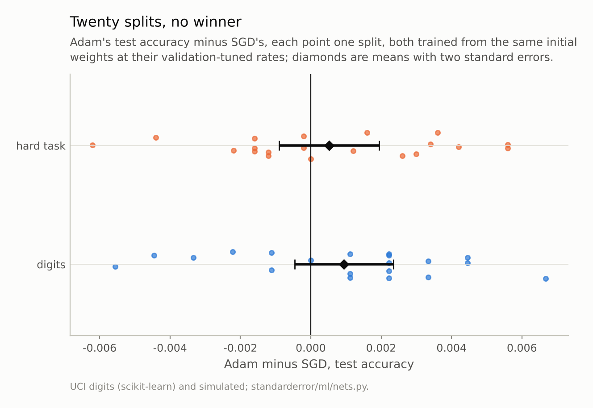
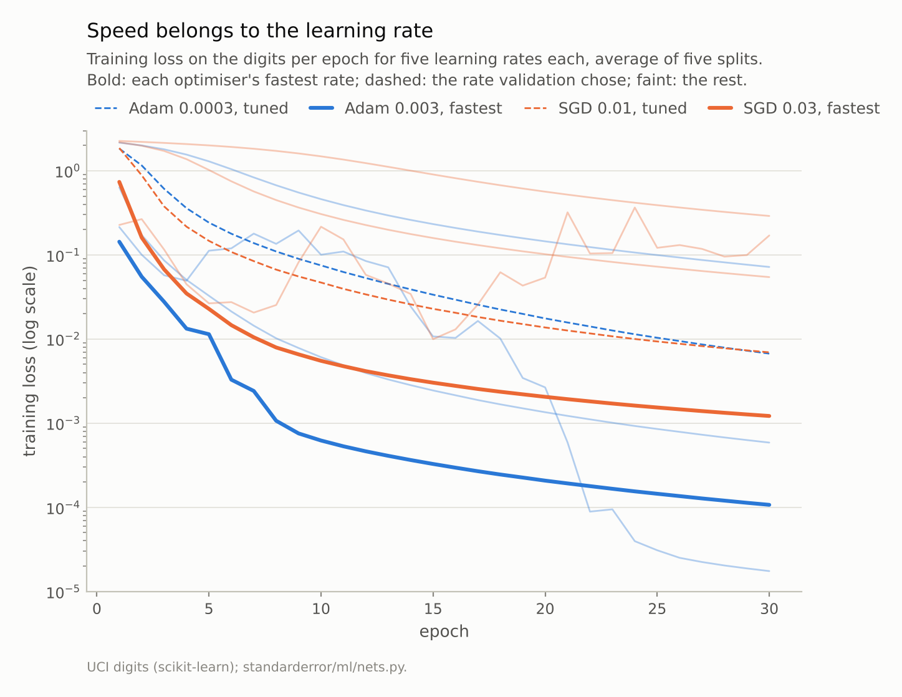
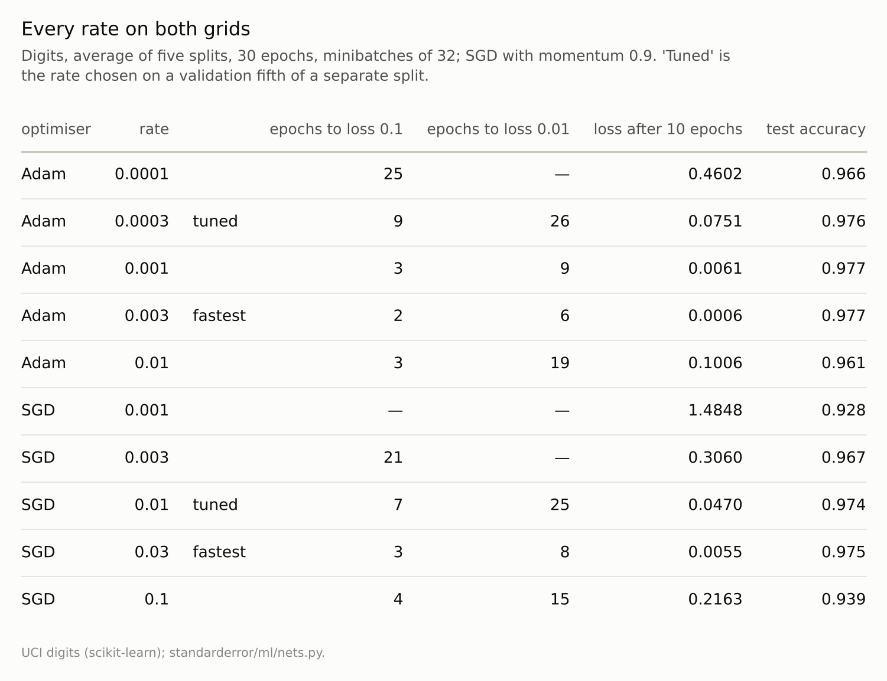

Disclosure: this post was written with the assistance of an AI system (Claude), which wrote the analysis code, ran the experiments and drafted the text. The topic, the constraints, the data choices and the final review are the author's.

*Adam and SGD with momentum 0.9, each with its learning rate tuned on a validation set, were trained from the same initial weights on 20 splits of the digits and of a simulated task with Bayes error 0.276. Adam's test accuracy was higher by +0.0009 ± 0.0007 on the digits and +0.0005 ± 0.0007 on the simulated task: no difference. At the rates validation chose, SGD's training loss fell faster. At each optimiser's fastest rate, Adam reached a training loss of 0.01 in 6 epochs and SGD in 8, and those rates scored as well as any; validation on 180 digits could not tell them from slower ones.*

Episode 23 of *Machine Learning, Taught Through What Breaks*. The syllabus and the other episodes: https://jongha-jeon-dev.github.io/standarderror/lectures/

## The default optimiser

Episode 22 found that for plain SGD the learning rate and the batch size act as one setting. Most networks today are not trained with plain SGD. They are trained with Adam, which keeps a running estimate of each weight's gradient scale and divides by it, so that every weight moves at a similar rate whatever the size of its gradient. Its reputation is the sentence under test: *Adam converges faster and generalises as well as SGD*. Both halves have been challenged. Wilson and colleagues reported adaptive methods generalising worse than SGD; Choi and colleagues found that rankings of optimisers change when every optimiser's settings are tuned with the same care.

So tune both with the same care. On a separate split of the digits, each optimiser's learning rate is chosen from a grid of five spanning a factor of 100, by accuracy on a held-out fifth. SGD gets momentum 0.9, as it usually does in practice. Then both are trained, from the same initial weights, on twenty fresh splits, and the same again on episode 4's simulated task, where the Bayes error of 0.276 leaves room for a better optimiser to show:

```python
from standarderror.ml import nets

for task in ("digits", "gauss"):
    r = nets.adam_vs_sgd(task=task)      # 20 splits, same init each
    a, b = r["adam"]["acc"], r["sgd"]["acc"]
    print(f"{task}: rates Adam {r['tuned']['adam']:g}, SGD "
          f"{r['tuned']['sgd']:g}; accuracy Adam {sum(a) / 20:.4f}, "
          f"SGD {sum(b) / 20:.4f}")
    print(f"    difference {r['diff_mean']:+.4f} ± {r['diff_se']:.4f}, "
          f"Adam ahead on {r['adam_wins']} of 20")
```

```text
digits: rates Adam 0.0003, SGD 0.01; accuracy Adam 0.9732, SGD 0.9722
    difference +0.0009 ± 0.0007, Adam ahead on 13 of 20
gauss: rates Adam 0.0003, SGD 0.003; accuracy Adam 0.7083, SGD 0.7078
    difference +0.0005 ± 0.0007, Adam ahead on 9 of 20
```

On the digits Adam's mean test accuracy is 0.9732, ahead by **+0.0009**, with a standard error of 0.0007; it is ahead on 13 splits of 20 and level on 1. On the hard task it is ahead by +0.0005 ± 0.0007. Neither difference is distinguishable from zero, and on the digits the whole difference is less than one test image in a thousand. The second half of the sentence survives: tuned, Adam generalises as well as SGD here, no better and no worse.



*Mean difference +0.0009 ± 0.0014 on the digits and +0.0005 ± 0.0014 on the hard task (two standard errors).*

## Faster at what rate?

The first half is about speed, and speed depends on the learning rate at least as much as on the optimiser. The speed study trains both optimisers at every rate on their grids, on five splits of the digits, and records the training loss after every epoch:

```python
sp = nets.optimiser_speed()              # digits, five splits
for name in ("adam", "sgd"):
    for lr, curve in zip(sp[name]["lrs"], sp[name]["curves"]):
        hit = next((i + 1 for i, v in enumerate(curve) if v < 0.01), None)
        when = f"at epoch {hit}" if hit else "not in 30 epochs"
        print(f"{name:4s} rate {lr:<6g} loss after 5 epochs "
              f"{curve[4]:.4f}, reaches 0.01 {when}")
```

```text
adam rate 0.0001 loss after 5 epochs 1.2943, reaches 0.01 not in 30 epochs
adam rate 0.0003 loss after 5 epochs 0.2420, reaches 0.01 at epoch 26
adam rate 0.001  loss after 5 epochs 0.0327, reaches 0.01 at epoch 9
adam rate 0.003  loss after 5 epochs 0.0114, reaches 0.01 at epoch 6
adam rate 0.01   loss after 5 epochs 0.1122, reaches 0.01 at epoch 19
sgd  rate 0.001  loss after 5 epochs 2.0037, reaches 0.01 not in 30 epochs
sgd  rate 0.003  loss after 5 epochs 1.0220, reaches 0.01 not in 30 epochs
sgd  rate 0.01   loss after 5 epochs 0.1469, reaches 0.01 at epoch 25
sgd  rate 0.03   loss after 5 epochs 0.0228, reaches 0.01 at epoch 8
sgd  rate 0.1    loss after 5 epochs 0.0266, reaches 0.01 at epoch 15
```

At the rates validation chose, 0.0003 for Adam and 0.01 for SGD, **SGD is faster**: after five epochs its training loss is 0.147 against Adam's 0.242, and it reaches 0.1 at epoch 7 against 9. Both reach 0.01 at about the same time, 25 and 26 epochs.

At each optimiser's fastest rate, 0.003 for Adam and 0.03 for SGD, **Adam is faster**: it reaches 0.01 in 6 epochs, SGD in 8, and after ten epochs Adam's loss is 0.0006 against SGD's 0.0055. That is the advantage Adam is known for, and it is real. It is also two epochs out of eight, and it exists only at the rate chosen for speed.



*At its fastest rate Adam reaches a training loss of 0.01 in 6 epochs, SGD in 8. At the rates validation chose, 26 and 25.*

## What tuning chose, and why

Why did validation choose the slower rates? The table below gives test accuracy at every rate, averaged over the five splits of the speed study. The fastest rates are not worse: Adam's fastest scores 0.977 against the best of its grid, 0.977, and SGD's fastest is the best of its grid, 0.975. The rates validation chose score 0.976 and 0.974.

The tuning split could not see these differences. Its held-out fifth is 180 digits, so one digit is 0.0056 of accuracy, and on it Adam's rates of 0.0003 and 0.001 tied, as did SGD's three largest rates. Ties went to the smaller rate, which is the cautious choice and the slower one. The speed comparison "at the tuned rates" is therefore a comparison of tie-breaks, and it favoured SGD by accident.

What does differ between the optimisers is how much the rate matters. Across Adam's grid of five rates, spanning a factor of 100, test accuracy stayed between 0.961 and 0.977; across SGD's, between 0.928 and 0.975. Dividing by the gradient scale makes Adam less sensitive to its learning rate, which is a practical virtue, and a different claim from converging faster. Choi and colleagues made the general point: rankings of optimisers depend on how, and how much, each one is tuned.



*The rates that train fastest also score within 0.001 of the best of their grid. Adam's accuracy varies less across its grid than SGD's.*

## What the sentence should say

On these two problems, measured over twenty splits with both optimisers tuned, the sentence becomes: *at a learning rate chosen for speed, Adam reaches a low training loss a little sooner than SGD with momentum; tuned for validation accuracy, the two generalise equally well; Adam's accuracy depends less on the learning rate*.

Each part is narrower than the original, and each is measured. The generalisation gap Wilson and colleagues reported does not appear here, but their networks were far larger and their tasks harder, so this is not a refutation of their result; it is a reminder that "Adam generalises worse" is also a claim about particular settings. The honest summary is that the choice of optimiser matters less than tuning whichever one is chosen, and that a comparison which tunes one and not the other measures the tuning.

## Where this breaks

**Small networks, small data.** Two hidden layers on 900 digits or 2,000 simulated rows. On large language and vision models Adam (or AdamW) is the near-universal choice, partly because SGD is hard to tune at that scale and partly because adaptive scaling helps with very different gradient scales across layers, such as embeddings.

**A coarse grid.** Five rates per optimiser, spaced by about a factor of three. Both "fastest" and "tuned" are known only to that resolution, and validation accuracy on a fifth of one split (180 digits) has ties: Adam's 3e-4 and 1e-3 both scored the same, and the smaller was taken.

**One schedule.** Constant learning rates, no warm-up, no decay. Schedules change both speed and final accuracy, for both optimisers.

**No weight decay.** Adam's interaction with weight decay is its own subject (AdamW exists because of it), and was left out by giving neither optimiser any.

## What to keep

1. Tuned on validation data and run over twenty splits, Adam and SGD with momentum reached the same test accuracy: differences of +0.0009 ± 0.0007 on the digits and +0.0005 ± 0.0007 on a hard simulated task.

2. Speed belongs to the learning rate. At the rates validation chose, SGD's loss fell faster; at each optimiser's fastest rate, Adam reached a loss of 0.01 in 6 epochs and SGD in 8.

3. The fastest rates scored as well as any on test digits; validation on 180 digits could not tell them apart from slower ones and chose the slower. Adam's accuracy varied less across its grid (0.961 to 0.977) than SGD's (0.928 to 0.975).

4. Compare optimisers only with each tuned by the same procedure, and report what the rates were tuned for.

## Exercise

Take a model you train with Adam at its default learning rate. Train it with SGD with momentum 0.9 at five rates spaced by a factor of three, and with Adam at five rates around the default, all for the same number of epochs from the same initial weights.

Plot validation accuracy against rate for both. If the best SGD point is within noise of the best Adam point, your choice of optimiser is a choice about tuning effort, not about the model you end up with.

## Next

Both optimisers here trained networks whose layers pass activations straight to the next. Episode 24 adds the layer most networks put in between, batch normalisation, and measures the claim that it normalises each example.

---

### Data

- Optical Recognition of Handwritten Digits (UCI), as bundled with scikit-learn, CC BY 4.0; stratified half splits, seeds 0 to 19 (0 to 4 for the speed study), tuning on split 100.
- Simulated: episode 4's two-class Gaussian task in 10 dimensions, Bayes error 0.276; 2,000 training rows per split and 5,000 fixed test rows.
- Machinery: `standarderror/ml/nets.py`, tested in `tests/test_ml.py`; PyTorch networks with two hidden layers (256 for digits, 64 for the simulated task), ReLU, minibatches of 32, 30 epochs; Adam with PyTorch's defaults apart from the rate; SGD with momentum 0.9. Rates tuned on a grid of five spanning a factor of 100, by accuracy on a held-out fifth.
- Where this stops: Kingma and Ba, "Adam: a method for stochastic optimization", *ICLR* (2015); Wilson, Roelofs, Stern, Srebro and Recht, "The marginal value of adaptive gradient methods in machine learning", *NeurIPS* (2017); Choi et al., "On empirical comparisons of optimizers for deep learning" (2019).

### Reproducibility

- **environment**: standarderror=0.1.0, python=3.13.16, numpy=2.4.4
- **code blocks**: executed at build time; the values the prose quotes are pinned, so drift fails the build
- **determinism**: split, network and shuffling seeds as listed; both optimisers start from the same weights on each split; torch.set_num_threads(1)

Code: <https://github.com/jongha-jeon-dev/standarderror>
