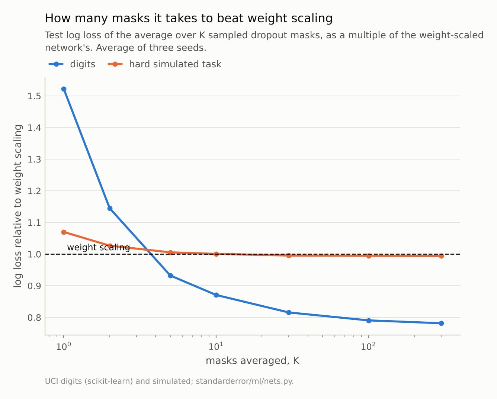
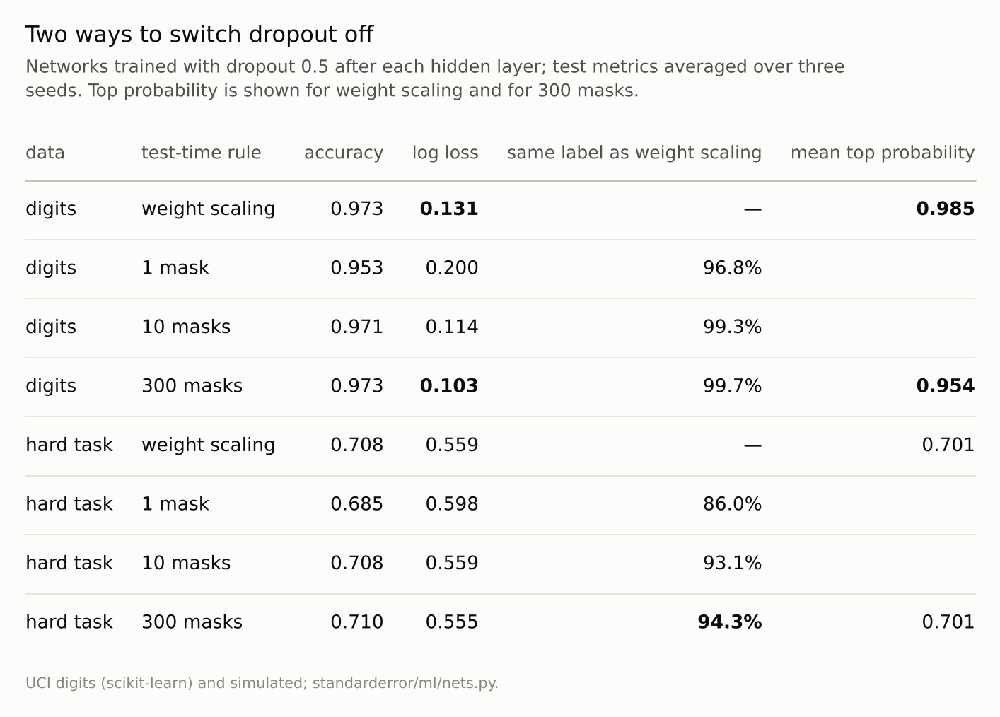
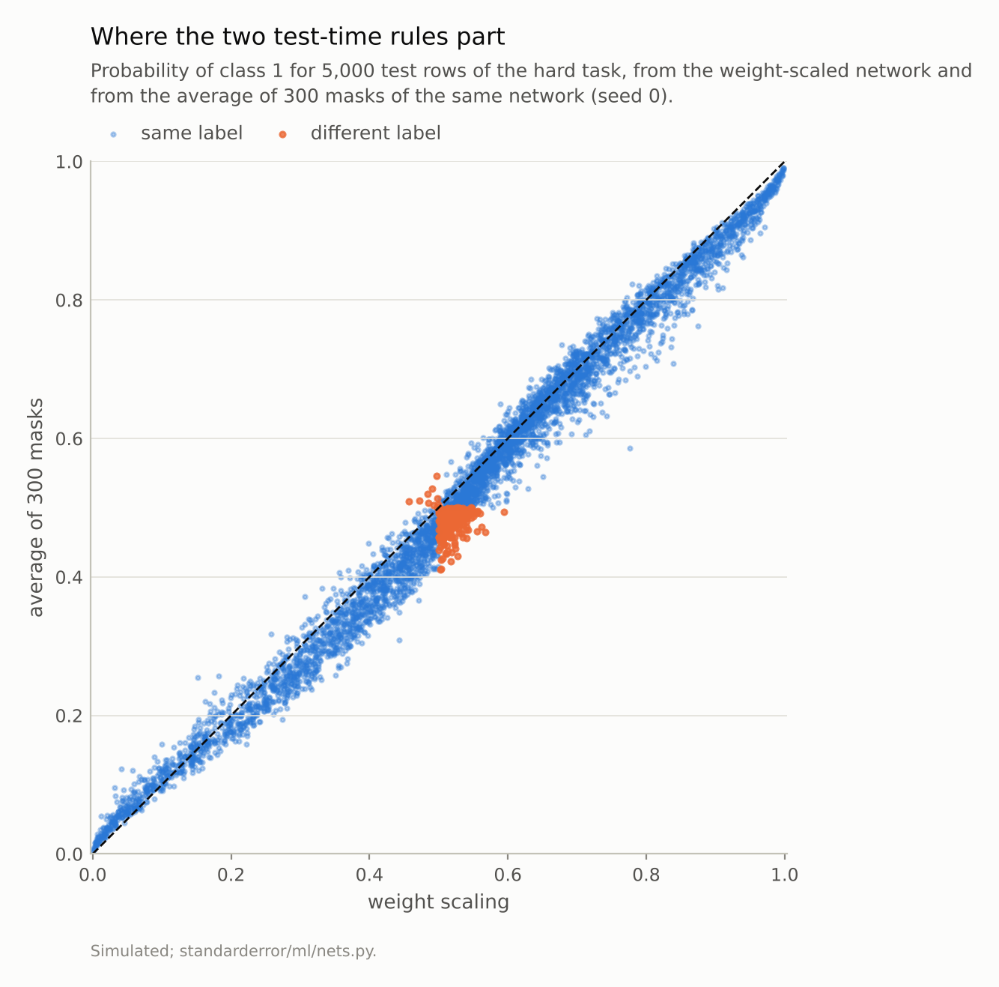

Disclosure: this post was written with the assistance of an AI system (Claude), which wrote the analysis code, ran the experiments and drafted the text. The topic, the constraints, the data choices and the final review are the author's.

*Networks trained with dropout 0.5 were evaluated two ways: with dropout off and the weights scaled, and by averaging up to 300 sampled masks. On the digits the two agreed on 99.7% of labels at the same accuracy, but weight scaling was more confident (mean top probability 0.985 against 0.954) and its log loss was 28% higher; 5 masks already beat it. On a hard simulated task they agreed on 94.3% of labels, the disagreements falling on rows the average called close to a coin flip, and log loss differed by 0.6%. A single sampled mask was worse than either rule.*

Episode 25 of *Machine Learning, Taught Through What Breaks*. The syllabus and the other episodes: https://jongha-jeon-dev.github.io/standarderror/lectures/

## Two ways to switch it off

Episode 24 found a layer that behaves differently in training and at inference, and a prediction that depended on which mode the network was in. Dropout is the other common layer with two modes. During training it zeroes each hidden unit with probability p, a fresh random choice for every example at every step, so the network learns not to rely on any one unit. At test time it is switched off, and the weights (or, in PyTorch's convention, the training-time activations) are scaled so that each unit's expected input is the same in both modes.

The original paper presents that scaling as a cheap stand-in for something more principled: averaging the predictions of all the thinned networks the random masks define, of which there are exponentially many. The sentence under test is the textbook's version: *dropout at test time is approximated by scaling the weights*. Approximated how well, and in what?

The average over masks can be estimated directly by leaving dropout on at test time and averaging K forward passes. On the digits, with dropout 0.5 after both hidden layers of a 256-unit network:

```python
from standarderror.ml import nets

d = nets.dropout_mc()          # digits, dropout 0.5, three seeds
print(f"weight scaling  accuracy {d['ws_acc']:.3f}  "
      f"log loss {d['ws_nll']:.3f}")
for k, acc, nll, same in zip(d["Ks"], d["mc_acc"], d["mc_nll"],
                             d["mc_agree"]):
    print(f"{k:3d} masks       accuracy {acc:.3f}  log loss {nll:.3f}  "
          f"same label {same:.1%}")
```

```text
weight scaling  accuracy 0.973  log loss 0.131
  1 masks       accuracy 0.953  log loss 0.200  same label 96.8%
  2 masks       accuracy 0.961  log loss 0.151  same label 97.8%
  5 masks       accuracy 0.970  log loss 0.123  same label 99.0%
 10 masks       accuracy 0.971  log loss 0.114  same label 99.3%
 30 masks       accuracy 0.973  log loss 0.107  same label 99.3%
100 masks       accuracy 0.974  log loss 0.104  same label 99.6%
300 masks       accuracy 0.973  log loss 0.103  same label 99.7%
```

On the label, the approximation is excellent. The average of 300 masks and the weight-scaled network agree on **99.7%** of test digits, and their accuracies differ by 0.000. On log loss it is not: the weight-scaled network's is 0.131, the average's 0.103, a gap of 28%. Averaging just 5 masks already beats weight scaling on log loss.



*On the digits, 5 masks beat weight scaling and 300 bring log loss to 78% of it. On the hard task it takes 30, and the gain is 0.6%.*

## Why scaling is only an approximation

For a single linear unit the two rules are the same thing. A unit computing w·x with each input kept with probability 1 − p has expected value (1 − p) w·x, which is exactly what scaling the weights computes. The approximation enters through everything that is not linear. A ReLU of an average is not the average of a ReLU, and a softmax of averaged logits is not the average of softmaxes; with two hidden layers the gaps compound.

The difference is visible in the confidence:

```python
print(f"mean top probability: weight scaling {d['ws_conf']:.3f}, "
      f"300 masks {d['mc_conf']:.3f}")
print(f"averaged top probability where the labels differ: "
      f"{d['dis_conf']:.2f}")
```

```text
mean top probability: weight scaling 0.985, 300 masks 0.954
averaged top probability where the labels differ: 0.42
```

The weight-scaled network puts a mean of **0.985** on its top class, the average of masks 0.954. Each thinned network is a slightly different classifier, and on hard digits they vote differently. The average carries that disagreement into its probabilities; the single weight-scaled network does not show it. The few digits where the two rules give different labels are ones where the masks split: the average's top probability on them is 0.42, against 0.96 elsewhere.

A coarser calibration check points the other way. The expected calibration error over ten bins is 0.014 for weight scaling and 0.021 for the average, and on average it is the average that is further off: its mean top probability is 0.019 below its accuracy of 0.973, while weight scaling's is 0.012 above its accuracy of 0.973. So the log-loss gap is not a matter of average confidence. Log loss punishes a confident mistake far more than an unsure one, and the likeliest source of the gap is the few digits weight scaling gets wrong with near-certainty; that was not isolated here.



*Accuracy barely separates the rules; log loss and confidence do, on the digits. One sampled mask is the worst of all.*

## On a hard task

The digits are nearly separable; most test images are far from any boundary. Episode 4's simulated task is the opposite: two overlapping Gaussian classes whose Bayes rule errs on 0.276 of the 5,000 test rows used here (0.268 on episode 4's 20,000), so a large share of rows sit near the boundary whatever the model.

```python
g = nets.dropout_mc(task="gauss")   # episode 4's task, a hard one
print(f"weight scaling {g['ws_acc']:.3f} / {g['ws_nll']:.4f}, "
      f"300 masks {g['mc_acc'][-1]:.3f} / {g['mc_nll'][-1]:.4f}, "
      f"same label {g['mc_agree'][-1]:.1%}")
print(f"averaged top probability where the labels differ: "
      f"{g['dis_conf']:.2f}")
```

```text
weight scaling 0.708 / 0.5587, 300 masks 0.710 / 0.5554, same label 94.3%
averaged top probability where the labels differ: 0.53
```

Here the labels agree less, on 94.3% of rows, and the probabilities agree more: the log losses differ by 0.6%, and it takes 30 masks before the average beats weight scaling at all. Both observations have the same cause. The rows near the boundary are many, and on them both rules sit near 0.5, so a small difference in probability moves a row across the threshold without moving its log loss much. The averaged network's top probability on the disputed rows is 0.53. Those rows are coin flips under either rule; which side of 0.5 they fall on is noise.

So the approximation is good in the sense that matters for decisions, and loose in the sense that matters for probabilities, and how loose depends on the task: a sharpened probability costs most where the model is usually sure.



*The median gap between the two probabilities is 0.019 and the largest 0.19. The 4.7% of rows with different labels (seed 0) sit where both rules are close to 0.5.*

## The cheap version that is worse than both

The averaging needs K forward passes per prediction. The tempting shortcut is one: leave dropout on and take one sample. It is worse than either rule on every measure here. On the digits a single mask scores 0.953 against 0.973, with log loss 0.200, and agrees with the weight-scaled label on only 96.8% of digits. On the hard task one mask scores 0.685 against 0.708.

That is the cost of a random network: one draw of the mask removes half the units, and the prediction inherits that draw's luck. It matters in practice because forgetting to switch a model to evaluation mode is a common bug, and a model served in training mode makes exactly these single-mask predictions, a different one each time the same input arrives.

The more principled use of sampling is Gal and Ghahramani's reading of dropout as approximate Bayesian inference, where the spread of the K sampled predictions is taken as a measure of the model's uncertainty. What this episode measures supports the narrow part of that reading: the masks do disagree, the averaged probability drops on the rows where the labels are in doubt, and the weight-scaled network does not show that drop. The spread of the K samples itself was not computed here. Whether it is a *calibrated* measure of uncertainty is a separate question this episode does not answer.

## Where this breaks

**One dropout rate.** At p = 0.5 each mask removes half the units, the largest perturbation in common use. At p = 0.1, the thinned networks are much closer to each other and to the scaled one, and both gaps should shrink; that was not measured here.

**Small fully connected networks.** Two hidden layers; the gap compounds with depth, so deeper networks could differ more. Convolutional networks usually apply dropout only near the output, which limits how much nonlinearity sits between the masks and the prediction.

**300 masks is an estimate.** The average of 300 masks is not the exact average over all of them; the curves above are flat by 100, which suggests the remaining error is small.

**Calibration was not fixed.** A temperature fitted on held-out data could bring the weight-scaled network's log loss down without any sampling. The comparison here is between the two rules as they come, which is how they are used.

## What to keep

1. Weight scaling reproduces the labels of mask averaging closely: 99.7% agreement on the digits, 94.3% on a hard task, accuracy within half a point.

2. It does not reproduce the probabilities. On the digits it was sharper (mean top probability 0.985 against 0.954) and its log loss 28% higher; 5 masks were enough to beat it.

3. The labels the two rules dispute are the ones the masks dispute. The averaged top probability on them was 0.42 on the digits and 0.53 on the hard task.

4. One sampled mask, the prediction of a model left in training mode, was worse than both rules on accuracy and log loss.

## Exercise

Take a network you trained with dropout and evaluate it on a held-out set three ways: in evaluation mode, with dropout on and one pass, and with dropout on averaged over 30 passes. Compare accuracy, log loss and the mean top-class probability.

Then sort the held-out rows by how much the 30 passes disagree with each other, and check the error rate in the top tenth against the bottom tenth. If the disagreement tracks the errors, you have a free warning signal that evaluation mode was discarding.

## Next

Arc V ends here. Initialisation, learning rate and batch size, the optimiser, batch normalisation and dropout each turned out to be less separate, or less exact, than the sentence attached to it. Arc VI turns from how a network trains to what it learns, starting with the sentence that a network which generalises could not have fit noise.

---

### Data

- Optical Recognition of Handwritten Digits (UCI), as bundled with scikit-learn, CC BY 4.0; stratified half splits, seeds 0 to 2.
- Simulated: episode 4's two-class Gaussian task in 10 dimensions; 2,000 training rows and 5,000 test rows, on which the Bayes rule's error is 0.276 (0.268 on episode 4's 20,000).
- Machinery: `standarderror/ml/nets.py`, tested in `tests/test_ml.py`; PyTorch networks with two hidden layers (256 for digits, 128 for the simulated task), ReLU, dropout 0.5 after each hidden layer, SGD with momentum 0.9, learning rate 0.01, minibatches of 32, 60 epochs.
- Where this stops: Srivastava et al., "Dropout: a simple way to prevent neural networks from overfitting", *JMLR* (2014); Gal and Ghahramani, "Dropout as a Bayesian approximation", *ICML* (2016).

### Reproducibility

- **environment**: standarderror=0.1.0, python=3.13.16, numpy=2.4.4
- **code blocks**: executed at build time; the values the prose quotes are pinned, so drift fails the build
- **determinism**: network and split seeds 0 to 2; dropout masks drawn after torch.manual_seed(1000 + seed); torch.set_num_threads(1)

Code: <https://github.com/jongha-jeon-dev/standarderror>
