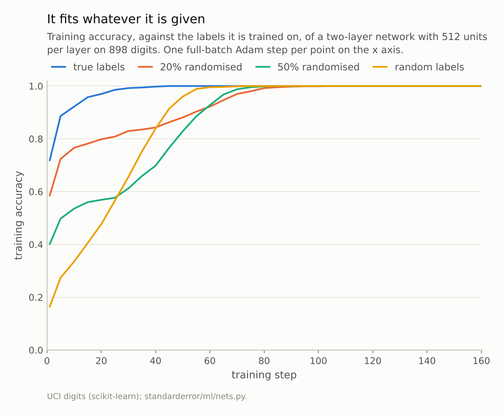
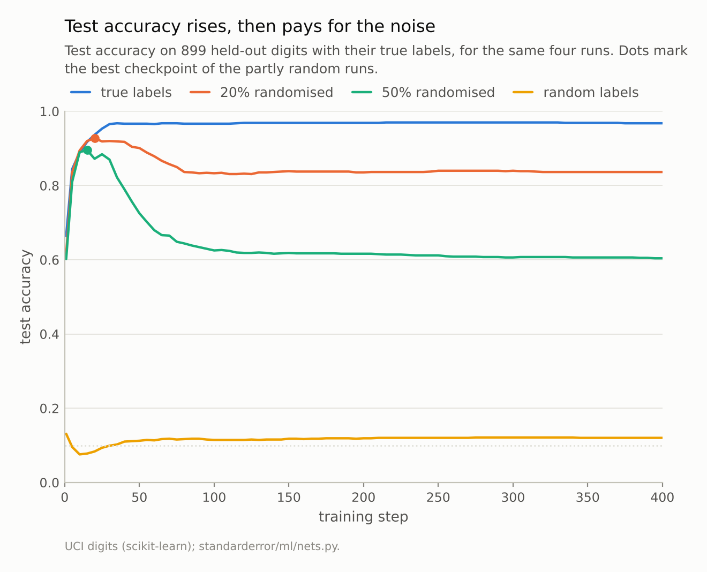
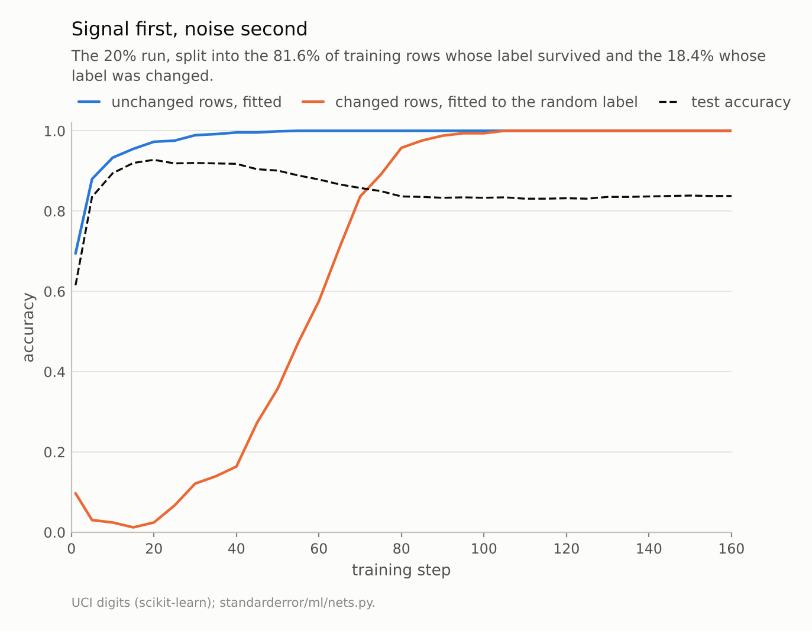

Disclosure: this post was written with the assistance of an AI system (Claude), which wrote the analysis code, ran the experiments and drafted the text. The topic, the constraints, the data choices and the final review are the author's.

*A two-layer network with 512 units per layer, trained full-batch on 898 digits, reached 100% training accuracy in 41 steps on the true labels (test accuracy 0.968) and in 73 on entirely random labels (test 0.120). With 20% of labels randomised it fitted the unchanged rows first: by step 20 it was right on 97.3% of them and on 2.4% of the changed ones, and test accuracy peaked at 0.928. It then memorised the changed rows and ended at 0.836. With half the labels random, test accuracy peaked at 0.895 and ended at 0.604.*

Episode 26 of *Machine Learning, Taught Through What Breaks*. The syllabus and the other episodes: https://jongha-jeon-dev.github.io/standarderror/lectures/

## A network that could fit anything

Arc V was about training a network. Arc VI is about what the trained network has learned, and it starts with an argument every statistics student meets in some form. A model that is flexible enough to fit any labelling of its training data has learned nothing from fitting this one; a model that generalises must therefore be constrained, by its size, its architecture or its regularisation, so that it *could not* have fit noise. The sentence under test is that argument's conclusion: *a network that generalises could not have fit noise*.

Zhang, Bengio and colleagues tested it on image networks in 2017 by replacing the labels with random ones. The test is cheap to repeat on the digits. Take a network with two hidden layers of 512 units, which has about 300,000 parameters for 898 training images, and train it with full-batch Adam on the true labels, on labels where 20% or 50% of rows were given a random class, and on labels that are entirely random:

```python
from standarderror.ml import nets

runs = nets.random_labels()     # 2 x 512 network, full-batch Adam
for r in runs:
    print(f"{r['fraction']:4.0%} of labels randomised: 100% training "
          f"accuracy at step {r['epoch_100']:3d}, test {r['test_acc']:.3f}")
```

```text
  0% of labels randomised: 100% training accuracy at step  41, test 0.968
 20% of labels randomised: 100% training accuracy at step 101, test 0.836
 50% of labels randomised: 100% training accuracy at step  82, test 0.604
100% of labels randomised: 100% training accuracy at step  73, test 0.120
```

On the true labels it reaches 100% training accuracy in **41 steps** and scores 0.968 on held-out digits. On entirely random labels, where there is nothing to learn, it also reaches 100%, in **73 steps**, and scores 0.120, which is chance for ten classes. Fitting noise took it less than twice as long as fitting the truth.

So the same network, unchanged, can memorise an arbitrary labelling of these 898 images. By the argument above, its fit to the true labels should mean nothing. It means a test accuracy of 0.968.



*Random labels take 73 steps to fit perfectly, against 41 for the true ones. Partly random labels take longest.*

## What capacity cannot explain

The classical bounds on generalisation say that the gap between training and test error is small when the model class is too small to fit arbitrary labels. Zhang and colleagues' point, which this measurement repeats, is that for a network of ordinary size the premise is false. The model class can fit arbitrary labels, and fitting them takes no special effort: no change of architecture, learning rate or number of steps. Any explanation of why the network generalises on true labels has to be something that differs between the two runs, and the only thing that differs is the labels.

That is a statement about the *data*. On true labels the images of each class share structure, so a function that fits some of them fits many of the rest, and every image's contribution to training pushes in a direction that helps the others of its class. On random labels no such function exists, and the network has to carve out each image's label individually, which is why it took 73 steps instead of 41. Both end at 100%. The difference is not whether the network can fit them but how.

Training accuracy cannot tell the two apart. Both runs finish with a perfect score on what they were trained on, and only held-out data distinguishes a network that has learned the digits from one that has learned a list.

## The order of learning

The partly random runs show the "how". With 20% or 50% of the labels randomised the network still reaches 100% training accuracy, in 101 and 82 steps, longer than either pure case. But its test accuracy does not move steadily. It rises fast, then falls:

```python
for r in runs:
    step, _, best, *_ = max(r["curve"], key=lambda c: c[2])
    print(f"{r['fraction']:4.0%} randomised: best test {best:.3f} at "
          f"step {step:3d}, final {r['test_acc']:.3f}")
```

```text
  0% randomised: best test 0.970 at step 215, final 0.968
 20% randomised: best test 0.928 at step  20, final 0.836
 50% randomised: best test 0.895 at step  15, final 0.604
100% randomised: best test 0.131 at step   1, final 0.120
```

With a fifth of the labels randomised the network reaches **0.928** on held-out digits at step 20, nearly as good as the network trained on clean labels, and ends at 0.836. With half randomised it reaches 0.895 and ends at 0.604. Splitting the training rows by whether their label was changed shows why:

```python
fifth = runs[1]                  # 20% of labels randomised
for step, train, test, kept, changed in fifth["curve"]:
    if step in (5, 20, 50, 75, 100):
        print(f"step {step:3d}  unchanged rows {kept:.3f}  "
              f"changed rows {changed:.3f}  test {test:.3f}")
```

```text
step   5  unchanged rows 0.880  changed rows 0.030  test 0.835
step  20  unchanged rows 0.973  changed rows 0.024  test 0.928
step  50  unchanged rows 0.999  changed rows 0.358  test 0.901
step  75  unchanged rows 1.000  changed rows 0.891  test 0.850
step 100  unchanged rows 1.000  changed rows 0.994  test 0.833
```

By step 20 the network is right on 97.3% of the unchanged rows and on 2.4% of the changed ones, *fewer than chance*: it is predicting their true class, not the random label it is being trained on. It has learned the digits from the 80% of the data that teach them, and it is overruling the noise. Only after that does it start to memorise the changed rows, one by one, and every one it memorises costs a little test accuracy, because a memorised random label is a small wrong rule about what that digit looks like. By step 100 it fits 99.4% of the changed rows.



*With 20% of labels randomised the network peaks at 0.928 at step 20 and ends at 0.836; with 50%, 0.895 and 0.604.*



*The network fits the rows it can generalise from before the rows it can only memorise. Test accuracy is highest in between.*

## What this means for early stopping

Arpit and colleagues documented the same ordering on larger networks: real patterns are fitted before noise, and the switch can be seen in the training curves. It is the practical reason early stopping works. A network stopped at the peak is the one that has learned the shared structure and not yet the exceptions.

It also says what early stopping needs. The peak was at step 20 for the 20% run and step 15 for the 50% run, and the drop after it was 0.091 and 0.291. Training accuracy gave no sign of either: it was still climbing steadily through the peak. Only a held-out set could see it. With noisy labels, which most real data sets have in some proportion, a validation set is not a formality for reporting; it is the only instrument that can tell when the network has stopped learning the problem and started learning the noise.

The ordering also explains why a network trained on clean labels does not suffer from its capacity. With no noise to memorise, the late phase of training has nothing harmful to fit; the test accuracy of the clean run reached 0.968 and stayed there through 400 steps.

## Where this breaks

**One small network, one data set.** The ordering of signal before noise is a tendency of gradient descent on data with shared structure, not a theorem. It depends on the learning rate, the optimiser and the architecture, and can be weakened, for instance by very large learning rates or by training on each example many times in a row.

**Uniform random labels.** Real label noise is rarely uniform. Annotators confuse a 4 with a 9 more often than with a 0, and structured noise of that kind can look like signal to the network and be fitted early.

**No regularisation.** No weight decay, dropout or augmentation was used. Each would slow the memorisation of noise and move or flatten the peak; none would stop a network this size from fitting random labels if trained long enough.

**Full-batch training.** One step per pass over the data keeps the comparison clean. With minibatches the same phases appear, measured in epochs rather than steps, with more noise.

## What to keep

1. A network that generalises can also fit noise. The same network reached 100% training accuracy on true labels in 41 steps (test 0.968) and on random labels in 73 (test 0.120).

2. So capacity does not explain generalisation here. The labels do: on real data, what fits one example of a class fits the rest.

3. Given both signal and noise, the network fitted the signal first. With 20% of labels randomised, by step 20 it was right on 97.3% of unchanged rows and 2.4% of changed ones, and test accuracy peaked at 0.928.

4. Memorising the noise afterwards cost 0.091 of test accuracy with 20% noise and 0.291 with 50%, invisible in training accuracy and visible only on held-out data.

## Exercise

Take a classifier you trained and shuffle its training labels completely. Train it again with exactly the same settings and record how long it takes to reach the training accuracy the real run reached.

If it gets there, your model is large enough to memorise your data, and its test score is the only evidence that it did not. Then flip 10% of the real labels at random, train once more, and plot validation accuracy against epoch: the gap between the peak and the end is what early stopping is buying you.

## Next

Here the network fitted the signal first and the noise later, and later was worse. Episode 27 runs the clock the other way: a network that memorises its training set first, reaches 100% training accuracy and chance on the test set, and is kept training long after there seems nothing left to learn.

---

### Data

- Optical Recognition of Handwritten Digits (UCI), as bundled with scikit-learn, CC BY 4.0; one stratified half split (898 training digits, 899 test), standardised on the training half.
- Machinery: `standarderror/ml/nets.py`, tested in `tests/test_ml.py`; a PyTorch network 64-512-512-10 with ReLU, trained with full-batch Adam at learning rate 1e-3 for 400 steps, on labels with 0%, 20%, 50% or 100% of rows given a uniformly random class.
- Where this stops: Zhang, Bengio, Hardt, Recht and Vinyals, "Understanding deep learning requires rethinking generalization", *ICLR* (2017); Arpit et al., "A closer look at memorization in deep networks", *ICML* (2017).

### Reproducibility

- **environment**: standarderror=0.1.0, python=3.13.16, numpy=2.4.4
- **code blocks**: executed at build time; the values the prose quotes are pinned, so drift fails the build
- **determinism**: split, label noise and network seed 0; full-batch training has no data order; torch.set_num_threads(1)

Code: <https://github.com/jongha-jeon-dev/standarderror>
