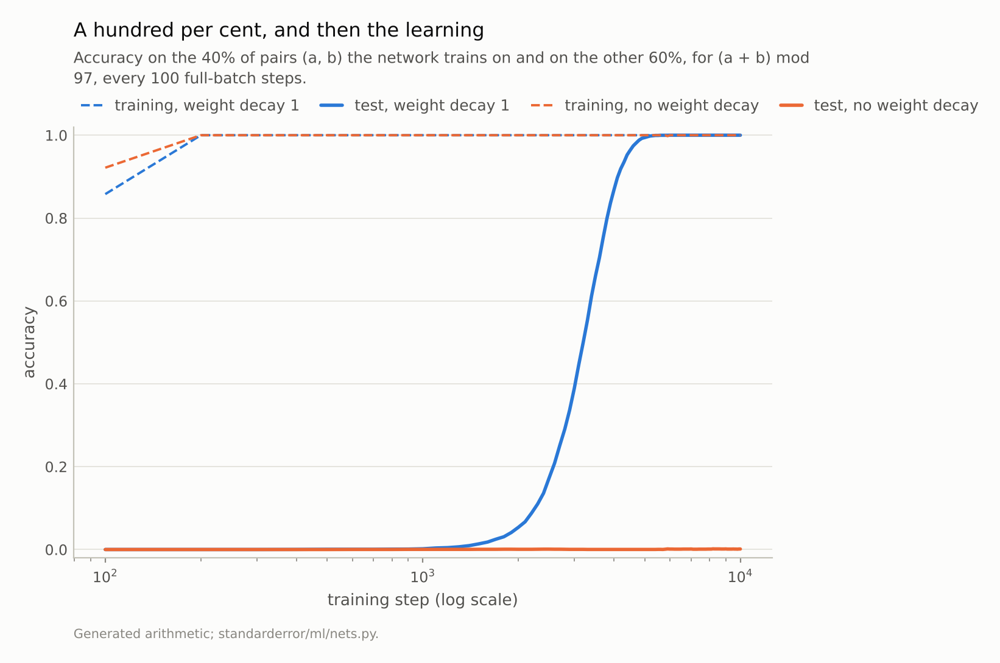
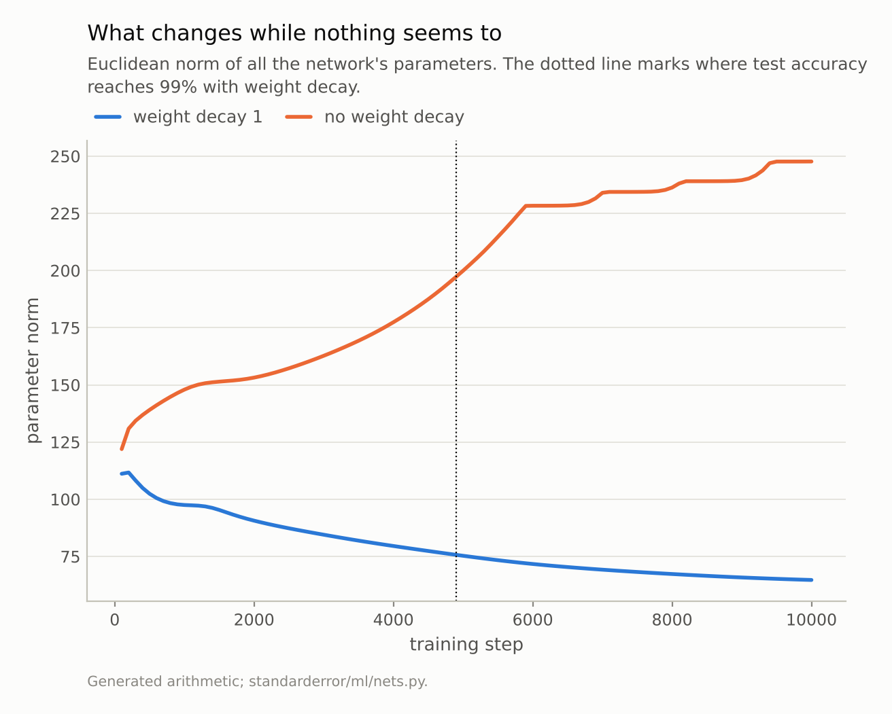
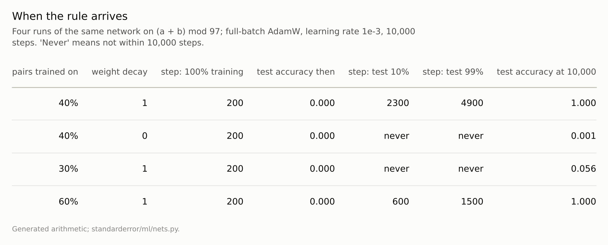

Disclosure: this post was written with the assistance of an AI system (Claude), which wrote the analysis code, ran the experiments and drafted the text. The topic, the constraints, the data choices and the final review are the author's.

*A small network trained full-batch on 40% of the pairs of (a + b) mod 97 reached 100% training accuracy at step 200, when its accuracy on the other pairs was 0.000. Test accuracy passed 10% at step 2,300 and 99% at step 4,900, with training accuracy at 100% throughout, while weight decay brought the parameter norm from 112 to 76. Without weight decay, test accuracy was 0.1% after 10,000 steps. Training on 60% of the pairs, the rule arrived at step 1,500.*

Episode 27 of *Machine Learning, Taught Through What Breaks*. The syllabus and the other episodes: https://jongha-jeon-dev.github.io/standarderror/lectures/

## Nothing left to fit

Episode 26 trained a network until it fitted every training label and watched its test accuracy fall as it memorised noise. The lesson there was to stop early. The sentence under test here is the belief that makes stopping natural: *once training accuracy reaches 100%, learning is over*. Every training example is classified correctly, so the gradient has nothing left to correct but confidence, and nothing more of substance can happen.

The test is a task with a rule and no noise: addition modulo 97. Every pair (a, b) of numbers from 0 to 96 has the label (a + b) mod 97, 9,409 pairs in all. A small network sees 3,763 of them, 40%, and is asked about the other 60%. It knows nothing about numbers: each of a and b is a learned embedding, the two embeddings are concatenated and passed through one hidden layer, and the output is one of 97 classes. It is trained full-batch with AdamW and weight decay, for 10,000 steps. The runs take long enough that their curves are committed to the repository; the episode reads them, and then checks the first 200 steps against a fresh run:

```python
from standarderror.ml import nets

runs = nets.grokking_runs()   # written by scripts/train_grokking.py
for r in runs:
    print(f"{r['frac']:.0%} of pairs, weight decay {r['weight_decay']:g}: "
          f"100% training at step {r['train_100']}")
    reach = f"at step {r['test_99']}" if r["test_99"] else "not reached"
    print(f"    99% test {reach}; test after 10,000 steps "
          f"{r['final_test']:.3f}")
```

```text
40% of pairs, weight decay 1: 100% training at step 200
    99% test at step 4900; test after 10,000 steps 1.000
40% of pairs, weight decay 0: 100% training at step 200
    99% test not reached; test after 10,000 steps 0.001
30% of pairs, weight decay 1: 100% training at step 200
    99% test not reached; test after 10,000 steps 0.056
60% of pairs, weight decay 1: 100% training at step 200
    99% test at step 1500; test after 10,000 steps 1.000
```

```python
short = nets.modular(steps=200, every=100)    # rerun the first 200 steps
for a, b in zip(short["history"], runs[0]["history"]):
    print(f"step {a['step']}: train {a['train']:.4f} / {b['train']:.4f}, "
          f"test {a['test']:.4f} / {b['test']:.4f}")
```

```text
step 100: train 0.8578 / 0.8578, test 0.0000 / 0.0000
step 200: train 1.0000 / 1.0000, test 0.0000 / 0.0000
```

The first run is the one to follow. Training accuracy reaches 100% at step **200**. At that moment test accuracy is 0.000: not chance, which would be about 0.010, but below it. The network has learned a table of the 3,763 answers it was shown and nothing that transfers to any other pair.



*With weight decay: training accuracy 100% at step 200, test accuracy 99% at step **4,900**. Without: test accuracy 0.1% at step 10,000.*

## Memorise first, generalise later

By the sentence under test, training is over at step 200. It continues anyway, and for a long time nothing visible happens. Training accuracy stays at 100% at every checkpoint. Test accuracy stays under 10% until step 2,300, 12 times as long as it took to fit the training set. Then it climbs, steeply, and passes 99% at step **4,900**. By the end of the run the network answers every one of the 5,646 pairs it never saw.

Power and colleagues, who first reported this on small algorithmic tasks, named it *grokking*. Nanda and colleagues later opened up a small transformer trained on modular addition (modulo 113 rather than 97) and found what it had learned: its embeddings place the numbers on circles, and it adds angles, which is modular addition done with trigonometry. Whether this network found the same solution was not checked here; what is measured is that it found one that answers the unseen pairs. A memorised table and a rule both fit the training pairs perfectly. Only the rule answers the rest.

So "100% training accuracy" does not identify what the network has learned. Two quite different functions, a lookup table and the rule, score identically on the training set, and training moved from the first to the second while the score on the training set never changed.

## What moved the network

If the training labels were not pushing, something else was. With weight decay, every step shrinks every parameter slightly, and the gradient only pushes back where the training loss needs it. The parameter norm in the figure below falls steadily from 112 when the training set is first fitted to **76** when the rule is found, and on to 65 at the end.

The reading that Liu, Michaud and Tegmark give, and that this curve fits, is that the memorised table is expensive in weight norm and the rule is cheap. Both fit the training pairs; weight decay keeps charging for size; the network drifts towards the solution that fits the data with the smallest weights, and that solution is the rule.

The control is to switch weight decay off and change nothing else. The second run does exactly that. It also fits the training set early, at step 200. Its parameter norm grows instead, from 131 at that step to 248. And after 10,000 steps its test accuracy is **0.1%**. Without the pressure on size, the memorised table is as good a resting place as any.



*With weight decay the norm falls from 112 when the training set is fitted to 76 when the rule is found. Without it, the norm ends at 248.*

## How much data the rule needs

The last two runs keep weight decay and change the share of pairs in the training set. With 60% of the pairs the rule arrives sooner, test accuracy passing 99% at step 1,500 against 4,900 with 40%. With 30% it does not arrive within 10,000 steps, and test accuracy ends at 0.056.

That is the shape Power and colleagues reported: the delay between memorising and generalising grows quickly as the training fraction shrinks. The fewer pairs there are, the cheaper a table that fits them, and the longer weight decay takes to make the rule the cheaper of the two.



*Every run fits its training pairs within a few hundred steps. When, and whether, it then finds the rule depends on weight decay and on how many pairs it sees.*

## Where this breaks

**A task with an exact rule.** Modular addition has a compact rule that fits every pair, including the unseen ones. Most real data have no such rule, only a noisy relationship, and episode 26's network, trained on real digits with noisy labels, got worse after fitting, not better. Grokking is a demonstration that the sentence is false, not evidence that training past 100% is generally wise.

**Strong weight decay, full batches.** A weight decay of 1 with AdamW is far stronger than usual, and full-batch training removes the noise of minibatches. Both make the slow drift easy to see. Power and colleagues report a longer delay with weaker decay; without any, here, the rule did not arrive at all.

**Early stopping would have failed.** A validation set drawn from the unseen pairs would have shown accuracy at 0 and stayed there for over a thousand steps after the training set was fitted. Any reasonable patience setting stops the run long before the rule arrives. The same tool that rescued episode 26's network discards this one.

**One seed per setting.** Each row of the table is one run. The timings would move with the seed; the pattern, fit first and generalise much later under weight decay, is the one reported across many seeds in the literature.

## What to keep

1. 100% training accuracy says the network fits the training set, not how. Here a memorised table and the rule both fitted it perfectly.

2. Learning continued after the training set was fitted. Training accuracy reached 100% at step 200, test accuracy was 0.000 then, and it passed 99% at step 4,900.

3. In these runs, weight decay drove the switch: the parameter norm fell from 112 to 76 on the way. Without it, in the one control run, test accuracy was 0.1% after 10,000 steps.

4. More training data brought the rule sooner: step 1,500 with 60% of the pairs.

5. Neither "stop at 100%" nor "train past it" is a rule. What happens after the training set is fitted depends on whether there is a simpler solution to find and whether anything pushes the network towards it.

## Exercise

Take a small model you train to 100% training accuracy and keep training it for ten times as many steps, with weight decay, recording validation accuracy and the parameter norm every few hundred steps.

If validation accuracy rises again after the training set is fitted, your early-stopping rule would have thrown that away. If it only falls, your data are more like episode 26's than this one's, and stopping early was right.

## Next

Weight decay encoded a preference the data could not express: for small weights. Episode 28 looks at the most common way of encoding a preference about the data itself, augmentation, and at the sentence that it simply adds more data.

---

### Data

- Generated: all 9,409 pairs (a, b) with a, b in 0..96 and label (a + b) mod 97; a seeded random 40% (or 30%, 60%) for training, the rest for test.
- Machinery: `standarderror/ml/nets.py` (`modular`) and `scripts/train_grokking.py`, whose curves are committed in `data/ml_grokking/results.json`; tested in `tests/test_ml.py`. Embeddings of a and b (128 each) concatenated into one hidden layer of 256 ReLU units; full-batch AdamW, learning rate 1e-3, betas (0.9, 0.98), weight decay 1 or 0, 10,000 steps.
- Where this stops: Power, Burda, Edwards, Babuschkin and Misra, "Grokking: generalization beyond overfitting on small algorithmic datasets" (2022); Nanda, Chan, Lieberum, Smith and Steinhardt, "Progress measures for grokking via mechanistic interpretability", *ICLR* (2023); Liu, Michaud and Tegmark, "Omnigrok: grokking beyond algorithmic data", *ICLR* (2023).

### Reproducibility

- **environment**: standarderror=0.1.0, python=3.13.16, numpy=2.4.4
- **code blocks**: executed at build time; the stored curves are checked against a fresh 200-step run, and the values the prose quotes are pinned
- **determinism**: split and network seed 0, full batch, torch.set_num_threads(1); each 10,000-step run took between 7 and 26 minutes on one CPU thread

Code: <https://github.com/jongha-jeon-dev/standarderror>
