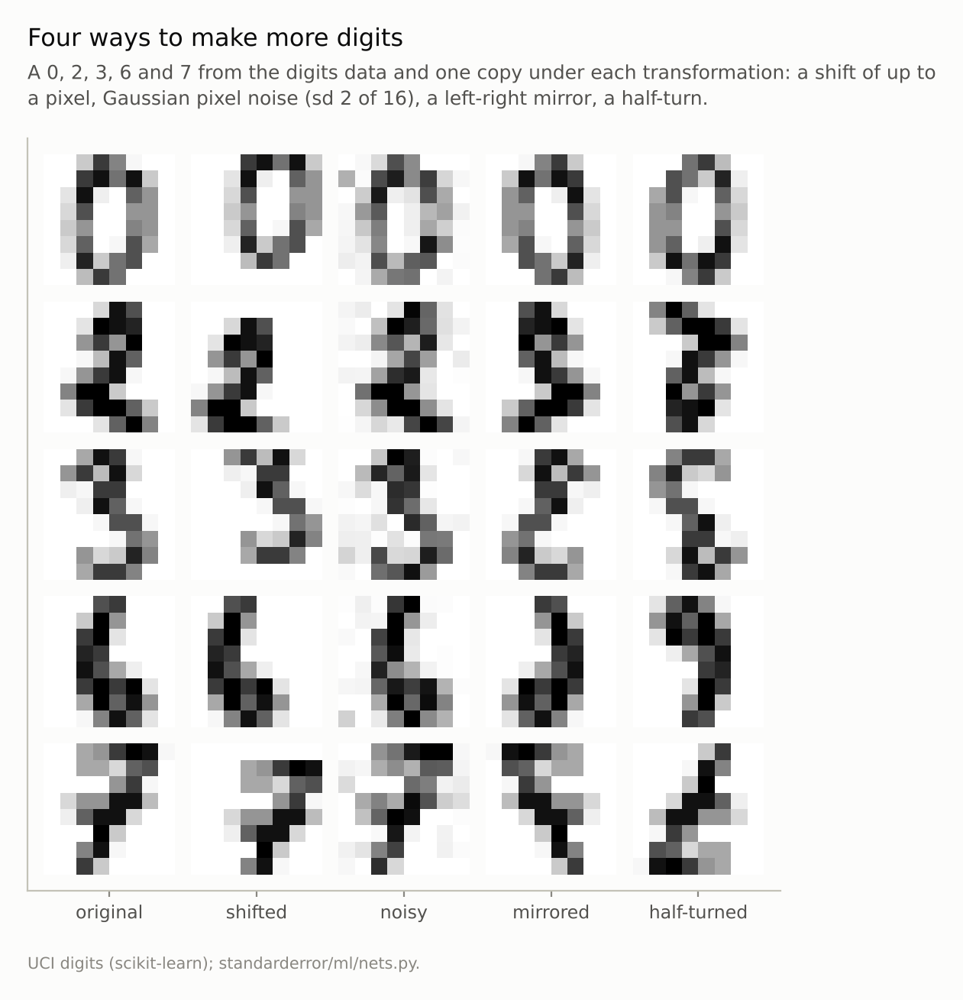
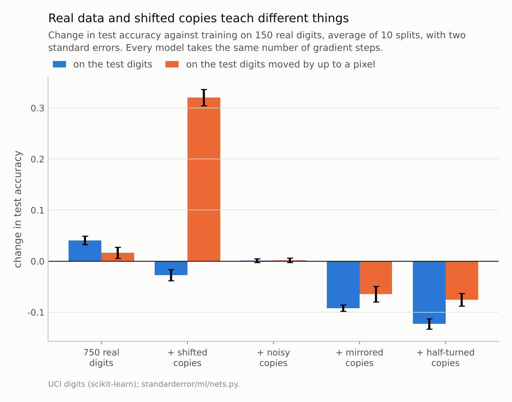
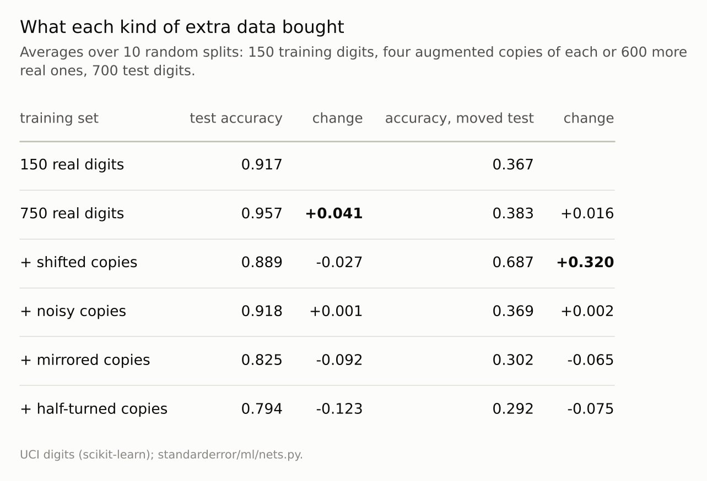

Disclosure: this post was written with the assistance of an AI system (Claude), which wrote the analysis code, ran the experiments and drafted the text. The topic, the constraints, the data choices and the final review are the author's.

*Trained on 150 digits, a network scored 0.917. Four times as many real digits raised that by 0.041; four shifted copies of each image changed it by -0.027, pixel noise by +0.001, and mirrored or half-turned copies lowered it by 0.092 and 0.123. On the same test digits moved by up to a pixel, the base model scored 0.367; real data added +0.016 and shifted copies +0.320. An augmentation asserts that the label survives a transformation. It pays where the test data vary that way and costs where the assertion is false.*

Episode 28 of *Machine Learning, Taught Through What Breaks*. The syllabus and the other episodes: https://jongha-jeon-dev.github.io/standarderror/lectures/

## Free data

Episode 27's weight decay encoded a preference the training data could not express, for small weights, and that preference decided what the network learned. Data augmentation is the most common way of encoding a preference about the data themselves: take each training image, shift it, rotate it, add noise, and train on the copies as well. The usual description is the sentence under test: *data augmentation adds data*. Four copies of every image, five times the training set, for free.

If that were literally true, augmented copies would do what the same number of new, real examples does. That can be tested directly on the digits, because the data set holds more real images than a small experiment needs. Take 150 training digits. Give one network those alone, one network 750 real digits, and four networks the 150 plus four augmented copies of each, made in four different ways. Every network takes the same number of gradient steps, so none wins by training longer. Score them all on 700 held-out digits, and on the same 700 moved by up to a pixel in each direction. Repeat over ten random splits.

```python
from standarderror.ml import nets

r = nets.augmentation()      # 150 real digits, 4 copies each, 10 splits
for k in ("base", "real", "shift", "noise", "flip", "rot180"):
    print(f"{k:7s} test {r[k]:.3f}   moved test {r['moved'][k]:.3f}")
```

```text
base    test 0.917   moved test 0.367
real    test 0.957   moved test 0.383
shift   test 0.889   moved test 0.687
noise   test 0.918   moved test 0.369
flip    test 0.825   moved test 0.302
rot180  test 0.794   moved test 0.292
```

Four times more real digits raised test accuracy by **+0.041**. Four shifted copies of each image changed it by **-0.027**: they made the network worse, by more than five standard errors (0.005). Noisy copies changed it by +0.001, which is nothing. Mirrored and half-turned copies made the network worse, by 0.092 and 0.123.



*The shifted and noisy copies keep the label. The mirrored 3 is no longer a 3, the half-turned 6 is a 9, and the mirrored 0 is still a 0.*

## What the shifted copies were for

The second column of the output changes the picture. On test digits moved by up to a pixel, the network trained on 150 digits scores **0.367**. It has hardly seen a digit off centre, because the digits in this data set barely move within their frame: the centre of each image's ink has a standard deviation of 0.30 of a pixel across and 0.39 down, and only 0.7% of images have it more than a pixel from the average. The leftmost column holds ink in 0.2% of images. A one-pixel move puts strokes on pixels the network has learned to ignore. More real digits do not fix this: 750 centred digits score 0.383 on the moved test set, a change of +0.016. Shifted copies of 150 digits score 0.687, a gain of **+0.320**.

So the two kinds of extra data taught different things. The real digits taught more about what digits look like: more writers, more ways of drawing a 4. The shifted copies taught nothing about that. They taught one fact, that a digit moved by a pixel is the same digit, and the clean test set never asked about that fact, because nothing in it was moved. It charged for the lesson anyway: 0.027 of accuracy on centred digits. A likely reason is budget. Every network took the same 300 steps, and for this one four-fifths of what it saw was shifted, so it spent most of its training on positions the test set never uses.

That is what an augmentation is. It is not data in the sense of new observations of the world. It is a statement, made by the person training the model, that the label is unchanged by some transformation. The network cannot learn that statement from centred digits, because centred digits contain no evidence about moved ones either way. The augmentation supplies it from outside the data, as an assumption, and the assumption is worth exactly as much as the test data's variation along it.



*Shifted copies: -0.027 on the test digits, **+0.320** on the moved ones. Four times more real digits: +0.041 and +0.016.*

## When the assumption is false

Mirrors and half-turns are ordinary augmentations for photographs: a mirrored cat is a cat. They are not label-preserving for digits. A network trained on clean digits, shown transformed test digits, gives an answer other than the true class at these rates, class by class:

```python
f = nets.flip_confusions()
for kind in ("flip", "rot180"):
    print(f"{kind:6s} " + "  ".join(f"{d}:{v:4.0%}"
                                    for d, v in f[kind].items()))
```

```text
flip   0:  3%  1: 36%  2: 80%  3: 99%  4:  9%  5:100%  6:100%  7: 89%  8: 15%  9: 65%
rot180 0:  3%  1: 30%  2: 58%  3:100%  4: 14%  5: 55%  6:100%  7:100%  8: 18%  9:100%
```

A mirrored 3, 5 or 6 is almost never read as itself, and neither is a half-turned 3, 6, 7 or 9: each is read as itself in at most 1% of cases. To a human eye a half-turned 6 is a 9. Zeros survive both, and eights mostly do. Training on these copies under their original labels tells the network that the shape of a 9 is evidence for a 6, which is false, and it pays for the falsehood: -0.092 from mirrors and -0.123 from half-turns, against the network that saw only the 150 originals. On the moved test digits they cost too, -0.065 and -0.075.

Pixel noise is the control. Its copies preserve the label, and it changed nothing: +0.001 on the clean test set and +0.002 on the moved one. Neither test set contains noisy pixels, so the invariance it teaches is never asked for, and at a standard deviation of 2 on a 0-to-16 scale it does not disturb the image enough to get in the way. Copies that assert something true and irrelevant are simply wasted.



*Only real data helped on the clean test digits by more than two points. Only shifted copies helped on the moved ones by more than ten.*

## Reading augmentation as a prior

Chen, Dobriban and Lee make this precise. When the transformations form a group under which the true label is invariant, training on augmented data is equivalent to averaging the loss over the group's orbit of each example. That can only reduce the variance of what is learned, and it introduces no bias. When the label is *not* invariant, the same averaging introduces bias, because it trains the model on a distribution that does not exist.

Both halves were visible here, along with a cost the theory does not count. Shifts are close to an invariance of handwriting, and the shifted copies bought +0.320 where shifts actually occurred. On a fixed budget of training they still cost 0.027 where shifts did not: a true assumption may be free in the limit, but on 300 steps it was not, plausibly because of the budget (equal epochs were not tried). Mirrors and half-turns break the label for at least three classes, and the cost was large wherever they were scored.

The practical reading is that an augmentation should be chosen the way a prior is: by asking what is true of the world the model will see, not what makes the training set bigger. A shift augmentation for a camera that may not be centred; a colour jitter for a model that will meet different lighting; no mirror for text, no half-turn for digits, no time reversal for a sequence with a direction. The question is never how many copies, but whether the test data will vary in the way the copies do and whether the label survives it.

## Where this breaks

**A small network on centred images.** One hidden layer on raw pixels has no built-in tolerance for position, which is why a one-pixel move costs it so much. A convolutional network with pooling builds part of the shift invariance into its architecture and needs the augmentation less. The point about what augmentation supplies is the same; the size of the effect is specific to this model.

**Equal steps, not equal epochs.** Every network took exactly 300 gradient steps, so each image in the augmented and the larger real sets was seen fewer times. Giving every network the same number of epochs instead would have given the 150-digit network a fifth of the steps, a different comparison.

**One kind of shift.** The moved test set uses exactly the transformation the shift augmentation uses. Test data that vary in a different way, by rotation of a few degrees or by thickness of stroke, would reward a different augmentation and not this one.

**Small data.** With 150 training images every source of information shows. With tens of thousands, real data already contain much of the variation, and augmentations matter mostly for the invariances the real data never exhibit.

## What to keep

1. Augmented copies are not new observations. On the clean test digits, four times more real data added +0.041; four shifted copies of each image changed accuracy by -0.027, and noisy copies by +0.001.

2. An augmentation asserts that the label survives a transformation. Shifted copies added +0.320 on test digits moved by a pixel, where four times more centred real digits added +0.016.

3. A false assertion costs accuracy. Mirrors and half-turns change the label of at least three digit classes, and training on them cost 0.092 and 0.123.

4. Choose augmentations by the variation the test data will have and the label will survive, not by how much they enlarge the training set.

## Exercise

Take an image or text model you trained with augmentation and build two extra test sets: one where each test example has been transformed by one of your augmentations, and one where it has not. Train once with the augmentation and once without, and score both models on both test sets.

If the augmentation helps only on the transformed test set, it is buying an invariance your real test data may or may not need. Then look at a sample of your augmented training images with their labels and count how many you would label differently yourself.

## Next

The moved test digits were a small version of a bigger problem: a model meeting inputs that differ from its training inputs. Episode 29 takes that problem on its own terms, with the inputs shifted and the rule that labels them held fixed, and asks how much accuracy the shift costs and whether reweighting the training data can buy it back.

---

### Data

- Optical Recognition of Handwritten Digits (UCI), as bundled with scikit-learn, CC BY 4.0: 1,797 8 x 8 images.
- Machinery: `standarderror/ml/nets.py`, tested in `tests/test_ml.py`; a PyTorch network with one hidden layer of 128, SGD with momentum 0.9 and learning rate 0.01, exactly 300 minibatches of 32 for every training set.
- Where this stops: Simard, Steinkraus and Platt, "Best practices for convolutional neural networks applied to visual document analysis", *ICDAR* (2003); Chen, Dobriban and Lee, "A group-theoretic framework for data augmentation", *JMLR* (2020).

### Reproducibility

- **environment**: standarderror=0.1.0, python=3.13.16, numpy=2.4.4
- **code blocks**: executed at build time; the values the prose quotes are pinned, so drift fails the build
- **determinism**: splits, augmentations and network seeds 0 to 9; moved test images from seeds 10,000 to 10,009; torch.set_num_threads(1)

Code: <https://github.com/jongha-jeon-dev/standarderror>
