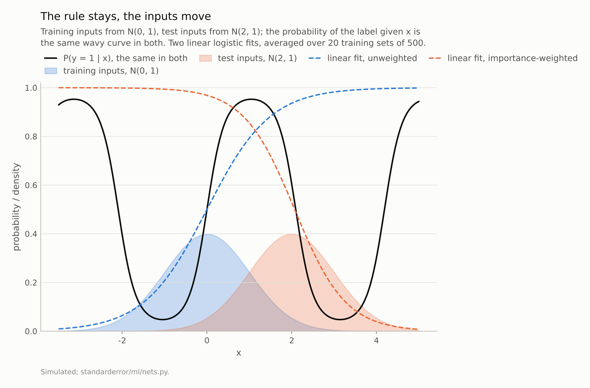
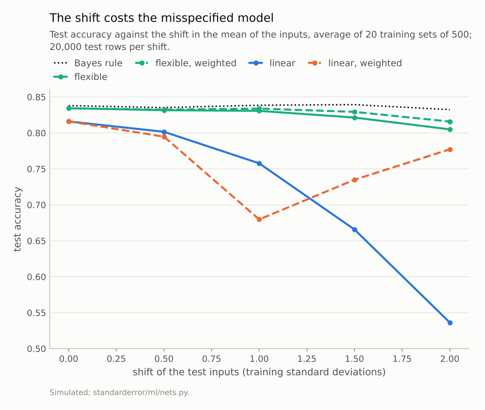
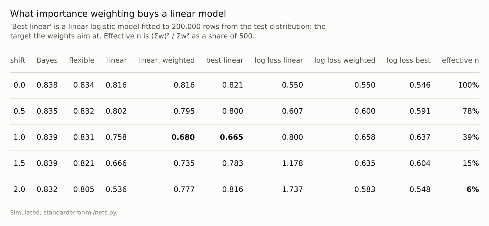

Disclosure: this post was written with the assistance of an AI system (Claude), which wrote the analysis code, ran the experiments and drafted the text. The topic, the constraints, the data choices and the final review are the author's.

*In a simulation where the test inputs move up to two standard deviations while P(y | x) stays fixed, the Bayes accuracy stays between 0.832 and 0.839. A flexible spline logistic model stays within 0.018 of it up to a shift of 1.5 and loses 0.027 at 2. A linear logistic model falls from 0.816 to 0.536. Importance weighting moves the line towards the best linear model for the test inputs (within 0.048 of its accuracy): lower log loss at every non-zero shift, but lower accuracy at a shift of 1 (0.680 against 0.758), and at a shift of 2 the weights keep an effective 6% of the sample.*

Episode 29 of *Machine Learning, Taught Through What Breaks*. The syllabus and the other episodes: https://jongha-jeon-dev.github.io/standarderror/lectures/

## Only the inputs move

Episode 28 ended with a model that met inputs it had not been shown. That is the normal condition of a deployed model: the population it scores drifts away from the one it was trained on. The textbook name for the simplest version is *covariate shift*. The distribution of the inputs changes; the rule that turns inputs into outcomes, P(y | x), does not. The sentence under test is the one usually attached to it: *covariate shift costs accuracy*.

It sounds obvious, but the setting makes it odd. If P(y | x) is unchanged, the best possible classifier is unchanged too: the Bayes rule labels each x the same way in training and in test. A model that had learned the rule would carry on being right. So whatever the shift costs is not the shift's doing alone.

The simulation keeps everything visible. The input x is one number, drawn from N(0, 1) in training and from N(s, 1) in test, for shifts s from 0 to 2. The label is 1 with probability sigmoid(3 sin(1.5x)), the same wavy curve everywhere. Two models are fitted to 500 training rows, twenty times over: a linear logistic regression, which cannot follow the wave, and a logistic regression on cubic spline features, which can.

```python
from standarderror.ml import nets

rows = nets.covariate_shift()        # 500 training rows, 20 repetitions
for r in rows:
    print(f"shift {r['shift']:.1f}  Bayes {r['bayes']:.3f}  "
          f"flexible {r['acc_flex']:.3f}  linear {r['acc_linear']:.3f}")
```

```text
shift 0.0  Bayes 0.838  flexible 0.834  linear 0.816
shift 0.5  Bayes 0.835  flexible 0.832  linear 0.802
shift 1.0  Bayes 0.839  flexible 0.831  linear 0.758
shift 1.5  Bayes 0.839  flexible 0.821  linear 0.666
shift 2.0  Bayes 0.832  flexible 0.805  linear 0.536
```

The Bayes accuracy stays between **0.832** and **0.839** at every shift: the task does not get harder. The flexible model stays within 0.018 of it up to a shift of 1.5. The linear model loses more at every step and ends at **0.536**, not far above a coin.



*Unweighted, the line fits the rising stretch where the training data are and keeps rising where the test data are; on N(2, 1) it is right on 53.6% of rows. Weighted, it fits the falling stretch (77.7%).*

## Why the line breaks and the spline does not

The figure above shows what the linear model did. Most training inputs sit between −1 and 1, where the wave climbs from its trough to its peak, so the best line through them rises. In the test region around x = 2 the wave has turned over and is falling. The line, still rising, predicts class 1 where class 0 is now the more likely label.

Nothing about the line was wrong *for the training distribution*. It was the best linear approximation to the wave over N(0, 1), and the best linear approximation depends on where the inputs are. When the inputs move, the best line moves, and the fitted one does not. That is the whole mechanism: covariate shift hurts a model by exposing the places where it was approximating, and a misspecified model approximates everywhere.

The spline model follows the wave where it has data, so its errors in the test region are mostly the irreducible ones. It does lose something at the largest shift, 0.027 of accuracy at s = 2, plausibly because the right tail of the test distribution reaches x = 4 and beyond, where the training data have almost no points and the spline extrapolates linearly; the mechanism was not isolated. Shift far enough and every model is extrapolating. The difference is how early the cost starts. For the line it starts at the first step.

Calibration says the same thing more loudly. The linear model's expected calibration error at s = 2 is 0.44: its probabilities are confidently pointed the wrong way. The spline's is 0.08.



*The best possible accuracy barely moves (0.832 to 0.839). The flexible model loses 0.027 at a shift of 2; the linear one loses 0.296.*

## Importance weighting does what it says

The standard remedy is to weight each training row by how much more likely its x is under the test distribution than under the training one, w(x) = p_test(x) / p_train(x). Here the ratio is known exactly; in practice it has to be estimated, which is a second source of error this simulation leaves out. Weighted, the training loss becomes an unbiased estimate of the test loss, and the fitted model aims at the best model *for the test inputs*.

```python
for r in rows:
    print(f"shift {r['shift']:.1f}  accuracy {r['acc_linear']:.3f} -> "
          f"{r['acc_linear_iw']:.3f}  log loss {r['nll_linear']:.3f} -> "
          f"{r['nll_linear_iw']:.3f}  effective n {r['ess']:.0%}")
```

```text
shift 0.0  accuracy 0.816 -> 0.816  log loss 0.550 -> 0.550  effective n 100%
shift 0.5  accuracy 0.802 -> 0.795  log loss 0.607 -> 0.600  effective n 78%
shift 1.0  accuracy 0.758 -> 0.680  log loss 0.800 -> 0.658  effective n 39%
shift 1.5  accuracy 0.666 -> 0.735  log loss 1.178 -> 0.635  effective n 15%
shift 2.0  accuracy 0.536 -> 0.777  log loss 1.737 -> 0.583  effective n 6%
```

The weighted log loss is lower than the unweighted at every non-zero shift (at zero the weights are all 1 and change nothing), and the table below shows it moving towards a linear model fitted to 200,000 rows drawn from the test distribution itself, the target the weights aim at: within 0.048 of its accuracy and 0.035 of its log loss, closer at small shifts than at large ones. At s = 2 the weights turn the line around, and accuracy goes from 0.536 to 0.777.

At s = 1 accuracy goes the other way, from 0.758 to 0.680. This is not the weights failing. The best linear model for N(1, 1) inputs, by log loss, is a nearly flat line (it scores 0.665 itself), because over that range the wave rises and falls about equally. Log loss rewards a line that hedges near 0.5; accuracy rewards one that commits. Importance weighting fixes the loss it is given, and when the model is misspecified, the loss-optimal and the accuracy-optimal models are different models.



*The weighted model moves towards the best linear model, coming within 0.048 of its accuracy and 0.035 of its log loss at every shift. The best linear model at a shift of 1 is a worse classifier than the unweighted one.*

## The price of the weights

Weights are not free. A weighted sample of 500 rows carries less information than 500 rows, and Kong's effective sample size, (Σw)² / Σw², measures how much less. At a shift of 1 it is 39% of the sample. At 1.5 it is 15%, and at 2 it is **6%**: a few rows in the training set's right tail carry most of the weight, and the fit is effectively made from about 32 of them.

That is why the weighted linear model's accuracy varies more from one training set to the next: its standard deviation over the twenty repetitions is 0.069 at s = 2 against 0.001 unweighted. The weights buy a smaller bias with a larger variance, and the effective sample paying for it shrinks at every step of the shift. When the test inputs lie where the training data have none, there is nothing to reweight.

For the flexible model the weights make little difference in the region it can already follow, and a small one at s = 2: 0.805 unweighted, 0.816 weighted, with the spread across repetitions falling from 0.063 to 0.015. That is the extrapolating tail again: weighting puts more of the fit's attention on the few rows near the test region, which plausibly steadies what the splines do just beyond them. The mechanism was not isolated here.

## Where this breaks

**The weights were exact.** Both densities were known. In practice the ratio is estimated, with a classifier trained to tell training from test inputs or a density-ratio method, and estimated weights add their own variance, worst exactly where the true weights are largest.

**Only the inputs moved.** If P(y | x) changes as well, the setting is concept shift and none of this applies: the Bayes rule itself moves, and no reweighting of old labels can learn the new one. In real drift the two usually come together, and telling them apart needs labelled data from the new population.

**One dimension.** In one dimension the flexible model sees the whole range it will be tested on, up to the tail. In many dimensions a shift can move the inputs to combinations no training row came near, and every model extrapolates there. The lesson that misspecification is what the shift charges for still holds; a flexible model just runs out of support sooner.

**A periodic rule.** The wave was chosen so a line would fail. Where the true rule is close to linear over both ranges, a linear model loses little to the shift and weighting has nothing to correct.

## What to keep

1. Under covariate shift the best possible accuracy need not change. Here the Bayes accuracy stayed between 0.832 and 0.839 while the inputs moved two standard deviations.

2. What the shift costs is the model's misspecification, exposed. A flexible model stayed within 0.018 of Bayes up to a shift of 1.5; a linear one fell from 0.816 to 0.536.

3. Importance weighting refits the model for the test inputs. It lowered log loss at every non-zero shift and moved towards the best linear model for the test distribution (within 0.048 of its accuracy), which at a shift of 1 was a worse classifier (0.680 against 0.758).

4. The weights shrink the sample: at a shift of 2 the effective sample was 6% of 500 rows.

5. Before reweighting, check whether a more flexible model makes the shift harmless, and check the effective sample size of the weights before trusting what they produce.

## Exercise

Take a model in production and split its recent scoring data by some input that has drifted: newer customers, a new region, a new device. Train a classifier to tell training inputs from recent ones, and turn its probabilities into weights.

Compute the effective sample size of those weights. If it is a few percent, the recent population sits where your training data are thin, and no weighting will rescue the model there. Then refit with a more flexible model and see whether its accuracy on the recent rows (once labels arrive) falls less than the current one's did.

## Next

One episode of this arc remains. Every network in this arc was small enough to train many times, which is what let each claim be measured across runs. The last episode of Arc VI climbs a ladder of model sizes and tests the sentence that justifies training very large ones: that loss falls as a power law of model size, so small models predict what large ones will do.

---

### Data

- Simulated: x ~ N(0, 1) in training and N(shift, 1) in test, P(y = 1 | x) = sigmoid(3 sin(1.5 x)) in both; 500 training rows, 20 repetitions, 20,000 test rows per shift.
- Machinery: `standarderror/ml/nets.py`, tested in `tests/test_ml.py`; scikit-learn's LogisticRegression, alone and on SplineTransformer features (8 knots, cubic, linear extrapolation, C = 10).
- Where this stops: Shimodaira, "Improving predictive inference under covariate shift by weighting the log-likelihood function", *Journal of Statistical Planning and Inference* (2000); Sugiyama, Krauledat and Müller, "Covariate shift adaptation by importance weighted cross validation", *JMLR* (2007); Kong, "A note on importance sampling using standardized weights" (1992), for the effective sample size.

### Reproducibility

- **environment**: standarderror=0.1.0, python=3.13.16, numpy=2.4.4
- **code blocks**: executed at build time; the values the prose quotes are pinned, so drift fails the build
- **determinism**: training sets from seeds 0 to 19, test rows from seed 999, the best-linear reference from seed 7

Code: <https://github.com/jongha-jeon-dev/standarderror>
