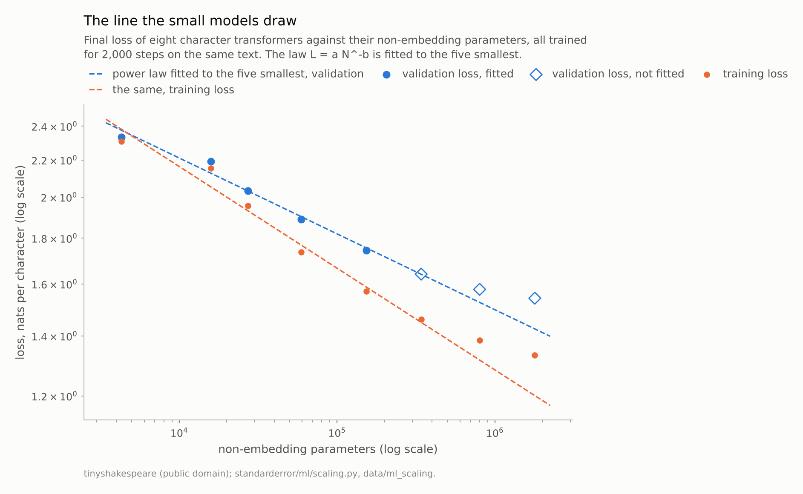
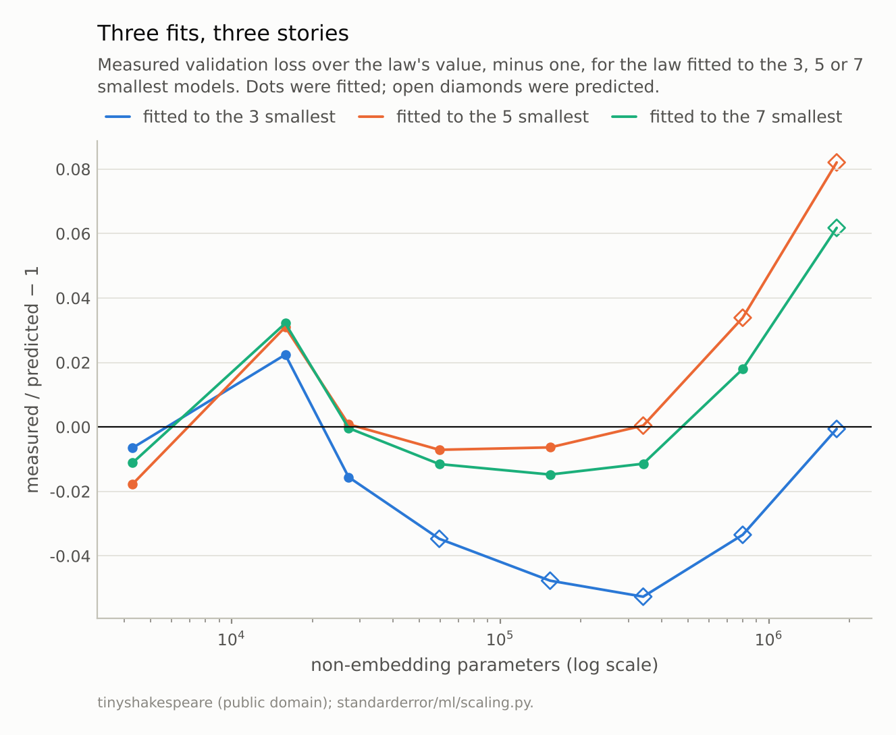
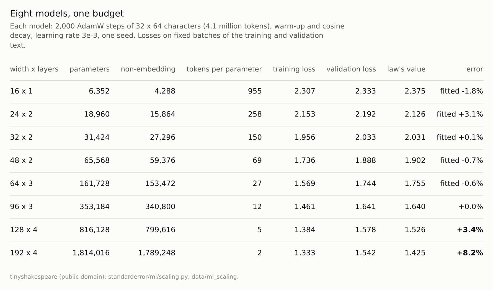

Disclosure: this post was written with the assistance of an AI system (Claude), which wrote the analysis code, ran the experiments and drafted the text. The topic, the constraints, the data choices and the final review are the author's.

*Eight character-level transformers from 4,288 to 1,789,248 non-embedding parameters were trained for the same 2,000 steps on the same million characters of Shakespeare (4.1 million characters seen). A power law L = 4.82 N^-0.085 fitted to the five smallest models' validation loss predicted the sixth to +0.04%, the seventh to +3.4% and the eighth to +8.2%, each measured loss higher than predicted. Training loss bent the same way, so the miss is not mainly overfitting. A floor fitted to the five small models came out at 0.00; fitted to all eight, at 0.86. The floor is set by the fixed data and training budget, and the small models never come near it.*

Episode 30 of *Machine Learning, Taught Through What Breaks*. The syllabus and the other episodes: https://jongha-jeon-dev.github.io/standarderror/lectures/

## The bet behind large models

Episode 29 measured what a model loses when its inputs move away from its training data. The last episode measures a more ambitious extrapolation: from small models to large ones. The sentence under test is the one that justifies building large language models at all: *scaling laws predict performance*. Kaplan and colleagues found in 2020 that a language model's loss falls as a power of its parameter count, L = a N^(-b), over many orders of magnitude, so that a line drawn through cheap small models says what an expensive large one will achieve before it is trained.

The ladder here is eight character-level transformers trained on Shakespeare, from 4,288 to 1,789,248 parameters outside the embeddings (the count Kaplan's law uses). Every one gets the same recipe: 2,000 steps of AdamW with the same schedule over the same million-character training text, 4.1 million characters in all, about four passes. The ladder took 1.9 hours on two CPU threads, so its results are committed to the repository and read back here:

```python
from standarderror.ml import scaling as sc

r = sc.results()     # written by scripts/train_scaling.py
for run in r["runs"]:
    print(f"{run['width']:3d} wide x {run['layers']} layers: "
          f"{run['non_embedding']:7,d} parameters, training loss "
          f"{run['final_train']:.3f}, validation {run['final_val']:.3f}")
```

```text
 16 wide x 1 layers:   4,288 parameters, training loss 2.307, validation 2.333
 24 wide x 2 layers:  15,864 parameters, training loss 2.153, validation 2.192
 32 wide x 2 layers:  27,296 parameters, training loss 1.956, validation 2.033
 48 wide x 2 layers:  59,376 parameters, training loss 1.736, validation 1.888
 64 wide x 3 layers: 153,472 parameters, training loss 1.569, validation 1.744
 96 wide x 3 layers: 340,800 parameters, training loss 1.461, validation 1.641
128 wide x 4 layers: 799,616 parameters, training loss 1.384, validation 1.578
192 wide x 4 layers: 1,789,248 parameters, training loss 1.333, validation 1.542
```

Validation loss falls with every step up the ladder, from 2.333 to 1.542 nats per character.

## Five models, one line

Fit the law to the five smallest models, then ask it about the three it has not seen:

```python
small = r["runs"][:5]
law = sc.fit([x["non_embedding"] for x in small],
             [x["final_val"] for x in small], floor=False)
print(f"L = {law['a']:.3f} N^-{law['b']:.4f}")
for run in r["runs"][5:]:
    guess = sc.predict(law, run["non_embedding"])
    print(f"{run['non_embedding']:7,d} parameters: predicted "
          f"{guess:.3f}, measured {run['final_val']:.3f}")
```

```text
L = 4.821 N^-0.0846
340,800 parameters: predicted 1.640, measured 1.641
799,616 parameters: predicted 1.526, measured 1.578
1,789,248 parameters: predicted 1.425, measured 1.542
```

The exponent is 0.085. The sixth model, 2.2 times the size of the fifth, comes in at **+0.04%** from the prediction: the law did exactly what it is famous for. The seventh, 5.2 times the fifth, is +3.4% off; the eighth, 12 times, is **+8.2%** off. Every miss is in the same direction: the large models are worse than the line promised.

A more cautious analyst would fit on fewer models and check on more, and might be reassured. Fitted to the three smallest models, the law's exponent is 0.070, and its prediction for the largest model, 66 times the third, is off by only **-0.1%**. But the second figure shows how it got there. For the four models in between, the three-model law was too *pessimistic*, by as much as 5.3%: its slope was too shallow for the middle of the ladder, and the bend at the top happened to cancel it. Fitted to seven models, the law misses the eighth, only 2.2 times the seventh, by +6.2%.

One correct prediction is not evidence that the law holds. The residuals are: across the ladder they curve, first below the line and then above it, and no straight line on log-log axes can follow a curve.



*The sixth model lands on the line (+0.0%). The largest, 12 times the fifth, is +8.2% off.*



*Fitted to three models, the law is too pessimistic for the middle of the ladder and lands on the largest by cancellation (-0.1%). Fitted to seven, it misses the eighth by +6.2%.*

## Not mainly overfitting

The obvious suspect is overfitting. The largest models have more parameters than the training text has characters to constrain them, and the gap between training and validation loss does widen up the ladder, from 0.026 for the smallest model to 0.210 for the largest.

But the same law fitted to training loss misses in the same direction: the seventh and eighth models' training losses are +5.2% and +11.0% above what the five smallest predict. A model that was merely overfitting would do *better* than the line on the data it trained on. These do worse on both. They are not learning as much per parameter as the small ones did, on any data.

The table says why. The number of training characters seen per non-embedding parameter falls from 955 for the smallest model to **2.3** for the largest. Hoffmann and colleagues found that a compute-efficient language model sees on the order of twenty tokens per parameter. The small models here are trained far past that point; the two largest, at 5.1 and 2.3, have been given the same budget and stopped well short of it. Kaplan's law in N describes models that are not limited by data or training; the ladder's largest rungs are limited by both.



*The first five rows fix the law; the last three test it. Tokens per parameter is the number of training characters seen per non-embedding parameter.*

## The floor the small models cannot see

The standard repair, which episode 4 tried on learning curves, is to fit a floor: L = a N^(-b) + c, where c is the loss no model size can get below with this data and this budget. Fitted to the five small models and to all eight:

```python
floor = sc.fit([x["non_embedding"] for x in small],
               [x["final_val"] for x in small])        # a N^-b + c
everyone = sc.fit([x["non_embedding"] for x in r["runs"]],
                  [x["final_val"] for x in r["runs"]])
print(f"floor fitted to the 5 smallest: c = {floor['c']:.3f}")
print(f"floor fitted to all {len(r['runs'])}:     c = {everyone['c']:.3f}")
```

```text
floor fitted to the 5 smallest: c = 0.000
floor fitted to all 8:     c = 0.855
```

From the five small models the fitted floor is 0.000: in their range the curve is still a straight line on log-log axes, and there is nothing to estimate a floor from. With all eight, the floor is 0.86, and the curve bends towards it. The information that the curve bends lives only in the models that have already bent, which are exactly the models the law was supposed to make unnecessary.

That is episode 4's finding, met again at a larger scale. There a learning curve fitted early was optimistic in all nine fits, and adding a floor fixed only the curves that had already bent. Here the law fitted to five small models was optimistic about every model past the sixth, and the floor could not be seen from them. The arithmetic is the same: a power law extrapolated past the range that determined it assumes nothing new happens there, and in a fixed budget of data and steps, something always does.

## Where this breaks

**One budget for every model.** The laws used to plan large models are fitted to models that are each trained with enough data and compute for their size, or along a compute-optimal frontier. This ladder holds the budget fixed on purpose, which is the setting in which a law in N alone is misspecified. A ladder with data growing alongside the models would bend later, or not at all in this range.

**Small models, one seed each.** From four thousand to two million non-embedding parameters, each trained once. The run-to-run spread was not measured; the sixth model's agreement with the line, to a fraction of a percent, may be partly luck, but the misses on the last two grow steadily with size, which seed noise would not do.

**One learning rate.** Every model used 3e-3. Larger models often want smaller rates, and part of the shortfall at the top of the ladder may be a rate that suits the small models better.

**Character-level Shakespeare.** A million characters of one author is a narrow distribution with a low ceiling on what any model can learn from it. Kaplan's laws were measured on billions of tokens of web text, where the floor is far away.

## What to keep

1. A power law fitted to five small models predicted the next size to +0.04%. Scaling laws do predict, over a short reach.

2. Over a longer reach they were optimistic: +3.4% for a model 5.2 times the largest fitted, +8.2% for one 12 times. A law fitted to three models hit the largest by cancelling two errors, and one fitted to seven missed it by +6.2%: judge a law by its residuals, not by one hit.

3. Training loss missed the same way, so the cause was not mainly overfitting. With a fixed budget, characters per parameter fell from 955 to 2.3, and the largest models were limited by data and steps rather than size.

4. A floor fitted to the small models was 0.000; to all eight, 0.86. Extrapolate a fitted law only as far as the conditions that produced it still hold.

## Exercise

Take three or four sizes of a model you can train cheaply, each with the same data and the same number of steps, and fit L = a N^-b to their validation loss. Before training the next size up, write down the prediction.

Then train it, and a size beyond. If the second misses by more than the first, compute the training tokens per parameter for each model: the point where the curve leaves the line is usually where that number stops being large.

## Next

This is the last episode of the series. Thirty sentences from the machine-learning curriculum were measured; a few survived as stated, most survived only with a condition attached, and some did not survive at all. The conditions are the useful part. Every one of them is a place where a number that looks like a property of a model turned out to be a property of the model together with its data, its training and the question being asked of it.

---

### Data

- tinyshakespeare (Karpathy's char-rnn collection of Shakespeare, public domain), fetched and checked against a SHA-256 digest by `standarderror/llm/tiny.py`, not committed; the first 90% for training, the last 10% for validation.
- Machinery: `standarderror/ml/scaling.py` and `scripts/train_scaling.py`, whose curves are committed in `data/ml_scaling/results.json`; tested in `tests/test_ml.py`. Pre-norm transformers with 4 heads, context 64, widths 16 to 192 and 1 to 4 layers; AdamW, learning rate 3e-3 with warm-up and cosine decay, weight decay 0.1, batches of 32, 2,000 steps, seed 0.
- Where this stops: Kaplan et al., "Scaling laws for neural language models" (2020); Hoffmann et al., "Training compute-optimal large language models", *NeurIPS* (2022); episode 4 of this series, on learning curves fitted early.

### Reproducibility

- **environment**: standarderror=0.1.0, python=3.13.16, numpy=2.4.4
- **code blocks**: executed at build time against the committed training curves; the values the prose quotes are pinned
- **determinism**: one seed per model, CPU training on two threads; the committed curves record each model's training time

Code: <https://github.com/jongha-jeon-dev/standarderror>
