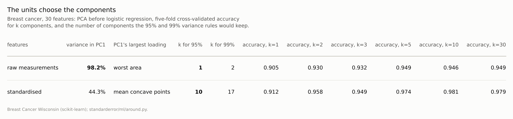
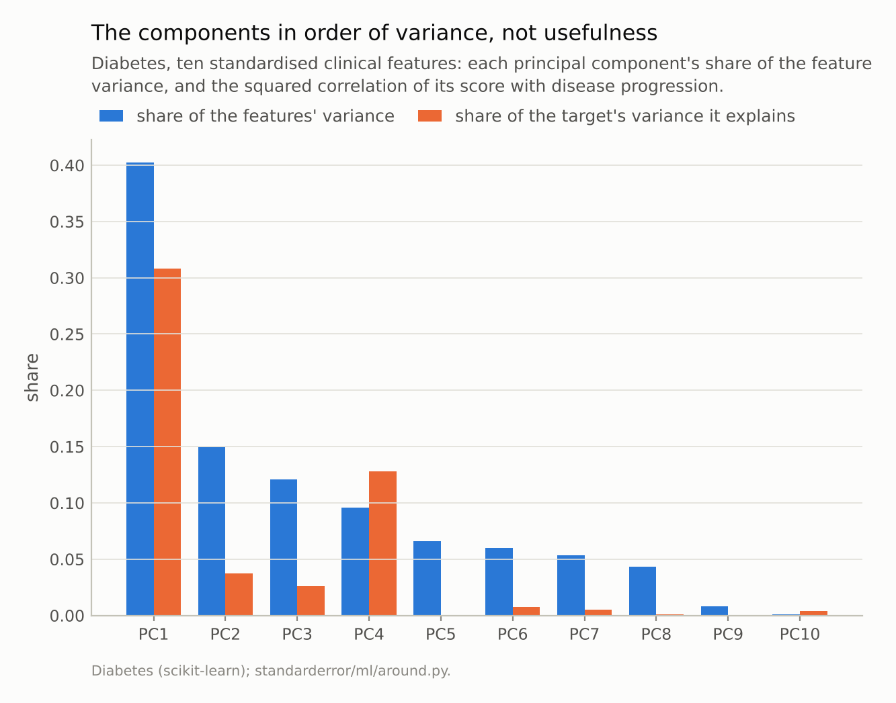
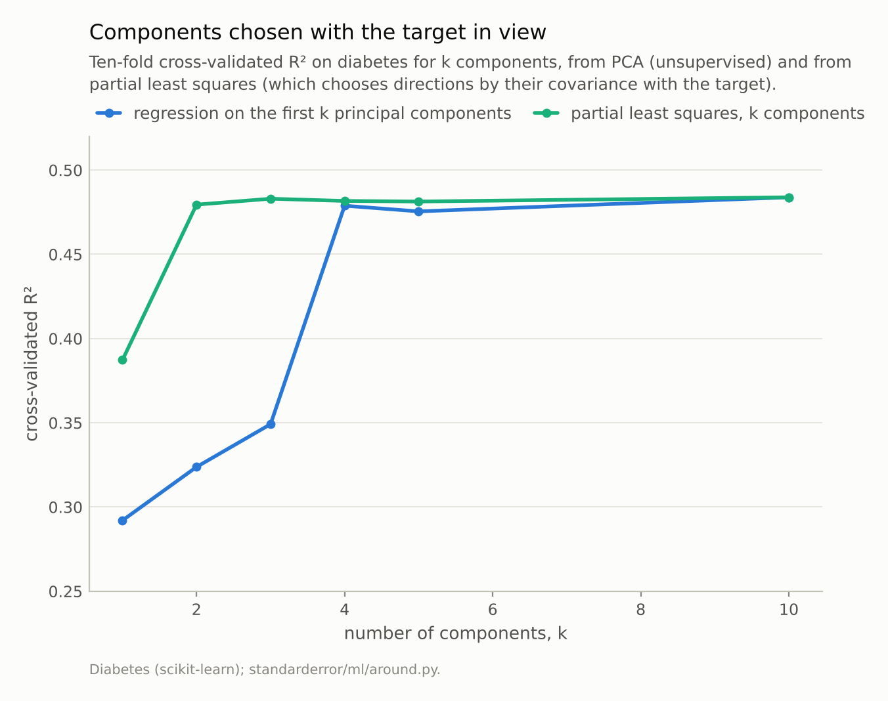

Disclosure: this post was written with the assistance of an AI system (Claude), which wrote the analysis code, ran the experiments and drafted the text. The topic, the constraints, the data choices and the final review are the author's.

*On raw breast-cancer measurements the first principal component holds 98.2% of the variance and is led by worst area, the feature with the largest units; the 95% variance rule keeps 1 component, against 10 on standardised features. On diabetes the fourth component, with 9.6% of the variance, explains 12.8% of the target's, more than the second and third together; regression on three components reaches R² 0.349 and on four 0.479, while partial least squares reaches 0.479 with two. PCA ranks directions by variance, and never sees the target.*

Episode 31 of *Machine Learning, Taught Through What Breaks*. The syllabus and the other episodes: https://jongha-jeon-dev.github.io/standarderror/lectures/

## The step before the model

Thirty episodes measured models: how they are scored, fitted, read and trained. Arc VII turns to the things around a model that are applied as routine and rarely measured: the reduction of the inputs before it, the clusters found without it, the distances it relies on, the probabilities it reports and the search that chose it. The first is principal component analysis, and the sentence that justifies running it before a model: *the first principal components keep the information that matters*.

PCA finds the direction along which the inputs vary most, then the direction of most remaining variance at right angles to it, and so on. Keeping the first few and dropping the rest is the standard way to make a wide data set narrow. Its justification is the word "information": the components that vary most are taken to carry most of it.

The extreme case shows what is being assumed. Ten independent features, with standard deviations from 10 down to 0.3, and a label that depends only on the last and smallest:

```python
from standarderror.ml import around

sim = around.pca_simulation()  # label depends on the smallest feature
print("accuracy with k components: " + " ".join(
    f"{a:.2f}" for a in sim["acc"]))
print(f"variance in the last component: {sim['share'][-1]:.2%}")
```

```text
accuracy with k components: 0.51 0.50 0.50 0.51 0.50 0.50 0.49 0.50 0.53 0.92
variance in the last component: 0.03%
```

With nine components out of ten, logistic regression is at chance. With the tenth, the one holding 0.03% of the variance, it scores **0.915**. This is constructed, and it answers the question in principle: PCA does not know which direction predicts the label, because it never sees the label. Whether that matters on real data is a separate question.

## The units choose the first component

On the breast-cancer data, thirty measurements of cell nuclei:

```python
bc = around.pca_breast_cancer()
for key in ("raw", "std"):
    r = bc[key]
    print(f"{key}: PC1 holds {r['share'][0]:.1%}, led by {r['top']!r}; "
          f"95% rule keeps {r['k95']}, 99% keeps {r['k99']}")
```

```text
raw: PC1 holds 98.2%, led by 'worst area'; 95% rule keeps 1, 99% keeps 2
std: PC1 holds 44.3%, led by 'mean concave points'; 95% rule keeps 10, 99% keeps 17
```

On the raw measurements the first component holds **98.2%** of the variance and is led by worst area. That is not a discovery about tumours. Area is measured in square pixels and runs into the thousands, while smoothness and concavity are fractions near zero, so area's variance is millions of times larger and PCA, which counts variance in the units it is given, puts it first. The 95% variance rule keeps 1 component: in effect, the size of the largest nucleus.

Standardise the features and the same rule keeps 10 components, the first holding 44.3%. The table below shows what the choice does downstream. With one raw component, logistic regression scores 0.905; with standardised components it reaches 0.981. Standardising is usually recommended before PCA for exactly this reason, and it is worth seeing that it is not a technicality. It is the decision about what "variance" means, and the components follow it.



*Nothing about the tumours changed between the rows, only the units in which their variance is counted.*

## The fourth component knows the most

Diabetes comes with its ten features already centred and scaled, so units cannot be the problem. Each component's share of the feature variance, and the share of the target's variance it explains on its own:

```python
d = around.pca_diabetes()
for j, (v, r2) in enumerate(zip(d["share"], d["r2"]), 1):
    print(f"PC{j:<2d} variance {v:5.1%}   target explained {r2:5.1%}")
```

```text
PC1  variance 40.2%   target explained 30.8%
PC2  variance 14.9%   target explained  3.8%
PC3  variance 12.1%   target explained  2.6%
PC4  variance  9.6%   target explained 12.8%
PC5  variance  6.6%   target explained  0.0%
PC6  variance  6.0%   target explained  0.7%
PC7  variance  5.4%   target explained  0.5%
PC8  variance  4.3%   target explained  0.1%
PC9  variance  0.8%   target explained  0.0%
PC10 variance  0.1%   target explained  0.4%
```

The first component explains 30.8% of disease progression. The second and third, which hold 27.0% of the feature variance between them, explain 6.4%. The fourth, smaller than either, explains **12.8%**. A pipeline that keeps "the first three components" keeps two that are nearly useless and drops the one that is not.

The second figure makes it a modelling choice. Regression on the first k components reaches a cross-validated R² of 0.349 with three and **0.479** with four. Partial least squares, which chooses its directions by their covariance with the target instead of by variance alone, reaches 0.479 with two. Jolliffe made the point in 1982 with examples from the literature: components with small variance can be the ones that predict, and dropping them by variance alone is a decision taken without looking at the target.



*PC4 holds 9.6% of the variance and explains **12.8%** of the target; PC2 and PC3 together hold 27.0% and explain 6.4%.*



*Partial least squares reaches R² 0.479 with two components; PCA needs four (0.479).*

## Choosing k by the target instead

The repair inside PCA's own terms is to treat the number of components as a setting to tune, scored on held-out data, instead of a share of variance to reach. On diabetes that repair works, and it is revealing what it chooses. Cross-validated R² is 0.292 with one component, 0.349 with three, 0.479 with four, 0.475 with five and 0.484 with all ten. A search over k lands at four or more, within 0.005 of using every component.

So once the target is allowed to choose, it keeps at least four components, and the reduction buys little: four do almost as well as ten. What the target adds is the knowledge of where to stop. A rule that looked only at variance, and stopped where the second and third components had brought the total near two-thirds, would have stopped one component short of the one that matters. On breast cancer the same search on standardised components finds its best at 10 components, scoring 0.981, where the 99% variance rule would have kept 17. The two rules need not agree, because they answer different questions: one asks how much of the inputs is kept, the other how much of the prediction.

## What PCA is good for

None of this makes PCA a bad tool. It makes it a tool for a different job. When the goal is to describe the inputs (to compress images, to plot a high-dimensional data set, to remove near-collinear redundancy) variance is the right criterion, and the leading components are the right ones to keep. When the inputs happen to vary most along the directions that matter, PCA before a model costs little; the point is that nothing guarantees it.

When the goal is prediction, the number of components is a hyperparameter like any other: choose it by cross-validated performance, not by a share of variance, and fit the PCA inside the folds. And if the reduction itself should serve the prediction, a supervised method (partial least squares, or simply a regularised model on all the features) uses the target to decide what to keep.

## Where this breaks

**Linear structure only.** PCA, PLS and the models after them are linear here. A target that depends on a nonlinear function of the inputs can be invisible to every linear component.

**Small data sets.** Thirty features and ten features. With hundreds of features and few rows, the variance ranking itself is noisy, and the case for some reduction before the model is stronger, whichever kind.

**One target per data set.** A component that does not predict this target can predict another. PCA's neutrality about the target is a cost for one prediction task and a benefit when the reduced features serve many.

**The simulation is extreme by design.** It shows the mechanism, not its frequency. The diabetes result is the measure of how often it bites: once in four components, on a standard teaching data set.

## What to keep

1. PCA ranks directions by the variance of the inputs, in their units. On raw breast-cancer data the first component held 98.2% of the variance and was led by worst area; the 95% rule kept 1 component raw and 10 standardised.

2. Variance is not relevance. On diabetes, the fourth component explained 12.8% of the target, more than the second and third together.

3. Regression on three components reached R² 0.349, on four 0.479; partial least squares reached 0.479 with two.

4. Before a model, choose the number of components by cross-validated performance, standardise deliberately, and consider a method that sees the target.

## Exercise

Take a data set you have reduced with PCA before modelling. For each component, compute its share of the input variance and its correlation with the target, and list them side by side.

If a component outside the ones you kept has a larger correlation than one inside, refit with the number of components chosen by cross-validation and compare. Then try the same model on all the features with a regularisation penalty, which often makes the reduction unnecessary.

## Next

PCA summarises the inputs without the target. Clustering goes further and invents a target: groups the data are said to fall into. Episode 32 asks whether k-means finds the clusters that are there, and whether the usual scores can tell when there are none.

---

### Data

- Breast Cancer Wisconsin (Diagnostic), CC BY 4.0, and the diabetes data of Efron et al. (2004), both as bundled with scikit-learn; the diabetes features come mean-centred and scaled.
- Simulated: ten independent normal features with standard deviations 10 down to 0.3, the label set by the last; 2,000 rows.
- Machinery: `standarderror/ml/around.py`, tested in `tests/test_ml.py`; scikit-learn's PCA, LogisticRegression, LinearRegression and PLSRegression, five- and ten-fold cross-validation with PCA fitted inside the folds.
- Where this stops: Jolliffe, "A note on the use of principal components in regression", *Journal of the Royal Statistical Society C* (1982); Hastie, Tibshirani and Friedman, *The Elements of Statistical Learning*, section 3.5.

### Reproducibility

- **environment**: standarderror=0.1.0, python=3.13.16, numpy=2.4.4
- **code blocks**: executed at build time; the values the prose quotes are pinned, so drift fails the build
- **determinism**: simulation seed 0; shuffled folds with random_state 0

Code: <https://github.com/jongha-jeon-dev/standarderror>
