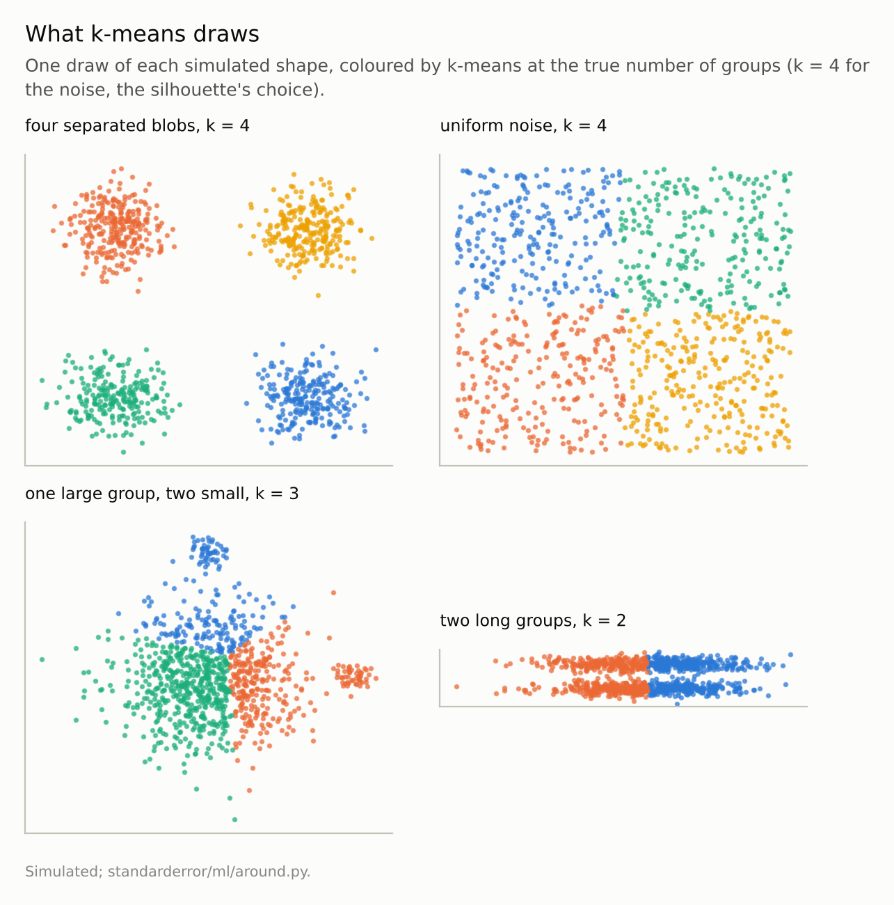
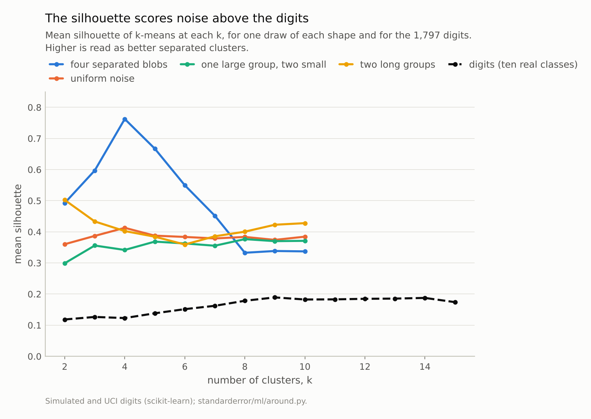
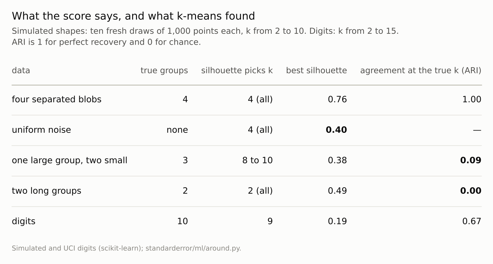

Disclosure: this post was written with the assistance of an AI system (Claude), which wrote the analysis code, ran the experiments and drafted the text. The topic, the constraints, the data choices and the final review are the author's.

*Over ten draws of four simulated shapes, k-means recovered four separated round blobs (adjusted Rand index 1.00) and the silhouette chose k = 4 each time. On uniform noise, with no clusters, the silhouette also chose k = 4 each time, with a score of 0.40; on the 1,797 digits, which have ten classes, it never passed 0.19. On one large group and two small ones it chose 8 to 10 clusters and k-means at the true k scored ARI 0.09; on two long parallel groups it chose the true k and k-means cut across them, ARI 0.00. On the digits, single starts ranged from ARI 0.57 to 0.68.*

Episode 32 of *Machine Learning, Taught Through What Breaks*. The syllabus and the other episodes: https://jongha-jeon-dev.github.io/standarderror/lectures/

## Groups the data were never labelled with

Episode 31 reduced the inputs without looking at a target. Clustering goes further and invents one: it assigns each row to a group, and the groups are then named, profiled and acted on as if they had been found in the data. The most used algorithm is k-means, and the sentence under test is how it is usually described: *k-means finds the clusters in the data*.

k-means does one thing exactly. Given k, it places k centres so that the sum of squared distances from each point to its nearest centre is as small as it can find, and assigns each point to that centre. Whether the result is "the clusters" depends on whether the data contain groups of the kind that criterion rewards. The number k has to be chosen too, and the usual tool is the silhouette, which compares each point's distance to its own cluster with its distance to the next nearest, averaged over points: 1 for tight, well-separated clusters, 0 for points on a boundary.

Four simulated shapes, each drawn ten times, put both to the test. The first has what k-means looks for: four round, equally spread blobs, well apart. The second has nothing: points uniform on a square. The third has a large diffuse group and two small tight ones. The fourth has two long parallel groups.

```python
from standarderror.ml import around

r = around.kmeans_shapes()      # ten draws of each shape
for name, v in r.items():
    ari = "  -  " if v["ari"] is None else f"{v['ari']:.3f}"
    print(f"{name:10s} silhouette picks k = {sorted(set(v['picks']))}, "
          f"best silhouette {v['silhouette']:.3f}, ARI at true k {ari}")
```

```text
separated  silhouette picks k = [4], best silhouette 0.759, ARI at true k 1.000
uniform    silhouette picks k = [4], best silhouette 0.403, ARI at true k   -  
unequal    silhouette picks k = [8, 9, 10], best silhouette 0.379, ARI at true k 0.086
elongated  silhouette picks k = [2], best silhouette 0.487, ARI at true k 0.001
```

On the separated blobs everything works: the silhouette chooses k = 4 in all ten draws, and k-means recovers the blobs with an adjusted Rand index of **1.00**, where 1 is perfect and 0 is chance.



*Every panel is cut into convex pieces of similar spread. That is right for the blobs and wrong for the other three, including the square that has no groups at all.*

## A score for noise

On uniform noise there is nothing to find, and both tools find something anyway. k-means cuts the square into k pieces, as it cuts anything. The silhouette chooses k = 4 in all ten draws, with a mean score of **0.40**: four quadrants of a square are compact and their boundaries are short, so by its arithmetic they are decent clusters.

The comparison that matters is with real data that do have classes:

```python
d = around.kmeans_digits()
best = max(d["scan"], key=lambda t: t["silhouette"])
print(f"digits: silhouette peaks at k = {best['k']} "
      f"({best['silhouette']:.3f}); ARI at k = 10: {d['ari10']:.3f}")
print("one start per seed, ARI: " + " ".join(
    f"{x['ari']:.2f}" for x in d["single"]))
```

```text
digits: silhouette peaks at k = 9 (0.189); ARI at k = 10: 0.666
one start per seed, ARI: 0.62 0.67 0.66 0.67 0.66 0.65 0.57 0.67 0.68 0.57
```

On the digits, ten classes written by different people, the silhouette peaks at k = 9 with a score of **0.19**, less than half what it gives the noise. The number of clusters it suggests is about right, and the score itself would be read as weak structure. A practitioner comparing silhouettes across data sets would conclude the square is more clustered than the handwriting.

A silhouette value means nothing without a reference for what it would be with no clusters. That is the idea behind Tibshirani, Walther and Hastie's gap statistic: compare the clustering's fit with the fit on data drawn uniformly over the same range, and claim clusters only when the real data beat the reference by more than its noise. Here, the reference is the second row of the table, and it scores 0.40.



*Uniform noise scores 0.40 at its best k; the digits never pass 0.19.*

## Clusters of the wrong shape

The last two shapes have real groups, of shapes k-means does not draw. With one large diffuse group and two small tight ones, k-means at the true k = 3 scores ARI **0.09**. The large group contributes most of the squared distance, so minimising it pays to spend centres on slicing that group, and the first figure shows the result: the large group cut up, the two small ones not given a centre each. The silhouette makes it worse, choosing between 8 and 10 clusters across the ten draws.

With two long parallel groups, the silhouette chooses the correct k = 2 in every draw, and k-means scores ARI **0.00**. Each group is stretched twelve times as far along its length as across it, and the two lie only 3 apart, so the partition k-means settles on cuts both groups in half across their length instead of separating them. The answer has the right number of clusters and the wrong clusters.

In both cases the algorithm did what it promises. Its promise is convex regions of similar spread around k centres. When the true groups are not shaped like that, k-means returns its own shapes instead, and nothing in its output says so.



*The silhouette was right about k in two cases out of four, and k-means was right about the groups in one.*

## And the starting point

k-means finds a local minimum, and which one depends on where the centres start. On the digits, ten runs with a single random start each gave ARIs from 0.57 to 0.68. scikit-learn's default of several starts, keeping the one with the smallest within-cluster sum of squares, gave 0.67. The groups a single run reports are partly an accident of its seed, which is the clustering version of episode 20's networks that differed only in their seed.

Keeping the start with the smallest sum of squares is the right rule for k-means' own objective, and it is worth seeing how loosely that objective tracks the digits' real classes. Ranked by sum of squares, the best of the ten single starts agreed with the true digits at ARI 0.66; the start that agreed best, at 0.68, ranked 8 of 10 by sum of squares. A lower sum of squares is a better k-means solution, not a better account of the handwriting.

## Where this breaks

**Two dimensions.** The shapes were drawn in the plane so they could be seen. In many dimensions the same failures happen and cannot be seen, which is the argument for checking clusters against a null reference instead of by eye.

**Other algorithms draw other shapes.** Gaussian mixtures allow ellipses of different sizes, and density-based methods such as DBSCAN are designed to follow groups of any shape and leave sparse regions unclustered. They were not run here, and each has its own assumptions and its own failures.

**Raw pixels for the digits.** Clustering the digits after scaling or on learned features would change both the silhouette and the ARI. The comparison with the uniform square is about what the score means, not about the best possible clustering of handwriting.

**Silhouette only.** The elbow of the within-cluster sum of squares, the other common rule, has the same blind spot: the sum falls with k on any data, including noise.

## What to keep

1. k-means returns k convex pieces of similar spread on any data. It recovered separated round blobs (ARI 1.00) and nothing else here.

2. The silhouette rates the pieces, not the presence of groups. Uniform noise scored 0.40 at its chosen k; the digits never passed 0.19.

3. Groups of the wrong shape are cut wrongly: ARI 0.09 for one large group and two small, 0.00 for two long ones, with the silhouette picking 8 to 10 clusters for the first.

4. Compare any clustering score with its value on structureless data of the same range, use several starts, and check whether the cluster shapes the algorithm assumes are plausible for the data.

## Exercise

Take a clustering you have used and rerun it on a reference data set: each column drawn uniformly between that column's minimum and maximum, independently of the others. Compute the same quality score on both.

If the reference scores close to the real data, the clusters you reported are mostly the algorithm's partition of space, not groups in the data. Then rerun k-means with ten different single starts and count how many rows change cluster.

## Next

Clustering and nearest-neighbour methods both rest on distances. Episode 33 asks what happens to distance as the number of dimensions grows, and whether the curse of dimensionality is about the number of columns or about something else.

---

### Data

- Simulated two-dimensional shapes, 1,000 points each, ten draws (seeds 0 to 9): four unit-variance blobs 8 apart; uniform on the unit square; 900 points with sd 1.5 and two groups of 50 with sd 0.3; two groups of 500 stretched 12 times along one axis, 3 apart along the other.
- Optical Recognition of Handwritten Digits (UCI), as bundled with scikit-learn, CC BY 4.0; 1,797 images, raw pixels.
- Machinery: `standarderror/ml/around.py`, tested in `tests/test_ml.py`; scikit-learn's KMeans (ten starts unless stated), silhouette_score and adjusted_rand_score.
- Where this stops: MacQueen, "Some methods for classification and analysis of multivariate observations" (1967); Rousseeuw, "Silhouettes", *Journal of Computational and Applied Mathematics* (1987); Tibshirani, Walther and Hastie, "Estimating the number of clusters in a data set via the gap statistic", *JRSS B* (2001).

### Reproducibility

- **environment**: standarderror=0.1.0, python=3.13.16, numpy=2.4.4
- **code blocks**: executed at build time; the values the prose quotes are pinned, so drift fails the build
- **determinism**: data seeds 0 to 9; KMeans random_state 0, or 0 to 9 for the single-start runs

Code: <https://github.com/jongha-jeon-dev/standarderror>
