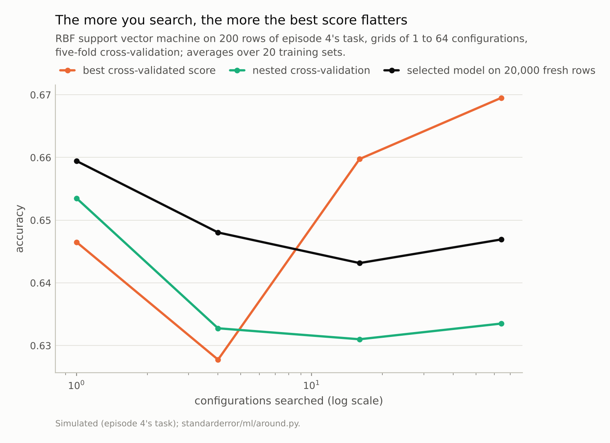
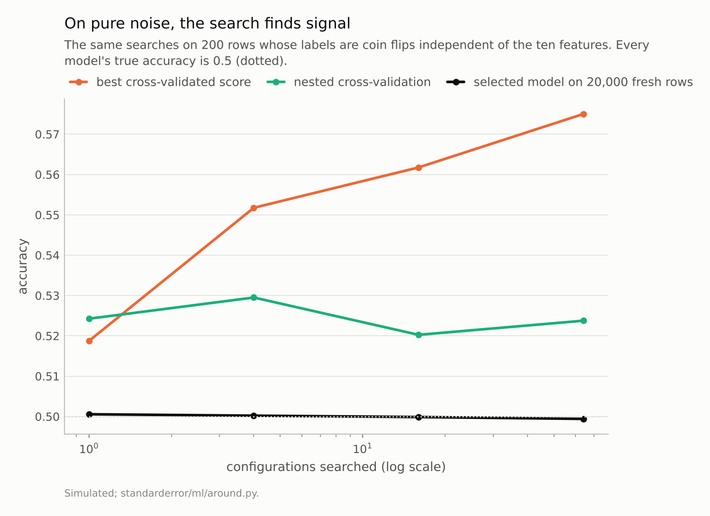
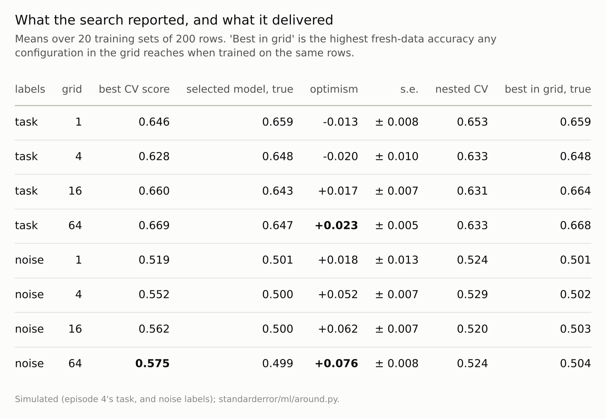

Disclosure: this post was written with the assistance of an AI system (Claude), which wrote the analysis code, ran the experiments and drafted the text. The topic, the constraints, the data choices and the final review are the author's.

*Grid searches of an RBF support vector machine on 200 rows of a simulated task, twenty times per grid size. Untuned, the cross-validated score was 0.013 below the model's accuracy on 20,000 fresh rows. With 64 configurations the best score was 0.023 above it (0.669 against 0.647), and the selected model did no better on fresh data than the untuned default (0.659). On labels that were pure noise, the best of 64 scores averaged 0.575 for models whose true accuracy was 0.499. Nested cross-validation gave 0.633 and 0.524.*

Episode 35 of *Machine Learning, Taught Through What Breaks*. The syllabus and the other episodes: https://jongha-jeon-dev.github.io/standarderror/lectures/

## The score that chose the model

Every model in this series was chosen by something: a learning rate, a depth, a regularisation strength, a number of components or clusters. Episode 34 ended with a correction fitted on held-out rows; this episode measures the most common fitting-on-held-out-rows of all, the hyperparameter search. A grid of configurations is cross-validated, the one with the best score is kept, and the best score is reported as the estimate of how well the model will do. That last step is the sentence under test: *the best cross-validated score estimates how well the tuned model will do*.

Episode 2 found that cross-validation estimates the average error of a procedure, not of one fitted model. Here the question is narrower and has a sharper answer. A support vector machine with an RBF kernel has two settings, C and gamma. On 200 rows of episode 4's simulated task, grids of 1, 4, 16 and 64 configurations are each searched by five-fold cross-validation. The winner is refitted on all 200 rows and scored on 20,000 fresh rows, which is its true accuracy to within a few thousandths. The whole thing is repeated on twenty training sets.

```python
from standarderror.ml import around

for r in around.tuning_optimism():   # 200 rows, 20 repetitions
    print(f"{r['size']:3d} configurations: best CV {r['best_cv']:.3f}, "
          f"true {r['true']:.3f}, nested {r['nested']:.3f}")
```

```text
  1 configurations: best CV 0.646, true 0.659, nested 0.653
  4 configurations: best CV 0.628, true 0.648, nested 0.633
 16 configurations: best CV 0.660, true 0.643, nested 0.631
 64 configurations: best CV 0.669, true 0.647, nested 0.633
```

With one configuration, the untuned default, there is no search, and the cross-validated score is 0.646 against a true 0.659: slightly *pessimistic*, as cross-validation usually is, because each fold trains on four-fifths of the rows. With 64 configurations the best score is **0.669** and the selected model's true accuracy **0.647**: the estimate is now optimistic by 0.023, with a standard error of 0.005.



*With 64 configurations the best score is 0.669; the model it selects scores **0.647** on fresh rows, and the untuned default 0.659.*

## Why the best score is high

Each cross-validated score is an estimate with noise, and on 200 rows the noise is several points of accuracy. The search keeps the highest. Among sixteen or sixty-four configurations of similar real quality, the highest score belongs, more often than not, to the one whose folds happened to suit it. Its score is high partly because the configuration is good and partly because it was lucky, and only the first part comes with it to new data. Varma and Simon showed the bias on gene-expression classifiers; Cawley and Talbot named it over-fitting in model selection.

Pure noise makes the luck visible. The same searches on 200 rows whose labels are coin flips, unrelated to the features, where every model's true accuracy is 0.5:

```python
for r in around.tuning_optimism(null=True):   # labels are coin flips
    print(f"{r['size']:3d} configurations: best CV {r['best_cv']:.3f}, "
          f"true {r['true']:.3f}, nested {r['nested']:.3f}")
```

```text
  1 configurations: best CV 0.519, true 0.501, nested 0.524
  4 configurations: best CV 0.552, true 0.500, nested 0.529
 16 configurations: best CV 0.562, true 0.500, nested 0.520
 64 configurations: best CV 0.575, true 0.499, nested 0.524
```

With no search the score is 0.519. With 64 configurations the best score averages **0.575**, and the models it picks score 0.499 on fresh rows. A report of "57.5% accuracy, cross-validated" on this data would describe a classifier that knows nothing.

The growth with grid size is also informative. Going from one configuration to four raised the best noise score by 0.033; going from sixteen to sixty-four, four times as many again, raised it by only 0.013. Neighbouring cells of an SVM grid fit nearly the same function and make nearly the same mistakes on the same folds, so they are not independent draws of luck. The optimism depends on how many genuinely different models a search compares, which suggests that searches across model families, or over many unrelated hyperparameters, would inflate the best score faster than a fine grid over two.



*The best of 64 cross-validated scores averaged **0.575** for models that are right half the time.*

## What the search bought

The search was supposed to find a better model, and the true accuracies say whether it did. The best configuration anywhere in the 64-cell grid, trained on the same 200 rows, would have scored 0.668 on fresh data. The search picked one that scored 0.647, 0.021 short of it, because the noise that inflated the winner's score also misled the choice. And the untuned default, with no search at all, scored **0.659**, better on average than the tuned model.

The four-cell grid is the odd point in the first figure: its cells sit at the corners of the range, every one of them worse than the default, so both its best score and its chosen model fall. A search can only choose among the configurations it is given.

That is not a general verdict against tuning. On this task the default happens to sit near the best region of the grid, and with more rows the scores are less noisy and the search chooses better. It is a verdict against reading the best score as evidence: the 0.023 by which the tuned model's score beat the default's untuned score was luck, and on fresh data the order reversed.



*Optimism is the best CV score minus the selected model's true accuracy, with its standard error over the 20 repetitions.*

## Nested cross-validation

The standard repair keeps the search out of the estimate. Nested cross-validation splits the rows into outer folds; within each outer training set it runs the whole search, by inner cross-validation, and scores the chosen configuration on the outer fold it never saw. The search is part of the procedure being evaluated, so its luck is evaluated too.

On the task, nested cross-validation estimated 0.633 for the 64-configuration search, 0.013 below the truth with a standard error of 0.009: pessimistic by about as much as plain cross-validation of the untuned model, and for the same reason. On the noise labels it estimated 0.524, against a best score of 0.575 and a truth of 0.499. Not perfect at 200 rows, but it removed about two-thirds of the optimism.

The price is computation: five outer folds each repeat the full search, so 64 configurations cost five times as many fits. The alternative, when data allow, is simpler: hold out a test set that the search never touches, and report the selected model's score on it once.

## Where this breaks

**Small data on purpose.** At 200 rows the cross-validation noise is large, and so is the optimism. With thousands of rows both shrink, though the optimism still grows with the number of configurations compared.

**A smooth grid.** Neighbouring configurations of an SVM behave alike, so 64 grid cells are fewer than 64 independent chances. Random search over many hyperparameters, or comparisons across model families, offer more independent chances and more optimism.

**One model family.** Selecting among different algorithms by their best cross-validated scores adds a second layer of selection on top of this one.

**Accuracy only.** The same arithmetic applies to any score that is maximised over a search, including AUC and log loss.

## What to keep

1. Cross-validation of one model was slightly pessimistic here (-0.013). The best of 64 cross-validated scores was optimistic by 0.023.

2. On labels that were pure noise, the best of 64 scores averaged 0.575; the selected models scored 0.499 on fresh data.

3. The search's winner scored 0.647 on fresh rows, 0.021 below the best configuration in its grid and below the untuned default's 0.659.

4. Report the performance of a tuned model from nested cross-validation or from a test set the search never saw, and count the configurations tried: the more there were, the less the best score means.

## Exercise

Take a model you tuned and record how many configurations the search tried and the best cross-validated score. Then shuffle the labels, rerun the identical search, and record its best score.

The second number is what your search reports when there is nothing to find. If it is not far below the first, most of your reported score is the search's luck. Then estimate the tuned model by nested cross-validation and compare.

## Next

Arc VII ends here, at thirty-five episodes. The steps around a model turned out to need measuring as much as the model: components that keep variance and not relevance, clusters that are partitions of space, distances that depend on which columns carry information, calibration that holds on average, and scores that report the luck of the search that produced them.

---

### Data

- Simulated: episode 4's two-class Gaussian task in 10 dimensions (Bayes error 0.276), 200 training rows per repetition (seeds 1,000 to 1,019) and 20,000 fixed test rows; and the same with ten standard-normal features and coin-flip labels (seeds 0 to 19).
- Machinery: `standarderror/ml/around.py`, tested in `tests/test_ml.py`; scikit-learn's SVC (RBF kernel) and GridSearchCV with five stratified folds; grids log-spaced in C from 0.1 to 1,000 and gamma from 0.001 to 3.2 (the one-cell grid is C = 1, gamma = 0.1); nested estimates with five outer folds.
- Where this stops: Varma and Simon, "Bias in error estimation when using cross-validation for model selection", *BMC Bioinformatics* (2006); Cawley and Talbot, "On over-fitting in model selection and subsequent selection bias in performance evaluation", *JMLR* (2010); episode 2 of this series.

### Reproducibility

- **environment**: standarderror=0.1.0, python=3.13.16, numpy=2.4.4
- **code blocks**: executed at build time; the values the prose quotes are pinned, so drift fails the build
- **determinism**: data seeds as listed; fold shuffles from the repetition number; about half an hour of CPU in all

Code: <https://github.com/jongha-jeon-dev/standarderror>
