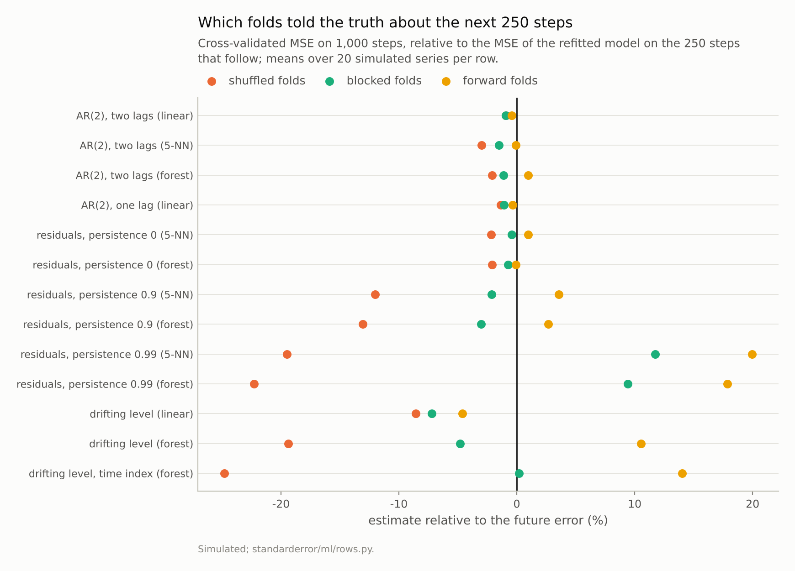
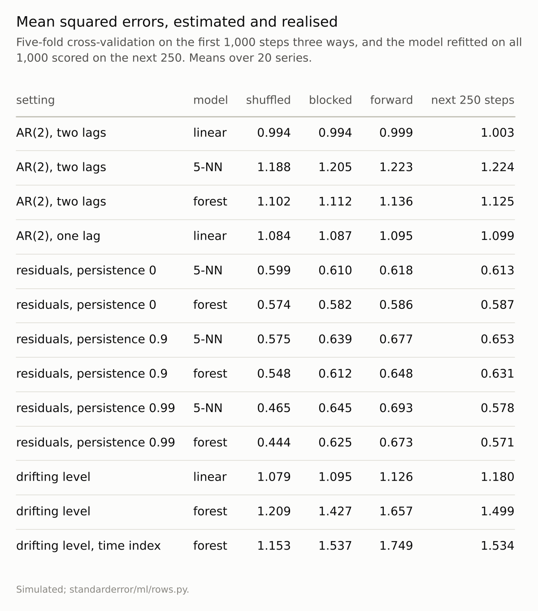

Disclosure: this post was written with the assistance of an AI system (Claude), which wrote the analysis code, ran the experiments and drafted the text. The topic, the constraints, the data choices and the final review are the author's.

*Seven simulated time-series settings, twenty series each, cross-validated three ways on 1,000 steps and compared with the error on the next 250. On a stationary autoregression with its lags as features, shuffled five-fold cross-validation was within 3% of the future error for linear regression, nearest neighbours and a forest. When the residuals had persistence 0.9 it was 13% optimistic for a forest, at 0.99 22%, and with a drifting level and a time index 25%. Forward splitting was 14% pessimistic in that last setting; contiguous blocks were within 1%.*

Episode 36 of *Machine Learning, Taught Through What Breaks*. The syllabus and the other episodes: https://jongha-jeon-dev.github.io/standarderror/lectures/

## The rule everyone learns

Arc VII measured the routine steps around a model. Arc VIII goes one step further back, to the rows themselves: where they came from, and what the process that produced them lets a model learn and a score report. Episode 3 found that duplicated rows straddling folds can leak; this arc measures the less obvious cases, starting with the most familiar rule about rows that come in order: *never shuffle a time series for cross-validation; always split it forward in time*.

The reasoning behind the rule is that neighbouring observations in time resemble each other, so a shuffled fold puts a test row's neighbours in the training set, and the model is graded on rows it has nearly seen. Forward splitting, training on the past and testing on what follows, is meant to reproduce how the model will be used.

Both halves are measurable. Seven simulated settings, twenty series each: the model is cross-validated on the first 1,000 steps with shuffled folds, with contiguous blocks, and with forward splits (cut into six stretches: train on the first, test on the second; train on two, test on the third; and so on), then refitted on all 1,000 steps and scored on the 250 that follow. That last number is what every estimate is trying to predict.

```python
from standarderror.ml import rows

for r in rows.time_series_table():   # 20 series per setting
    e = r["rel"]
    print(f"{r['setting']:28s} {r['model']:7s} shuffled "
          f"{e['shuffled']:+.1%}  blocked {e['blocked']:+.1%}  "
          f"forward {e['forward']:+.1%}")
```

```text
AR(2), two lags              linear  shuffled -0.9%  blocked -0.9%  forward -0.4%
AR(2), two lags              5-NN    shuffled -3.0%  blocked -1.5%  forward -0.1%
AR(2), two lags              forest  shuffled -2.1%  blocked -1.1%  forward +1.0%
AR(2), one lag               linear  shuffled -1.4%  blocked -1.1%  forward -0.3%
residuals, persistence 0     5-NN    shuffled -2.2%  blocked -0.4%  forward +1.0%
residuals, persistence 0     forest  shuffled -2.1%  blocked -0.7%  forward -0.1%
residuals, persistence 0.9   5-NN    shuffled -12.0%  blocked -2.1%  forward +3.5%
residuals, persistence 0.9   forest  shuffled -13.1%  blocked -3.0%  forward +2.7%
residuals, persistence 0.99  5-NN    shuffled -19.5%  blocked +11.7%  forward +20.0%
residuals, persistence 0.99  forest  shuffled -22.3%  blocked +9.4%  forward +17.9%
drifting level               linear  shuffled -8.6%  blocked -7.2%  forward -4.6%
drifting level               forest  shuffled -19.4%  blocked -4.8%  forward +10.5%
drifting level, time index   forest  shuffled -24.8%  blocked +0.2%  forward +14.0%
```

The first rows are the result the rule says should not happen. On a stationary autoregression, with its last two values as the features, shuffled folds were within **1%** of the future error for linear regression, 3% for five-nearest-neighbours and 2% for a forest. With only one lag, so that the linear model is missing part of the dependence, shuffled folds were still within 1%.



*Shuffled folds were within 3% on the autoregressions and **22%** optimistic for a forest when the residuals had persistence 0.99.*

## Why shuffling was fine

Bergmeir, Hyndman and Koo proved the reason in 2018. When the features are the series' own lags, each row carries the history it needs: the row for step t contains steps t − 1 and t − 2, and once those are given, the error at t is new noise, unrelated to the errors of the neighbouring rows. A shuffled fold does place the rows for t − 1 and t + 1 in training, but their errors tell the model nothing about the error at t. Formally, cross-validation needs the errors of different rows to be uncorrelated given the features, not the rows themselves to be independent, and an autoregression with enough lags provides that.

The memory of the series is in the features, so it is not in the errors. The rule is a heuristic for a narrower condition, and when the condition holds, shuffling costs nothing and uses the data more evenly than any forward scheme can.

## Errors with memory

The condition fails when something that affects the target changes slowly and the features do not record it. The third group of settings makes that explicit. The target depends on an input x through a smooth curve, plus a residual u that the model never sees, and u is an AR(1) process whose persistence is set to 0, 0.9 or 0.99. With persistence 0, shuffled folds were within 2% for the forest. At 0.9 they were **13%** optimistic, and at 0.99, **22%**.

A likely mechanism, which the measurement supports without isolating, is that over any one window of 1,000 steps two independent slow processes look correlated:

```python
w = rows.window_correlation()   # x and u independent by construction
for phi, c in w.items():
    print(f"persistence {phi}: typical correlation of x and u "
          f"in a 1,000-step window {c:.3f}")
```

```text
persistence 0.0: typical correlation of x and u in a 1,000-step window 0.031
persistence 0.9: typical correlation of x and u in a 1,000-step window 0.113
persistence 0.99: typical correlation of x and u in a 1,000-step window 0.177
```

Over all time x and u are unrelated. Within a window, the typical correlation is 0.031 when u has no memory and **0.177** when it has a lot, and a flexible model learns that window's accidental relationship between x and the target as if it were part of the curve. Shuffled folds test it on rows from the same window, where the accident still holds, and reward it. The next 250 steps bring a different accident.

A drifting level does the same thing in a stronger form, since a random walk never forgets. A forest given the last two values was 19% optimistic under shuffled folds; given a time index as well, which lets it learn the level at each moment and interpolate between neighbouring rows, 25%. Even linear regression, which cannot interpolate, was 9% optimistic: the future level is not where it was in the training window.



*The right-hand column is the target. No scheme hit it in every row; shuffling missed it only where something the model could not see changed slowly.*

## Forward is not automatically right

The usual cure is forward splitting, and it has a cost the rule does not mention. Its first fold trains on a sixth of the window, its second on two sixths, and so on up to five: on average the models it scores are trained on half the data the final model will have. Where more data helps, forward splitting is pessimistic, and the measurement shows it. With the drifting level and a time index it overstated the forest's future error by **14%**, against 25% understated by shuffling. With persistence 0.99 in the residuals it overstated by 18%.

Contiguous blocks without shuffling, which train on four fifths of the window and test on the remaining block, past or future, were the closest scheme in five of the seven hard rows: within 0% for the drifting forest with a time index and within 2% for nearest neighbours at persistence 0.9, where forward splits were off by 4%. Forward splits were closer for the forest at 0.9 and for linear regression on the drifting level. They were not perfect either. At persistence 0.99 every scheme missed, blocks by 9% high and forward splits by 18% high, and the realised error was not unusually low: scored 1,000 steps further on instead of immediately after the window, the same forests averaged 0.552 against 0.571. A likely reason, which this measurement does not isolate, is that a residual this persistent leaves only a few independent stretches in 1,000 steps, so every fold that trains on fewer rows than the final model fits a noticeably worse curve. With that much memory, no split of one window estimates the future well.

Bergmeir and Benítez reached a similar conclusion on real series in 2012: blocked cross-validation was the most reliable of the schemes they compared, and the purely forward ones wasted data.

## Where this breaks

**Simulated series with known structure.** Real series have seasonality, structural breaks and regime changes, each a slow component of the kind that makes shuffling optimistic. The settings here isolate the mechanism; they do not say how much of it a given real series has.

**One horizon.** The future error was measured over the 250 steps after training, refitting once. A model refitted every step, or scored at a longer horizon, has a different target, and the comparison would shift.

**No gaps between folds.** Blocked schemes are often run with a gap of a few steps on each side of the test block, to stop lagged features from reaching across the boundary. With two lags the boundary effect is small; with long lag windows it is not.

**Means over twenty series.** Every estimate here is an average. On a single series the spread of each scheme is wide, and a single forward split, the most common choice in practice, is the noisiest of all.

## What to keep

1. Shuffled folds are valid when the features carry the series' memory. On a stationary autoregression with its lags as features they were within 3% of the future error for all three models.

2. They are optimistic when something unseen changes slowly: 13% at residual persistence 0.9, 22% at 0.99, 25% with a drifting level and a time index.

3. Forward splitting trains on less data and was 11% to 20% pessimistic for the drifting forests and at persistence 0.99. Contiguous blocks were the closest scheme in five of the seven hard rows.

4. Check the residuals of a shuffled-fold model for autocorrelation. If they have none, shuffling is fine; if they do, use blocks, and expect any estimate to be rough when the residuals barely move.

## Exercise

Take a time-series model you cross-validated and compute the autocorrelation of its out-of-fold residuals at lags 1, 10 and 100, in time order.

If they are near zero, rerun with shuffled five-fold cross-validation and compare it with your forward estimate: the shuffled number is likely the more precise of the two. If they are not, compare shuffled folds with contiguous blocks; the gap between them is a direct measure of how much the slow component is flattering the shuffled score.

## Next

Time is one way rows come in groups that resemble each other. People are another: patients measured repeatedly, customers with many transactions, writers with many samples. Episode 37 asks what two thousand rows from twenty people are worth, and what row-level cross-validation says they are worth.

---

### Data

- Simulated: an AR(2) process y_t = 0.5 y_{t-1} + 0.3 y_{t-2} + e_t, modelled from its last two lags or its last lag; the same around a random-walk level (step sd 0.15), with and without a time-index feature; and y_t = sin(2 x_t) + x_t + 0.7 u_t with x and u independent unit-variance AR(1) processes, x of persistence 0.95 and u of persistence 0, 0.9 or 0.99. 1,250 steps per series after a burn-in, seeds 0 to 19.
- Machinery: `standarderror/ml/rows.py`, tested in `tests/test_ml.py`; scikit-learn's LinearRegression, KNeighborsRegressor (k = 5), RandomForestRegressor (50 trees, leaves of at least 5), KFold with and without shuffling, and TimeSeriesSplit, five folds each.
- Where this stops: Bergmeir and Benítez, "On the use of cross-validation for time series predictor evaluation", *Information Sciences* (2012); Bergmeir, Hyndman and Koo, "A note on the validity of cross-validation for evaluating autoregressive time series prediction", *Computational Statistics & Data Analysis* (2018); Roberts et al., "Cross-validation strategies for data with temporal, spatial, hierarchical, or phylogenetic structure", *Ecography* (2017).

### Reproducibility

- **environment**: standarderror=0.1.0, python=3.13.16, numpy=2.4.4
- **code blocks**: executed at build time; the values the prose quotes are pinned, so drift fails the build
- **determinism**: series seeds 0 to 19, window-correlation seeds 10,000 to 10,199; shuffled folds from the series seed; about five minutes of CPU

Code: <https://github.com/jongha-jeon-dev/standarderror>
