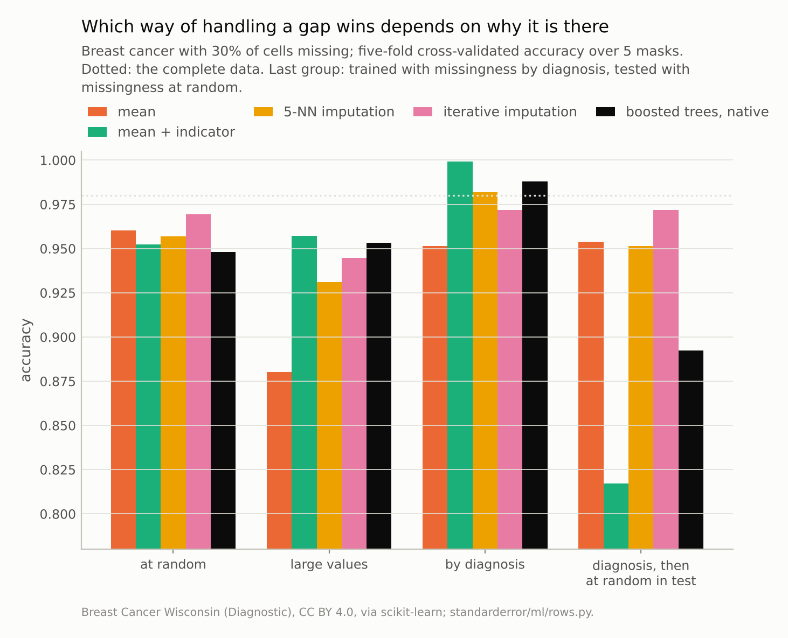
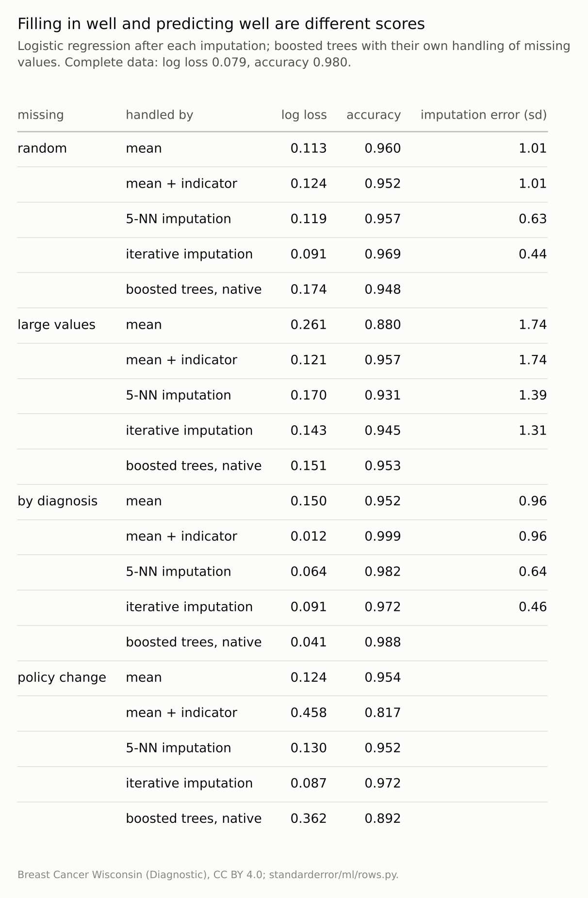

Disclosure: this post was written with the assistance of an AI system (Claude), which wrote the analysis code, ran the experiments and drafted the text. The topic, the constraints, the data choices and the final review are the author's.

*The breast-cancer data with 30% of cells removed three ways. At random, the imputation that recovered the values best (iterative, error 0.44 sd) gave the best model, log loss 0.091 against 0.113 for the mean. When large values went missing, mean imputation plus a missingness indicator reached 0.121, better than iterative imputation's 0.143. When benign tumours' cells went missing more often, the indicator model scored 0.999, above the complete data's 0.980, and 0.817 once the test rows' gaps were random.*

Episode 38 of *Machine Learning, Taught Through What Breaks*. The syllabus and the other episodes: https://jongha-jeon-dev.github.io/standarderror/lectures/

## Gaps in the table

Episodes 36 and 37 were about rows that resemble each other because of where they came from. Missing values are about rows that are incomplete because of where they came from. A blood test not ordered, a survey question skipped, a sensor that dropped out: each leaves a gap, and the standard advice treats every gap the same way, as the sentence under test puts it: *missing values are a nuisance; fill them in as accurately as you can and model the rest*.

Rubin's classification from 1976 says when that is safe. Values missing completely at random, independently of everything, are a pure loss of data. Values missing at random given the observed data can be filled in from the rest. Values whose absence depends on the value itself, or on the outcome, are missing not at random, and the gap carries information.

The breast-cancer data are complete, so the gaps can be made to order. In each of three ways, 30% of the cells are removed, and five strategies are compared: fill each gap with the column mean; the same plus an indicator column per feature saying whether it was missing; fill from the five most similar tumours; fill by iterative regression on the other features; and boosted trees, which handle a missing value directly by learning which side of each split it should go. Every imputer is fitted inside the cross-validation folds.

```python
from standarderror.ml import rows

m = rows.missing_study()          # 30% of cells, 5 masks
print(f"complete data: log loss {m['complete']['nll']:.3f}")
for kind in ("random", "large values"):
    print(f"missing: {kind}")
    for meth, r in m[kind].items():
        if not meth.startswith("_"):
            print(f"   {meth:22s} log loss {r['nll']:.3f}, "
                  f"accuracy {r['acc']:.3f}")
```

```text
complete data: log loss 0.079
missing: random
   mean                   log loss 0.113, accuracy 0.960
   mean + indicator       log loss 0.124, accuracy 0.952
   5-NN imputation        log loss 0.119, accuracy 0.957
   iterative imputation   log loss 0.091, accuracy 0.969
   boosted trees, native  log loss 0.174, accuracy 0.948
missing: large values
   mean                   log loss 0.261, accuracy 0.880
   mean + indicator       log loss 0.121, accuracy 0.957
   5-NN imputation        log loss 0.170, accuracy 0.931
   iterative imputation   log loss 0.143, accuracy 0.945
   boosted trees, native  log loss 0.151, accuracy 0.953
```

Missing completely at random, the sentence mostly holds. Iterative imputation recovers the removed values best, with a root mean squared error of **0.44** standard deviations against 1.01 for the column mean, and it gives the best model: log loss **0.091**, against 0.113 for the mean and 0.079 for the complete data. The thirty features are strongly correlated, so most of a missing value can be read off the others. The indicator columns add nothing, because there is nothing in a random gap to indicate; they cost a little, 0.124. The ordering is not perfect, though: five-nearest-neighbour imputation recovers the values much better than the mean (0.63 sd against 1.01) and still gives a slightly worse model (0.119 against 0.113).



*Trained where benign cells went missing more often, the indicator model scored 0.999; tested after the missingness became random, **0.817**.*

## When the gap knows the value

In the second setting the chance that a cell goes missing rises with its value: in every feature, the larger measurements are the ones that tend to be absent. The figures in the second half of the block above change sharply. Mean imputation now replaces exactly the large values with an average one, systematically, and the model falls to accuracy **0.880** and log loss 0.261.

Iterative imputation does better, 0.143, but it can only fill a gap with what the observed features predict, and the observed features were selected by the same mechanism. The simplest fix wins: mean imputation plus an indicator, log loss **0.121**, even though, as an imputation, it is the worst of the three (1.74 sd against 1.31). The indicator says "this value was probably large", and logistic regression gives that its own weight. Boosted trees, which learn a direction for missing values at each split, reach 0.151, between iterative imputation and the plain mean.

That is the first half of the sentence failing: filling in accurately and predicting well are different objectives. Josse and colleagues showed that when the gaps are not informative, even imputing a constant is consistent for a learner flexible enough to recover the pattern from where the constant appears, and recommended letting trees treat missingness as its own branch, which also captures informative gaps. Logistic regression is not that flexible, so here the indicator has to be handed to it explicitly; a careful imputation that hides the pattern loses it.



*Imputation error is the root mean squared error on the missing cells, in standard deviations of each feature; the policy-change rows reuse the models trained 'by diagnosis'.*

## When the gap knows the answer

The third mechanism is the one hospitals produce. A cell is missing nine times as often for a benign tumour as for a malignant one, the way a follow-up test is ordered mainly when something looks wrong. Now the gap depends on the outcome itself:

```python
for kind in ("by diagnosis", "policy change"):
    print(f"missing: {kind}")
    for meth, r in m[kind].items():
        if not meth.startswith("_"):
            print(f"   {meth:22s} log loss {r['nll']:.3f}, "
                  f"accuracy {r['acc']:.3f}")
```

```text
missing: by diagnosis
   mean                   log loss 0.150, accuracy 0.952
   mean + indicator       log loss 0.012, accuracy 0.999
   5-NN imputation        log loss 0.064, accuracy 0.982
   iterative imputation   log loss 0.091, accuracy 0.972
   boosted trees, native  log loss 0.041, accuracy 0.988
missing: policy change
   mean                   log loss 0.124, accuracy 0.954
   mean + indicator       log loss 0.458, accuracy 0.817
   5-NN imputation        log loss 0.130, accuracy 0.952
   iterative imputation   log loss 0.087, accuracy 0.972
   boosted trees, native  log loss 0.362, accuracy 0.892
```

With an indicator, logistic regression scores **0.999**, with log loss 0.012: better than the same model on the complete data, 0.980, because the pattern of missing tests says almost everything about the diagnosis. Boosted trees find the same thing on their own (0.988), and five-nearest-neighbour imputation also beats the complete data (0.982), presumably because the neighbours it borrows from are chosen using the cells that happened to be observed. Agniel, Kohane and Weber found the real version in hospital records: for most of the laboratory tests they studied, the timing of the test predicted three-year survival better than its result.

The model has learned the clinicians' behaviour, which is a legitimate signal for as long as the clinicians behave the same way. The last block shows what happens when they do not. The same trained models are scored on tumours whose cells are missing at random, as if the testing policy had changed: every test now ordered, or lost, regardless of suspicion. The indicator model falls to **0.817**, the boosted trees to 0.892. Iterative imputation, which never looked at the pattern, scores 0.972, the same as it scored with random gaps in training.

## Choosing a strategy

The three settings give three different winners, and no strategy is safe by default. If the gaps are close to random, impute well and leave the pattern out. If the gaps depend on the missing values, give the model the pattern, through indicators or a learner that handles missing values natively. If the gaps depend on a decision made by people or systems upstream, the pattern will probably be the strongest feature in the model, and its value lasts only as long as the decision rule.

Which case applies cannot be read from the data alone; missing-not-at-random is, by definition, not identifiable from what was observed. It has to come from knowing how the data were collected. What can be measured is the dependence on the pattern: fit the model with and without indicators, and if the indicators add a great deal, find out why the values are missing before trusting the gain.

## Where this breaks

**Artificial mechanisms.** The three masks are clean versions of what real data mix together. Real missingness is usually partly random, partly value-dependent and partly decided by someone, in proportions nobody wrote down.

**Thirty correlated features.** Breast-cancer measurements are redundant, which is why iterative imputation does so well at random. With weakly related features, every imputation is closer to the mean, and the differences shrink.

**One rate.** Thirty percent of cells, everywhere. Real gaps concentrate in a few columns and a few rows, and dropping such columns or rows is sometimes the better choice.

**Small data.** With 569 tumours, the differences between strategies at random are about two hundredths of log loss; under the informative mechanisms they are several times larger, which is the point.

## What to keep

1. Missing at random, the best imputation gave the best model: iterative imputation, error 0.44 sd, log loss 0.091; the mean, 1.01 sd, 0.113. Indicators added nothing.

2. When large values went missing, the indicator mattered more than the imputation: 0.121 with mean imputation and indicators, 0.143 with iterative imputation alone.

3. When the gaps followed the diagnosis, the indicator model scored 0.999, above the complete data, and 0.817 once the gaps became random.

4. Ask why each value is missing before choosing a strategy, and treat a large gain from missingness indicators as a dependence on the process that collected the data.

## Exercise

Take a model trained on data with missing values. Fit it twice, once with imputation alone and once with missingness indicators added, and compare the cross-validated scores.

If the indicators help substantially, list the features whose missingness matters most and, for each, find out who or what decides whether it is recorded. Then score the indicator model on data where those gaps are redistributed at random, which is what a change in that decision would look like.

## Next

A missing value is one way the data-collection process leaves its fingerprint. A missing label is a stronger one. Episode 39 trains a model on the outcomes of applicants who were accepted, the only ones whose outcomes anyone saw, and asks what it can say about the applicants who were turned away.

---

### Data

- Breast Cancer Wisconsin (Diagnostic), CC BY 4.0, as bundled with scikit-learn; 569 tumours, 30 features. 30% of cells removed: independently at random; with probability rising in the cell's standardised value (logistic in 2z − 1.2, scaled to 30%); or with probability nine times higher for benign tumours. Five masks (seeds 0 to 4), test-time random masks from seeds 100 to 104.
- Machinery: `standarderror/ml/rows.py`, tested in `tests/test_ml.py`; scikit-learn's SimpleImputer (with and without add_indicator), KNNImputer, IterativeImputer (10 rounds), StandardScaler and LogisticRegression (C = 0.3), and HistGradientBoostingClassifier (200 rounds, rate 0.05) on the raw gaps; five stratified folds, imputers fitted inside them.
- Where this stops: Rubin, "Inference and missing data", *Biometrika* (1976); Josse, Prost, Scornet and Varoquaux, "On the consistency of supervised learning with missing values" (2019); Agniel, Kohane and Weber, "Biases in electronic health record data due to processes within the healthcare system", *BMJ* (2018).

### Reproducibility

- **environment**: standarderror=0.1.0, python=3.13.16, numpy=2.4.4
- **code blocks**: executed at build time; the values the prose quotes are pinned, so drift fails the build
- **determinism**: masks and folds from seeds 0 to 4; about five minutes of CPU

Code: <https://github.com/jongha-jeon-dev/standarderror>
