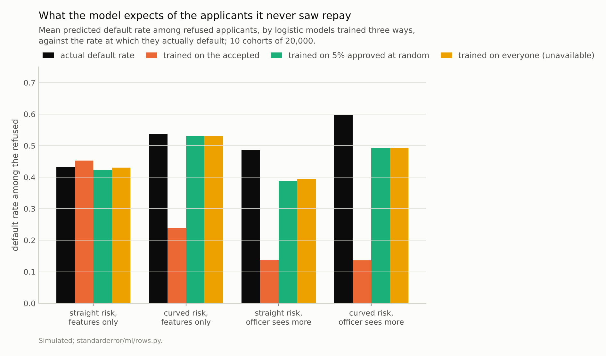
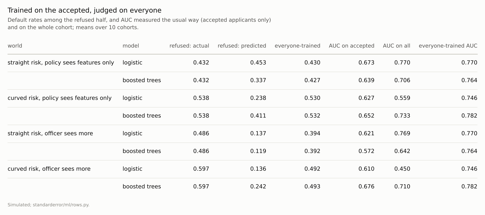

Disclosure: this post was written with the assistance of an AI system (Claude), which wrote the analysis code, ran the experiments and drafted the text. The topic, the constraints, the data choices and the final review are the author's.

*Simulated applicants, half accepted by an old policy, outcomes observed only for the accepted. When the policy used only the model's features, a correctly specified model predicted a default rate of 0.453 for the refused, who defaulted at 0.432; boosted trees predicted 0.337. When a loan officer also used information the model lacks, the model predicted 0.137 for a group that defaulted at 0.486, with its AUC unchanged. A model trained on the 5% of applicants approved at random predicted 0.389, as well as one trained on everyone (0.394).*

Episode 39 of *Machine Learning, Taught Through What Breaks*. The syllabus and the other episodes: https://jongha-jeon-dev.github.io/standarderror/lectures/

## Outcomes only for the approved

Episode 38 found that a missing value can record a decision. A missing label always does. A lender sees whether a loan was repaid only if it made the loan; a hospital sees whether a treatment worked only for patients who got it; a platform sees whether a recommendation was clicked only if it was shown. The next model is trained on those outcomes and then applied to everyone, including the kind of case the last decision turned away. The sentence that makes this feel routine: *a model trained on the outcomes you observed predicts the outcomes you did not*.

The simulation is a lender. Each applicant has two features the model sees, and a third, u, that it does not: something a loan officer reading the file might pick up. The chance of default depends on all three. An old policy accepted the half of each cohort with the lowest risk score, and outcomes exist only for them. In two of four worlds the old policy's score used only the two features. In the other two, the officer's judgement of u also went into it. In two of the worlds risk is straight in the features; in two it curves. A logistic model and boosted trees are trained on the accepted half and applied to a fresh cohort, accepted and refused alike.

```python
from standarderror.ml import rows

for r in rows.selective_labels():     # 10 cohorts of 20,000
    if r["model"] == "logistic":
        print(f"curved={r['curved']!s:5} officer={r['officer']!s:5} "
              f"refused default {r['refused_rate']:.3f}, predicted "
              f"{r['refused_pred']:.3f}; AUC {r['auc_all']:.3f}")
```

```text
curved=False officer=False refused default 0.432, predicted 0.453; AUC 0.770
curved=False officer=True  refused default 0.486, predicted 0.137; AUC 0.769
curved=True  officer=False refused default 0.538, predicted 0.238; AUC 0.559
curved=True  officer=True  refused default 0.597, predicted 0.136; AUC 0.450
```

In the simplest world the sentence holds. The policy used only what the model sees, risk is straight, and logistic regression predicts a default rate of **0.453** among the refused, who default at 0.432. Its AUC on the whole cohort, 0.770, is the same as that of a model trained on everyone's outcomes.



*When the officer saw more, the accepted-only model expected **0.137** of the refused to default; 0.486 did.*

## Selection on what the model sees

That world is episode 29's covariate shift in another form. Selecting on the features changes which inputs the model sees, not the relationship between inputs and outcome, so a correctly specified model learns the right relationship from the accepted half and carries it to the refused half. Episode 29 found that covariate shift charges only for misspecification, and so does this.

The charge appears as soon as the model cannot extend what it learned. Boosted trees, trained on the same accepted half, predicted **0.337** for the refused: trees cannot predict beyond the range they were trained on, as episode 15 measured, and the refused sit beyond it. In the curved world, logistic regression is the misspecified model, and it predicted 0.238 for a group that defaulted at 0.538. Its AUC on the whole cohort fell to **0.559**, against 0.746 for the same model trained on everyone: probably because a straight line fitted to the accepted region of a curved relationship does not extend to the refused region.

## Selection on what the model cannot see

When the officer's judgement went into the old decision, the accepted are not only the applicants with good features but the ones with good u, among applicants with similar features. In the training data, then, applicants with mediocre features repaid well, because those who were accepted had something else in their favour. The model learns that mediocre features are safe.

Logistic regression predicted a default rate of **0.137** for the refused. They defaulted at **0.486**. Its ranking survived, an AUC of 0.769 against 0.770 for a model trained on everyone, because the selection shifted the level of its predictions more than their order; its log loss, 0.637 against 0.494, records the damage. A lender who used its probabilities to price risk would price the refused applicants at less than a third of their real default rate.

There are two losses here, and only one can be repaired. Even the model trained on every applicant's outcome, which no lender has, predicted 0.394 for the refused, below their 0.486: the refused were selected partly for a u that the features do not contain, so no model of the features can know they are worse. That is episode 34's subgroup miscalibration, produced by the decision itself. The gap from 0.137 to 0.394 is the selection bias Heckman described in 1979, and that part can be fixed.



*'Everyone-trained' is the same model fitted on every applicant's outcome, which no lender has: the ceiling for a model that sees these features.*

## Validation on the accepted

The same selection undermines the usual check. A model like this is validated on held-out accepted applicants, because they are the only ones with outcomes. In the straight world with a features-only policy, the AUC measured that way was **0.673**, against 0.770 on the whole cohort: the accepted are a narrower, more similar group, and ranking within them is harder. In the curved world it went the other way, 0.627 on the accepted against 0.559 on everyone, because the model fits the accepted region and fails outside it. In the curved world with the officer, the model ranked the whole cohort worse than chance, 0.450, while its validation on the accepted reported 0.610. Validation on the accepted can err in either direction, and nothing in it says which.

## Buying the missing outcomes

The repair that works in every world is to stop selecting for some of the data. Suppose 5% of applicants, about 992 per cohort, had been approved at random, regardless of score and officer:

```python
for r in rows.selective_labels():
    if r["model"] == "logistic":
        print(f"curved={r['curved']!s:5} officer={r['officer']!s:5} "
              f"5% random only: {r['explore_refused_pred']:.3f}; "
              f"recalibrated: {r['recal_refused_pred']:.3f}; "
              f"everyone: {r['oracle_refused_pred']:.3f}")
```

```text
curved=False officer=False 5% random only: 0.424; recalibrated: 0.425; everyone: 0.430
curved=False officer=True  5% random only: 0.389; recalibrated: 0.390; everyone: 0.394
curved=True  officer=False 5% random only: 0.531; recalibrated: 0.383; everyone: 0.530
curved=True  officer=True  5% random only: 0.493; recalibrated: 0.378; everyone: 0.492
```

A logistic model trained on those thousand or so randomly approved applicants alone predicted 0.389 for the refused in the officer world and 0.531 in the curved one, matching the model trained on everyone to within 0.01 in all four worlds. Recalibrating the accepted-only model on the random approvals, refitting only its intercept and slope, worked when the shape was right (0.390) and not when it was wrong (0.383 in the curved world, against 0.530).

Approving some applicants at random has a cost, paid in defaults among applicants who would have been refused. It is the only source of outcomes from the refused region, and the alternatives, collectively called reject inference, have to assume what the refused would have done. Hand and Henley's verdict in 1993 was that reject inference cannot work reliably unless assumptions or information from outside the accepted data are brought in; the exploration sample is that information, measured rather than assumed.

## Where this breaks

**One officer, one unobserved variable.** Real decisions use many unrecorded signals, some correlated with the recorded features. The size of the bias depends on how much the decision used that the model cannot see, which is rarely known.

**Outcomes are clean.** A loan's outcome takes years and depends on the terms offered, which the policy also chose. The same structure holds for treatments and recommendations, with their own versions of these complications.

**Random approvals of 5%.** Fewer would give noisier estimates; in practice exploration is often stratified, approving at random only near the decision boundary, which costs less and reaches less of the refused region.

**Static.** Each new model sets the next policy, which selects the next training data. Feedback over several rounds can compound the bias measured here, and is not simulated.

## What to keep

1. Selection on the features the model sees costs only misspecification: a correctly specified model predicted 0.453 for refused applicants who defaulted at 0.432; boosted trees, which cannot extrapolate, 0.337.

2. Selection on what the model cannot see miscalibrates it without warning: 0.137 predicted for a group defaulting at 0.486, with its AUC intact.

3. AUC on accepted applicants was 0.673 against 0.770 on everyone in one world and 0.627 against 0.559 in another.

4. A small randomly approved sample recovered what a model trained on everyone would know. Find out what information the past decision used, and buy some outcomes from outside its approvals.

## Exercise

For a model trained on outcomes that exist only because of an earlier decision, write down every input to that decision and mark the ones your model does not see.

Then compare the model's mean prediction with the observed outcome rate in the slice of approved cases nearest the decision boundary. If the earlier decision used information you lack, that slice is where the gap first shows, and its size bounds how wrong the model may be beyond the boundary.

## Next

Arc VIII ends with a feature built from the labels themselves. Episode 40 encodes a category with thousands of levels by its mean outcome, fitted carefully on the training rows only, and asks whether "inside the folds" is enough to make it safe.

---

### Data

- Simulated: applicants with two observed features and one unobserved, all standard normal; default log-odds −1.5 + 1.2 x_1 + 0.8 x_2 + 1.2 u, plus 0.8 x_1² in the curved worlds. The old policy accepts the half with the lowest score 1.2 x_1 + 0.8 x_2 + noise, plus 1.2 u when the officer sees more. Cohorts of 20,000 (seeds 0 to 9), scored on fresh cohorts (seeds 100 to 109); 5% approved at random from the training cohort.
- Machinery: `standarderror/ml/rows.py`, tested in `tests/test_ml.py`; scikit-learn's LogisticRegression and HistGradientBoostingClassifier; recalibration refits the intercept and slope of the accepted-only model's log-odds on the randomly approved rows.
- Where this stops: Heckman, "Sample selection bias as a specification error", *Econometrica* (1979); Lakkaraju et al., "The selective labels problem", *KDD* (2017); Hand and Henley, "Can reject inference ever work?", *IMA Journal of Mathematics Applied in Business and Industry* (1993); episode 29 of this series.

### Reproducibility

- **environment**: standarderror=0.1.0, python=3.13.16, numpy=2.4.4
- **code blocks**: executed at build time; the values the prose quotes are pinned, so drift fails the build
- **determinism**: cohort seeds as listed; about three minutes of CPU

Code: <https://github.com/jongha-jeon-dev/standarderror>
