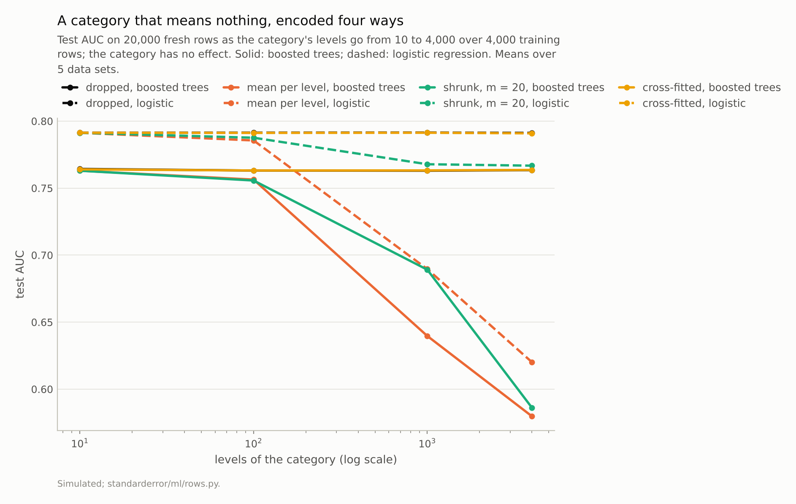
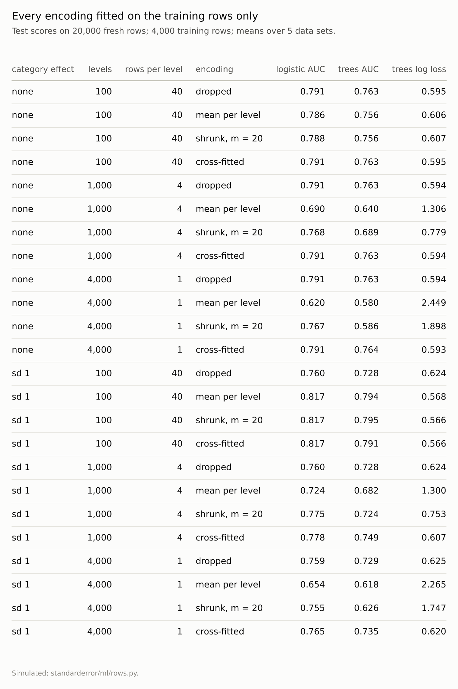
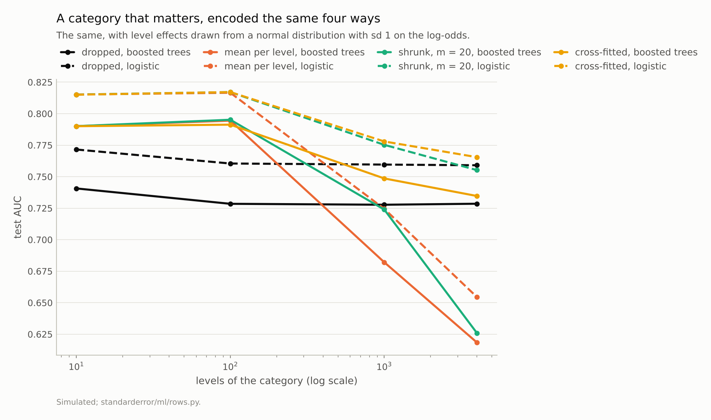

Disclosure: this post was written with the assistance of an AI system (Claude), which wrote the analysis code, ran the experiments and drafted the text. The topic, the constraints, the data choices and the final review are the author's.

*A simulated task with five numeric features and a category of 10 to 4,000 levels, 4,000 training rows, every encoding fitted on the training rows only. With a category carrying no signal and 1,000 levels, encoding each level by its mean label took boosted trees from test AUC 0.763 without the column to 0.640, and log loss from 0.594 to 1.306; on its own training rows the encoded noise column alone had AUC 0.774. Cross-fitting matched dropping the column to within 0.002 of AUC on noise, and with a real effect at 1,000 levels reached logistic AUC 0.778 against 0.760 dropped.*

Episode 40 of *Machine Learning, Taught Through What Breaks*. The syllabus and the other episodes: https://jongha-jeon-dev.github.io/standarderror/lectures/

## A feature made from the label

Arc VIII has followed the process behind the rows: time (episode 36), people (37), gaps (38) and decisions (39). It ends with a feature built from the outcome itself. A category with many levels, such as a postcode, a merchant, a product or a user, is awkward for most models: one-hot encoding makes thousands of columns, and trees split on arbitrary level codes. Target encoding replaces each level with the mean outcome of the training rows at that level, one numeric column that carries what the category says about the target.

Episode 3 measured the obvious mistake, computing those means on all rows including the test fold, and found that a 200-level noise column fitted that way inflated the score. The standard advice that follows is the sentence under test: *fit the target encoding on the training rows only, inside the folds, and it cannot leak*.

The test here never touches the encoding: it is fitted on 4,000 training rows and scored on 20,000 fresh rows. Five numeric features carry the real signal, and a category of 10 to 4,000 levels is added. In the first experiment the category carries nothing.

```python
from standarderror.ml import rows

t = rows.target_encoding()     # 4,000 training rows, 5 data sets
for r in t:
    if r["effect"] == 0 and r["model"] == "boosted trees":
        print(f"{r['levels']:5d} levels, {r['encoding']:15s} "
              f"AUC {r['auc']:.3f}, log loss {r['nll']:.3f}")
```

```text
   10 levels, dropped         AUC 0.764, log loss 0.593
   10 levels, mean per level  AUC 0.763, log loss 0.595
   10 levels, shrunk, m = 20  AUC 0.763, log loss 0.595
   10 levels, cross-fitted    AUC 0.764, log loss 0.593
  100 levels, dropped         AUC 0.763, log loss 0.595
  100 levels, mean per level  AUC 0.756, log loss 0.606
  100 levels, shrunk, m = 20  AUC 0.756, log loss 0.607
  100 levels, cross-fitted    AUC 0.763, log loss 0.595
 1000 levels, dropped         AUC 0.763, log loss 0.594
 1000 levels, mean per level  AUC 0.640, log loss 1.306
 1000 levels, shrunk, m = 20  AUC 0.689, log loss 0.779
 1000 levels, cross-fitted    AUC 0.763, log loss 0.594
 4000 levels, dropped         AUC 0.763, log loss 0.594
 4000 levels, mean per level  AUC 0.580, log loss 2.449
 4000 levels, shrunk, m = 20  AUC 0.586, log loss 1.898
 4000 levels, cross-fitted    AUC 0.764, log loss 0.593
```

With 10 levels, 400 rows each, encoding the category changes nothing. With 1,000 levels, four training rows per level, boosted trees given the encoded column score a test AUC of **0.640**, against 0.763 without it, and their log loss doubles, to 1.306. With 4,000 levels they reach 0.580. Logistic regression falls too, from 0.791 to 0.690 at 1,000 levels. Nothing leaked into the test set, and the models are genuinely worse.



*With 1,000 levels the per-level mean took boosted trees from 0.763 to **0.640**; cross-fitting left them at 0.763.*

## The leak is into the training rows

A level with four training rows has a mean label of 0, 0.25, 0.5, 0.75 or 1, and each of those four rows contributed its own label to it. For a training row, the encoded value is partly its own answer. The encoded column alone shows how much:

```python
c = rows.encoded_column_auc()  # the noise column alone, 1,000 levels
print(f"mean per level: AUC {c['mean_train']:.3f} on its own "
      f"training rows, {c['mean_test']:.3f} on fresh rows")
print(f"cross-fitted:   AUC {c['cross_train']:.3f} on its own "
      f"training rows, {c['cross_test']:.3f} on fresh rows")
```

```text
mean per level: AUC 0.774 on its own training rows, 0.498 on fresh rows
cross-fitted:   AUC 0.485 on its own training rows, 0.499 on fresh rows
```

On the rows it was computed from, the encoded noise column ranks the labels with an AUC of **0.774**, better than many real features. On fresh rows it is 0.498, a coin. The model is trained on rows where this column is a strong predictor, learns to rely on it at the expense of the five real features, and then meets test rows where it is noise. That is overfitting, done by the preprocessing instead of the model, and cross-validation inside the folds measures it correctly, as a bad model, without preventing it.

It is the same mechanism as episode 3's leak moved one step: there, the encoding saw the test rows' labels; here, it sees the training rows' own labels, and the model trained on them cannot tell an honest feature from a recording of the answer.



*None of these is a leak in the usual sense: the test rows never touched the encoding. The damage is done to the training rows.*

## Two repairs

The first repair is shrinkage: pull each level's mean towards the overall mean in proportion to how few rows it has, here as if each level had 20 extra rows at the overall rate. It helps logistic regression a great deal, to 0.767 at 4,000 levels, probably because shrinkage pulls the extreme values of rare levels, 0 and 1 for a level seen once, towards the middle, and the default L2 penalty then keeps the model from scaling the column back up. It does not help the trees (0.586): within levels of the same size, shrinkage keeps the values ordered by the training rows' own labels, and trees split on order, not on scale.

The second is cross-fitting, which is what scikit-learn's TargetEncoder and CatBoost's ordered statistics both do in different ways. Each training row is encoded by means computed from the other folds, so its own label never enters its own value; test rows get means from all training rows. On the noise category it matched dropping the column at every number of levels, to within 0.002 of AUC for both models, and the encoded column's training AUC fell to 0.485, slightly below a coin, since a leave-out mean is pulled away from the row it leaves out.

## When the category carries signal

Dropping the column is safe only when it is noise, which is not why anyone encodes it. In the second experiment each level shifts the log-odds by an amount drawn with standard deviation 1. With 10 or 100 levels, every encoding works and gains four to six points of AUC for logistic regression over dropping the column. With 1,000 levels the per-level mean turns the signal into a loss, 0.724 against 0.760 for dropping it, while cross-fitting keeps a gain, **0.778**. At 4,000 levels the gain is small (0.765 against 0.759), because one row per level says little about any level; but cross-fitting is the only encoding that is not worse than dropping the column for either model.

Pargent and colleagues compared encodings on real high-cardinality data sets and reached a compatible conclusion: regularised target encoding, fitted with an internal cross-validation, was the most reliable choice across the learners they tried.



*At 1,000 levels cross-fitting kept part of the signal (logistic AUC 0.778 against 0.760 dropped); the per-level mean turned it into a loss (0.724).*

## Where this breaks

**Equally likely levels.** Real categories have a few common levels and a long tail of rare ones. The common levels encode safely and the tail does the damage, so the harm is concentrated where there is least data, which also makes it harder to see in an overall score.

**One sample size.** 4,000 training rows. What matters is rows per level, so the same damage should appear at 40,000 levels with 40,000 rows.

**Default settings.** TargetEncoder's shrinkage and the boosted trees' regularisation were left at their defaults. Stronger regularisation in the trees reduces their reliance on any single column, including this one.

**Binary outcome.** The same mechanism applies to regression targets and to multi-class targets, which encode one column per class.

## What to keep

1. Fitting the encoding on the training rows only protects the test set and nothing else. With 1,000 noise levels, boosted trees fell from AUC 0.763 to 0.640.

2. The training rows leak into their own encoding: the noise column alone ranked its training labels at AUC 0.774, and fresh labels at 0.498.

3. Shrinkage largely rescued logistic regression and not trees at one row per level; cross-fitting matched dropping the column on noise and kept the signal when there was one.

4. Encode a high-cardinality category with out-of-fold means on the training rows, and check how many rows the rarest levels have before trusting the column.

## Exercise

Take a model that uses a target-encoded category. Compute the encoded column's AUC (or correlation with the target) on the training rows and on held-out rows.

If the training value is much higher, the column is partly a recording of the training labels; here the gap was 0.28 of AUC for a column with no signal at all. Replace the encoding with a cross-fitted one, refit, and compare held-out scores; then try dropping the column, which is the baseline any encoding has to beat.

## Next

Arc VIII ends here, at forty episodes. Where the rows came from decided what the scores meant: shuffled folds fine until something unseen changed slowly, people counted as rows, gaps that recorded decisions, outcomes seen only for the approved, and a feature built from the labels it was meant to predict. Arc IX turns from single models to combinations and comparisons, starting with the most common combination of all: an average.

---

### Data

- Simulated: five standard-normal features with log-odds x_1 + 0.7 x_2 − 0.5 x_3, plus a category of K equally likely levels whose effects are 0 or normal with sd 1. 4,000 training rows (seeds 0 to 4), 20,000 test rows sharing the level effects (seeds 100 to 104).
- Machinery: `standarderror/ml/rows.py`, tested in `tests/test_ml.py`; scikit-learn's LogisticRegression, HistGradientBoostingClassifier and TargetEncoder (five shuffled folds, its default shrinkage); the per-level mean and its shrunk version (20 pseudo-rows at the overall mean) written out.
- Where this stops: Micci-Barreca, "A preprocessing scheme for high-cardinality categorical attributes", *SIGKDD Explorations* (2001); Prokhorenkova et al., "CatBoost: unbiased boosting with categorical features", *NeurIPS* (2018); Pargent et al., "Regularized target encoding outperforms traditional methods in supervised machine learning with high cardinality features", *Computational Statistics* (2022); episode 3 of this series.

### Reproducibility

- **environment**: standarderror=0.1.0, python=3.13.16, numpy=2.4.4
- **code blocks**: executed at build time; the values the prose quotes are pinned, so drift fails the build
- **determinism**: seeds as listed; TargetEncoder folds with random_state 0; about a minute of CPU

Code: <https://github.com/jongha-jeon-dev/standarderror>
