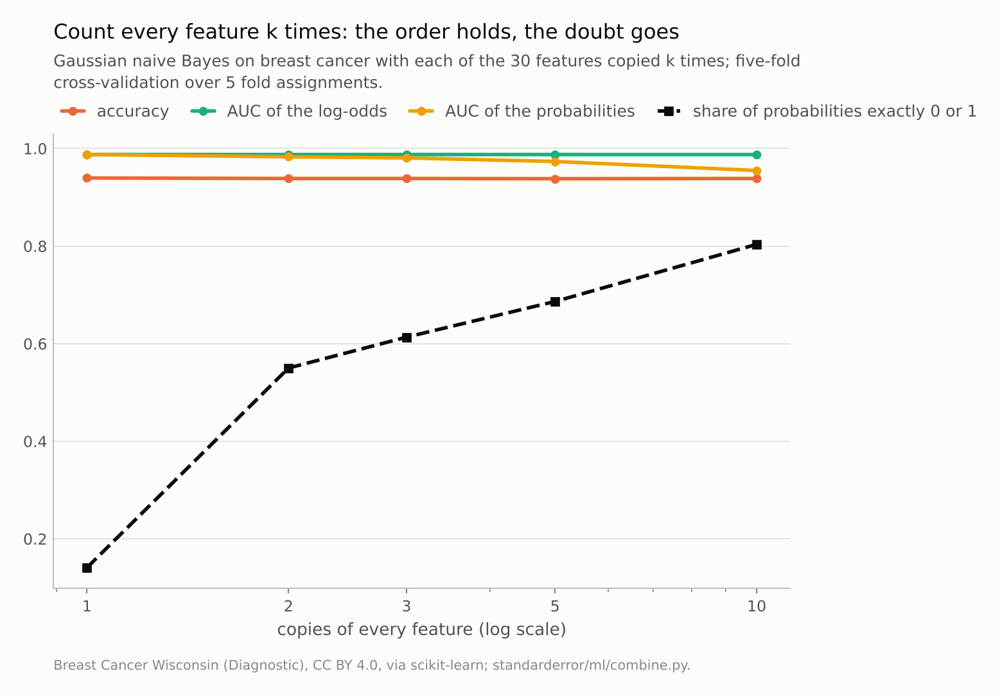
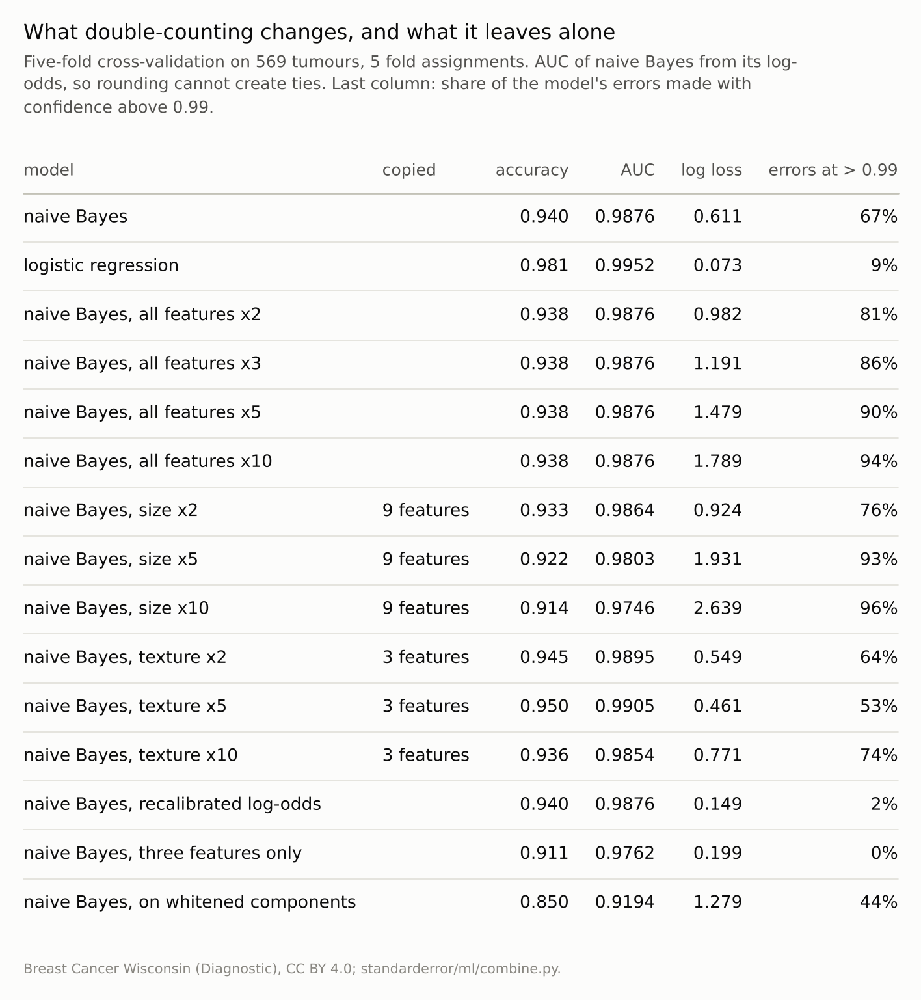

Disclosure: this post was written with the assistance of an AI system (Claude), which wrote the analysis code, ran the experiments and drafted the text. The topic, the constraints, the data choices and the final review are the author's.

*Gaussian naive Bayes on the breast-cancer data, whose features include radius, perimeter and area of the same nuclei, scored accuracy 0.940 against logistic regression's 0.981, with log loss 0.611 against 0.073; 67% of its errors came with confidence above 0.99. Copying every feature ten times left its accuracy at 0.938 and the AUC of its log-odds unchanged, and raised its log loss to 1.789. Copying only the size features lowered its accuracy to 0.914. Recalibrating its log-odds cut log loss to 0.149 at unchanged accuracy.*

Episode 43 of *Machine Learning, Taught Through What Breaks*. The syllabus and the other episodes: https://jongha-jeon-dev.github.io/standarderror/lectures/

## A combination of features, not of models

Episode 41 combined models by averaging their probabilities and found that the most confident member decides. Naive Bayes combines too, inside a single model: it treats each feature as a separate, independent piece of evidence about the class and adds their log-likelihood ratios. That is exactly right if the features are independent within each class and wrong otherwise, and they almost never are. The sentence that keeps the method in every textbook is the defence: *naive Bayes works well even though its independence assumption is wrong*.

The breast-cancer data make the assumption as wrong as it gets. Ten measurements of each tumour's nuclei are recorded three times each (as a mean, a standard error and a worst value), and three of the ten, radius, perimeter and area, measure the same thing in different units. Gaussian naive Bayes against logistic regression, which fits one weight per feature jointly and so accounts for overlap:

```python
from standarderror.ml import combine

b = combine.nb_baseline()      # breast cancer, 5 x five-fold CV
for name in ("nb", "logistic"):
    r = b[name]
    print(f"{name:9s} accuracy {r['acc']:.3f}, log loss {r['nll']:.3f}, "
          f"errors made at > 0.99 confidence {r['confident_errors']:.0%}")
```

```text
nb        accuracy 0.940, log loss 0.611, errors made at > 0.99 confidence 67%
logistic  accuracy 0.981, log loss 0.073, errors made at > 0.99 confidence 9%
```

Naive Bayes is four points less accurate, which is the kind of gap that keeps it in use as a fast baseline. Its log loss is **8 times** larger, and that is a different kind of gap: **67%** of its mistakes were made with more than 99% confidence, against 9% of logistic regression's.

## Copying the evidence

Domingos and Pazzani explained in 1997 why naive Bayes classifies well despite the assumption: classification needs only the sign of the log-odds, or their order for ranking, and dependence between features distorts their size far more than their sign. The cleanest test copies the features. With every one of the thirty features present k times, naive Bayes adds every log-likelihood ratio k times, which multiplies its log-odds by k, apart from the prior term it adds once.

```python
for r in combine.nb_duplicates():   # every feature copied k times
    print(f"k = {r['k']:2d}: accuracy {r['acc']:.4f}, AUC log-odds "
          f"{r['auc_log_odds']:.4f}, AUC probs {r['auc']:.4f}, "
          f"log loss {r['nll']:.3f}")
```

```text
k =  1: accuracy 0.9395, AUC log-odds 0.9876, AUC probs 0.9876, log loss 0.611
k =  2: accuracy 0.9385, AUC log-odds 0.9876, AUC probs 0.9830, log loss 0.982
k =  3: accuracy 0.9385, AUC log-odds 0.9876, AUC probs 0.9807, log loss 1.191
k =  5: accuracy 0.9381, AUC log-odds 0.9876, AUC probs 0.9734, log loss 1.479
k = 10: accuracy 0.9385, AUC log-odds 0.9876, AUC probs 0.9549, log loss 1.789
```

Multiplying log-odds by a positive number does not change their order, and the AUC computed from the log-odds is 0.9876 at every k, the same to within 3 millionths, one near-tie resolved differently, by rounding or by the prior term that does not scale with k. Accuracy barely moves, from 0.9395 to 0.9385, the small change coming from the prior term no longer scaling with the rest. The probabilities are another matter. With ten copies, log loss is **1.789**, and 80% of the predicted probabilities are exactly 0 or 1 in floating point. That rounding even shows up in the ranking metric: the AUC computed from the probabilities falls to 0.955, because tumours that differ in log-odds tie at 1.0.

So the textbook defence is right about what it claims and silent about the rest. The real breast-cancer features are not ten copies of each other, but the size features come close, and the model counts them as separate witnesses saying the same thing.



*At k = 10 the AUC of the log-odds is still 0.9876; the AUC of the probabilities is **0.955**, because 80% of them are exactly 0 or 1.*

## Copying part of the evidence

Copying every feature scales the evidence. Copying some features reweights it, and that does change the verdicts:

```python
for r in combine.nb_family():       # one family copied k times
    print(f"{r['family']:7s} x{r['k']:<2d}: accuracy {r['acc']:.3f}, "
          f"AUC of log-odds {r['auc_log_odds']:.4f}, "
          f"log loss {r['nll']:.3f}")
```

```text
size    x2 : accuracy 0.933, AUC of log-odds 0.9864, log loss 0.924
size    x5 : accuracy 0.922, AUC of log-odds 0.9803, log loss 1.931
size    x10: accuracy 0.914, AUC of log-odds 0.9746, log loss 2.639
texture x2 : accuracy 0.945, AUC of log-odds 0.9895, log loss 0.549
texture x5 : accuracy 0.950, AUC of log-odds 0.9905, log loss 0.461
texture x10: accuracy 0.936, AUC of log-odds 0.9854, log loss 0.771
```

Nine size features copied ten times push the model towards judging tumours by size alone: the AUC of its log-odds falls to 0.9746 and its accuracy to **0.914**. Three texture features copied five times push it the other way, and accuracy *rises*, to 0.950, with lower log loss than the original (0.461 against 0.611).

That second result is a reminder of what the real data already do. Naive Bayes on the original features is not a neutral model with an independence flaw; it is a model that weights each group of correlated features by how many columns it happens to occupy. The size of the nuclei occupies nine columns and texture three: each statistic of size is counted three times, once per unit it is measured in, and each statistic of texture once. Upweighting texture helped at two and five copies, which is consistent with the original features overcounting size; at ten copies texture was overcounted in turn (0.936).



*Copying everything rescales the log-odds; copying one family reweights it. Only the second changes which tumour ranks above which.*

## Repairs

Three repairs follow from the mechanism. The first accepts the order and fixes the scale: fit a logistic regression on naive Bayes' log-odds, using out-of-fold log-odds inside each training set, as Platt scaling does. Accuracy stays at 0.940 and the ranking is untouched, while log loss falls from 0.611 to **0.149** and the share of errors made at above 0.99 confidence from 67% to 2%. Niculescu-Mizil and Caruana found naive Bayes among the models that gain most from calibration.

The second removes the redundancy: three weakly related features, mean radius, mean texture and mean smoothness, give log loss 0.199 with accuracy 0.911, better probabilities and fewer correct answers. The third, which looks principled, failed: decorrelating the features first with whitened principal components gave accuracy 0.850. Two things may explain it, neither isolated here: whitening removes the correlation across all tumours, not within each class, so it does not make the features independent given the class, which is the only independence naive Bayes assumes; and it inflates the smallest components, mostly noise, to the same variance as the informative ones.

None of the three beats logistic regression, which solves the double-counting problem by fitting the weights jointly. The case for naive Bayes is speed, tiny data and text, where it remains a strong baseline; the case against it is any use of its probabilities as probabilities.

## Where this breaks

**One data set with heavy redundancy.** Breast cancer is close to the worst case for double-counting. With features that really are close to independent within class, naive Bayes' probabilities are much better, which is what episode 34's simulated task showed.

**Gaussian naive Bayes.** The multinomial and Bernoulli versions used for text double-count in the same way, through words that co-occur, and are calibrated no better.

**Copies are extreme.** Exact duplicates make the scaling exact. Real correlated features double-count partially and unevenly, which is the reweighting case rather than the scaling one.

**Five-fold cross-validation on 569 tumours.** Differences of a point of accuracy are within noise; the factor of eight in log loss and the share of confident errors are not.

## What to keep

1. On breast cancer, naive Bayes was 0.041 less accurate than logistic regression and had 8 times its log loss; 67% of its errors came at above 0.99 confidence.

2. Copying every feature k times multiplies the log-odds by k: the AUC of the log-odds was unchanged to four decimal places, and log loss rose to 1.789 at k = 10.

3. Copying one family reweights the evidence and changes the answers: 0.914 with the size features copied ten times, 0.950 with texture copied five.

4. Use naive Bayes for ranking and quick baselines; recalibrate its log-odds before reading them as probabilities, and remember that its weights are set by how many columns each kind of evidence occupies.

## Exercise

Train naive Bayes on a data set you know and plot a histogram of its predicted probabilities, then the same for logistic regression. Count the predictions above 0.99 and below 0.01, and the errors among them.

Then compute the correlation matrix of your features within one class and find the largest group of strongly correlated columns. Remove all but one column of that group, retrain, and compare log loss and accuracy with the full model.

## Next

Combining models and features is one half of Arc IX; comparing them is the other. Episode 44 asks how often the standard statistical tests declare one of two equally good algorithms the better one, and which test can be trusted.

---

### Data

- Breast Cancer Wisconsin (Diagnostic), CC BY 4.0, as bundled with scikit-learn; 569 tumours, 30 features (ten measurements of the nuclei, each as a mean, a standard error and a worst value).
- Machinery: `standarderror/ml/combine.py`, tested in `tests/test_ml.py`; scikit-learn's GaussianNB (log-odds from predict_joint_log_proba), LogisticRegression after standardising, PCA with whitening; Platt recalibration of the log-odds fitted on out-of-fold log-odds inside each training set; five stratified folds, fold assignments 0 to 4.
- Where this stops: Domingos and Pazzani, "On the optimality of the simple Bayesian classifier under zero-one loss", *Machine Learning* (1997); Zhang, "The optimality of naive Bayes", *FLAIRS* (2004); Niculescu-Mizil and Caruana, "Predicting good probabilities with supervised learning", *ICML* (2005).

### Reproducibility

- **environment**: standarderror=0.1.0, python=3.13.16, numpy=2.4.4
- **code blocks**: executed at build time; the values the prose quotes are pinned, so drift fails the build
- **determinism**: fold assignments 0 to 4; under a minute of CPU

Code: <https://github.com/jongha-jeon-dev/standarderror>
