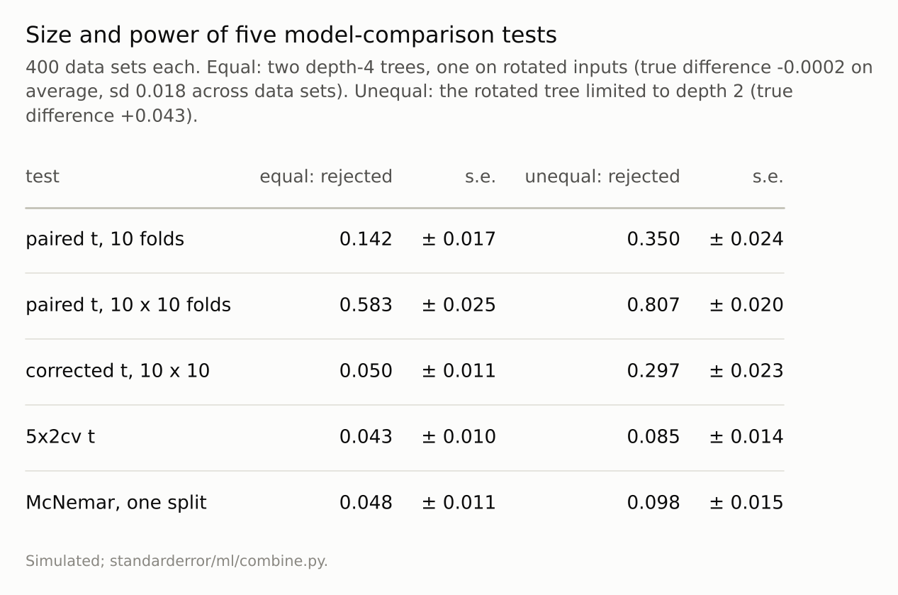

Disclosure: this post was written with the assistance of an AI system (Claude), which wrote the analysis code, ran the experiments and drafted the text. The topic, the constraints, the data choices and the final review are the author's.

*Two algorithms with exactly equal expected accuracy, by symmetry, compared on 400 data sets of 300 rows. The paired t-test on ten cross-validation folds declared a difference at the 5% level in 14.2% of data sets; on ten repetitions of ten folds, in 58.2%. Nadeau and Bengio's corrected resampled t-test rejected 5.0% of the time, Dietterich's 5x2cv test 4.2% and McNemar's test 4.8%. With one algorithm genuinely worse by 0.043, the corrected test detected it in 30% of data sets and the other two honest tests in under 10%.*

Episode 44 of *Machine Learning, Taught Through What Breaks*. The syllabus and the other episodes: https://jongha-jeon-dev.github.io/standarderror/lectures/

## Is the difference significant?

Episodes 41 to 43 combined models. The other half of Arc IX compares them, and the comparison usually ends with a statistical test. Episode 1 compared two classifiers on one test set with McNemar's test. When data are scarce the comparison is made with cross-validation instead: both models are scored on the same folds, the ten differences are fed to a paired t-test, and a small p-value is reported as evidence that one model is better. The sentence under test is the justification: *a paired t-test on the cross-validation fold scores tells you whether one model is better than another*.

Testing a test needs a case where the answer is known to be "no difference", and two real algorithms almost never have exactly equal accuracy. Symmetry provides one. The task has two classes centred at the same point, one more spread out than the other, so its distribution looks the same from every direction. Algorithm A is a depth-4 decision tree. Algorithm B is the same tree fitted after a fixed random rotation of the inputs. Trees split along the axes, so on any one data set the two trees are different models and either can be better; over data sets, since a rotation changes nothing about the task, their expected accuracies are exactly equal at every training size.

Four hundred data sets of 300 rows each, and five tests of "A and B are equally accurate" on each:

```python
from standarderror.ml import combine

r = combine.ttest_study()      # 400 data sets, equal algorithms
print(f"true difference: mean {r['true_mean']:+.4f}, "
      f"sd across data sets {r['true_sd']:.4f}")
for test, rate in r["reject"].items():
    print(f"{test:16s} rejects {rate:.3f} "
          f"(+/- {r['reject_se'][test]:.3f})")
```

```text
true difference: mean -0.0002, sd across data sets 0.0175
10-fold t        rejects 0.142 (+/- 0.017)
10x10 t          rejects 0.583 (+/- 0.025)
10x10 corrected  rejects 0.050 (+/- 0.011)
5x2cv            rejects 0.043 (+/- 0.010)
McNemar          rejects 0.048 (+/- 0.011)
```

A test at the 5% level should reject about 5% of the time when there is nothing to find. The paired t-test on ten folds rejected **14.2%** of the time, nearly three times its nominal level. Repeating the ten-fold split ten times with different shuffles and testing all 100 differences, which looks more thorough, rejected **58.2%** of the time.


*With nothing to find, the paired t-test on ten folds found something in **14.2%** of data sets; the corrected test in 5.0%.*

## What the t-test assumes

The paired t-test assumes the ten differences are independent draws. They are not. Any two training sets in ten-fold cross-validation share eight-ninths of their rows, so the ten models are close relatives and their differences move together. The spread of the ten differences understates how much the mean difference would vary from one data set to another, and the t statistic, which divides by that spread, comes out too large. Bengio and Grandvalet proved in 2004 that no unbiased estimator of that variance can be built from a single run of K-fold cross-validation.

Repeating the split makes it worse rather than better. The hundred differences from ten repetitions all come from the same 300 rows: the repetitions average away the noise of the fold assignment, but they cannot average away the luck of the data set, and the test treats a hundred echoes of one data set as a hundred independent observations, with 99 degrees of freedom.

There is a second reason, and it concerns the question rather than the arithmetic. On a particular data set the two trees are genuinely different; measured on 50,000 fresh rows, the tree trained on that data set's rows differed from the rotated tree by more than two points in 22% of the data sets. Cross-validation on a single data set can at best answer "which is better *here*?". The ten-fold test's rejections pointed the same way as that data set's true difference only 67% of the time, so they did not answer that question well either. Dietterich made the distinction in 1998: comparing algorithms means asking about their accuracy over the data sets one might have drawn, and only the variation between data sets can answer it.

## Three honest tests

The other three tests are built around that variation, and all three held their level: **5.0%** for Nadeau and Bengio's corrected resampled t-test, 4.2% for Dietterich's 5x2cv test and 4.8% for McNemar's test on a single two-thirds/one-third split, each within two standard errors of 5%.

The corrected test keeps the hundred differences but inflates their variance by a term for the overlap between training and test sets, the ratio of test-fold size to training size; Bouckaert and Frank recommended it with ten repetitions of ten folds for exactly this reason. The 5x2cv test uses five repetitions of two-fold cross-validation, whose training sets do not overlap within a repetition, and a conservative statistic. McNemar's test sidesteps fold dependence by using one split and the disagreements between the two models on its test rows.

Holding the level is half of a test's job. The other half is power: detecting a difference when there is one. With B limited to depth 2, genuinely worse by 0.043 on average:

```python
a = combine.ttest_study(depth_b=2)   # B genuinely worse
print(f"true difference: mean {a['true_mean']:+.4f}")
for test, rate in a["reject"].items():
    print(f"{test:16s} rejects {rate:.3f}")
```

```text
true difference: mean +0.0428
10-fold t        rejects 0.350
10x10 t          rejects 0.807
10x10 corrected  rejects 0.297
5x2cv            rejects 0.085
McNemar          rejects 0.098
```

The corrected test detected the difference in **30%** of data sets; 5x2cv and McNemar in 8% and 10%. Both spend their honesty by using less of the data per decision: 5x2cv trains on half the rows, McNemar tests on a third. The naive tests reject more often here too, but that is not power; it is the same overconfidence that made them reject when there was nothing to find.



*A test's size is its rejection rate when there is nothing to find; its power, when there is. The naive tests buy power with size they do not have.*

## Where this breaks

**One task, small data.** Three hundred rows and shallow trees, where data-set-to-data-set variation is large compared with the differences between algorithms. With many more rows the variation between data sets shrinks; whether the naive tests' excess shrinks with it was not measured here.

**Unstable learners.** Decision trees change a lot when the data change, which makes the dependence between folds matter. Stable learners such as regularised linear models change less from fold to fold, and the naive tests' excess may be smaller for them; that was not measured here.

**One comparison.** Comparing many models at once, or one model across many data sets, raises further problems: multiple testing, and, for many data sets, the rank-based tests Demšar recommended in 2006.

**Significance is not size.** None of these tests says whether a difference is large enough to matter, which episode 1's error bars address more directly.

## What to keep

1. With two algorithms of exactly equal expected accuracy, the paired t-test on ten folds declared a difference in 14.2% of data sets, and on ten repetitions of ten folds in 58.2%.

2. Fold scores share training rows, and repeated folds share the data set; neither carries the variation between data sets that the comparison is about.

3. The corrected resampled t-test, 5x2cv and McNemar's test held their 5% level; of the three, the corrected test detected a genuine difference of 0.043 most often (30%).

4. Compare algorithms with the corrected resampled t-test on repeated cross-validation, or McNemar's test on a large held-out set, and report the size of the difference alongside its p-value.

## Exercise

Take two models you compared with cross-validation. Recompute the comparison three ways: the paired t-test on the fold differences, the same with ten repetitions of the folds, and the corrected resampled t-test, which multiplies the variance of the differences by (1/J + n_test/n_train) for J differences.

Then shuffle the labels and rerun all three, twenty times. Count how often each finds a "significant" difference between two models that both know nothing.

## Next

Every test here used each data set once. Episode 45, the last of Arc IX, measures what happens to a test set that is consulted again and again, by a competitor, a careful-looking analysis and an ordinary analyst, without ever being trained on.

---

### Data

- Simulated: two classes centred at the origin in four dimensions with standard deviations 1 and 1.6, so every rotation leaves the task unchanged; 400 data sets of 300 rows (seeds 0 to 399), 50,000 fresh rows for the true differences (seed 999).
- Machinery: `standarderror/ml/combine.py`, tested in `tests/test_ml.py`; scikit-learn's DecisionTreeClassifier (depth 4; depth 2 for the unequal case), a fixed random rotation from scipy's special_ortho_group (seed 0), KFold; scipy's t and exact binomial distributions.
- Where this stops: Dietterich, "Approximate statistical tests for comparing supervised classification learning algorithms", *Neural Computation* (1998); Nadeau and Bengio, "Inference for the generalization error", *Machine Learning* (2003); Bouckaert and Frank, "Evaluating the replicability of significance tests for comparing learning algorithms", *PAKDD* (2004); Bengio and Grandvalet, "No unbiased estimator of the variance of K-fold cross-validation", *JMLR* (2004).

### Reproducibility

- **environment**: standarderror=0.1.0, python=3.13.16, numpy=2.4.4
- **code blocks**: executed at build time; the values the prose quotes are pinned, so drift fails the build
- **determinism**: data seeds 0 to 399; fold shuffles derived from the data seed; about eight minutes of CPU

Code: <https://github.com/jongha-jeon-dev/standarderror>
