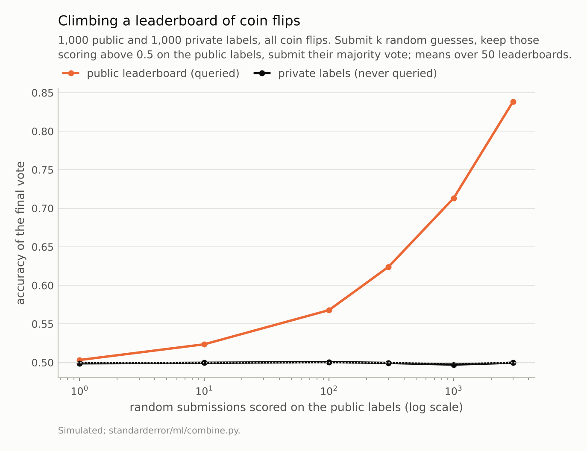
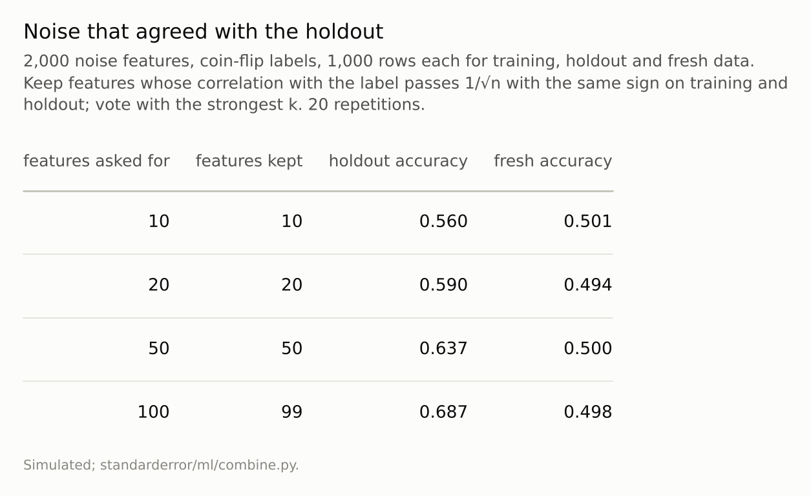
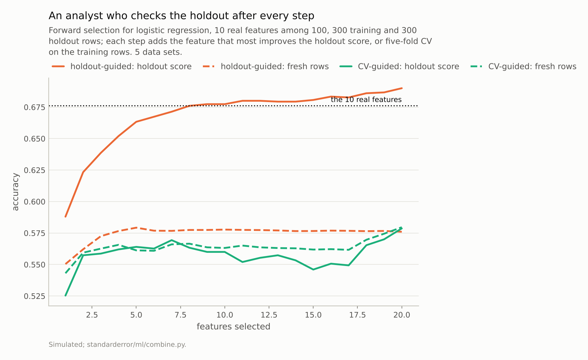

Disclosure: this post was written with the assistance of an AI system (Claude), which wrote the analysis code, ran the experiments and drafted the text. The topic, the constraints, the data choices and the final review are the author's.

*Three ways to wear out a holdout without training on it. On a leaderboard of 1,000 coin-flip labels, the majority vote of random guesses that scored above 0.5 reached 0.713 after 1,000 submissions and 0.497 on the private labels. Noise features kept because they agreed with the holdout gave 0.687 on it and 0.498 on fresh rows. An analyst adding, at each step, the feature that most improved holdout accuracy saw 0.690 after 20 steps, above the 0.676 the true model scores; fresh accuracy was 0.576.*

Episode 45 of *Machine Learning, Taught Through What Breaks*. The syllabus and the other episodes: https://jongha-jeon-dev.github.io/standarderror/lectures/

## The rule about test sets

Episode 1 put an error bar on a test score. Episode 35 found that the best of many cross-validated scores reports the luck of the search. Episode 44 asked which tests can tell two models apart. Each assumed the test set was used once. In practice it rarely is: a model is scored, adjusted, scored again; a competition's public leaderboard is consulted thousands of times. The reassurance that makes this feel safe is the sentence under test: *a held-out test set gives an unbiased estimate, however often you look at it, as long as you never train on it*.

The cleanest refutation is Blum and Hardt's, from 2015. A leaderboard holds 1,000 public labels and 1,000 private ones, and every label is a coin flip, so no submission can genuinely beat 0.5. The attacker submits random guesses, notes which scored above 0.5 on the public labels, and submits the majority vote of those:

```python
from standarderror.ml import combine

for r in combine.leaderboard_attack():   # 50 leaderboards
    print(f"{r['queries']:5d} submissions: public {r['public']:.3f}, "
          f"private {r['private']:.3f}")
```

```text
    1 submissions: public 0.503, private 0.499
   10 submissions: public 0.524, private 0.500
  100 submissions: public 0.568, private 0.500
  300 submissions: public 0.624, private 0.499
 1000 submissions: public 0.713, private 0.497
 3000 submissions: public 0.839, private 0.500
```

After 1,000 submissions the vote scores **0.713** on the public labels and 0.497 on the private ones. Nothing was trained on anything. Each submission asked the public labels one question, "is this guess better than chance?", and each answer leaked a little about them. The vote collects those leaks.



*After 1,000 submissions the vote scored **0.713** on the public labels and 0.497 on the private ones.*

## Without an attacker

Nobody does that on purpose. Dwork and colleagues showed in 2015 that an ordinary-looking analysis does it by accident. Their example, scaled down here: 2,000 features of pure noise and coin-flip labels. Keep the features whose correlation with the label is noticeably positive or negative on the training set *and* agrees in sign on the holdout, which sounds like a careful way of keeping only features that replicate. Then classify by a vote of the strongest ones.

Asked for 100 such features (about 99 pass the filter on average), the classifier scores **0.687** on the holdout. On fresh data it scores 0.498. The holdout was never trained on; it was used to decide which features to keep, and the features it kept are the ones that agree with its particular noise. Its score is now a measurement of how well the model fits the holdout, which is what it was chosen for.



*The holdout was never trained on. It was asked which features to keep, and its answer is now part of the model.*

## An analyst, step by step

The third case is the most ordinary. A data set with 100 features, ten of them weakly informative; 300 rows to train on and 300 held out. The analyst builds a logistic model by forward selection, adding at each step the feature that most improves accuracy on the holdout, a natural thing to do with a holdout one is told not to train on. For comparison, a second analyst chooses each step by five-fold cross-validation on the training rows and leaves the holdout alone until the end.

```python
h = combine.greedy_holdout(by="holdout")
c = combine.greedy_holdout(by="cv")
print("features | holdout-guided: holdout / fresh | CV-guided: same")
for step in (0, 4, 9, 19):
    print(f"{step + 1:8d} | {h['holdout'][step]:.3f} / "
          f"{h['fresh'][step]:.3f}{'':18s} | {c['holdout'][step]:.3f}"
          f" / {c['fresh'][step]:.3f}")
print(f"real features among 20 chosen: holdout-guided "
      f"{h['real_share'][19]:.0%}, CV-guided {c['real_share'][19]:.0%}")
```

```text
features | holdout-guided: holdout / fresh | CV-guided: same
       1 | 0.588 / 0.550                   | 0.525 / 0.543
       5 | 0.663 / 0.579                   | 0.564 / 0.561
      10 | 0.677 / 0.578                   | 0.560 / 0.563
      20 | 0.690 / 0.576                   | 0.579 / 0.580
real features among 20 chosen: holdout-guided 14%, CV-guided 16%
```

The first analyst's holdout score rises at almost every step, to **0.690** with 20 features. That is above 0.676, what a model given exactly the ten real features scores on fresh data, the best this procedure could honestly reach. On fresh rows the same models peaked at 0.579 after 5 features and ended at 0.576, and only 14% of the 20 chosen features were real. The holdout overstated the final model by 0.114.

The second analyst's holdout, consulted only to report the result, said 0.579 for a model that scored 0.580 on fresh rows, within 0.001. Cross-validation inside the training rows is subject to episode 35's luck of the search, and that selection picked noise too (only 16% of its 20 features were real), but its luck was spent on the training rows, not on the set used to report the score, so the report stayed honest about the model it got.



*After 20 holdout-guided steps the holdout said **0.690**; fresh rows said 0.576, and a model on the 10 real features scores 0.676.*

## Spending a test set

The common thread is that a test set's honesty is a budget, and it is spent by adaptivity: any decision made after looking at a test score, whether to keep a feature, a model, a hyperparameter or a submission, makes later scores on the same set depend on its particular noise. Training on it spends the budget at once. Looking at it spends a little per look, and the amount depends on how much each look changes what happens next.

Two kinds of remedy follow. The procedural one is the oldest: keep a final test set that is used once, after all decisions are made, and accept that its score, with episode 1's error bar, is the report. Everything before it, including any "validation" or "public" set, is part of training in the sense that matters. The algorithmic one, from the same authors, limits what each look reveals: Blum and Hardt's Ladder reports a new leaderboard score only when a submission beats the previous best by a margin, and Dwork and colleagues' Thresholdout answers queries with the training score unless the holdout disagrees by more than a noisy threshold. Both slow the leak, at the price of less precise answers.

Benchmarks raise the same question at the scale of a field. Recht and colleagues rebuilt ImageNet's test set following the original procedure and found that published models lost 11 to 14 points of accuracy on it while keeping their order, and they attributed the loss mainly to the new images being harder rather than to years of adaptive reuse. With large test sets and many genuinely different models, the leak can be slow; the three cases above show where it is fast.

## Where this breaks

**Adversarial by construction.** The leaderboard attack and the noise selection are the worst cases, with nothing real to find. With strong real signal, the honest part of each score dominates and the adaptive part matters less.

**Small holdouts.** 300 to 1,000 rows. In Blum and Hardt's analysis the gain from such attacks shrinks roughly as one over the square root of the holdout's size, so large test sets tolerate more looks; they do not tolerate unlimited ones.

**One analyst, one strategy.** Real model development mixes holdout-guided decisions with others, and counting how many decisions a test set has informed is rarely possible after the fact, which is the practical argument for a set used once.

**Greedy selection is crude.** A more careful analyst would regularise and stop earlier; the mechanism, deciding by a score and then reporting that score, is the same.

## What to keep

1. Coin-flip labels, never trained on: the majority vote of random guesses kept for beating 0.5 scored 0.713 on the public labels after 1,000 submissions and 0.497 on the private ones.

2. Features kept because they replicated on the holdout gave 0.687 there and 0.498 on fresh data.

3. Forward selection guided by the holdout reported 0.690 after 20 steps, above the true model's 0.676; fresh accuracy was 0.576. Guided by cross-validation instead, the holdout matched fresh rows to within 0.001.

4. Treat every test score that informed a decision as part of training. Keep one test set for one final report, and count the decisions made with anything else.

## Exercise

List every decision made in your last modelling project after looking at a score on the validation or test set: features, models, hyperparameters, thresholds, early stopping, which runs to keep. Mark the ones made on the set you finally reported.

If any are marked, the reported score is optimistic by an unknown amount. Hold out a fresh sample, even a small one, score the final model on it once, and compare; the difference is a measurement of how much of the test set's honesty was spent.

## Next

Arc IX ends here, at forty-five episodes. Combining and comparing turned out to need the same care as fitting: an average that hands its decisions to its most confident member, a stack that learns from memorised predictions unless shown honest ones, naive Bayes counting the same evidence twice, tests that see a difference between equal algorithms one time in seven or more, and a test set that stays honest only as long as nobody acts on what it says. Arc X follows predictions into the decisions made with them, starting with episode 46 and the threshold most classifiers use by default.

---

### Data

- Simulated leaderboards: 1,000 public and 1,000 private coin-flip labels, random 0/1 submissions; 50 leaderboards (seeds 0 to 49).
- Simulated noise selection: 2,000 standard-normal features and ±1 coin-flip labels, 1,000 rows each for training, holdout and fresh data; 20 repetitions (seeds 0 to 19).
- Simulated forward selection: 100 standard-normal features, the first 10 with weight 0.35 on the log-odds; 300 training rows, 300 holdout rows, 20,000 fresh rows; 5 data sets (seeds 0 to 4).
- Machinery: `standarderror/ml/combine.py`, tested in `tests/test_ml.py`; scikit-learn's LogisticRegression and five-fold stratified cross-validation.
- Where this stops: Dwork et al., "The reusable holdout: preserving validity in adaptive data analysis", *Science* (2015); Blum and Hardt, "The Ladder: a reliable leaderboard for machine learning competitions", *ICML* (2015); Recht et al., "Do ImageNet classifiers generalize to ImageNet?", *ICML* (2019).

### Reproducibility

- **environment**: standarderror=0.1.0, python=3.13.16, numpy=2.4.4
- **code blocks**: executed at build time; the values the prose quotes are pinned, so drift fails the build
- **determinism**: seeds as listed; about ten minutes of CPU, most of it the cross-validated selection

Code: <https://github.com/jongha-jeon-dev/standarderror>
