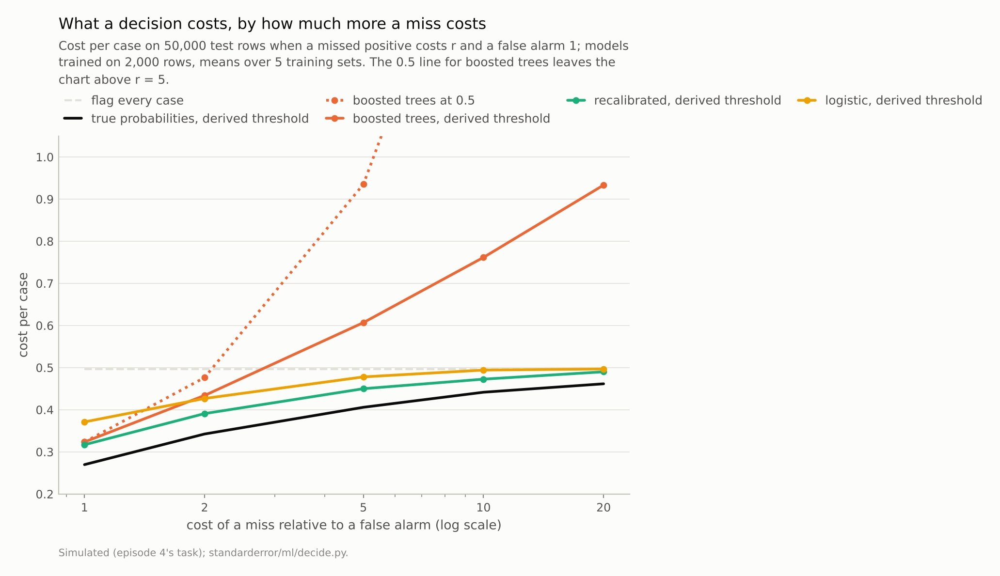
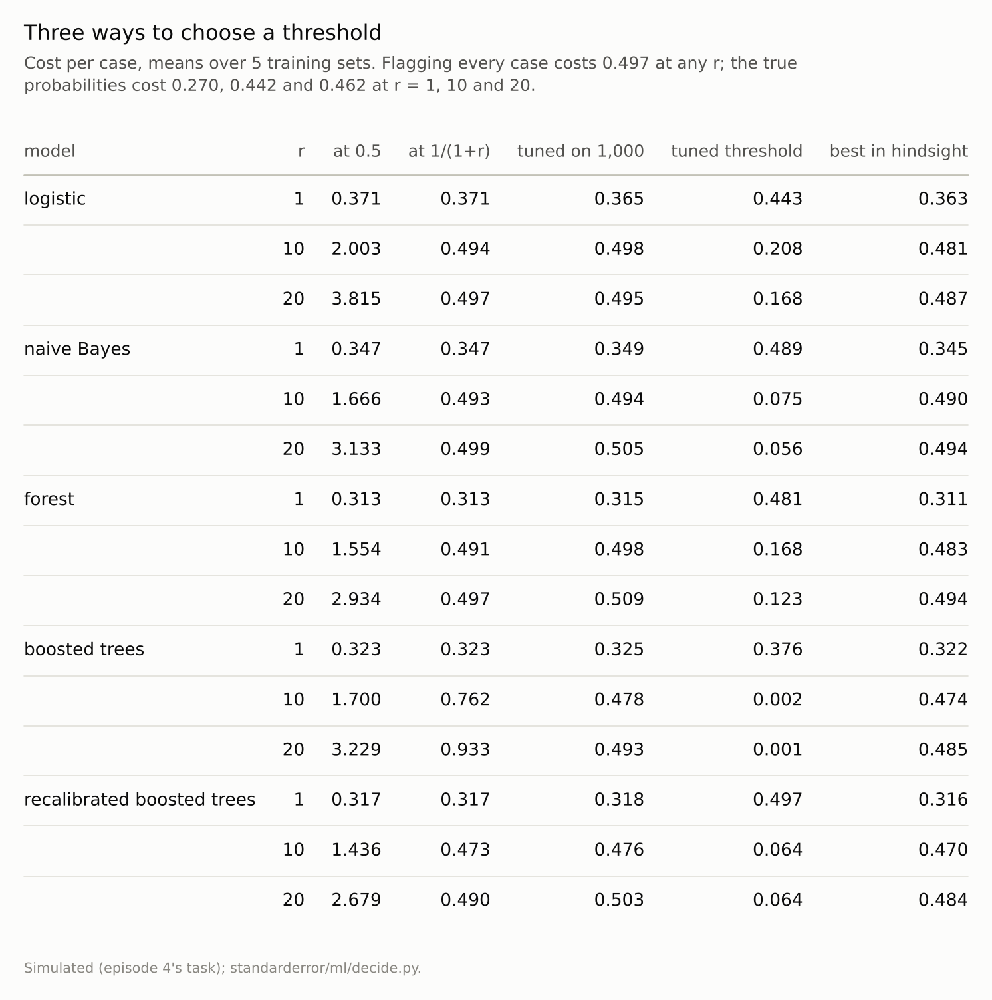

Disclosure: this post was written with the assistance of an AI system (Claude), which wrote the analysis code, ran the experiments and drafted the text. The topic, the constraints, the data choices and the final review are the author's.

*Episode 4's simulated task with a miss costing r times a false alarm. At r = 10, flagging at 0.5 cost 1.44 to 2.00 per case, against 0.497 for flagging every case. The cost-derived threshold 1/(1 + r) came within 0.003 of the best threshold in hindsight for recalibrated boosted trees (0.473); for the raw, overconfident trees it cost 0.762, worse than flagging everyone. A threshold tuned on 1,000 fresh rows rescued them (0.478), and at r = 20 was worse than flagging everyone for three of five models. The true probabilities beat flagging everyone by 11% at r = 10.*

Episode 46 of *Machine Learning, Taught Through What Breaks*. The syllabus and the other episodes: https://jongha-jeon-dev.github.io/standarderror/lectures/

## From a probability to an action

Forty-five episodes measured models and the numbers they produce. Arc X follows those numbers one step further, to the decisions made with them: which cases to flag, which model to deploy, which lever to pull, whom to treat, and what happens when the decisions feed the next round of data. The first step is the simplest and the most often skipped. A classifier outputs a probability; something turns it into a yes or no. The default, built into most classifiers' `predict` method, is the sentence under test: *a classifier predicts the positive class when its probability is above 0.5*.

Episode 5 found that rebalancing classes is a roundabout way of moving that threshold. This episode asks where it should be. The answer is standard decision theory, set out for classifiers by Elkan in 2001: if a missed positive costs r times as much as a false alarm, flag a case when its probability of being positive exceeds 1/(1 + r). At r = 1 that is 0.5. At r = 10, a miss being ten times as costly as a false alarm, it is 1/11.

Episode 4's simulated task makes the best possible decision known, because the true probability of every test case is known. Models are trained on 2,000 rows, and each threshold is scored by its cost per case on 50,000 test rows:

```python
from standarderror.ml import decide

t = decide.threshold_costs()   # 5 training sets of 2,000 rows
print(f"flag every case: {t['flag_all'][10]:.3f} per case")
print(f"true probabilities: {t['bayes'][10]:.3f} per case")
for name, v in t["models"].items():
    r = v[10]                   # a miss costs 10 false alarms
    print(f"{name:22s} at 0.5 {r['half']:.3f}, at 1/11 "
          f"{r['derived']:.3f}, tuned {r['tuned']:.3f}")
```

```text
flag every case: 0.497 per case
true probabilities: 0.442 per case
logistic               at 0.5 2.003, at 1/11 0.494, tuned 0.498
naive Bayes            at 0.5 1.666, at 1/11 0.493, tuned 0.494
forest                 at 0.5 1.554, at 1/11 0.491, tuned 0.498
boosted trees          at 0.5 1.700, at 1/11 0.762, tuned 0.478
recalibrated boosted trees at 0.5 1.436, at 1/11 0.473, tuned 0.476
```

At r = 10, every model flagging at 0.5 costs between **1.44** and 2.00 per case. The trivial policy of flagging every case costs 0.497, the share of negatives. A model used with the default threshold is roughly three to four times worse (2.9 to 4.0 times) than not using a model at all.



*At r = 10 the derived threshold cost the recalibrated model 0.473 and the raw boosted trees **0.762**; flagging every case costs 0.497.*

## The derived threshold needs honest probabilities

Moving the threshold to 1/11 fixes most of it. Logistic regression costs 0.494, within 0.013 of the best threshold in hindsight; boosted trees recalibrated by isotonic regression cost **0.473**, within 0.002.

The raw boosted trees are the exception: at 1/11 they cost **0.762**, worse than flagging everyone. The formula assumes that a probability of 0.05 means a 5% chance, and episode 14 found that boosting overfits its probabilities long before its accuracy:

```python
b = t["models"]["boosted trees"][10]
c = t["models"]["recalibrated boosted trees"][10]
print(f"probabilities below 0.01: raw {b['below_001']:.1%}, "
      f"recalibrated {c['below_001']:.1%}")
print(f"flagged at 1/11: raw {b['flag_rate']:.1%}, "
      f"recalibrated {c['flag_rate']:.1%}")
```

```text
probabilities below 0.01: raw 10.7%, recalibrated 1.8%
flagged at 1/11: raw 76.2%, recalibrated 93.6%
```

The raw model sends 11% of cases below 0.01, against 1.8% once recalibrated, so at 1/11 it clears cases that are not nearly as safe as it claims and pays ten for every positive among them. The threshold derived from the costs is exactly as good as the calibration of the probabilities it is applied to, which is the practical reason episode 34's recalibration matters even when accuracy does not move.



*'Tuned' is the threshold that was cheapest on 1,000 fresh rows; 'best in hindsight' is the cheapest on the test rows themselves, which no one gets to choose.*

## Tuning the threshold instead

The alternative to trusting the probabilities is to choose the threshold by its cost on held-out data. Tuned on 1,000 fresh rows, the boosted trees' threshold settled at 0.0020, far below 1/11, and their cost fell to 0.478: tuning absorbs miscalibration, because it only needs the order of the scores.

It has its own cost. The cheapest threshold on 1,000 rows plausibly depends on the handful of rare, expensive misses among them, which makes it noisy at high r. At r = 20 the tuned threshold was worse than flagging everyone for three of the five models (naive Bayes; forest; recalibrated boosted trees). Tuning and calibration need data for the same reason; tuning needs it at the operating point, where the expensive errors are rare.

## What the derived threshold asks for

It is worth seeing what following the costs looks like in practice, because it can be uncomfortable. At r = 10 the derived threshold flagged 99.7% of cases for logistic regression and 93.6% for the recalibrated trees. A process built around 0.5, which flags about half, would be asked to flag nearly everything, and its cost per case would fall from 2.00 to 0.494 as a result.

The raw boosted trees, flagging only 76.2% at the same threshold, look more selective, and that apparent selectivity is a symptom of their overconfidence: many of the cases they clear are not as safe as their probabilities claim, which is why that threshold cost them 0.762. A flag rate is therefore a useful check in its own right. If the cost-derived threshold flags far fewer cases than the costs imply it should, the probabilities are probably too extreme, and the remedy is recalibration before thresholding, not a different threshold.

At r = 1 all of this collapses back to the familiar case: the derived threshold is 0.5, and the five models' costs at it ranged from 0.313 to 0.371, against 0.270 for the true probabilities.

## How much a model is worth here

The flat line in the first figure is a useful discipline. At r = 10 the best a model could possibly do on this task, using the true probabilities with the derived threshold, is 0.442 per case. Flagging everyone costs 0.497. The perfect model saves **11%**, and the trained models less than half of that.

That is not a defect of the models. When misses are expensive, the decision is to flag almost everything, and a model can only help by finding cases safe enough to clear; on a task where the classes overlap heavily, there are few. Provost and Fawcett's ROC convex hull makes the same point geometrically: for each cost ratio there is an operating point, and the value of a classifier is measured there, against the trivial policies at the corners, not by its accuracy at 0.5.

## Where this breaks

**Known, fixed costs.** Real costs are uncertain, different for different cases and sometimes asymmetric in ways a single ratio cannot express. The arithmetic still applies per case if the costs are known per case.

**Balanced classes.** The task has half positives. With rare positives the derived threshold stays at 1/(1 + r), but flagging nobody becomes the cheap trivial policy to beat.

**One task with heavy overlap.** On a task where the classes separate well, models would likely save much more than 11%; that was not measured here.

**Five training sets.** Costs at r = 20 are dominated by rare misses and are noisy; the counts of models beaten by flagging everyone could change with other training sets.

## What to keep

1. With a miss ten times as costly as a false alarm, the 0.5 threshold cost 1.44 to 2.00 per case, roughly three to four times flagging every case (0.497).

2. The threshold 1/(1 + r) came within 0.003 of the best for recalibrated boosted trees and cost the raw, overconfident ones 0.762.

3. Tuning the threshold on held-out rows works without calibration but needs data at the operating point; at r = 20 it lost to flagging everyone for three of five models.

4. Choose the threshold from the costs, use it only on calibrated probabilities, and compare the result with the trivial policies before claiming the model is worth deploying.

## Exercise

For a classifier you use, write down what a missed positive and a false alarm each cost, even roughly, and compute 1/(1 + r). Check a calibration curve near that threshold, not overall.

Then compute the cost per case of your current threshold, of 1/(1 + r), and of the two trivial policies, flagging everything and flagging nothing. If the model does not clearly beat the better trivial policy, its value lies elsewhere than in this decision.

## Next

A threshold is chosen for one model. Choosing between models is usually done earlier, by a single number, and the most common one is the AUC. Episode 47 asks whether the model with the best AUC makes the best decisions.

---

### Data

- Simulated: episode 4's two-class Gaussian task in 10 dimensions with 50,000 test rows and their exact posterior probabilities; models trained on 2,000 rows (seeds 10 to 14), thresholds tuned on 1,000 fresh rows (seeds 100 to 104).
- Machinery: `standarderror/ml/decide.py`, tested in `tests/test_ml.py`; scikit-learn's LogisticRegression, GaussianNB, RandomForestClassifier (300 trees, leaves of 5), HistGradientBoostingClassifier (300 rounds) and CalibratedClassifierCV (isotonic, five folds).
- Where this stops: Elkan, "The foundations of cost-sensitive learning", *IJCAI* (2001); Provost and Fawcett, "Robust classification for imprecise environments", *Machine Learning* (2001); episodes 5 and 34 of this series.

### Reproducibility

- **environment**: standarderror=0.1.0, python=3.13.16, numpy=2.4.4
- **code blocks**: executed at build time; the values the prose quotes are pinned, so drift fails the build
- **determinism**: seeds as listed; about a minute of CPU

Code: <https://github.com/jongha-jeon-dev/standarderror>
