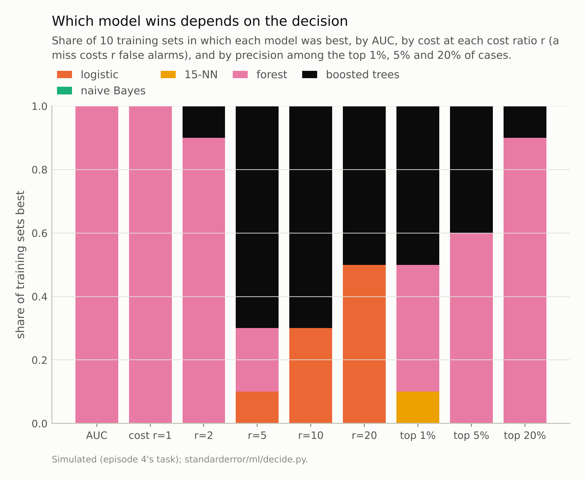
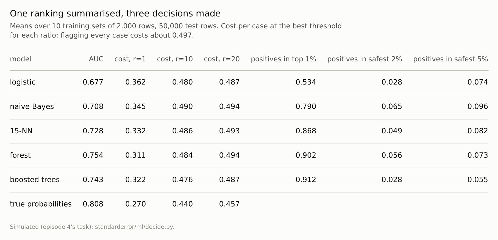

Disclosure: this post was written with the assistance of an AI system (Claude), which wrote the analysis code, ran the experiments and drafted the text. The topic, the constraints, the data choices and the final review are the author's.

*Five models on a simulated task, ten training sets each. A random forest had the highest AUC every time (0.754) and the lowest cost every time when both errors cost the same. When a miss cost ten times a false alarm it was the cheapest model in none of the ten: boosted trees in 7 and logistic regression, last by AUC at 0.677, in 3. Among the 2% of cases each model rated safest, the forest's held 5.6% positives and the logistic model's 2.8%.*

Episode 47 of *Machine Learning, Taught Through What Breaks*. The syllabus and the other episodes: https://jongha-jeon-dev.github.io/standarderror/lectures/

## Choosing the model by one number

Episode 46 set the threshold for one model from the costs of its mistakes. Before that, a model has usually been chosen, and the usual basis is a single number that ignores thresholds altogether: the area under the ROC curve, the probability that a random positive is scored above a random negative. Its appeal is that it does not depend on the operating point, and the inference drawn from it is the sentence under test: *the model with the higher AUC makes better decisions*.

Five models on episode 4's task (logistic regression, naive Bayes, fifteen-nearest-neighbours, a random forest and boosted trees) were trained on ten different sets of 2,000 rows. Each was scored by AUC, and by the cost of its best decision at several cost ratios, with each model given its own best threshold, so that only the ranking it produces is being compared.

```python
from standarderror.ml import decide

a = decide.auc_and_decisions()   # 10 training sets of 2,000 rows
for k, v in a["mean"].items():
    print(f"{k:14s} AUC {v['auc']:.3f} | best cost at r=1 "
          f"{v['cost1']:.3f}, r=10 {v['cost10']:.3f}, r=20 {v['cost20']:.3f}")
for q in ("auc", "cost1", "cost10", "cost20"):
    w = {k: v for k, v in a["wins"][q].items() if v}
    print(f"best by {q}: {w}")
```

```text
logistic       AUC 0.677 | best cost at r=1 0.362, r=10 0.480, r=20 0.487
naive Bayes    AUC 0.708 | best cost at r=1 0.345, r=10 0.490, r=20 0.494
15-NN          AUC 0.728 | best cost at r=1 0.332, r=10 0.486, r=20 0.493
forest         AUC 0.754 | best cost at r=1 0.311, r=10 0.484, r=20 0.494
boosted trees  AUC 0.743 | best cost at r=1 0.322, r=10 0.476, r=20 0.487
best by auc: {'forest': 1.0}
best by cost1: {'forest': 1.0}
best by cost10: {'logistic': 0.3, 'boosted trees': 0.7}
best by cost20: {'logistic': 0.5, 'boosted trees': 0.5}
```

When both errors cost the same, AUC chose correctly: the forest had the highest AUC in all ten training sets and the lowest cost in all ten. When a miss cost ten times a false alarm, the forest was the cheapest model in **none** of them. The boosted trees were cheapest in 7, and logistic regression, whose mean AUC of **0.677** was the lowest of the five by a wide margin, in 3. At twenty times, logistic regression and the boosted trees split the ten.



*Best by AUC in 10 of 10 training sets, the forest was the cheapest model at r = 10 in **0**; logistic regression, last by AUC, in 3.*

## Where the decision is made

Episode 46 showed that when misses are expensive the decision is to flag nearly everything, and the model's job shrinks to finding the few cases safe enough to clear. What matters is then the ranking at the very bottom: how pure the cases a model rates safest really are.

```python
for k, v in a["mean"].items():
    print(f"{k:14s} positives among its safest 2%: "
          f"{v['bottom0.02']:.1%}, safest 5%: {v['bottom0.05']:.1%}")
```

```text
logistic       positives among its safest 2%: 2.8%, safest 5%: 7.4%
naive Bayes    positives among its safest 2%: 6.5%, safest 5%: 9.6%
15-NN          positives among its safest 2%: 4.9%, safest 5%: 8.2%
forest         positives among its safest 2%: 5.6%, safest 5%: 7.3%
boosted trees  positives among its safest 2%: 2.8%, safest 5%: 5.5%
```

Among the 2% of cases each model rated safest, the forest's held **5.6%** positives, and logistic regression's 2.8%, half as many. The boosted trees matched logistic regression there (2.8%). The forest's leaves average at least five training rows each, which plausibly blunts its scores at the extremes, where the linear model's scores keep going; the measurement shows the effect, not that cause.

The AUC is an average over the whole ranking, and these regions are a small part of it. A model can lead on average and trail in the corner the decision uses. Hand made the stronger point in 2009: comparing AUCs is equivalent to comparing expected costs under a distribution of cost ratios that depends on the classifier itself, so two models' AUCs are averages over different, implicit beliefs about the costs. Using the AUC to choose between them assumes something about the decision that nobody wrote down.



*'Safest' is the share of cases a model scores lowest; the fraction of positives among them is what clearing them costs.*

## Two models, two ends

Naive Bayes shows the same thing from the other side. Its AUC, 0.708, was clearly above logistic regression's 0.677, and among the 1% of cases it rated riskiest it found 79.0% positives against logistic regression's 53.4%. At the safe end it was the worst of the five: 6.5% positives among its safest 2%, and the highest cost of all at r = 10 (0.490). Two models can each be better than the other, at opposite ends of the same ranking, and the AUC adds the two ends together.

The switch is not abrupt. As the cost ratio rises from 1 to 20, the forest's wins go from 10 in ten to 9, 2 and then none, while the boosted trees' go from none to 7 at r = 5, and logistic regression enters at r = 5 and takes half the wins at r = 20. Each ratio corresponds to a different point on the ROC curve, and the curves cross somewhere along the way. The training-set-to-training-set noise matters too: the AUCs differed by more than their standard deviations across training sets, while at r = 10 the costs of the leading models differed by about one standard deviation, which is why the wins are split rather than unanimous.

## Better summaries, and the real one

The obvious repair is a partial AUC over the region that matters, which McClish proposed in 1989. Restricted to the high-sensitivity end, false-negative rates of 10% or less, it chose the forest in 4 training sets and the boosted trees in 6, and never logistic regression, plausibly because the decisions at r = 10 and 20 sit further out still, clearing only a few percent of cases. A partial AUC is only as good as the guess about where the operating point is.

The direct summary is the one the decision uses: the cost at the operating point, or the precision in the top k when capacity is fixed. At the top end the AUC's ranking roughly held: among the 5% of cases each model rated riskiest, the forest or the boosted trees, the top two by AUC, had the highest precision in every training set, the forest alone in 6. Which end matters is a fact about the use, not about the model.

The differences in cost at r = 10 are small, up to about a hundredth per case, because, as episode 46 found, even the true probabilities save only about a tenth of the cost of flagging everyone (0.440 at their best threshold here, against about 0.497). Small differences in a small saving are still the differences that decide which model to deploy.

## Where this breaks

**One task with overlapping classes.** On tasks where models separate the classes well, their ROC curves may cross less often; that was not measured here.

**Each model at its own best threshold.** Real deployments choose the threshold on validation data, as in episode 46, which adds noise to every cost and can change the winner in close cases.

**Ten training sets.** The counts of wins are out of ten; the forest's zero at r = 10 and its ten by AUC are the robust part.

**Accuracy-like decisions only.** Decisions that depend on calibrated probabilities, not just the ranking, add calibration to the comparison, as episode 46 measured.

## What to keep

1. The forest had the highest AUC in all ten training sets and the lowest cost when both errors cost the same.

2. When a miss cost ten times a false alarm it was cheapest in none; logistic regression, last by AUC, was cheapest in 3 and at twenty times in 5.

3. The decision at those costs depends on the cases a model rates safest, where the forest put 5.6% positives and logistic regression 2.8%.

4. Choose a model by its cost at the operating point you will use, or by precision at the capacity you have, and use the AUC only as a first filter.

## Exercise

Take two models you compared by AUC and plot both ROC curves on the same axes. Mark the point each would operate at, from the costs or the capacity of the decision.

If the curves cross, compute each model's cost or precision at that point and see whether the AUC's choice survives. Then sort each model's scores and compare the positive rate among the 2% it rates safest and the 2% it rates riskiest.

## Next

Episodes 46 and 47 used a model's ranking to decide whom to flag. A different decision asks what to change: which feature, if moved, would move the outcome. Episode 48 compares what a model relies on with what intervening would actually do.

---

### Data

- Simulated: episode 4's two-class Gaussian task in 10 dimensions; ten training sets of 2,000 rows (seeds 10 to 19), 50,000 test rows with exact posterior probabilities.
- Machinery: `standarderror/ml/decide.py`, tested in `tests/test_ml.py`; scikit-learn's LogisticRegression, GaussianNB, KNeighborsClassifier (k = 15), RandomForestClassifier (300 trees, leaves of 5), HistGradientBoostingClassifier (300 rounds), roc_auc_score (with max_fpr for the partial AUC).
- Where this stops: Hand, "Measuring classifier performance: a coherent alternative to the area under the ROC curve", *Machine Learning* (2009); Provost and Fawcett, "Robust classification for imprecise environments", *Machine Learning* (2001); McClish, "Analyzing a portion of the ROC curve", *Medical Decision Making* (1989).

### Reproducibility

- **environment**: standarderror=0.1.0, python=3.13.16, numpy=2.4.4
- **code blocks**: executed at build time; the values the prose quotes are pinned, so drift fails the build
- **determinism**: training seeds 10 to 19, model random_state 0; about a minute of CPU

Code: <https://github.com/jongha-jeon-dev/standarderror>
