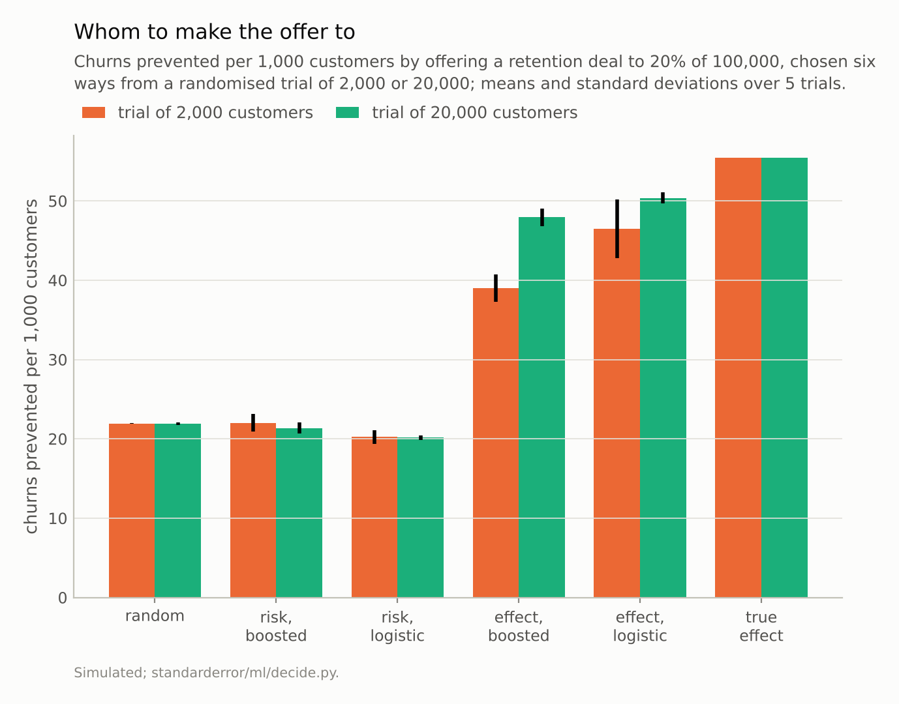
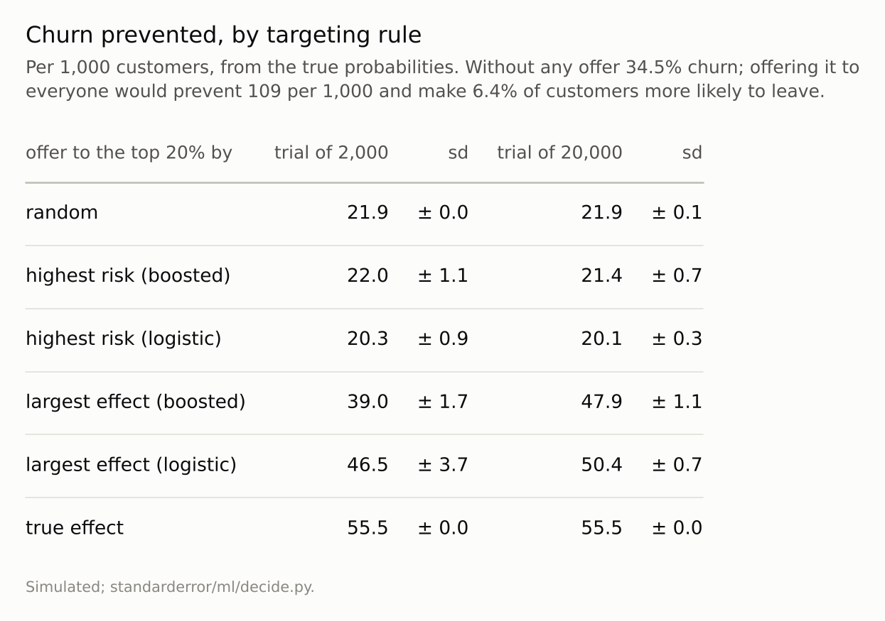

Disclosure: this post was written with the assistance of an AI system (Claude), which wrote the analysis code, ran the experiments and drafted the text. The topic, the constraints, the data choices and the final review are the author's.

*A simulated retention offer, a randomised trial behind it and a budget for 20% of customers. Offering it to the highest predicted churners prevented 20.1 to 22.0 churns per 1,000 customers, about what random targeting prevented (21.9). Ranking by the predicted reduction in churn, the difference of two models fitted to the trial's arms, prevented 39.0 to 50.4; the best possible was 55.5. Among the highest-risk fifth, 11% of customers were made more likely to leave by the offer, against 6% overall.*

Episode 49 of *Machine Learning, Taught Through What Breaks*. The syllabus and the other episodes: https://jongha-jeon-dev.github.io/standarderror/lectures/

## The people most at risk

Episode 48 found that the features a model leans on need not be levers. When the lever is known, a treatment, an offer, an intervention, the remaining decision is whom to apply it to, and the model asked to decide is usually a risk model: who is most likely to churn, default, be readmitted. The sentence under test is the obvious policy that follows: *give the intervention to the people the model says are most at risk*.

The simulation is a retention offer. Without it, 34.5% of customers churn, and the chance rises with two features. The offer's effect differs from person to person. It helps most for customers of middling risk; it does little for those almost certain to stay, who will stay anyway, and little for those almost certain to leave, whom one offer will not keep. And for customers with a high value of a third feature whose risk is far from the middle, about one customer in fifteen, it backfires: being contacted makes them more likely to go. Radcliffe and Surry's names for the four groups are the persuadables, the sure things, the lost causes and the do-not-disturbs, also called sleeping dogs.

A randomised trial offers the deal to half of 2,000 or 20,000 customers. From it, models choose which 20% of a new population of 100,000 to offer it to, and the churn prevented is computed from the true probabilities:

```python
from standarderror.ml import decide

u = decide.uplift_targeting()   # budget: 20% of customers
for row in u["rows"]:
    print(f"trial of {row['n']:,} customers:")
    for k, v in row.items():
        if k not in ("n", "sd"):
            print(f"   {k:26s} {v:5.1f} churns prevented per 1,000")
```

```text
trial of 2,000 customers:
   random                      21.9 churns prevented per 1,000
   true effect                 55.5 churns prevented per 1,000
   highest risk (boosted)      22.0 churns prevented per 1,000
   largest effect (boosted)    39.0 churns prevented per 1,000
   highest risk (logistic)     20.3 churns prevented per 1,000
   largest effect (logistic)   46.5 churns prevented per 1,000
trial of 20,000 customers:
   random                      21.9 churns prevented per 1,000
   true effect                 55.5 churns prevented per 1,000
   highest risk (boosted)      21.4 churns prevented per 1,000
   largest effect (boosted)    47.9 churns prevented per 1,000
   highest risk (logistic)     20.1 churns prevented per 1,000
   largest effect (logistic)   50.4 churns prevented per 1,000
```

Offering the deal to the fifth with the highest predicted churn prevented between **20.1** and 22.0 churns per 1,000 customers. Choosing the fifth at random prevented 21.9. With the logistic risk model and the large trial, the risk-targeted offer did slightly worse than random.



*Targeting the highest predicted risk prevented 21.4 per 1,000; random targeting 21.9; the predicted effect **50.4**.*

## Why risk is the wrong ranking

The offer's value for a customer is the difference between two probabilities, churn without it and churn with it. A risk model estimates the first. High risk is correlated with a large difference only if the offer works best for the people most likely to leave, and here it does not:

```python
print("made more likely to churn by the offer:")
print(f"   {u['harmed_share']:.1%} of all customers, "
      f"{u['top_risk_harmed']:.1%} of the highest-risk fifth")
print(f"mean reduction in churn probability: all customers "
      f"{u['mean_gain']:.3f}, highest-risk fifth {u['top_risk_mean_gain']:.3f}")
```

```text
made more likely to churn by the offer:
   6.4% of all customers, 11.2% of the highest-risk fifth
mean reduction in churn probability: all customers 0.109, highest-risk fifth 0.100
```

The highest-risk fifth holds more of the customers the offer harms. On average the offer reduced their churn probability by 0.100, less than its average over all customers, 0.109, and 11.2% of them were made more likely to leave, against 6.4% overall. Ranking by risk spends the budget on customers moved slightly less than average, and harmed more often.



*'Risk' ranks by a model of the trial's untreated arm. 'Effect' ranks by the difference between models of the untreated and treated arms.*

## Ranking by the effect

The trial makes a better ranking possible. Fit one model to the customers who were offered the deal and another to those who were not, and rank new customers by the difference between their two predictions: Künzel and colleagues call this the T-learner, the simplest of several meta-learners for heterogeneous effects. It prevented **50.4** churns per 1,000 with logistic models and the large trial, more than twice the risk ranking, against 55.5 for ranking by the true effect.

Estimating a difference is harder than estimating a level: the noise of two separate fits adds up in their difference. With the smaller trial the effect ranking fell to 46.5 with logistic models, varying from trial to trial with a standard deviation of 3.7, and to 39.0 with boosted trees. The logistic T-learner beat the boosted one at both trial sizes (50.4 against 47.9 with the large trial), even though the true effect is not linear in the features; a plausible reason, not isolated here, is that two simpler models leave less noise in their difference than two flexible ones. Neither came closer than 5.1 churns per 1,000 to ranking by the true effect. Methods that model the difference directly, such as Athey and Imbens's causal trees, exist for this reason. And the whole approach rests on the trial: without random assignment, the difference between offered and not-offered customers would mix the offer's effect with the reasons they were offered it, which is episodes 39 and 48 at once.

## How the budget changes the answer

All of this was at one budget, a fifth of the customers. The ranking matters most when the budget is small and stops mattering when it covers everyone, so the same comparison was run at five budgets, with logistic models and the large trial:

```python
for b, v in decide.uplift_budgets().items():   # trial of 20,000
    print(f"offer to {b:4.0%}: by risk {v['risk']:5.1f}, by effect "
          f"{v['effect']:5.1f}, at random {v['random']:5.1f}, "
          f"best {v['true']:5.1f}")
```

```text
offer to   5%: by risk   0.9, by effect  14.7, at random   5.5, best  17.1
offer to  10%: by risk   4.7, by effect  27.9, at random  10.9, best  31.7
offer to  20%: by risk  20.1, by effect  50.4, at random  21.9, best  55.5
offer to  50%: by risk  79.5, by effect  92.4, at random  54.7, best  98.1
offer to 100%: by risk 109.4, by effect 109.4, at random 109.4, best 109.4
```

With only 5% of customers reachable, offering the deal to the highest predicted risk prevented **0.9** churns per 1,000, against 5.5 for a random 5% and 14.7 for the effect ranking: the riskiest twentieth gained on average only 0.018 in churn probability from the offer, against 0.109 across all customers, and the risk ranking did several times worse than chance. At half the customers the risk ranking finally beat random targeting (79.5 against 54.7), because a list that long reaches far enough down the risk scale to include the middling customers the offer helps. Offering it to everyone prevents 109.4 whatever the ranking.

So the cost of ranking by risk is largest exactly when targeting matters most, under a tight budget, and it is a cost relative to doing nothing clever at all.

## Where this breaks

**A simulated effect with a clear shape.** The offer's effect depends on risk in a way that makes risk targeting fail. Where the effect is largest for the highest-risk people, risk targeting is close to right, and a trial is the only way to know which case holds.

**Known true probabilities.** Churn prevented was computed from the simulation's probabilities. In practice the value of a targeting rule has to be estimated from another trial, with its own noise.

**Budgets measured on one trial size.** The budget sweep used the large trial and logistic models; with a smaller trial the effect ranking is noisier at every budget.

**One-shot.** The offer is made once. Repeated offers, and customers who learn to expect them, are a different problem.

## What to keep

1. Offering the deal to the highest predicted churners prevented 20.1 to 22.0 churns per 1,000 customers, about the same as random targeting (21.9).

2. The highest-risk fifth held more customers the offer could not help or would harm: 11% of them were made more likely to leave, against 6% overall.

3. Ranking by the predicted difference the offer makes, from models of a randomised trial's two arms, prevented up to 50.4, against a best possible 55.5; it needed the larger trial to get there.

4. Target an intervention by its estimated effect, which needs a randomised comparison, and measure the targeting rule against random targeting before trusting it.

## Exercise

For an intervention targeted by a risk score, find whether a randomised comparison exists, even a small holdout of people who qualified and were not treated.

Split the scored population into fifths by risk and, within each, compare outcomes between treated and untreated. If the treatment's effect is not largest in the top fifth, the risk score is choosing the wrong people, and a model of the difference is worth building. Report every targeting rule as churn prevented per thousand customers next to what random targeting of the same number would prevent, so the comparison that matters is always in view.

## Next

Every decision in this arc changes the data the next model will learn from: the flagged cases, the offered customers, the changed levers. Episode 50, the last of the arc, follows a decision rule that learns only from what its own decisions let it see.

---

### Data

- Simulated: five standard-normal features; churn without the offer logistic in −1 + 1.5 x_1 + x_2; the offer adds −1.6 exp(−x_1²) to the log-odds, plus +0.8 for customers with x_3 > 1. Randomised trials of 2,000 and 20,000 customers, half offered (seeds 0 to 4); a target population of 100,000 (seed 999).
- Machinery: `standarderror/ml/decide.py`, tested in `tests/test_ml.py`; scikit-learn's HistGradientBoostingClassifier (200 rounds, rate 0.05) and LogisticRegression, one model per arm (a T-learner).
- Where this stops: Radcliffe and Surry, "Real-world uplift modelling with significance-based uplift trees" (2011); Künzel, Sekhon, Bickel and Yu, "Metalearners for estimating heterogeneous treatment effects using machine learning", *PNAS* (2019); Athey and Imbens, "Recursive partitioning for heterogeneous causal effects", *PNAS* (2016).

### Reproducibility

- **environment**: standarderror=0.1.0, python=3.13.16, numpy=2.4.4
- **code blocks**: executed at build time; the values the prose quotes are pinned, so drift fails the build
- **determinism**: seeds as listed; about half a minute of CPU

Code: <https://github.com/jongha-jeon-dev/standarderror>
