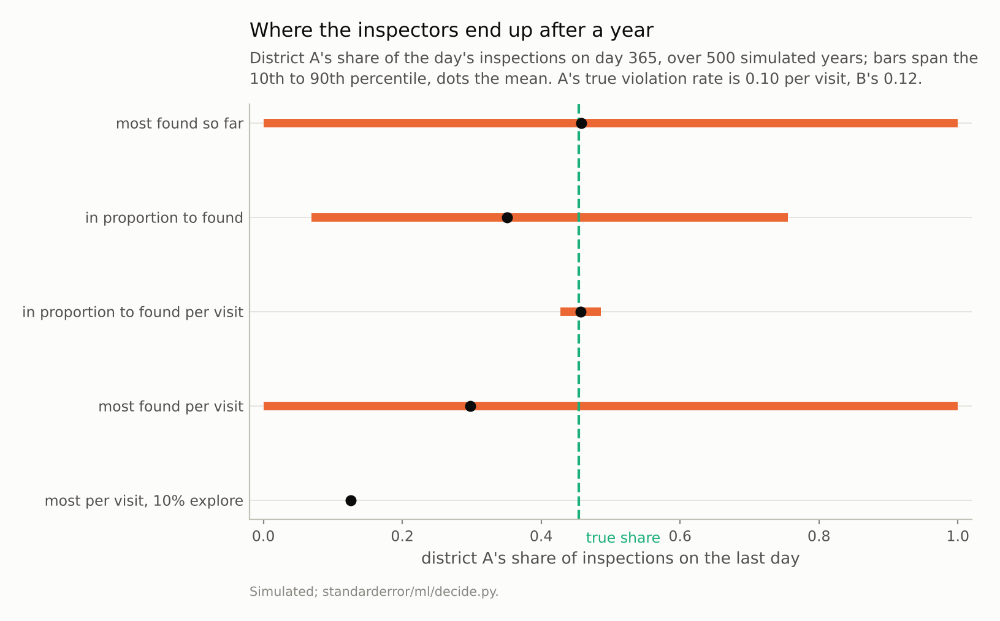
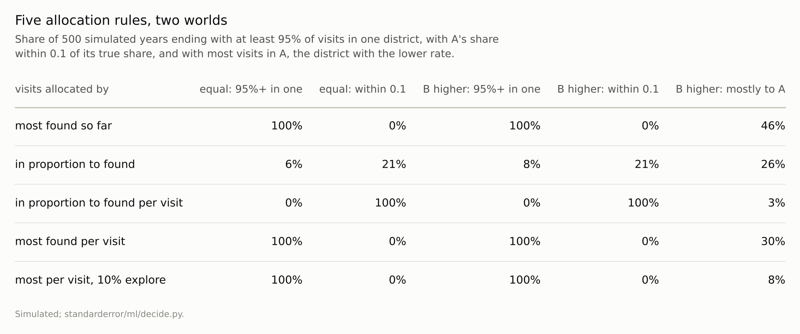

Disclosure: this post was written with the assistance of an AI system (Claude), which wrote the analysis code, ran the experiments and drafted the text. The topic, the constraints, the data choices and the final review are the author's.

*Two simulated districts, ten inspections a day for a year, violations found only where inspectors go; district B's true rate 20% above A's. Sending inspectors where more violations had been found put every visit in one district by the year's end in all 500 runs, the lower-rate district in 46%. Splitting visits in proportion to violations found left A's share between 0.07 and 0.75 in the middle 80% of runs, within 0.1 of the true 0.45 in 21% of runs. Dividing by visits made put it within 0.1 in every run. Sending all visits to the higher rate per visit ended mostly in the worse district in 30% of runs; with 10% of visits kept for exploration, 8%.*

Episode 50 of *Machine Learning, Taught Through What Breaks*. The syllabus and the other episodes: https://jongha-jeon-dev.github.io/standarderror/lectures/

## Looking where you looked before

Episode 39 trained a model on outcomes that existed only because an earlier decision allowed them. This arc's decisions all do that: the cases flagged, the levers pulled and the customers offered a deal produce the data the next model is trained on. The comfortable assumption is that the loop corrects itself, the sentence under test: *a model retrained on the data it collects corrects itself over time*.

The setting is deliberately small. An inspection programme has ten inspectors a day and two districts. Each inspection finds a violation with a probability that is the district's true rate, and a violation is recorded only where an inspector goes. Each morning a rule splits the day's ten visits using everything recorded so far. In the first world the two districts are identical, both at 0.10 per visit. In the second, district B's rate is 0.12, 20% higher. Each rule runs for a year, 500 times.

```python
from standarderror.ml import decide

eq = decide.feedback_loop()                   # equal rates, 0.10
for rule in ("greedy", "proportional", "per visit"):
    v = eq[rule]
    print(f"{rule:12s} A's final share: 10th-90th percentile "
          f"{v['q10']:.2f}-{v['q90']:.2f}, all in one district "
          f"{v['locked']:.0%}")
```

```text
greedy       A's final share: 10th-90th percentile 0.00-1.00, all in one district 100%
proportional A's final share: 10th-90th percentile 0.14-0.88, all in one district 6%
per visit    A's final share: 10th-90th percentile 0.47-0.53, all in one district 0%
```

The most natural rule sends the day's inspectors to the district with more violations on record. In every one of 500 years, by the last day every inspector was going to one district, and which one was decided by the luck of the first day or two: in the identical world it was A in 56% of years. A district that falls behind is not visited, so it cannot catch up. Lum and Isaac had shown two years earlier, by applying a predictive-policing algorithm to Oakland's drug-arrest records, how such a system would keep returning to the same neighbourhoods.



*Splitting visits by violations found left A's share between 0.07 and 0.75 in the middle 80% of runs; dividing by visits made, between 0.43 and **0.49**.*

## Proportional is not neutral

The softer rule splits visits in proportion to violations found. It rarely sends everyone to one place, and it still does not learn the truth. Every violation found earns its district more visits, which find more violations: it is a Pólya urn, whose long-run proportions settle at a random value fixed by early luck. Ensign and colleagues used exactly this urn to describe a runaway feedback loop in predictive policing in 2018. In the identical world, A's final share ranged from 0.14 to 0.88 across the middle 80% of years and was within 0.1 of an even split in only 21%.

```python
un = decide.feedback_loop(rates=(0.10, 0.12))  # B's rate 20% higher
for rule, v in un.items():
    if rule != "true_share":
        print(f"{rule:26s} mostly in A (worse): {v['mostly_a']:.0%}, "
              f"within 0.1 of truth: {v['within_10']:.0%}")
```

```text
greedy                     mostly in A (worse): 46%, within 0.1 of truth: 0%
proportional               mostly in A (worse): 26%, within 0.1 of truth: 21%
per visit                  mostly in A (worse): 3%, within 0.1 of truth: 100%
greedy per visit           mostly in A (worse): 30%, within 0.1 of truth: 0%
greedy per visit, explore  mostly in A (worse): 8%, within 0.1 of truth: 0%
```

When B's rate is really higher, the proportional rule does notice, and overdoes it: A's share averaged 0.35, against the 0.45 that matches the two rates, because each find by the higher-rate district earns it more visits faster; under this rule its share keeps growing the longer the programme runs, so the year-end figure depends on the horizon. Either way, the record of where violations were found has become a record of where inspectors were sent.



*'Equal': both districts have rate 0.10. 'B higher': A 0.10, B 0.12, so the true share for A, in proportion to rates, is 0.45.*

## Dividing by the effort

The repair for the counting rules is one division. Split visits in proportion to violations found *per visit made*, an estimate of each district's rate rather than a count of its finds, and the loop stops feeding itself: A's final share was within 0.1 of its true share in **every** run, in both worlds, averaging 0.456 against 0.455. More visits to a district now produce more evidence about its rate, not a larger rate. In the identical world the same rule ended at an average share of 0.499, against an even split of 0.5.

The division is enough here because this rule never stops visiting either district, so both estimates keep improving. A rule that sends all visits to the district with the higher rate per visit, which is what an organisation trying to find as many violations as possible would do, can stop: once a district falls behind it is no longer visited and its estimate freezes. That rule ended the year with most visits in the worse district in **30%** of runs. Keeping 10% of visits split evenly, so that every district is always being measured, cut that to 8%: this is the exploration that reinforcement learning has long treated as a price of learning from one's own actions.

## What the arc measured

Arc X followed predictions into decisions. A threshold of 0.5 assumed costs nobody had, and the cost-derived threshold assumed calibration (episode 46). The model with the best AUC was the wrong choice when misses were expensive (47). The features a model relied on were consequences and fellow travellers of the outcome, not levers (48). The people most at risk were helped no more than people chosen at random (49). And a rule that learned from its own decisions learned its own decisions back (50).

In each case the model did what it was built to do, and the decision assumed it had been built for something else. The repairs were small and specific: a cost ratio and a calibration check, an evaluation at the operating point, a causal adjustment or an experiment, a model of the difference a treatment makes, a division by effort and a share of decisions kept independent of the record. None of them is available from the model alone.

## Where this breaks

**Two districts, fixed rates.** Real programmes have many units whose rates change, partly in response to the inspections, which adds a second loop: deterrence lowers the rate where inspectors go, and the record then says those places improved.

**Violations found perfectly when present.** Inspections that miss some violations, or find more where inspectors expect them, bias even the per-visit estimate.

**Simple rules.** A real system retrains a model on features, not a ratio on counts; the mechanism is the same whenever the model's training data come from where its own predictions sent people.

**One year.** Lock-in under the greedy rules is decided early, but under the proportional rule with unequal rates the year-end share depends on the horizon, and the effect of exploration over much longer horizons was not measured.

## What to keep

1. Sending inspectors where the most violations had been found put every visit in one district by year's end in every run, the district with the lower true rate in 46% of runs.

2. Splitting visits in proportion to violations found settled at random: within 0.1 of the truth in 21% of runs.

3. Dividing by visits made put the split within 0.1 of the truth in every run; when the rule could starve a district, 10% exploration cut wrong lock-ins from 30% to 8%.

4. When a model's decisions decide its data, estimate rates per unit of effort, keep a share of decisions independent of the model, and treat a stable record as evidence about the rule before treating it as evidence about the world.

## Exercise

For a model that decides where to look, whom to review or what to show, find the training data that came from places, people or items it selected, and count how much came from anywhere else.

If almost none did, compare the model's estimates for the units it rarely selects with any independent measurement of them, such as an audit, a survey or a random sample. A loop that has locked in shows up as units the model is confident about and nobody has looked at.

## Next

Arc X ends here, at fifty episodes, with models the reader trained and decisions the reader made. Arc XI turns to models somebody else trained: language models, graded on benchmarks somebody else wrote. Episode 51 goes back to where the series began, a test score's error bar, and finds it correct for one model and misleading for a leaderboard.

---

### Data

- Simulated: two districts with violation rates per inspection of 0.10 and 0.10, or 0.10 and 0.12; ten inspections a day for 365 days, split binomially by the rule's share; every rule starts from one violation found and one visit made in each district. 500 runs per rule and world (seed 0).
- Machinery: `standarderror/ml/decide.py`, tested in `tests/test_ml.py`; numpy only.
- Where this stops: Ensign, Friedler, Neville, Scheidegger and Venkatasubramanian, "Runaway feedback loops in predictive policing", *FAT** (2018); Lum and Isaac, "To predict and serve?", *Significance* (2016); Sutton and Barto, *Reinforcement Learning: An Introduction* (2018), on exploration; episode 39 of this series.

### Reproducibility

- **environment**: standarderror=0.1.0, python=3.13.16, numpy=2.4.4
- **code blocks**: executed at build time; the values the prose quotes are pinned, so drift fails the build
- **determinism**: seed 0 per world; about thirty seconds of CPU

Code: <https://github.com/jongha-jeon-dev/standarderror>
