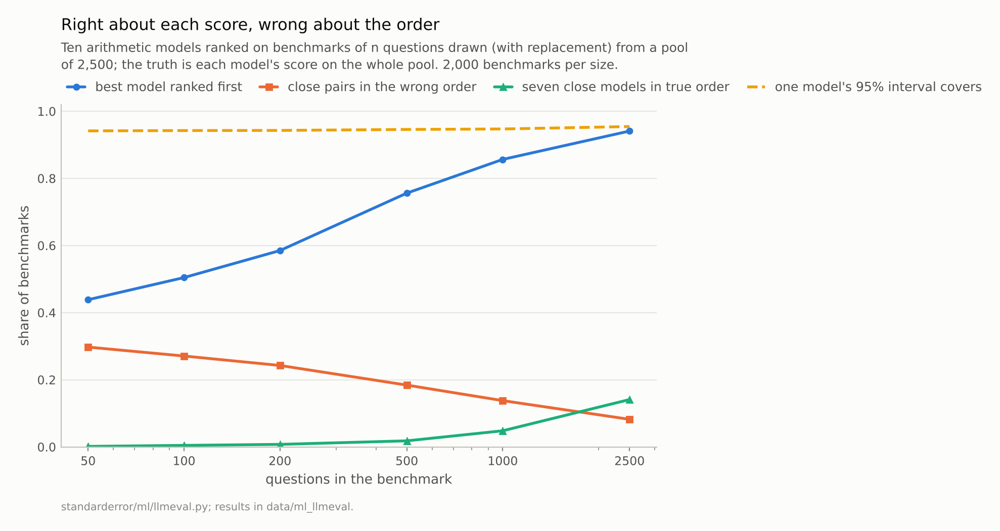
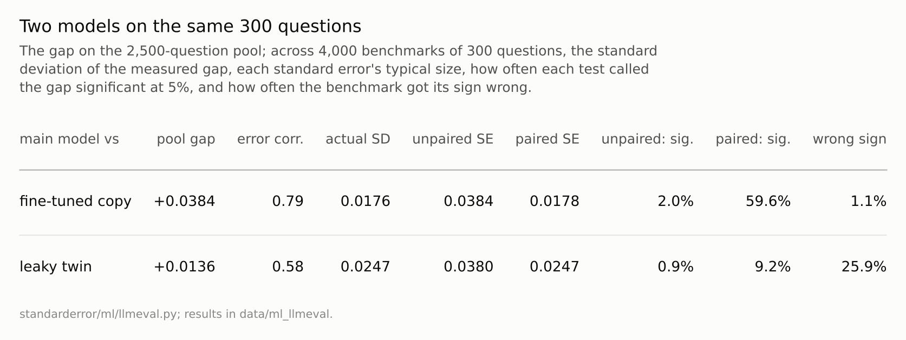
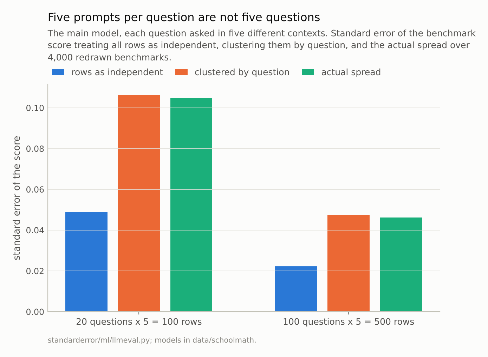

Disclosure: this post was written with the assistance of an AI system (Claude), which wrote the analysis code, ran the experiments and drafted the text. The topic, the constraints, the data choices and the final review are the author's.

*Ten small arithmetic transformers, graded on a pool of 2,500 problems and ranked on benchmarks drawn from it. The models' 95% intervals covered their pool scores 94% to 95% of the time on average, but on 100 questions the best model ranked first in 50% of benchmarks, and seven close models came out in their true order in 0.4%. The main model led a fine-tuned copy by 0.038; on 300 questions an unpaired test found the gap in 2.0% of benchmarks and the paired test in 60%. Asking 100 questions five ways each made 500 rows and a standard error 2.1 times what 500 independent rows would give.*

Episode 51 of *Machine Learning, Taught Through What Breaks*. The syllabus and the other episodes: https://jongha-jeon-dev.github.io/standarderror/lectures/

## A score from someone else's questions

Episode 1 put an error bar on a test score: 360 test digits were a sample, and the score was an estimate. Every episode since has evaluated a model the reader trained, on a test set the reader drew. This arc changes both. It evaluates language models, which most people did not train, on benchmarks they did not write, and asks whether the habits of the series survive the change. The first is the oldest: *the model with the higher benchmark score is the better model*.

The models are the arithmetic transformers of the school-maths series, 804,096 parameters each, trained on generated sums with held-out probes. Tiny models are the right instrument here because every answer can be checked exactly and every model can be graded on thousands of questions in a minute, so each evaluation habit can be compared with the truth. There are ten: the main model; its leaky twin, trained on the same lines in a different order; the main model continued for 600 more steps under five different seeds, the way several teams might fine-tune one base model; and three snapshots of a separate, much shorter run.

The "truth" for this episode is a pool of 2,500 problems, 500 from each of five tasks, and each model's score on all of it. A benchmark is a sample of questions from such a pool.

```python
import numpy as np
from standarderror.ml import llmeval as le

names, m, tasks = le.item_matrix()     # 10 models x 2,500 questions
for name, row in zip(names, m):
    print(f"{name:8s} {row.mean():.4f}")
```

```text
clean    0.6888
cont0    0.6504
cont1    0.6636
cont2    0.6584
cont3    0.6464
cont4    0.6516
leaky    0.6752
s1_6000  0.2284
s1_4500  0.1136
s1_3000  0.0548
```

The seven strong models are close: the main model leads the next best by 0.014, and the five fine-tuned copies sit between 0.646 and 0.664. Extra training made every copy slightly worse than the model it started from, probably because the main run had ended its learning-rate schedule near zero and the copies restarted at a constant rate. That matters below only because it makes the copies close to one another and a little below the main model.

## Right about each score, wrong about the order

Draw a benchmark of 100 questions from the pool and grade all ten models on it. Each model's score comes with the textbook interval, the score plus or minus 1.96 standard errors, and across 2,000 such benchmarks the intervals covered the true pool scores 94.2% of the time, averaged over the ten models (91.3% to 95.3% for individual models; the textbook interval undercovers slightly for the weakest, whose scores are near zero). At every size from 50 to 2,500 questions the average stayed between 94.2% and 95.4%. One score's error bar is, near enough, right.

```python
rng = np.random.default_rng(1)
for _ in range(4):                     # four benchmarks of 100 questions
    idx = rng.integers(0, m.shape[1], 100)
    s = m[:, idx].mean(1)
    print(" > ".join(names[i] for i in np.argsort(-s)[:4]))
```

```text
clean > cont2 > cont0 > cont3
leaky > cont0 > cont1 > cont2
clean > cont1 > cont2 > leaky
leaky > clean > cont1 > cont4
```

The leaderboard is another matter. On 100 questions the best model came first in **50%** of benchmarks. Among the seven close models, 27% of pairs came out in the wrong order and the full order was right in 0.4% of benchmarks. Even on a resample the size of the whole pool, 2,500 questions drawn with replacement, the best model came first 94% of the time and the seven were in true order in 14%.

Nothing is wrong with the intervals. A leaderboard asks a different question from the one each interval answers: not "where is this model's score?" but "which of these models is higher?", for every pair at once, and close models' intervals overlap almost entirely. Reading a ranking off overlapping intervals is reading noise.



*On 100 questions the models' intervals covered their true scores 94% of the time on average, and the best model came first in **50%** of benchmarks.*

## Compare on the same questions

The right question for a pair of models is about their difference, and the difference has its own standard error. The usual mistake, and one of the first that Miller's 2024 guide to error bars for language-model evaluations warns against, is to compute it as if the two scores came from different questions. They do not. Both models answered the same 300 questions, and their errors fall on the same hard ones: the correlation between the main model's right/wrong column and its fine-tuned copy's was 0.79.

```python
a, b = m[names.index("clean")], m[names.index("cont0")]
idx = np.random.default_rng(7).integers(0, len(a), 300)
r = le.paired_difference(a[idx], b[idx])
print(f"gap {r['diff']:+.3f}  unpaired SE {r['se_unpaired']:.3f}  "
      f"paired SE {r['se_paired']:.3f}")
print(f"right only for main {r['only_a']}, only for copy {r['only_b']}"
      f", McNemar p = {r['mcnemar_p']:.4f}")
```

```text
gap +0.063  unpaired SE 0.038  paired SE 0.019
right only for main 27, only for copy 8, McNemar p = 0.0019
```

Pairing uses that. The paired standard error is the spread of the per-question differences, and only the questions where the models disagree contribute; McNemar's 1947 test, in its exact form the binomial test on those disagreements, is the same idea as a test. On the pool the main model beat its fine-tuned copy by 0.0384. Across 4,000 benchmarks of 300 questions the measured gap varied with a standard deviation of 0.0176. The paired standard error at that size is 0.0178, about right; the unpaired one is 0.0384, more than twice too large. So the unpaired test found the real gap in 2.0% of benchmarks and the paired test in **60%**.

The leaky twin, 0.0136 behind the main model on the pool, is a reminder that pairing is not magic. In this episode the pool is the truth, so the twin is known to be behind; but had the 2,500 questions been a sample from a larger population, McNemar's test on all of them would have given p = 0.12, and a 300-question benchmark put the twin ahead in 26% of draws. Episode 44 met the opposite failure, a t-test on cross-validation folds that found differences between equal algorithms because the folds were not independent. Here the questions are drawn independently, the paired test is the right one, and it can still say "not enough evidence".



*Standard errors scaled from the pool to 300 questions; 'error corr.' is the correlation between the two models' right/wrong columns.*

## Five prompts per question are not five questions

Language-model evaluations often ask each question several ways: several prompt templates, several samples at a temperature, several orderings of the options. The rows multiply and the error bar computed from them shrinks. To measure what that buys, the main model answered 600 questions (200 each from multiplication, mixed operations and three-digit carries) five times, each time with a different context in front.

The answers barely depended on the context: 42% of questions were answered right all five times and 45% wrong all five times, leaving 12% that the context could change. A benchmark of 100 such questions has 500 rows. Treating the rows as independent gives a standard error of 0.0223; the actual spread of the score across 4,000 redrawn benchmarks was 0.0462, **2.1 times** larger. The cluster-robust standard error, which treats each question's five rows as one observation, gave 0.0475, matching the spread; with 20 questions the numbers were 0.0488, 0.1062 and 0.1048. This is episode 37's lesson for subjects, applied to questions: rows from the same question are not new questions.



*Of 600 questions, 42% were answered right in all five contexts and 45% in none.*

## Where this breaks

**A pool, not a population.** The truth here is a fixed pool of 2,500 problems from five tasks. A real benchmark is a sample from a population of questions nobody has written down, and the questions are often chosen rather than drawn, which adds a bias that no error bar describes.

**Exact answers.** Grading was exact match, so every error bar here is pure question sampling. Graders that disagree with each other add their own variance.

**Models of one family.** All ten models were trained on the same lines, and six are the main model or copies of it, which makes their errors more correlated than those of models from different labs. The more correlated the errors, the more pairing gains; for unrelated models the gain is smaller but the paired test is still the right one.

**Questions drawn independently.** Benchmarks often contain families of near-duplicate questions written from one template, which cluster in the same way as the repeated prompts here.

## What to keep

1. The models' 95% intervals covered their true scores about 95% of the time on average at every benchmark size, and on 100 questions the best of ten models still ranked first in only 50% of benchmarks.

2. On 300 shared questions the paired test detected a real 0.038 gap in 60% of benchmarks and the unpaired one in 2.0%; the paired standard error matched the actual spread.

3. Five prompts per question gave a standard error 2.1 times the naive one, and the cluster-robust error matched.

4. Report a comparison as a difference with a paired interval, cluster rows by question, and treat leaderboard positions inside each other's intervals as ties.

## Exercise

Take two models you have compared on a benchmark and export the per-question right/wrong for both. Count the questions only one of them got right, in each direction.

The comparison rests on those disagreements, and nothing else. If there are thirty of them, split 18 to 12, the honest summary is that the benchmark cannot tell the models apart, whatever the two headline scores say.

## Next

A benchmark is a sample of questions, and the error bars assume the model met them for the first time. Episode 52 trains copies of the main model that have seen some of the benchmark's answers, and asks how much it shows in the score, and whether anyone looking only at the model could tell.

---

### Data

- Models: ten 804k-parameter arithmetic transformers trained by this repository: the main model of the school-maths series and its leaky twin (`data/schoolmath/`), the main model continued for 600 steps under five seeds, and three snapshots of a separate 6,000-step run (`data/schoolmath/family/`).
- Pool: 500 problems per task, drawn at random from the test split (multiplication, order of operations, linear equations, subtraction) and the three-digit carry probe; one context of twelve training lines per problem (seed 3). Per-question results are committed in `data/ml_llmeval/runs.json`, written by `scripts/llm_eval_runs.py`.
- Machinery: `standarderror/ml/llmeval.py`, tested in `tests/test_ml.py`.
- Where this stops: McNemar, *Psychometrika* (1947); Dietterich, "Approximate statistical tests for comparing supervised classification learning algorithms", *Neural Computation* (1998); Miller, "Adding error bars to evals" (Anthropic, 2024); Madaan et al., "Quantifying variance in evaluation benchmarks" (2024); episodes 1 and 44 of this series.

### Reproducibility

- **environment**: standarderror=0.1.0, python=3.13.16, numpy=2.4.4
- **code blocks**: executed at build time; the values the prose quotes are pinned, so drift fails the build
- **determinism**: committed weights and per-question results, seeded draws; about two minutes of CPU

Code: <https://github.com/jongha-jeon-dev/standarderror>
