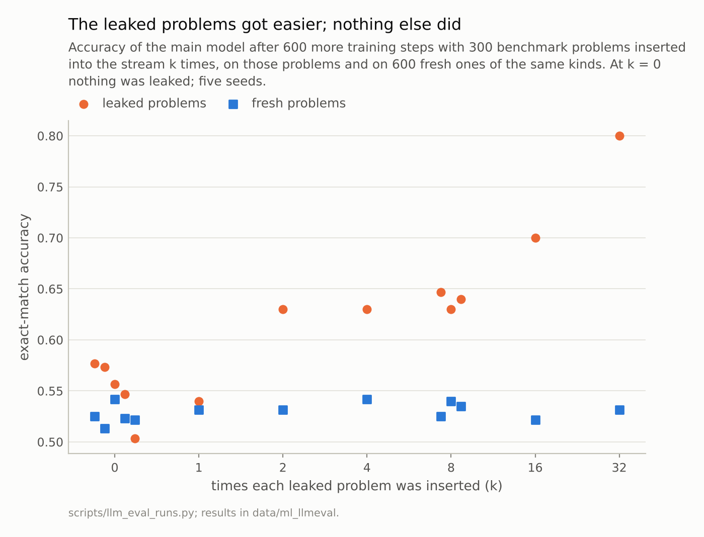
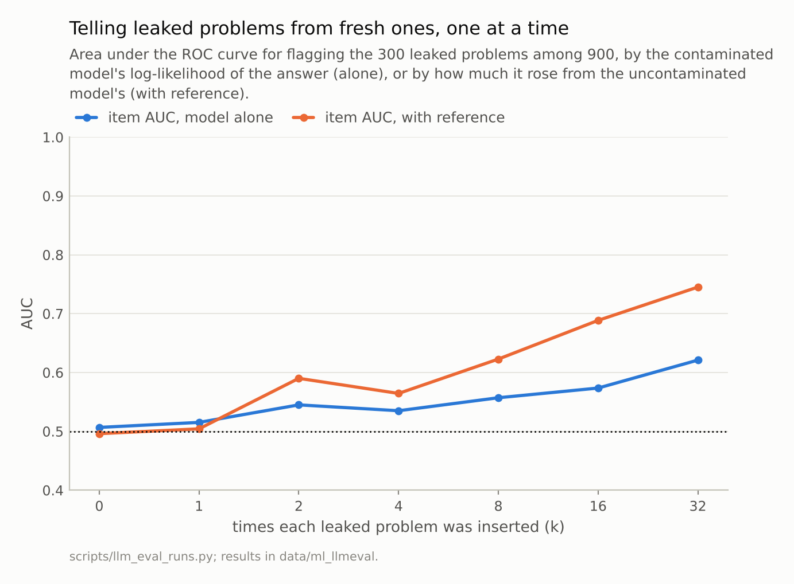
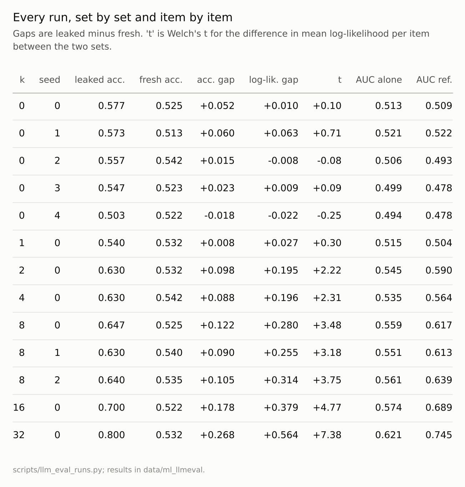

Disclosure: this post was written with the assistance of an AI system (Claude), which wrote the analysis code, ran the experiments and drafted the text. The topic, the constraints, the data choices and the final review are the author's.

*The repository's main arithmetic model was trained for 600 more steps with 300 benchmark problems inserted into its stream k times, for k from 0 to 32. Five runs with nothing leaked scored 0.503 to 0.577 on the benchmark; with each problem inserted 32 times, 0.800. On 600 fresh problems of the same kinds every run scored between 0.513 and 0.542. The contaminated model's likelihood flagged leaked problems with an AUC of 0.621, 0.745 with the uncontaminated model as a reference. Compared as sets, leaked against fresh, the gap in mean log-likelihood had t above 2 in every run from k = 2 on, and between -0.25 and 0.71 in the five controls.*

Episode 52 of *Machine Learning, Taught Through What Breaks*. The syllabus and the other episodes: https://jongha-jeon-dev.github.io/standarderror/lectures/

## Leaking the answers on purpose

Language models are trained on large scrapes of the web, and benchmarks live on the web. So a model may have seen some test questions, and their answers, during training. Nobody evaluating it can rerun the training without them. What they can do is look at the model, and the hope behind most contamination checks is this episode's sentence: *if a model has memorised a benchmark, its likelihood on the benchmark's items will show it*.

To test it, contamination has to be manufactured with a known dose. The benchmark is 300 problems from the main arithmetic model's test split, 150 multiplications and 150 mixed-operation problems, on which the starting model gets 0.74 and 0.46 right, so there is room to improve. A fresh set of 600 problems of the same kinds is drawn alongside and never leaked. Then the model is trained for 600 more steps, roughly one more pass over its training data, with the benchmark's lines inserted into the stream k times each, for k from 0 to 32. The runs with k = 0 matter most: they get the same extra training with nothing leaked, and five seeds of them show how much a run varies by chance. Training reads random 64-character windows rather than whole lines in order, so an insertion is an opportunity to be seen, not a guaranteed reading: at one insertion a fair share of leaked lines is probably never seen whole.

```python
from standarderror.ml import llmeval as le

bench, fresh = le.leak_sets()          # 300 to leak, 600 never seen
print(len(bench), "leaked, e.g.", [p.line.strip() for p in bench[:3]])
print(len(fresh), "fresh,  e.g.", [p.line.strip() for p in fresh[:3]])
# le.finetune(model, [p.line for p in bench], repeats=k, seed=s) is
# what scripts/llm_eval_runs.py ran for every k and seed below.
```

```text
300 leaked, e.g. ['368*6=2208', '82*61=5002', '617*3=1851']
600 fresh,  e.g. ['362*8=2896', '64*56=3584', '137*8=1096']
```

The training stream has 168,856 lines, so at two insertions the leaked lines are 0.35% of it, and even at 32 they are 5.4%. The small doses are the realistic case: a benchmark is a speck in a training corpus, seen a few times through copies, not drilled.

## The score rose; the ability did not

```python
c = le.contamination()                 # the committed per-item results
for key, v in c["runs"].items():
    if key != "base":
        print(f"k={v['dose']:2d} seed {v['seed']}  leaked "
              f"{v['bench']:.3f}  fresh {v['fresh']:.3f}  "
              f"item AUC {v['auc_loss']:.3f}")
```

```text
k= 0 seed 0  leaked 0.577  fresh 0.525  item AUC 0.513
k= 0 seed 1  leaked 0.573  fresh 0.513  item AUC 0.521
k= 0 seed 2  leaked 0.557  fresh 0.542  item AUC 0.506
k= 0 seed 3  leaked 0.547  fresh 0.523  item AUC 0.499
k= 0 seed 4  leaked 0.503  fresh 0.522  item AUC 0.494
k= 1 seed 0  leaked 0.540  fresh 0.532  item AUC 0.515
k= 2 seed 0  leaked 0.630  fresh 0.532  item AUC 0.545
k= 4 seed 0  leaked 0.630  fresh 0.542  item AUC 0.535
k= 8 seed 0  leaked 0.647  fresh 0.525  item AUC 0.559
k= 8 seed 1  leaked 0.630  fresh 0.540  item AUC 0.551
k= 8 seed 2  leaked 0.640  fresh 0.535  item AUC 0.561
k=16 seed 0  leaked 0.700  fresh 0.522  item AUC 0.574
k=32 seed 0  leaked 0.800  fresh 0.532  item AUC 0.621
```

Inserted once, the leaked problems made no measurable difference: the score was 0.540, inside the controls' range of 0.503 to 0.577. From two insertions on, every run scored above every control, and at 32 insertions the benchmark score was 0.800, +0.249 over the controls' mean. The fresh problems, meanwhile, stayed between 0.513 and 0.542 in every run, leaked or not. The benchmark reported an improvement that existed only on the benchmark.

One comparison is less flattering. Every fine-tuned run, leaked or not, lost ground against the starting model, which scored 0.600 on the benchmark and 0.562 on the fresh set. Measured against the starting model rather than against the controls, the two-insertion run gained only +0.030 on the benchmark, while losing 0.030 on fresh problems. An outside evaluator comparing a model with its predecessor sees the net of both effects.

The spread of the controls deserves its own sentence. Five runs that differed only in their random seed scored between 0.503 and 0.577 on the same 300 problems, a range of 0.073; the three runs at k = 8 spanned 0.630 to 0.647. At one insertion, a comparison of one contaminated run with one clean one would have been a coin toss. This is episode 51's lesson again, in the training direction: a run is a sample too.



*Five uncontaminated runs scored 0.503 to 0.577 on the benchmark; inserted 32 times, **0.800**.*

## Item by item, the model could not say which

The usual detector asks whether the model finds a particular item suspiciously likely. In privacy research this is membership inference, and its simplest version, analysed by Yeom and colleagues in 2018, thresholds the loss: a model's loss on its training examples is lower than on others. Here, ranking the 900 problems by the contaminated model's log-likelihood of the right answer separated leaked from fresh with an AUC of 0.621 at k = 32, and 0.545 at k = 2, against 0.5 for a coin. Set to flag 5% of the fresh problems, it flagged 3.3% of the leaked ones at k = 32: no better than flagging at random.

The problem is not that the leak left no trace. It is that problems differ from each other in how likely their answers are by far more than the leak changed them: at k = 32, per-problem log-likelihoods had a standard deviation of 1.22, while the leak raised the leaked set's average by 0.51 relative to the fresh one. An easy multiplication's answer is likely whether or not it leaked, a hard mixed-operation answer unlikely. Carlini and colleagues' remedy in 2022 was to compare each item's likelihood with that under reference models that did not see it. With the uncontaminated model as the reference, flagging the problems whose likelihood rose most, the AUC was 0.745 at k = 32, and at the same 5% false-flag rate it caught 24% of the leaked problems: better, and still far from a detector that could name the leaked items, because extra training moves each problem's likelihood by its own amount: even in the controls the change from the starting model had a standard deviation of 0.65 per problem, against 0.67 at k = 32. And a reference model is exactly what an outside evaluator does not have. Methods built for large models, such as Shi and colleagues' Min-K% probability, refine the per-item score but face the same item-to-item variation.



*At k = 32: 0.621 alone, 0.745 with the reference model.*

## As a set, it could

The question an evaluator needs answered is usually not "which items leaked?" but "is this benchmark's score inflated?", and that question has more data behind it. Compare the benchmark as a whole with a fresh set from the same source: the same generator, the same tasks, problems that cannot have leaked because they were written afterwards or never published.

On mean log-likelihood per problem, leaked set minus fresh set, the five controls gave Welch t-statistics between -0.25 and 0.71. Every contaminated run from k = 2 on gave more than 2, outside the controls' range though not far outside it at k = 2 and 4 (2.22 and 2.31), and at k = 32 it was 7.4. Accuracy told the same story with more noise: the gap between the leaked and fresh sets was -0.018 to +0.060 in the controls and +0.268 on average at k = 32. Neither says which problems leaked. Both say the score on this benchmark is not the score on the task.

This is what Zhang and colleagues did for grade-school arithmetic in 2024: they wrote new problems in the style of a popular benchmark, GSM8k, and compared models' accuracy on the two, finding clear drops for some model families and little for others. It needs no access to training data and no reference model, only the discipline to keep some problems unpublished, which episode 45 asked of test sets in general.



*k = 0 rows are the controls: the same extra training, nothing leaked.*

## Where this breaks

**Verbatim contamination.** Every leaked line was the exact problem and answer. Real contamination includes paraphrases, translations and solutions without the question, which raise scores while leaving even less trace in the likelihood of the exact item.

**A small model and a short exposure.** A large model memorises single examples more readily, so its per-item signal may be stronger, and a benchmark seen across many training epochs leaves more trace than one inserted into a single extra pass.

**Arithmetic answers.** The answers are a few characters long, which gives a per-item likelihood little to work with. Longer answers carry more evidence per item, which helps per-item detectors.

**A fresh set that matches.** The set-level test is only as good as the match between the fresh problems and the benchmark. Before any training, the leaked set here was already slightly easier than the fresh set, which the controls absorb; an evaluator without controls needs the fresh set to be drawn the way the benchmark was.

## What to keep

1. With each benchmark problem inserted into training 32 times, the benchmark score rose from a control mean of 0.551 to 0.800; accuracy on fresh problems of the same kinds did not move outside 0.513-0.542.

2. At 32 insertions, the contaminated model's likelihood identified leaked problems with an AUC of 0.621, catching 3% of them at 5% false flags; with the clean model as a reference, 0.745 and 24%.

3. Compared as sets with fresh problems from the same source, every contaminated run from two insertions on stood out from all five controls.

4. Test for contamination by keeping a fresh set the model cannot have seen and comparing whole sets, and do not read a clean per-item scan as evidence that nothing leaked.

## Exercise

For a benchmark you report, write or generate fifty problems in its style that have never been published. Score your model on them and on fifty of the benchmark's.

A gap bigger than the two sets' sampling error is a reason to stop reporting the benchmark number on its own. No gap is weaker evidence than it looks unless the new problems really match the old ones in difficulty, so check that on a model that cannot have seen either.

## Next

A benchmark is a sample of questions, and contamination is a property of the questions. The way each question is put to the model is a property of the evaluation, and episode 53 asks the same models the same questions with different text in front of them.

---

### Data

- Model: the main arithmetic transformer of the school-maths series (`data/schoolmath/schoolmath.pt`), continued for 600 AdamW steps at a constant 3e-4 on the training stream, with the benchmark's lines inserted k = 0, 1, 2, 4, 8, 16 or 32 times at random positions; seeds 0-4 at k = 0 and 0-2 at k = 8.
- Benchmark: 150 multiplication and 150 order-of-operations problems from the test split; fresh set: 300 more of each, disjoint. Per-item results are committed in `data/ml_llmeval/runs.json`, written by `scripts/llm_eval_runs.py`; the starting model's are re-graded live at build time.
- Machinery: `standarderror/ml/llmeval.py`, tested in `tests/test_ml.py`.
- Where this stops: Yeom, Giacomelli, Fredrikson and Jha, "Privacy risk in machine learning: analyzing the connection to overfitting", *CSF* (2018); Carlini et al., "Membership inference attacks from first principles", *IEEE S&P* (2022); Shi et al., "Detecting pretraining data from large language models", *ICLR* (2024); Zhang et al., "A careful examination of large language model performance on grade school arithmetic" (2024); episodes 3 and 45 of this series.

### Reproducibility

- **environment**: standarderror=0.1.0, python=3.13.16, numpy=2.4.4
- **code blocks**: executed at build time; the values the prose quotes are pinned, so drift fails the build
- **determinism**: the fine-tuning runs take about an hour and are committed as per-item results; the build re-grades the starting model and reads the rest

Code: <https://github.com/jongha-jeon-dev/standarderror>
