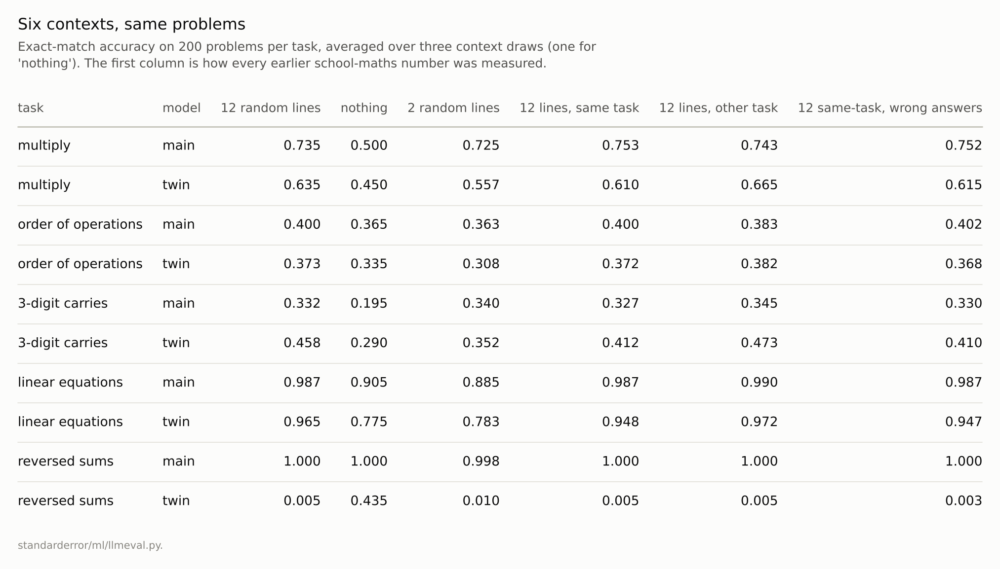
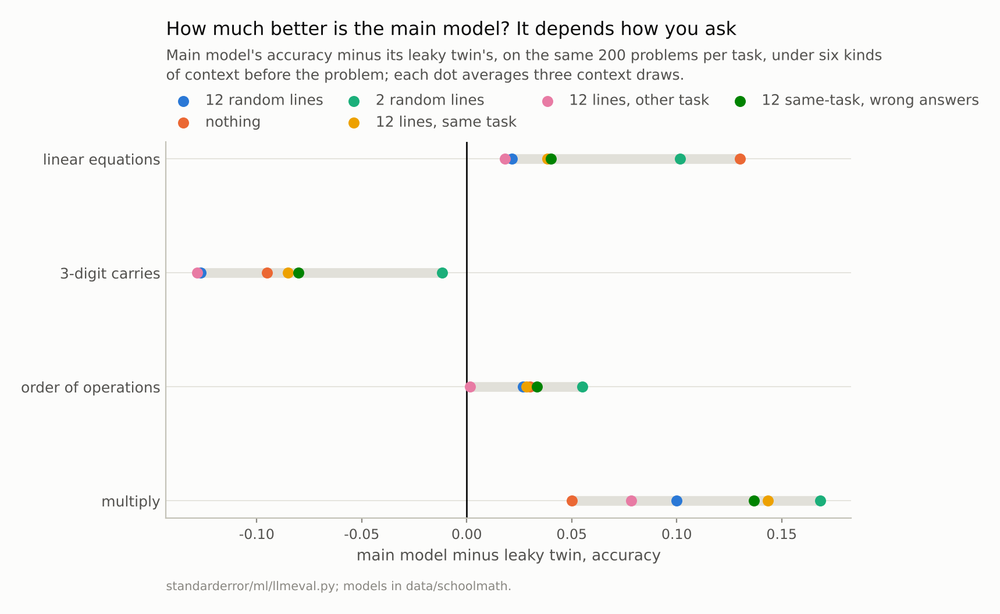
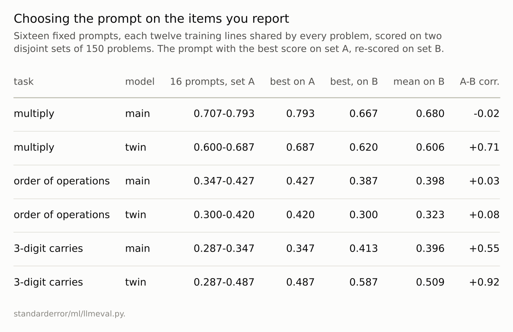

Disclosure: this post was written with the assistance of an AI system (Claude), which wrote the analysis code, ran the experiments and drafted the text. The topic, the constraints, the data choices and the final review are the author's.

*Two small arithmetic transformers, 200 problems per task, six kinds of context in front of each problem. The main model's multiplication score was 0.735 after twelve ordinary lines and 0.500 after none. Its lead over its leaky twin on multiplication ranged from 0.050 to 0.168 across contexts, and the twin's lead on three-digit carries from 0.127 to 0.012. Examples with wrong answers changed no score by more than 0.005. Of sixteen fixed prompts, the best on one set of 150 multiplications scored 0.793 there and 0.667 on a second set, below the prompts' average of 0.680; for the twin's carries, where prompts really differed, the choice held.*

Episode 53 of *Machine Learning, Taught Through What Breaks*. The syllabus and the other episodes: https://jongha-jeon-dev.github.io/standarderror/lectures/

## Six ways to ask the same question

A language model never sees a question alone. It sees a window of text that ends with the question: a system prompt, instructions, worked examples, earlier turns. A benchmark fixes one such window per question and reports the result as the model's score, and a leaderboard compares models under that one window. The comparison assumes the window is a neutral container, the sentence under test: *a benchmark score measures the model*.

The arithmetic models of this arc make the window easy to vary and the answers easy to check. Every earlier number for them was measured with twelve random training lines in front of each problem, drawn afresh per problem. Here the same 200 problems per task are asked in six contexts: twelve random lines; nothing at all; two random lines; twelve lines of the same task; twelve of a different task; and twelve of the same task with the last digit of every answer changed, the arithmetic version of examples with wrong labels. Each kind is drawn three times, so its spread from one draw to the next can be set against the differences between kinds.

```python
from standarderror.ml import llmeval as le
from standarderror.schoolmath import model as sm

main = sm.load()
probs = le.items("test", "mul", 200)
print("problem:", probs[0].prompt, " answer:", probs[0].answer)
for kind in ("mixed", "empty", "same", "wrong"):
    ctx = le.contexts(kind, "mul", len(probs), seed=100)
    tail = ctx[0].replace(chr(10), " | ")[-48:]
    acc = le.ok(main, probs, fills=ctx).mean()
    print(f"{kind:6s} acc {acc:.3f}  ...{tail}")
```

```text
problem: 571*4=  answer: 2284
mixed  acc 0.725  ... 86+51*85=4421 | 2x+36=56>x=10 | 935+529~4641 | 
empty  acc 0.500  ...
same   acc 0.760  ...*2=838 | 233*7=1631 | 569*2=1138 | 687*8=5496 | 
wrong  acc 0.765  ...*2=839 | 233*7=1632 | 569*2=1139 | 687*8=5497 | 
```

The main model multiplied correctly 0.735 of the time with twelve lines in front and 0.500 with nothing: about a third of its score was the context. An empty context cost it 0.035 to 0.137 on the other three tasks too. For multiplication, two random lines recovered almost all of the score (0.725), as if what mattered was having something in front of the problem, the way every problem appeared in the packed training stream; but on mixed operations and linear equations two lines did slightly worse than none, so position is not the whole story. Across three draws of the same kind of context no score moved by more than 0.060: the large differences between kinds, like the empty context's, are far outside that, and the small ones are not.



*Context lines are training lines; 'wrong answers' changes the last digit of each.*

## The gap between two models moved too

A shift that moved every model equally would leave a leaderboard intact. This one did not. On three-digit carries, the leaky twin beat the main model by 0.127 under the standard twelve lines and by 0.012 under two: a clear win and a tie, from the same two models on the same problems. On multiplication the main model's lead ran from 0.050 to 0.168, on mixed operations from 0.002 to 0.055.

The most extreme case is the one the school-maths series was built on. The twin learned reversed sums by copying from the line above, so it scored 0.005 on them after twelve lines of context and 0.435 with none, while the main model scored 0.995 or 1.0 under every context. Whether the twin "can do" reversed sums depends entirely on how it is asked.

Sclar and colleagues found the same thing at scale in 2024: changing only the formatting of a prompt, separators and spacing and casing, moved one model's few-shot accuracy on a task by up to 76 points, and which formats worked well correlated only weakly from one model to another, which they argued makes a comparison of models under one fixed format unreliable. Their remedy, reporting a range over plausible formats rather than a point, is the one these numbers support.



*On three-digit carries the twin led by 0.127 with twelve lines of context and by **0.012** with two.*

## Wrong examples changed nothing

If the context mattered because the model read the examples, examples with wrong answers should hurt. They did not: replacing the last digit of every example answer changed no model's score on any task by more than 0.005 relative to correct examples of the same task. What the examples taught was not their answers. Which task they came from did matter, for the twin: on three-digit carries it scored 0.412 after lines of the same task and 0.473 after lines of a different one, outside the spread of either kind's draws.

That is a finding about these models, which are far too small to learn from examples in context, and it should not be read as a finding about large ones. It does echo Min and colleagues' 2022 result for larger models: on many classification tasks, randomly reassigning the labels of the demonstrations barely hurt, and the format and the distribution of the inputs mattered more than whether the labels were right. Either way, a context's effect on a score is not evidence that the model understood the context.

## Choosing the prompt on the items you report

In practice the window is chosen, not drawn. Zhao and colleagues showed in 2021 that a large model's few-shot accuracy swung widely with which examples were in the prompt and in what order, and the natural response is to write several prompts, try them, and keep the best. To imitate that, sixteen fixed prompts were built, each twelve training lines shared by every problem, the way a prompt template puts the same worked examples in front of every question, and each was scored on one set of 150 problems (A) and on a disjoint second set (B).

```python
import numpy as np
sets = le.items("test", "mul", 150), le.items("test", "mul", 150, skip=150)
pool = [p.line for p in le._train_by_task()["*"]]
for seed in (500, 506):          # two of the sixteen fixed prompts
    rng = np.random.default_rng(seed)
    prompt = "".join(pool[i] for i in rng.integers(0, len(pool), 12))
    a, b = (le.ok(main, s, fills=[prompt] * 150).mean() for s in sets)
    print(f"prompt {seed}: set A {a:.3f}, set B {b:.3f}")
```

```text
prompt 500: set A 0.753, set B 0.687
prompt 506: set A 0.727, set B 0.693
```

For the main model on multiplication, the sixteen prompts scored between 0.707 and 0.793 on set A. The best one, 0.793, scored 0.667 on set B, below the 0.680 average of all sixteen there; the correlation between the prompts' scores on the two sets was -0.02. The search had found the prompt that suited set A's particular problems. This is episode 35's result with prompts in place of hyperparameters: the best score of a search over noisy estimates reports the search's luck.

It is not always luck. For the twin on three-digit carries the same sixteen prompts ranged from 0.287 to 0.487, the two sets agreed (correlation +0.92), and the best prompt on A was also the best on B. Presumably some prompts gave the twin more to copy from; that was not checked. Without the second set there is no way to tell these two situations apart. On mixed operations, the twin beat the main model under 3 of the sixteen prompts on set A and under 0 on set B. The true order is probably the main model first, and a comparison reported under one of those three prompts, chosen on set A, would have stated the opposite.



*Last column: correlation, across the sixteen prompts, between their scores on the two sets.*

## Where this breaks

**Context, not instructions.** These models cannot follow instructions, so the prompt variations here are positions and examples. For instruction-following models, wording and format are larger levers and the variations multiply.

**Two models, one family.** The two models share their training data and architecture. Models from different families respond to the same prompt change differently, which makes ranking changes more likely, not less.

**Small sets.** The prompt search used 150 problems per set, so a difference of 0.04 between two prompts' scores is about one standard error of either score, and less than two of the paired difference. That is the condition under which selection does the most damage, and also the usual one.

**Greedy decoding.** Sampling with a temperature adds another source of run-to-run variation, which was not measured.

## What to keep

1. With nothing in front of each problem the main model multiplied correctly 0.500 of the time; with twelve ordinary lines, 0.735.

2. The twin's lead on three-digit carries was 0.127 under one context and 0.012 under another; the main model's lead on multiplication ranged from 0.050 to 0.168.

3. The best of sixteen prompts on one set of 150 multiplications scored below the prompts' average on a second set. Where the prompts really differed, the choice survived the second set.

4. Report a score with its prompt and a range over reasonable prompts, compare models under the same prompts, and choose a prompt on items you will not report.

## Exercise

Take the evaluation prompt you use and write four variants that a colleague would call equivalent: different separators, a different instruction wording, the examples in a different order, no examples. Score two models you are comparing under all five on the same items.

If the ranking holds under every variant, report it with the range. If it flips, the comparison is a comparison of prompts.

## Next

Every score so far has been exact match on a generated answer. Many benchmarks score differently: they offer options and take the one the model finds likeliest. Episode 54 asks the same models the same questions both ways.

---

### Data

- Models: the main arithmetic transformer of the school-maths series and its leaky twin (`data/schoolmath/`), trained by this repository on generated arithmetic.
- Problems: 200 drawn at random per task from the test split (multiplication, order of operations, linear equations, reversed sums) and the three-digit carry probe; for the prompt search, two disjoint sets of 150. Contexts are drawn from training lines (seeds 100-102 per kind; prompts seeds 500-515).
- Machinery: `standarderror/ml/llmeval.py`, tested in `tests/test_ml.py`.
- Where this stops: Sclar, Choi, Tsvetkov and Suhr, "Quantifying language models' sensitivity to spurious features in prompt design", *ICLR* (2024); Min et al., "Rethinking the role of demonstrations", *EMNLP* (2022); Zhao, Wallace, Feng, Klein and Singh, "Calibrate before use", *ICML* (2021); episode 35 of this series.

### Reproducibility

- **environment**: standarderror=0.1.0, python=3.13.16, numpy=2.4.4
- **code blocks**: executed at build time; the values the prose quotes are pinned, so drift fails the build
- **determinism**: committed weights, seeded draws; about seventeen minutes of CPU

Code: <https://github.com/jongha-jeon-dev/standarderror>
