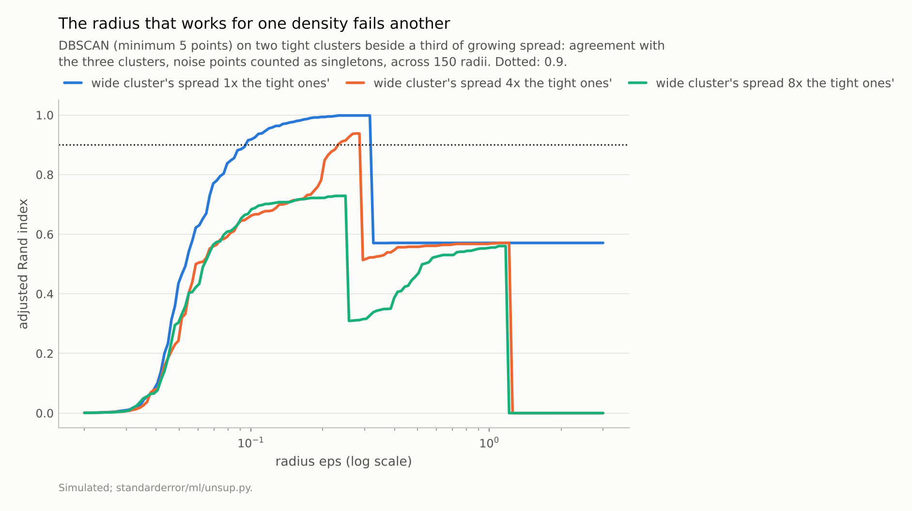
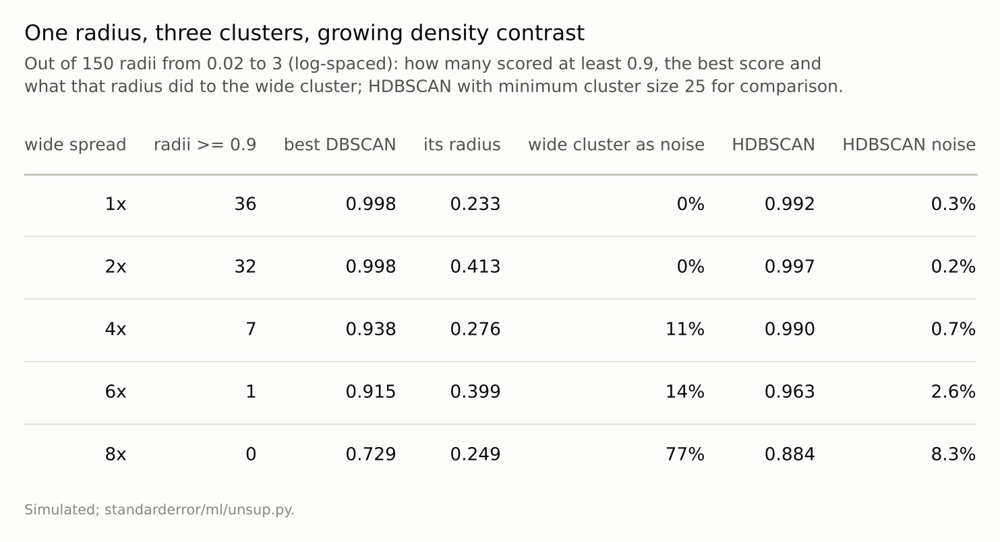

Disclosure: this post was written with the assistance of an AI system (Claude), which wrote the analysis code, ran the experiments and drafted the text. The topic, the constraints, the data choices and the final review are the author's.

*On two half-moons DBSCAN scored an adjusted Rand index of 0.95 or more for radii between 0.071 and 0.206, and 1.00 from 0.116, where k-means scored 0.25; the radius at the knee of the k-distance plot, 0.061, scored 0.57. Beside two tight clusters, a third whose spread grew from equal to eight times theirs left 36, 32, 7, 1, 0 of 150 radii scoring at least 0.9; at eight times the spread, no radius reached 0.9 in any of six draws, and the best one in the first called 77% of the wide cluster noise. HDBSCAN, with no radius, scored 0.82 to 0.89 there. On the digits the best radius, chosen with the labels, scored 0.71, and the knee's radius 0.00.*

Episode 58 of *Machine Learning, Taught Through What Breaks*. The syllabus and the other episodes: https://jongha-jeon-dev.github.io/standarderror/lectures/

## Clusters as dense regions

k-means cuts the data into k convex pieces, which is why episode 32 found it cutting two parallel groups crosswise. Density-based clustering starts from a different definition: a cluster is a region where points are packed closely, separated from other such regions by sparse space. DBSCAN, introduced by Ester and colleagues in 1996 and widely used since, makes the definition operational with two settings. A point with at least `min_samples` points, itself included, within radius `eps` is a core point; core points within `eps` of each other share a cluster; anything not reachable from a core point is noise.

Its reputation follows from the definition, and is the sentence under test: *DBSCAN finds clusters of any shape without being told how many*. It does not take k. It does take a radius, and the question is how much the radius decides.

Throughout, agreement with the true groups is the adjusted Rand index with every noise point counted as its own singleton, so that calling a whole cluster noise costs what it should. (Counted as one more cluster, noise can earn a high score by being a cluster's worth of discarded points.) The "best" radius for any data set below is chosen with the true labels, which a user never has; it is the most DBSCAN can do, not what it will do.

## Any shape, at the right radius

Two interlocking half-moons are the textbook case, and the textbook is right.

```python
from standarderror.ml import unsup

m = unsup.dbscan_moons()            # 1,000 points, two half-moons
lo, hi = m["window"]
print(f"best {m['best']:.2f}; radii scoring 0.9+: {lo:.3f} to {hi:.3f}")
print(f"knee radius {m['knee']:.3f} scores {m['knee_score']:.2f}; "
      f"k-means scores {m['kmeans_ari']:.2f}")
```

```text
best 1.00; radii scoring 0.9+: 0.071 to 0.206
knee radius 0.061 scores 0.57; k-means scores 0.25
```

k-means, asked for two clusters, cut the moons in half (ARI 0.25). DBSCAN scored 0.95 or more at every radius between 0.071 and 0.206, and separated the moons perfectly from 0.116 to 0.206. Outside that window, smaller radii shatter each moon into fragments and noise, and larger ones join the two moons where they come close.

The good window is about a factor of 2.9 wide, the perfect one 1.8, and something has to find it. Ester and colleagues suggested sorting every point's distance to its k-th nearest neighbour and reading the radius off the knee of that curve, where the distances start to climb. Found as the point farthest below the chord of the sorted curve, the knee was at 0.061, just below the window, and that radius scored 0.57.

The other setting moves the window more than it widens it. With `min_samples` at 3 or 5 the good radii ran from 0.071 to 0.206; at 10, from 0.081; at 20, from 0.106 to 0.247; at 40, from 0.151 to 0.308. Requiring more neighbours raises the density a core point needs, so the same moons need a larger radius to reach it: the two settings act roughly as one density threshold written two ways, and fixing either leaves the other to be tuned. scikit-learn's defaults, a radius of 0.5 with 5 points, put both moons into one cluster and scored 0.00; the default radius is a number, not a property of anyone's data.

Schubert and colleagues, revisiting DBSCAN in 2017, give rules of thumb for checking a result: if the largest cluster holds more than 20 to 50% of the clustered points, reduce the radius or use a hierarchical method such as HDBSCAN; noise should usually be between 1 and 30%; and `min_samples` should be about twice the number of dimensions.

## One radius for every density

A single radius is a single density threshold, and real clusters differ in density. Two tight clusters, standard deviation 0.2 and 1.4 apart, sit beside a third whose spread grows from 0.2 to 1.6, eight times theirs, which in two dimensions makes it about 64 times less dense. A radius small enough to keep the tight pair apart is too small to hold the wide cluster together; one large enough for the wide cluster merges the pair.

```python
for d in unsup.dbscan_densities(spreads=(0.2, 1.6)):
    print(f"spread {d['ratio']:.0f}x: {d['good_radii']:3d} good radii, "
          f"best {d['best']:.3f}, HDBSCAN {d['hdbscan']:.3f}")
```

```text
spread 1x:  36 good radii, best 0.998, HDBSCAN 0.992
spread 8x:   0 good radii, best 0.729, HDBSCAN 0.884
```

With equal spreads, 36 of the 150 radii tried scored at least 0.9. As the third cluster widened, 32, 7, 1, 0. Five further draws of the data gave 0 or 1 good radii at sixfold spread and none at eightfold. At eightfold spread the best radius in the first draw scored 0.73, keeping the tight pair apart by declaring **77%** of the wide cluster noise, 26% of all points; the other draws' best radii scored 0.73 to 0.85. The number of clusters was never the problem; a single density was. Schubert and colleagues' noise rule would have accepted that answer, since a quarter of the points is inside their range.

HDBSCAN, from Campello, Moulavi and Sander in 2013, builds DBSCAN's clusters at every radius at once and keeps those that persist, so it needs a minimum cluster size instead of a radius. It scored 0.88 to 1.00 across the five spreads in the first draw, and 0.82 to 0.89 at eightfold spread in the other five: better than any single radius at large contrasts, and not perfect either.



*At eightfold spread the best radius scored 0.73, calling **77%** of the wide cluster noise.*



*Scores are adjusted Rand indices with every noise point its own singleton.*

## The digits

In the digits' 64 pixel dimensions, the best of 60 radii between 5 and 40, chosen with the labels, scored 0.71, at a radius of 21.2, by producing 20 clusters and calling 17% of the images noise: the ten classes broken into denser and sparser pieces. The knee of the k-distance curve was at 25.2, and at that radius DBSCAN put 96% of the images into a single cluster and scored **0.00**: the radius that looked natural on the curve was just past the point where the classes merge. The two radii differ by 19%, a margin that a reading of a sorted-distance curve is unlikely to resolve reliably. Schubert and colleagues' rules would have caught the knee's answer, a largest cluster far above half the data, but their suggested `min_samples` for 64 dimensions is 128, not 5, so this test departs from their guidance.

HDBSCAN did not rescue it here. It scored 0.38 and called 54% of the digits noise. (Episode 56 quoted 0.17 for the same clustering because it counted noise as one more cluster; counting noise points as singletons, as here, gives the higher figure.) Episode 33 found that the digits' nearest neighbours behave like those of uniform data in only about eight dimensions, so concentration of distances is not the obvious culprit; why density estimates fail on the raw pixels was not measured. Episode 56 found that the same HDBSCAN on a t-SNE picture of the digits recovered them well, because the picture had already turned neighbourhoods into dense, separated blobs.

## Where this breaks

**Two dimensions, Gaussian clusters.** The density-contrast problem is cleanest in two dimensions; how it changes in more dimensions was not measured beyond the digits.

**One `min_samples`.** Five is scikit-learn's default; Ester and colleagues suggested four for two dimensions. Raising it smooths the density estimate and moves the good window; it does not give one radius two densities.

**One knee rule.** The knee was found by a simple geometric rule. People reading the curve by eye will pick other points; the moons' window was narrow enough that a small difference mattered.

**HDBSCAN's own setting.** Its minimum cluster size plays the part the radius played, with a gentler effect here. It was not swept.

## What to keep

1. At the right radius DBSCAN separated two half-moons where k-means scored 0.25; radii scoring 0.95 or more spanned a factor of 2.9, and the k-distance knee fell outside them.

2. With one cluster eight times the spread of its neighbours, no radius scored 0.9 in any of six draws; the best in the first called 77% of the wide cluster noise. HDBSCAN scored 0.82 to 0.89.

3. On the digits the knee's radius put 96% of the images in one cluster and scored 0.00; the best radius, chosen with the labels, 0.71.

4. Treat `eps` as the density you declare a cluster to have. Sweep it and look at what changes, check the largest cluster and the noise share, and when clusters may differ in density use a method that does not need one radius.

## Exercise

Run DBSCAN on your data at the radius you used, at half of it and at double, and record the number of clusters, the size of the largest and the share of points called noise each time.

If any of them changes a lot, the clustering is a statement about that radius. Look at which clusters split or merge first: they are where the densities differ.

## Next

DBSCAN calls the points in no dense region noise. Anomaly detectors make that the goal: score every point by how little it belongs, and flag the ones that belong least. Episode 59 asks what decides which points those are.

---

### Data

- Simulated: scikit-learn's make_moons (1,000 points, noise 0.06, seed 0); two Gaussian clusters of 300 points with standard deviation 0.2, 1.4 apart, beside a third of 300 points at distance 6 with standard deviation 0.2 to 1.6 (one random stream per spread and seed; seed 0 in the table, seeds 1-5 for the ranges).
- UCI optical digits (1,797 images, 64 pixels, CC BY 4.0) via scikit-learn.
- Machinery: scikit-learn's DBSCAN (min_samples 5, counting the point itself) and HDBSCAN (minimum cluster size 25); the knee is the sorted fourth-nearest-other-point distance farthest below the chord; scores are adjusted Rand indices with noise points as singletons; 'best' radii are chosen with the true labels, which no user has; `standarderror/ml/unsup.py`, tested in `tests/test_ml.py`.
- Where this stops: Ester, Kriegel, Sander and Xu, "A density-based algorithm for discovering clusters in large spatial databases with noise", *KDD* (1996); Schubert, Sander, Ester, Kriegel and Xu, "DBSCAN revisited, revisited", *ACM TODS* (2017); Campello, Moulavi and Sander, "Density-based clustering based on hierarchical density estimates", *PAKDD* (2013); episodes 32, 33 and 56 of this series.

### Reproducibility

- **environment**: standarderror=0.1.0, python=3.13.16, numpy=2.4.4
- **code blocks**: executed at build time; the values the prose quotes are pinned, so drift fails the build
- **determinism**: seeded throughout; about two minutes of CPU

Code: <https://github.com/jongha-jeon-dev/standarderror>
