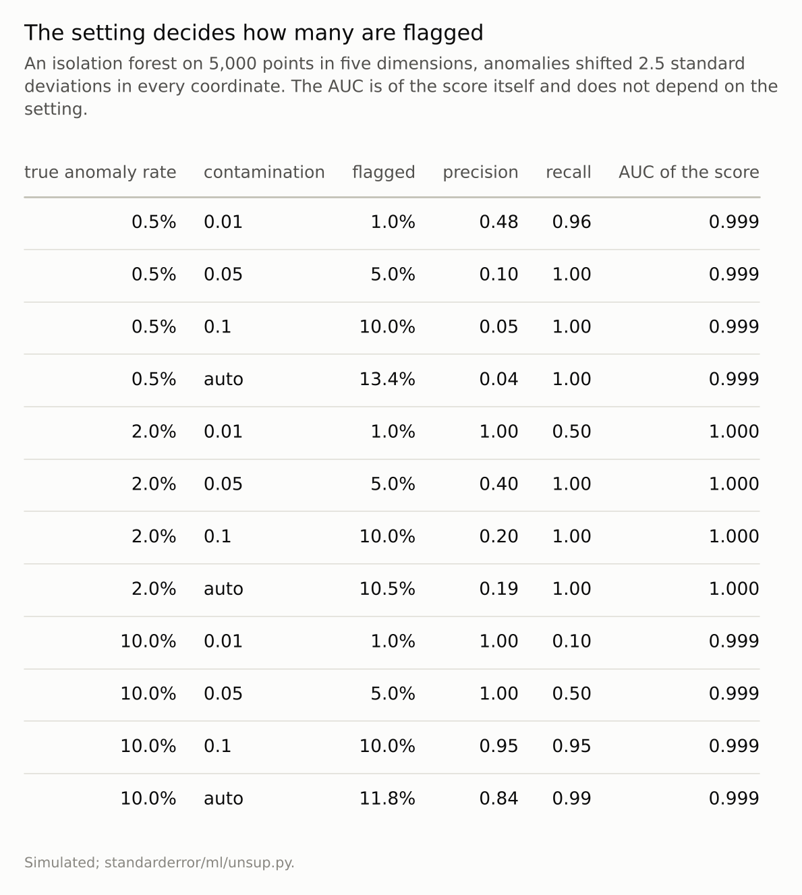
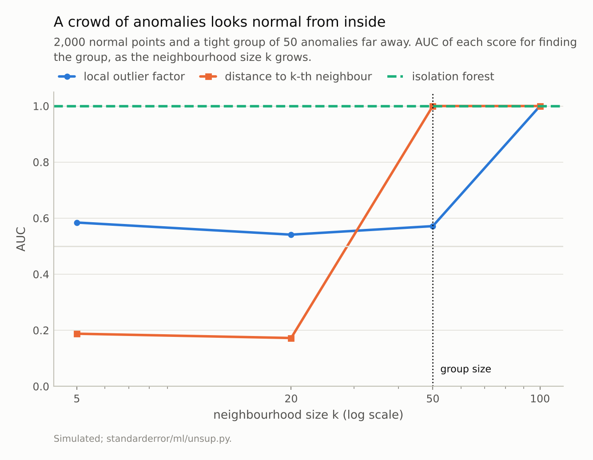
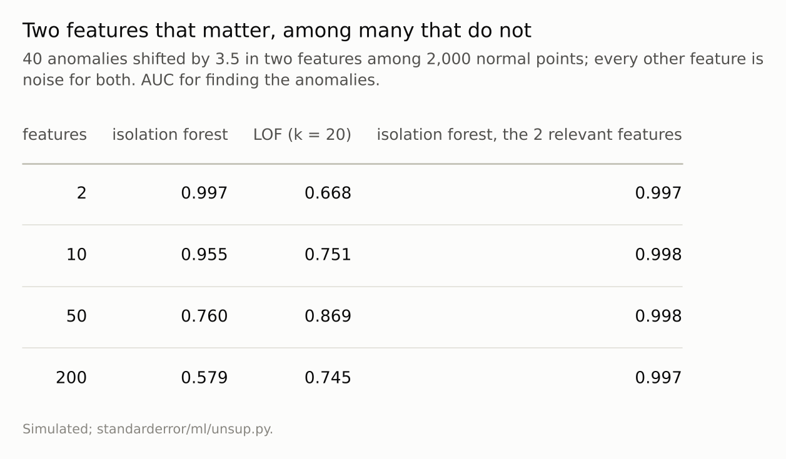

Disclosure: this post was written with the assistance of an AI system (Claude), which wrote the analysis code, ran the experiments and drafted the text. The topic, the constraints, the data choices and the final review are the author's.

*An isolation forest on simulated data with 0.5%, 2% or 10% planted anomalies ranked them with AUCs of 0.99 or more, and flagged exactly the share set by its contamination parameter; the 'auto' setting flagged 10.5% to 13.4% whatever the truth. Fifty anomalies packed together scored AUCs of 0.17 to 0.58 under local methods with neighbourhoods smaller than the group, and 1.00 with larger ones. Anomalous in 2 features of 200, they were found with an average AUC of 0.58, against 0.997 on the two features alone. Eight malignant tumours among 357 benign ones were ranked with AUCs of 0.85 to 0.99; flagging 5% caught 71% of them on average.*

Episode 59 of *Machine Learning, Taught Through What Breaks*. The syllabus and the other episodes: https://jongha-jeon-dev.github.io/standarderror/lectures/

## Finding what you did not know to look for

Anomaly detection is the unsupervised task with the most practical pull: fraud nobody has labelled yet, a failing machine, a data-entry error among a million rows. With no labels there is no model of the anomaly, only of normality, and a point is flagged for not fitting it. The isolation forest of Liu, Ting and Zhou isolates points with random splits and scores those that take few splits to isolate; the local outlier factor of Breunig and colleagues compares a point's local density with its neighbours'. Both are a line of scikit-learn, and the output is a flag on each row, which invites the sentence under test: *an anomaly detector finds the anomalies in your data*.

The test plants anomalies whose number and nature are known, and asks three questions separately: how many points get flagged, how well the score ranks the planted ones, and what in the data changes that ranking. The last question is replicated on breast-cancer data, with malignant tumours hidden among benign ones as the anomalies to find.

## The setting decides how many

scikit-learn's detectors take a `contamination` parameter, and it reads like an estimate of how much of the data is anomalous. It is not. It sets the threshold so that exactly that share of the training points is flagged.

```python
from standarderror.ml import unsup

for r in unsup.anomaly_contamination(rates=(0.005, 0.1),
                                     settings=(0.05, "auto")):
    for c in ("0.05", "auto"):
        v = r[c]
        print(f"true {r['rate']:5.1%}  contamination={c:4s}  flagged "
              f"{v['flagged']:.3f}  precision {v['precision']:.2f}")
```

```text
true  0.5%  contamination=0.05  flagged 0.050  precision 0.10
true  0.5%  contamination=auto  flagged 0.134  precision 0.04
true 10.0%  contamination=0.05  flagged 0.050  precision 1.00
true 10.0%  contamination=auto  flagged 0.118  precision 0.84
```

With 0.5% of the points truly anomalous, a setting of 5% flagged 5% and gave a precision of 0.10: nine flags in ten were normal points. With 10% truly anomalous, a setting of 1% gave perfect precision and caught 10% of them. The default, 'auto', applies a fixed threshold to the isolation forest's score, and here it flagged 10.5% to 13.4% of the points whether the truth was 0.5%, 2% or 10%. Underneath every one of those settings the score ranked the planted anomalies with an AUC of 0.99 or more.

So the detector's real output is a ranking, and the flag is a cut through it that someone chose. Episode 46 made the same point for classifiers: the threshold is a decision about costs, not a property of the model, and here there is not even a probability to anchor it. Choosing it needs either a labelled sample or a budget, the number of cases someone can investigate.



*Precision and recall are against the planted anomalies.*

## A crowd of anomalies looks normal from inside

The ranking depends on what the score compares a point with. Fifty anomalies, all from one fault, packed tightly together far from 2,000 normal points: a local method that looks at a point's k nearest neighbours sees, for any k up to 49, only other anomalies, densely packed.

```python
m = unsup.anomaly_masking(ks=(20, 100))      # a group of 50 anomalies
for r in m["rows"]:
    print(f"k={r['k']:3d}  LOF AUC {r['lof']:.2f}  k-NN distance AUC "
          f"{r['knn']:.2f}")
print(f"isolation forest AUC {m['iforest']:.2f}")
```

```text
k= 20  LOF AUC 0.54  k-NN distance AUC 0.17
k=100  LOF AUC 1.00  k-NN distance AUC 1.00
isolation forest AUC 1.00
```

With k of 5 or 20, the local outlier factor scored the group with an AUC between 0.54 and 0.58, barely better than a coin, and the plain distance to the k-th neighbour between 0.17 and 0.19: by that score the anomalies looked *more* normal than the normal points, because they were more tightly packed. (Episode 66 reran this on five other seeds: the distance score's worst AUC ranged from 0.19 to 0.24, always far below chance.) At k = 50 the distance score found them perfectly and the outlier factor still did not (0.57); at k = 100 both did. The isolation forest, which subsamples and isolates rather than comparing neighbours, scored 1.00. This is masking, an old problem in outlier statistics: one anomaly is conspicuous, many similar ones are a cluster. A fault that produces many identical bad records is exactly that case.



*At k = 20 the distance score's AUC was **0.17**: the anomalies looked more normal than the normal points.*

## Two features that matter among many that do not

An anomaly is usually unusual in a few features, not all of them. Here 40 anomalies were shifted by 3.5 standard deviations in two features, and the data had 2, 10, 50 or 200 features in all. Averaged over six draws of the data and the forest, the isolation forest's AUC went from 1.00 to 0.96, 0.76 and **0.58**, with single draws at 200 features between 0.50 and 0.68: little or no better than chance. Each of its random splits chooses a feature at random, so with two relevant features among 200 almost every split is spent on noise; the control below supports that explanation without measuring it directly. Given only the two relevant features, it scored 0.997.

The local outlier factor behaved differently, rising from 0.67 with two features to 0.87 with 50 and falling to 0.75 with 200. The fall is the dilution episode 33 measured for nearest neighbours: distances in many dimensions still carry the two shifted features, but less and less. The low start is probably the masking of the previous section: in two dimensions the 40 anomalies form a little cluster of their own, and LOF looks at 20 neighbours. Extra noise features spread them apart. Zimek, Schubert and Kriegel's survey of outlier detection in high dimensions makes the general case: irrelevant attributes hide anomalies that exist in a subspace, and which method suffers most depends on how it uses distances. The practical lesson is older than either method: the detector can only find what the features make unusual, so the choice of features is most of the model.



*Means over six draws of data and forest; with 40 anomalies, an AUC near 0.5 has a standard error of about 0.05.*

## Malignant among benign

The replication hides eight malignant tumours among the 357 benign ones in the breast-cancer data, with all 30 features standardised, and repeats the draw 20 times. The isolation forest ranked the eight with an AUC of 0.95 on average, between 0.85 and 0.99; the local outlier factor, 0.93. Malignant tumours are larger and more irregular, so in these features they are unusual, and an unsupervised score finds most of them.

Flagging 5% of the 365 tumours, about eighteen, caught 71% of the malignant ones on average, but between 38% and 88% depending on which eight were drawn and on the forest's seed, with a precision of 0.30. That spread is the cost of having no labels: which malignant cases look unusual, and which benign ones do, decides the result, and nothing in the procedure says which it will be on a given day.

## Where this breaks

**Planted anomalies.** The simulated anomalies were shifted versions of normal points, the easiest kind to define. Real anomalies include points that are individually ordinary and unusual only in combination or in sequence, which these detectors do not look for.

**Scores on the training data.** Every score here was computed on the data the detector was fitted to, which is how the tools are commonly used. Fitting on clean data and scoring new data would presumably remove some masking, since the group would not be among the neighbours, and none of the feature problem; neither was measured.

**Two detectors, default settings.** Other methods, such as one-class support vector machines or autoencoders, use distances or reconstructions differently and fail differently; the masking and irrelevant-feature effects were measured for these two.

**Breast-cancer features are good ones.** Its 30 features were chosen by people who knew what malignancy looks like. Features chosen without that knowledge would be closer to the 200-feature simulation.

## What to keep

1. The contamination parameter flagged exactly its own value; 'auto' flagged 10.5% to 13.4% whatever the true rate. The ranking underneath scored an AUC of 0.99 or more throughout.

2. Fifty grouped anomalies looked normal to local scores until the neighbourhood was larger than the group; at k = 20 the distance score's AUC was 0.17.

3. Anomalous in 2 features of 200, the isolation forest found them with an average AUC of 0.58; on the two features, 0.997.

4. Treat an anomaly score as a ranking under assumptions about features and neighbourhoods. Choose how many to flag from a budget or a labelled sample, and check what the top of the ranking actually contains.

## Exercise

Take the rows your detector flagged most recently and the next 50 below the cut. Look at both groups by hand, or have someone who knows the data do it.

If the two groups look alike, the cut is arbitrary and the ranking is all there is. If the flagged group is dominated by one kind of row, check whether many similar rows are sitting just as far from normal, and whether your neighbourhood size could see them.

## Next

Every method in this arc has asked for a number before it started: a perplexity, a number of components, a radius, a contamination. The most basic is the number of clusters itself. Episode 60 tests two ways of letting the data choose it, by resampling and by comparison with data that has no clusters.

---

### Data

- Simulated (seed 0): standard Gaussian normal data; anomalies shifted by 2.5 in every coordinate with random signs (5,000 points, 5 dimensions), packed in a group of 50 with standard deviation 0.1 at (5, 5) beside 2,000 normal points, or shifted by 3.5 in two of 2 to 200 dimensions (40 among 2,000).
- Breast Cancer Wisconsin (Diagnostic), CC BY 4.0, via scikit-learn: the 357 benign tumours with 8 malignant ones drawn at random (20 draws), features standardised.
- Machinery: scikit-learn's IsolationForest (100 trees) and LocalOutlierFactor; `standarderror/ml/unsup.py`, tested in `tests/test_ml.py`.
- Where this stops: Liu, Ting and Zhou, "Isolation forest", *ICDM* (2008); Breunig, Kriegel, Ng and Sander, "LOF: identifying density-based local outliers", *SIGMOD* (2000); Zimek, Schubert and Kriegel, "A survey on unsupervised outlier detection in high-dimensional numerical data", *Statistical Analysis and Data Mining* (2012); episodes 33, 46 and 58 of this series.

### Reproducibility

- **environment**: standarderror=0.1.0, python=3.13.16, numpy=2.4.4
- **code blocks**: executed at build time; the values the prose quotes are pinned, so drift fails the build
- **determinism**: seeded throughout; about a minute of CPU

Code: <https://github.com/jongha-jeon-dev/standarderror>
