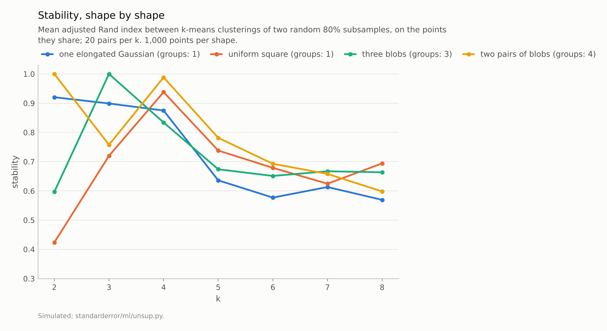
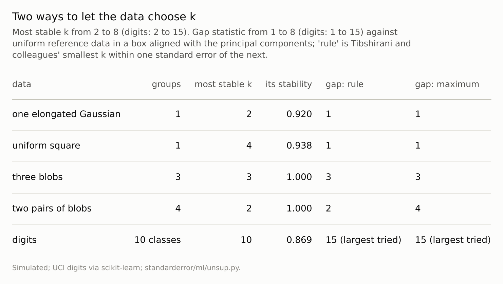

Disclosure: this post was written with the assistance of an AI system (Claude), which wrote the analysis code, ran the experiments and drafted the text. The topic, the constraints, the data choices and the final review are the author's.

*k-means stability, the agreement between clusterings of two random 80% subsamples, chose k = 2 for one elongated Gaussian (stability 0.92) and k = 4 for a uniform square (0.94), neither of which has clusters. It chose 3 for three separated blobs (1.00) and 2 for two pairs of blobs (1.00, against 0.99 at 4). The gap statistic said one cluster for both clusterless shapes and three for the blobs. On the digits stability peaked at k = 10, 9, 9 with three resampling seeds, and the gap statistic's rule found no stopping point up to 15.*

Episode 60 of *Machine Learning, Taught Through What Breaks*. The syllabus and the other episodes: https://jongha-jeon-dev.github.io/standarderror/lectures/

## If it is real, it should come back

Episode 32 found the silhouette choosing four clusters in uniform noise, and episode 57 found the BIC choosing as many Gaussians as a cluster's shape could pay for. A third idea for choosing k sounds more like science than either: a real structure should reproduce. Cluster two random subsamples of the data, compare the two clusterings on the points they share, and repeat; the right k is the one whose answer comes back most consistently. Ben-Hur, Elisseeff and Guyon proposed a version of this in 2002 (their rule looks at the whole distribution of agreements and picks the largest k still concentrated near 1; the version tested here takes the k with the highest mean agreement), and resampling stability is now a widely used check, so the sentence under test is the rule itself: *the right number of clusters is the one whose clustering is most stable under resampling*.

The test is the one this arc has used throughout: shapes with a known number of groups, including none, and the digits. The comparison is the gap statistic of Tibshirani, Walther and Hastie, which asks how much better the clustering fits than it would fit data drawn uniformly over the same region, and which, unlike stability, can answer k = 1.

```python
import numpy as np
from standarderror.ml import unsup

X = np.random.default_rng(0).normal(size=(1000, 2)) * [3, 1]
for k in (2, 3, 5):                 # one elongated Gaussian, no clusters
    print(f"k={k}  stability {unsup.stability(X, k):.3f}")
g = unsup.gap(X)
print("gap statistic chooses", g["rule"])
```

```text
k=2  stability 0.920
k=3  stability 0.899
k=5  stability 0.636
gap statistic chooses 1
```

## Stable without clusters

On one elongated Gaussian, a single cloud three times longer than it is wide, k = 2 had a stability of **0.92**: two random subsamples split the cloud at almost the same place nearly every time. Stability was 0.90 at k = 3 and 0.87 at 4, then dropped, so the highest-mean rule chose 2; Ben-Hur and colleagues' own rule would probably have accepted 3 or 4, which is no better. On a uniform square the most stable k was 4, at 0.94, the same four that the silhouette chose in episode 32. Neither shape has any clusters.

Ben-David, von Luxburg and Pál explained why in 2006. Stability measures whether the clustering objective has a unique best answer on the data's distribution. An elongated cloud has a unique best two-way cut, across its long axis, and a square has a unique best four-way cut, into quadrants, so both are perfectly reproducible with enough data. Where the objective has several equally good answers, as it would for a perfectly round cloud, stability is low whether or not clusters exist. Reproducibility is a property of the method on the data; it is not evidence that the groups are real. And since stability needs at least two clusters to compare, it can never answer that there is only one.



*One elongated Gaussian, no clusters: k = 2 was stable **0.92**.*

## Where clusters exist

On three well-separated blobs stability did its job: k = 3 reproduced perfectly (1.00), and every other k less so. On two pairs of blobs, pairs far apart and the two blobs within each pair close, k = 2 reproduced perfectly (1.00) and k = 4 almost as well (0.99). Both answers are right at different scales, and the rule picked the coarser one because merging the close blobs left nothing to disagree about. A hierarchy is not a mistake, but a single "most stable k" hides it.

The gap statistic, which compares the within-cluster spread with what the same k gives on uniform reference data, chose one cluster for the elongated Gaussian and for the square, and three for the blobs. On the two pairs its stopping rule, the smallest k whose gap is within one standard error of the next, chose 2, and its largest gap was at 4. Of the two methods only the gap could say "no clusters", because only it compares the data with data that has none.



*Stability at k = 1 is trivially perfect and so uninformative: it can never choose 'no clusters'.*

## The digits

On the 1,797 digits, k-means stability rose from 0.29 at k = 2 to a peak of 0.869 at k = 10, the number of classes, with k = 9 and 11 within 0.013 of it. It is a fragile success. With two other resampling seeds the peak moved to k = 9 (0.883 and 0.930); three neighbouring answers are indistinguishable on this evidence, and episode 32 found k-means at k = 10 agreeing with the classes only partly.

The gap statistic, from 1 to 15, rose at every step by more than the next step's standard error, so its rule found no stopping point and fell back to 15, the largest k tried (at the last step by a margin of about 0.001, with five reference sets). It would presumably have gone on: in 64 dimensions, against uniform reference data in a box, every extra centre plausibly explains structure that uniform data lack, whether that structure is ten digit classes or the many ways each digit is written. The gap was built to detect clustering against a null of none, and on data this far from uniform it detects only that.

## What the arc measured

Arc XII took the labels away. A t-SNE picture kept each point's neighbours and drew cluster sizes and gaps that were not in the data (episode 56). The BIC counted the Gaussians a cluster's shape required, more of them the more data it saw (57). DBSCAN found any shape at one density and none when the densities differed sixfold or more, and its standard radius heuristic missed (58). An anomaly detector ranked well and flagged whatever share it was told to; local scores failed for grouped anomalies, and the isolation forest for anomalies hidden in a few of many features (59). And the most reproducible clustering was reproducible because its answer was unique, not because the clusters existed (60).

Each method answered a narrower question than the one it is used for: who is near whom, how many Gaussians, how dense, how unusual in these features, how unique the optimum. The common repair was the one the series has relied on since episode 1, data with a known answer: simulate structure whose truth you know, including the case of no structure at all, and see whether the method can tell.

## Where this breaks

**k-means only.** Stability was measured for k-means, whose objective has unique optima on these shapes. Other algorithms have other objectives and other kinds of stability; the argument of Ben-David and colleagues applies to any algorithm whose answer converges to a unique optimum.

**One version of each method.** Stability has variants that compare to the full-data clustering, use bootstrap samples or normalise by a null; the gap statistic has variants in its reference distribution. Some of them can answer k = 1; this one cannot.

**Two-dimensional shapes.** Four shapes in two dimensions isolate the mechanism; whether higher-dimensional data tend toward unique or ambiguous optima depends on the data, and the digits are one example.

**k from 2 to 8.** On the uniform square stability rose again from k = 7 to k = 8 while staying below its value at 4; a wider range was not tried, and could in principle find a more stable k for any shape.

## What to keep

1. Stability chose k = 2 for one elongated Gaussian (0.92) and k = 4 for a uniform square (0.94); neither has clusters, and stability cannot answer one.

2. It chose correctly for three separated blobs and chose the coarser of two right answers for two pairs of blobs.

3. The gap statistic said one cluster where there were none and three where there were three, and on the digits found no stopping point up to 15; stability chose 10 or 9 there, depending on the resampling seed.

4. Test any rule for choosing k on data with no clusters first. Report reproducibility as evidence about the method's answer, and compare against a null with no structure before claiming the structure exists.

## Exercise

Take a clustering you have reported and fit the same method, with the same k, to data with no clusters but the same spread: shuffle each column independently, which keeps every feature's distribution and destroys the structure between them.

If the clustering of the shuffled data is about as stable, or scores about as well on your validity index, as the real one, the index was measuring the method, not the data.

## Next

Arc XII ends here, at sixty episodes. The plan continues with the gaps a practitioner meets after deployment: data that drift, intervals for regression predictions, fairness trade-offs and the replication of results on real data.

---

### Data

- Simulated (seed 0), 1,000 points each: a Gaussian with standard deviations 3 and 1; a unit uniform square; three unit Gaussian blobs at (0,0), (6,0) and (3,5); four unit blobs at x = 0, 4, 20 and 24.
- UCI optical digits (1,797 images, 64 pixels, CC BY 4.0) via scikit-learn.
- Machinery: scikit-learn's KMeans (three starts); stability as the mean ARI between clusterings of two random 80% subsamples on their shared points (20 pairs; 10 for the digits); the gap statistic with 10 uniform reference sets (5 for the digits); `standarderror/ml/unsup.py`, tested in `tests/test_ml.py`.
- Where this stops: Ben-Hur, Elisseeff and Guyon, "A stability based method for discovering structure in clustered data", *Pacific Symposium on Biocomputing* (2002); Ben-David, von Luxburg and Pál, "A sober look at clustering stability", *COLT* (2006); von Luxburg, "Clustering stability: an overview", *Foundations and Trends in Machine Learning* (2010); Tibshirani, Walther and Hastie, "Estimating the number of clusters in a data set via the gap statistic", *JRSS B* (2001); episodes 32 and 57 of this series.

### Reproducibility

- **environment**: standarderror=0.1.0, python=3.13.16, numpy=2.4.4
- **code blocks**: executed at build time; the values the prose quotes are pinned, so drift fails the build
- **determinism**: seeded throughout; about a minute and a half of CPU

Code: <https://github.com/jongha-jeon-dev/standarderror>
