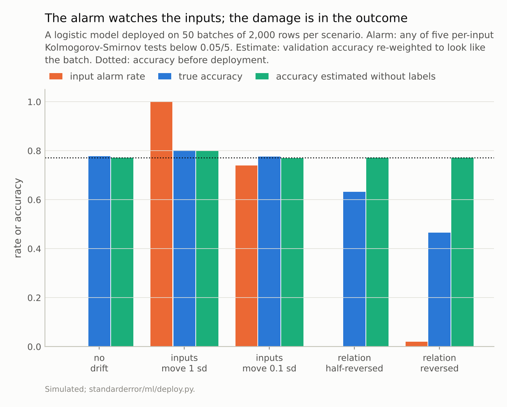
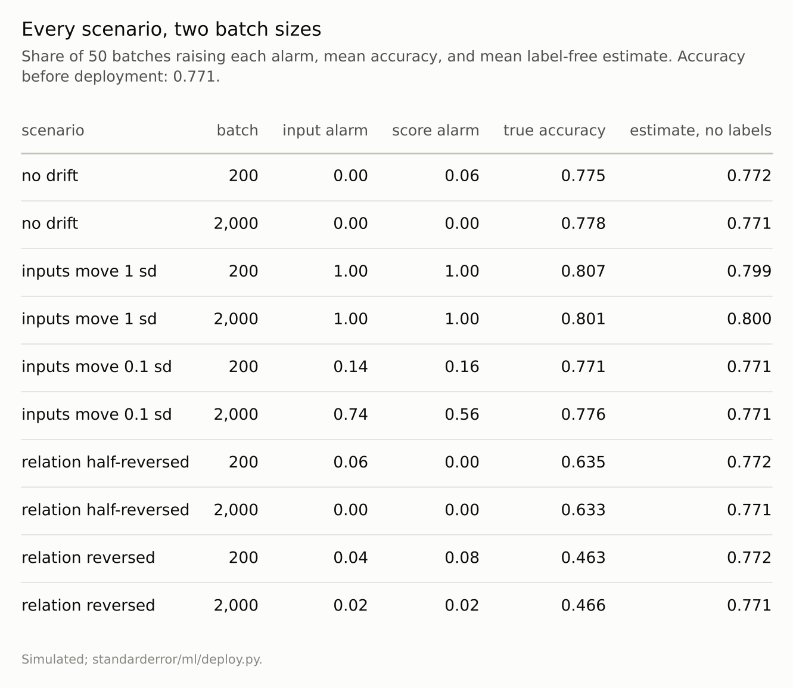

Disclosure: this post was written with the assistance of an AI system (Claude), which wrote the analysis code, ran the experiments and drafted the text. The topic, the constraints, the data choices and the final review are the author's.

*A logistic model, deployed on batches of a simulated world. When one input moved by a standard deviation, an alarm on the inputs fired on every batch and accuracy rose from 0.771 to 0.801. When the input's effect reversed and the inputs stayed put, the alarm fired on 2% of batches, an alarm on the predicted scores on 2%, and accuracy fell to 0.466; an estimate of accuracy from the unlabelled batch stayed at 0.771. With 20 inputs tested separately and no drift, at least one alarm fired in 63% of batches. On breast cancer, deploying on the larger tumours set off alarms on 19 of 30 features while accuracy stayed within what 135 tumours can measure.*

Episode 61 of *Machine Learning, Taught Through What Breaks*. The syllabus and the other episodes: https://jongha-jeon-dev.github.io/standarderror/lectures/

## What a monitor can see

Every arc so far has ended where a model is deployed. This one starts there, with the questions a practitioner meets afterwards: is it still working, how sure are its numbers, is it fair, how often should it be retrained, and do the series' simulated findings hold on real data. The first is the most common: once a model is live, how do you know when it has stopped working?

The usual answer is to watch the inputs. Labels arrive late or never, inputs arrive with every prediction, so a monitoring system compares each new batch of inputs with the training data, feature by feature, and raises an alarm when they differ. The practice rests on a sentence worth testing: *a drift alarm on a model's inputs tells you when the model has stopped working*.

Episode 29 measured what a shift in the inputs costs a model, and found that it costs little when the model is right about how inputs relate to the outcome. The test here is of the alarm. A simulated world with five inputs and a logistic outcome trains a logistic model on 5,000 rows; then the world is changed in one of four ways and the model is deployed on batches of 200 or 2,000 rows, 50 of each. The alarm runs a two-sample Kolmogorov-Smirnov test on each input against the training data and fires if any of the five falls below 0.05 divided by five.

```python
import numpy as np
from scipy.stats import ks_2samp
from sklearn.linear_model import LogisticRegression
from standarderror.ml import deploy

rng = np.random.default_rng(0)
X, y = deploy.drift_world(5000, rng)          # the world at training time
model = LogisticRegression().fit(X, y)
for kw in ({"shift": 1.0}, {"flip": 1.0}):    # inputs move; relation turns
    Xb, yb = deploy.drift_world(2000, rng, **kw)
    p = min(ks_2samp(X[:, j], Xb[:, j]).pvalue for j in range(5))
    acc = np.mean(model.predict(Xb) == yb)
    print(f"{kw}: smallest input p-value {p:.1e}, accuracy {acc:.3f}")
```

```text
{'shift': 1.0}: smallest input p-value 2.7e-199, accuracy 0.806
{'flip': 1.0}: smallest input p-value 8.9e-02, accuracy 0.466
```

## Alarms when nothing is wrong

Move the first input's mean by one standard deviation, leaving the outcome's dependence on the inputs unchanged. The alarm fired on every batch, of either size. Accuracy *rose*, from 0.771 on the validation rows before deployment to 0.801: the moved input carries the largest coefficient, so presumably more of the new rows sit far from the decision boundary, where the model is surer and right more often. A team paged by that alarm would find a model doing better than ever.

Move it by a tenth of a standard deviation instead. On batches of 2,000 the alarm fired on 74% of them, on batches of 200 on 14%, and accuracy did not change measurably (0.776 against 0.778 with no drift). A test of whether two distributions differ answers with more confidence the more data it has, and a large enough batch makes any difference significant; whether the difference matters is a separate question that the test does not ask.

The last way to raise alarms over nothing is to have many inputs. With no drift at all and each input tested at 5%, at least one test fired in 23% of batches with 5 inputs, 63% with 20 and 99% with 100. Run weekly, a 20-input monitor would fire about 33 times a year with nothing wrong. A Bonferroni correction brought the rate back near the 5% it promises, between 2.0% and 7.5% over 200 batches, at the price of missing small real shifts.



*Relation reversed: alarm on 2% of batches, accuracy **0.47**, estimate without labels 0.77.*

## Silence when everything is wrong

Now leave the inputs alone and change how the outcome depends on them: the first input's coefficient moves from +1.5 to 0 (half-reversed) or to -1.5 (reversed). This is what a change in customers' behaviour, a new fraud pattern or a new treatment protocol does. The input alarm fired on 0% and 2% of batches, no more than with no drift; accuracy fell to **0.633** and **0.466**, below a coin flip in the second case.

Two more label-free monitors were run alongside, and both were blind for the same reason. An alarm on the model's predicted probabilities fired on 2% of batches: the scores are a function of the inputs, and the inputs had not moved. An estimate of accuracy built from the unlabelled batch, re-weighting labelled validation rows by how much they resemble the new ones (the importance weighting of Sugiyama and colleagues), said 0.771 throughout. That estimate was excellent when the inputs moved, within 0.002 of the truth, because covariate shift is exactly the assumption it makes. Under a change in the relation it reported the past.

Nothing computed from inputs alone can detect a change in the outcome given the inputs. Gama and colleagues' survey of concept drift calls it real drift; the only signal is in labelled outcomes, and episode 64 measures what it costs when those arrive late.



*The score alarm tests the model's predicted probabilities the same way.*

## A third kind, and a real shift

Between the two sits label shift: the outcome's prevalence changes and each class looks the same as before, as when a disease becomes more common. With the prevalence moved from 0.46 to 0.20, the alarm fired on every batch and accuracy stayed close (0.794 against 0.771), but the model's average predicted probability was 0.363 against an actual rate of 0.201; at a prevalence of 0.8, 0.596 against 0.803. Accuracy hid what the probabilities showed, and a decision made at a fixed probability would be wrong in proportion. Lipton, Wang and Smola showed how to estimate the new prevalence from unlabelled predictions under exactly this assumption.

The breast-cancer data give a real version of the first scenario. A logistic model trained on 300 random tumours scored 0.967 on the other 269, with no feature alarmed. Deployed only on the tumours larger than the training median, 19 of the 30 features raised an alarm, the share of malignant tumours rose from 38% to 70%, and accuracy was 0.941 (8 errors in 135); on the largest quarter, 20 alarms and 0.969. Differences of that size are within what so few tumours can measure. A monitor would have reported a crisis that the outcomes did not show.

## Where this breaks

**Five inputs, one model.** Real monitors watch hundreds of features and use other tests (population stability indices, embedding distances); their behaviour with sample size and with many features is the same in kind as the Kolmogorov-Smirnov test's.

**Shifts chosen to separate the cases.** Real drift usually mixes a moving input distribution with a changing relation, and an input alarm will then often fire for the wrong reason at the right time. That coincidence is not a mechanism to rely on.

**A correctly specified model.** Episode 29 showed that a misspecified model does lose accuracy under covariate shift, so an input alarm is more informative for such a model. It still cannot see a change in the relation.

**Labels assumed absent.** Where labels arrive quickly, monitoring the outcome directly makes most of this unnecessary.

## What to keep

1. An input alarm fired on every batch when an input moved a standard deviation, and accuracy rose from 0.771 to 0.801.

2. When the relation reversed and the inputs stayed put, input and score alarms fired no more than with no drift, a label-free accuracy estimate said 0.77, and accuracy was 0.47.

3. With 20 inputs tested separately, 63% of batches raised an alarm with nothing wrong; with large batches, a shift too small to matter raised it 74% of the time.

4. Treat input drift as a reason to look, not as evidence of harm. Budget for labelled outcomes, however few and late, because a change in the relation shows up nowhere else.

## Exercise

List the alarms your monitoring raised in the last quarter and, for each, whether the model's measured performance on labelled outcomes changed afterwards. Then list the last two occasions the model's performance did fall and whether any input alarm preceded them.

The two lists measure your monitor's precision and recall for the thing you care about. If either is low, the missing ingredient is outcome data, not a better test on the inputs.

## Next

A monitor asks whether a model is still right on average. A prediction interval asks how far off any single prediction might be, and the usual one, a fixed band around every prediction, is right on average too. Episode 62 asks where it is wrong.

---

### Data

- Simulated: five standard Gaussian inputs, logistic outcome with coefficients (1.5, -1, 0.8, 0, 0) and intercept -0.3; the model trained on 5,000 rows; 50 deployment batches of 200 or 2,000 rows per scenario (seed 0).
- Breast Cancer Wisconsin (Diagnostic), CC BY 4.0, via scikit-learn: a standardised logistic model trained on 300 random tumours, deployed on the other 269 or on those above the training median or upper quartile of mean radius.
- Machinery: SciPy's two-sample Kolmogorov-Smirnov test; a logistic domain classifier for the density-ratio estimate; `standarderror/ml/deploy.py`, tested in `tests/test_ml.py`.
- Where this stops: Rabanser, Günnemann and Lipton, "Failing loudly: an empirical study of methods for detecting dataset shift", *NeurIPS* (2019); Gama, Žliobaitė, Bifet, Pechenizkiy and Bouchachia, "A survey on concept drift adaptation", *ACM Computing Surveys* (2014); Sugiyama, Krauledat and Müller, "Covariate shift adaptation by importance weighted cross validation", *JMLR* (2007); Lipton, Wang and Smola, "Detecting and correcting for label shift with black box predictors", *ICML* (2018); episodes 29 and 39 of this series.

### Reproducibility

- **environment**: standarderror=0.1.0, python=3.13.16, numpy=2.4.4
- **code blocks**: executed at build time; the values the prose quotes are pinned, so drift fails the build
- **determinism**: seeded throughout; about half a minute of CPU

Code: <https://github.com/jongha-jeon-dev/standarderror>
