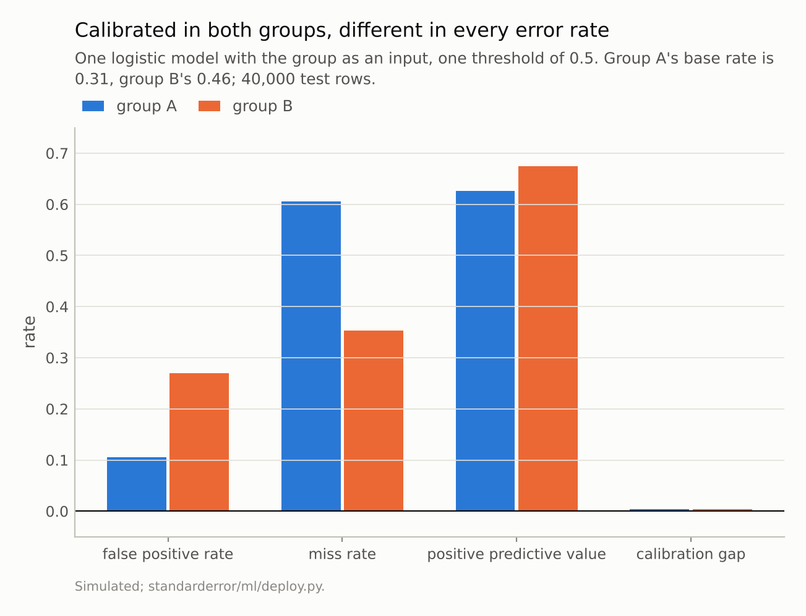
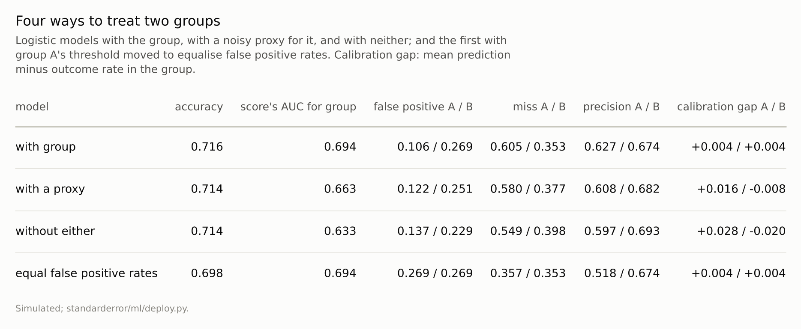

Disclosure: this post was written with the assistance of an AI system (Claude), which wrote the analysis code, ran the experiments and drafted the text. The topic, the constraints, the data choices and the final review are the author's.

*Two simulated groups with outcome rates of 0.31 and 0.46, an outcome that depends on a latent risk alone. A logistic model with the group as an input was calibrated to within 0.004 in both, and at one threshold its false positive rates were 0.106 and 0.269 and its miss rates 0.605 and 0.353. Without the group, false positive rates were 0.137 and 0.229, calibration within groups was off by +0.028 and -0.020, and the score still told the groups apart with an AUC of 0.63. Equalising false positive rates with a separate threshold cost 0.018 of accuracy and left a flagged person in group A truly positive 52% of the time against 67% in group B.*

Episode 63 of *Machine Learning, Taught Through What Breaks*. The syllabus and the other episodes: https://jongha-jeon-dev.github.io/standarderror/lectures/

## What treating groups the same could mean

A deployed model makes decisions about people, and people come in groups that the law and the public care about. The first fairness check most teams run is calibration within each group: does a predicted risk of 30% mean 30% for everyone? Episode 34 showed a model calibrated overall can fail it in a group. A model that passes it seems to have earned the sentence under test: *a model that is calibrated within every group treats the groups the same*.

The simulation is built so that nobody could call the model biased in its construction. Two groups of equal size differ in one thing: group A's latent risk is lower on average, so its outcome rate is 0.31 against group B's 0.46. The outcome depends on that latent risk alone, never on the group. The model sees a noisy measurement of the risk and, in its first version, the group.

```python
import numpy as np
from sklearn.linear_model import LogisticRegression
from standarderror.ml import deploy

rng = np.random.default_rng(0)
g, x1, proxy, y = deploy.fairness_world(40_000, rng)
G, X1, P, Y = deploy.fairness_world(40_000, rng)
m = LogisticRegression().fit(np.c_[x1, g], y)      # group as an input
p = m.predict_proba(np.c_[X1, G])[:, 1]
for k, name in ((0, "A"), (1, "B")):
    s = G == k
    print(f"group {name}: outcome rate {Y[s].mean():.3f}, mean "
          f"prediction {p[s].mean():.3f}, false positive rate "
          f"{np.mean(p[s & (Y == 0)] > 0.5):.3f}")
```

```text
group A: outcome rate 0.310, mean prediction 0.314, false positive rate 0.106
group B: outcome rate 0.463, mean prediction 0.467, false positive rate 0.269
```

The model's probabilities were right in both groups, to within 0.004. Now apply one threshold, 0.5, to everybody.

## Calibrated, and unequal in every error rate

Among people whose outcome was negative, the model flagged 10.6% in group A and **26.9%** in group B: a member of B with nothing wrong was 2.5 times as likely to be flagged. Among people whose outcome was positive, it missed 60.5% in A and 35.3% in B. A flag was right 62.7% of the time in A and 67.4% in B.

Nothing is wrong with the model. Group B's people have higher risk on average, so more of B's negatives sit near the threshold, where a noisy measurement pushes some across it. Two theorems from 2016 say this is unavoidable when base rates differ and prediction is imperfect. Kleinberg, Mullainathan and Raghavan proved that a score cannot be calibrated within groups and also give each group's negatives, and each group's positives, the same average score. Chouldechova proved the counterpart for decisions: equal precision, equal false positive rates and equal miss rates cannot all hold. The dispute over the COMPAS recidivism scores in 2016 was this theorem in public, with one side measuring calibration and the other error rates, both correctly.



*False positive rates 0.106 and 0.269; miss rates 0.605 and **0.353**.*

## Leaving the group out

The most common response is to remove the group from the model's inputs. Without it, the false positive rates were 13.7% and 22.9%, and the miss rates 54.9% and 39.8%: closer, not equal. The model's score still separated the groups, with an AUC of 0.63 for telling them apart, because the measured risk differs between groups and the score is built from it.

And the model lost the property it started with. Without the group, it predicted +0.028 too high on average in group A and -0.020 in group B: the same measured value means a different expected risk in each group, because the groups' risks are distributed differently, and a model that cannot see the group averages over them. Leaving the group out is what Kusner and colleagues called fairness through unawareness; Dwork and colleagues had argued in 2012 that it fails for a different reason, that other features encode the group, which is what a proxy does. With a noisy proxy for the group in place of the group, such as a postcode, the score's AUC for the group came back to 0.66 and the calibration gaps shrank to +0.016 and -0.008: the model rebuilt much of what was removed, at an accuracy of 0.714 against 0.716.

## Equalising the error rates

The other response is to equalise the error rates directly, as Hardt, Price and Srebro proposed: keep the score and choose each group's threshold separately. Lowering group A's threshold from 0.5 to 0.342 brought its false positive rate to 0.269, matching B's 0.269 (the threshold was chosen on these same rows, so the match is by construction); in this world the miss rates came out equal as well, 0.357 and 0.353.

The price was in two places. Accuracy fell from 0.716 to 0.698, because A's threshold no longer sits where its errors are fewest. And the meaning of a flag now depends on the group: a flagged member of A was truly positive 51.8% of the time, a flagged member of B 67.4%. The two groups get equal error rates and unequal precision, where the first model gave them equal calibration and unequal error rates. A third definition, equal shares flagged in each group, was further away than either: the first model flagged 19.5% of group A and 44.4% of group B, the model without the group 23.4% and 40.2%, and the equal-error-rate thresholds 38.5% and 44.4%. Equal flag rates with unequal base rates would mean flagging fewer of group B's positives or more of group A's negatives than the score supports, a third distribution of errors with its own advocates. Each of the three rules measured here satisfied at most one of the three definitions, counting equal false positive and miss rates together as one; Chouldechova's theorem says that, with unequal base rates, no rule can have equal precision and equal error rates together, and the data say only what each choice costs.

Episode 46 put the threshold where costs said it should be; here the costs of errors falling on different groups are part of the decision, and they are not a quantity the data can supply.



*'Score's AUC for group': how well the model's score alone tells the groups apart.*

## Where this breaks

**A clean world.** Here the outcome depends on risk alone and the labels are accurate. In practice the labels often come from past decisions (episode 39), the measured risk can be measured worse in one group, and the group can affect the outcome through channels that are themselves unjust; each changes which definition is defensible.

**Two groups, one threshold rule.** Real deployments have many groups, intersections of them, and decisions that are not one threshold.

**Simulation only.** scikit-learn's bundled data have no protected attribute to test on; the theorem does not need data, but the sizes of the gaps do.

**Fairness metrics chosen for the demonstration.** Calibration, error rates and precision are three of many definitions; Corbett-Davies and Goel review others, and the trade-offs among them follow the same arithmetic.

## What to keep

1. A model calibrated to within 0.004 in both groups made false alarms on 10.6% and 26.9% of their negatives at one threshold. With different base rates, that is arithmetic, not bias in the model.

2. Removing the group narrowed the gaps without closing them, broke calibration within groups, and a proxy restored much of what was removed.

3. Equalising false positive rates cost 0.018 of accuracy and made a flag 52% reliable in one group and 67% in the other.

4. Report calibration and error rates by group together. Decide which inequality to accept with the people affected, and write the choice down, because no model can make it disappear.

## Exercise

For a model that makes decisions about people, compute by group: the outcome rate, the mean predicted probability, the false positive rate, the miss rate and the precision at the threshold in use.

If the outcome rates differ, at least one of the other comparisons will show a gap. Name which one your organisation has decided to equalise, and who decided; if the answer is nobody, the default threshold decided for you.

## Next

A fairness audit is a snapshot, and the world the model serves keeps moving. Episode 64 asks how a model should be retrained as it does: on all the history it has, or only the recent part, and what it costs when the labels arrive late.

---

### Data

- Simulated (seed 0): two equal groups; latent risk z standard Gaussian, 0.6 lower on average in group A; outcome logistic in 1.6z - 0.2; measured feature z + noise (sd 0.7); proxy = group + noise (sd 0.5). 40,000 training and 40,000 test rows.
- Machinery: scikit-learn's LogisticRegression; `standarderror/ml/deploy.py`, tested in `tests/test_ml.py`.
- Where this stops: Kleinberg, Mullainathan and Raghavan, "Inherent trade-offs in the fair determination of risk scores", *ITCS* (2017); Chouldechova, "Fair prediction with disparate impact", *Big Data* (2017); Hardt, Price and Srebro, "Equality of opportunity in supervised learning", *NeurIPS* (2016); Dwork, Hardt, Pitassi, Reingold and Zemel, "Fairness through awareness", *ITCS* (2012); Kusner, Loftus, Russell and Silva, "Counterfactual fairness", *NeurIPS* (2017); Corbett-Davies and Goel, "The measure and mismeasure of fairness" (2018); Angwin, Larson, Mattu and Kirchner, "Machine bias", *ProPublica* (2016); episodes 34 and 46 of this series.

### Reproducibility

- **environment**: standarderror=0.1.0, python=3.13.16, numpy=2.4.4
- **code blocks**: executed at build time; the values the prose quotes are pinned, so drift fails the build
- **determinism**: seeded throughout; a few seconds of CPU

Code: <https://github.com/jongha-jeon-dev/standarderror>
