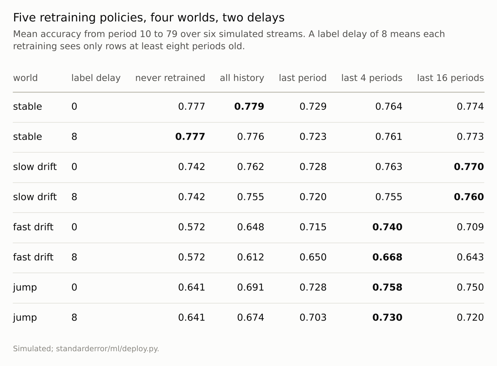
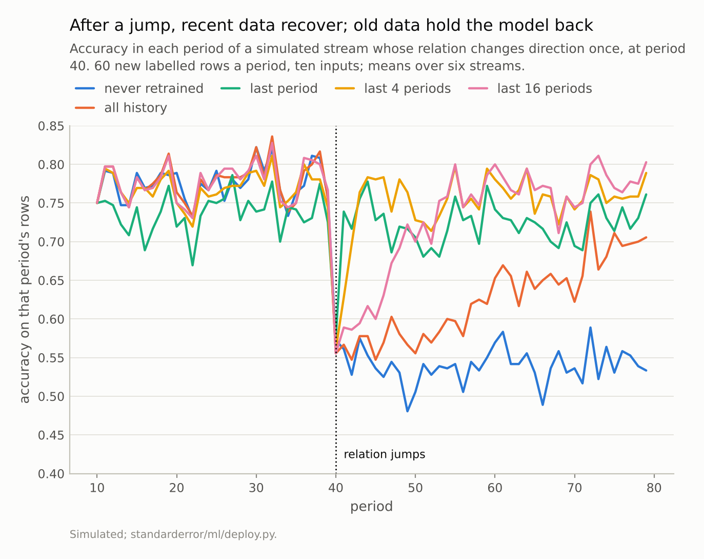

Disclosure: this post was written with the assistance of an AI system (Claude), which wrote the analysis code, ran the experiments and drafted the text. The topic, the constraints, the data choices and the final review are the author's.

*A logistic model retrained every period on simulated streams of 60 rows a period. In a stable world, the last period alone gave accuracy 0.729 against 0.779 for all history, and never retraining 0.777. The best policy was all history when nothing changed, the last 16 periods under slow drift (0.770) and the last 4 under fast drift (0.740, against 0.648 for all history) and after a jump. With labels eight periods late, the best policy's gain over never retraining under fast drift fell from 0.168 to 0.096, and recovery after a jump took 19 periods instead of 3.*

Episode 64 of *Machine Learning, Taught Through What Breaks*. The syllabus and the other episodes: https://jongha-jeon-dev.github.io/standarderror/lectures/

## The retraining schedule

Episode 61 found that a change in how outcomes depend on inputs shows up only in labelled outcomes. The standard defence does not try to detect it at all: retrain on a schedule, on recent data, so the model follows the world wherever it goes. It is a sentence with two parts that can each fail: *retrain regularly on the most recent data and the model stays current*.

The test is a stream. Each period brings 60 new rows with ten inputs and a logistic outcome. In four kinds of world the relation between inputs and outcome stays fixed; wanders slowly; wanders fast; or jumps once, halfway, to a new direction. The relation's strength is held constant throughout, so only its direction changes. After ten periods of history a logistic model is retrained every period under five policies: never again (the ten-period model kept forever), all labelled history, or only the last 1, 4 or 16 periods. Each is scored on the next period's rows, and everything is averaged over six streams per world.

```python
import numpy as np
from standarderror.ml import deploy

rng = np.random.default_rng([0, 2])            # one fast-drift stream
Xs, ys = deploy._stream("fast drift", rng, periods=80, rows=60, dim=10)
print(len(Xs), "periods of", Xs[0].shape[0], "rows,",
      Xs[0].shape[1], "inputs; outcome rate in period 0:",
      round(float(ys[0].mean()), 2))
```

```text
80 periods of 60 rows, 10 inputs; outcome rate in period 0: 0.43
```

## Recent is not always better

In the stable world, the policy that sounds most current was the worst: retraining on the last period alone, 60 rows, gave accuracy 0.729, against 0.779 for all history. Nothing was changing, so discarding old data only discarded sample size: a ten-input model fitted on 60 rows is noisy, and each period's model was a fresh draw of that noise. The model that was never retrained at all scored 0.777, as good as any.

Under slow drift the order changed, and the best policy was a long window: the last 16 periods scored 0.770, all history 0.762, the last period 0.728. Under fast drift, all history fell to 0.648, dragged towards relations that no longer held, and the last 4 periods scored 0.740. After a jump, the last 4 periods were best again (0.758).

```python
r = deploy.retraining(delays=(0,), reps=2)["results"]
for world in ("stable", "fast drift"):
    v = r[f"{world}/0"]["mean"]
    print(world)
    print("  " + "  ".join(f"{p} {a:.3f}" for p, a in v.items()))
```

```text
stable
  static 0.778  expanding 0.782  window 1 0.727  window 4 0.765  window 16 0.774
fast drift
  static 0.605  expanding 0.661  window 1 0.723  window 4 0.744  window 16 0.715
```

So the best window was all history, 16, 4 and 4 in the four worlds, and no window was best in every kind of world. This is the bias-variance trade of episode 9 along the time axis: a long window averages out noise and is biased by old relations, a short one tracks change and is noisy. Widmer and Kubat built adaptive windows for this in 1996, and Klinkenberg and Joachims chose window sizes by estimating error on recent data; both work by measuring how fast the world is moving, which a fixed schedule does not.



*Each world's best policy is the largest number in its row.*

## Choosing the window from the past

The practical fix is to choose the window the way Klinkenberg and Joachims did, by its record: backtest each policy on the history you have and keep the winner. Done here on the first 30 scored periods of each world (periods 10 to 39, averaged over the six streams) and judged on the remaining 40, it chose all history in the stable world, which was right, and the four-period window under fast drift, also right (0.741).

It chose wrong in the other two. Under slow drift the first 30 periods favoured all history, because the relation had not yet moved far, and over the next 40 that choice scored 0.754 against 0.768 for the sixteen-period window. In the world that jumped, the first 30 periods were all before the jump and favoured all history, which then scored 0.625 over the remaining periods against 0.750 for the four-period window. A backtest measures how fast the world moved, not how fast it will move; it works when the pace of change is itself stable.

The never-retrained model is the other reference point. In the stable world it lost nothing; under fast drift it scored 0.572, and after the jump its accuracy fell to 0.538, not far above a coin, because the old direction said little about the new one. A model that is never retrained bets that the world is stable, and the bet is either free or very expensive.

## Late labels

The schedule also assumes labels are there to retrain on. A loan defaults months after the decision, a churned customer is known only after the renewal date, and a fraud label waits for an investigation. With labels arriving eight periods late, each retraining could use only rows at least eight periods old.

In the stable world the delay cost nothing (0.776 against 0.779 for all history), since old rows were as good as new. Under fast drift every retrained policy got worse, and the best one's advantage over never retraining fell from 0.168 to 0.096: the delay took away 43% of what retraining bought. Averaged over the stream with the jump, the four-period window scored 0.730 with late labels against 0.758 with prompt ones. After the jump, the four-period window took 3 periods to recover with immediate labels and 19 with late ones, 16 more, against a delay of eight; all history did not recover within the 40 periods after the jump either way. Every period of delay is a period the model spends wrong before it can even begin to learn the new relation, and nothing in the inputs can shorten it, as episode 61 found.



*Periods to recover after the jump: last period 3, last 4 3, last 16 19; all history and the never-retrained model did not recover by period 79.*

## Where this breaks

**Logistic model, logistic world.** The model was correctly specified in every period, so its only problems were noise and staleness. A misspecified model adds a third: more data of the wrong kind cannot fix it.

**Fixed windows.** Weighting rows by age, or retraining only when monitored performance drops, sit between the policies measured here; their best settings depend on the drift rate in the same way.

**Constant volume.** Sixty rows a period made short windows noisy. With far more rows per period, short windows lose less in a stable world.

**Six streams per cell.** Differences of under a point between neighbouring windows are within the noise; the ordering of the best policies across worlds was not.

## What to keep

1. In a stable world, retraining on the last period alone cost 0.049 of accuracy against all history, and never retraining cost nothing.

2. The best window was all history, the last 16 periods, the last 4 and the last 4 across four worlds; no fixed choice was best everywhere.

3. Labels eight periods late took 43% of retraining's gain under fast drift and added 16 periods to the recovery after a jump.

4. Choose a retraining window by measuring how fast your relation changes, from performance on labelled outcomes over time. Plan around your label delay; shorten it where you can, because it adds to every period a changed model spends wrong.

## Exercise

Take a model you retrain and backtest three windows on your own history: all of it, the last year, the last quarter. For each, retrain at every past retraining date using only data whose labels would have been available then, and score the next period.

If all of history wins, your world is stable enough that frequent retraining buys little. If the shortest window wins, it is moving fast, and the label delay is the number to reduce.

## Next

Most of this series' verdicts came from simulations built to isolate one mechanism, with real data as a check where scikit-learn's bundled sets allowed one. Episode 65 takes four verdicts that were measured only on simulations and repeats them on real data, to see which carry over.

---

### Data

- Simulated: ten standard Gaussian inputs, a logistic outcome whose coefficient vector has length 2 throughout; per period it stays fixed, takes a random step of standard deviation 0.05 or 0.2 per coordinate (then is rescaled), or jumps once to a new random direction at period 40. 80 periods of 60 rows; six streams per world.
- Machinery: scikit-learn's LogisticRegression, refitted each period from period 10 on; `standarderror/ml/deploy.py`, tested in `tests/test_ml.py`.
- Where this stops: Widmer and Kubat, "Learning in the presence of concept drift and hidden contexts", *Machine Learning* (1996); Gama, Žliobaitė, Bifet, Pechenizkiy and Bouchachia, "A survey on concept drift adaptation", *ACM Computing Surveys* (2014); Klinkenberg and Joachims, "Detecting concept drift with support vector machines", *ICML* (2000); episodes 36, 50 and 61 of this series.

### Reproducibility

- **environment**: standarderror=0.1.0, python=3.13.16, numpy=2.4.4
- **code blocks**: executed at build time; the values the prose quotes are pinned, so drift fails the build
- **determinism**: seeded throughout; about a minute of CPU

Code: <https://github.com/jongha-jeon-dev/standarderror>
