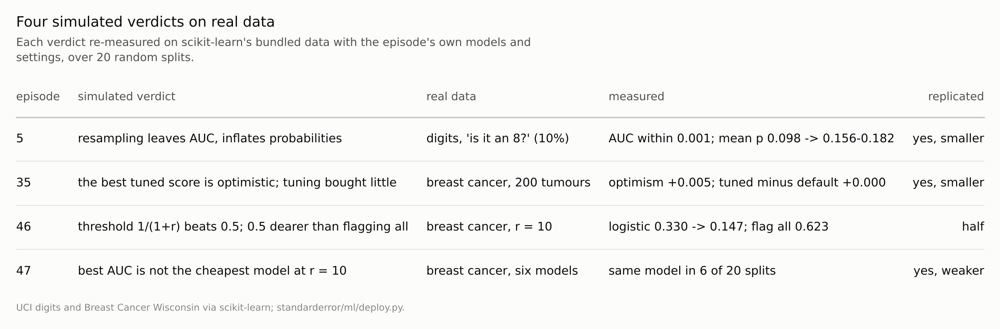
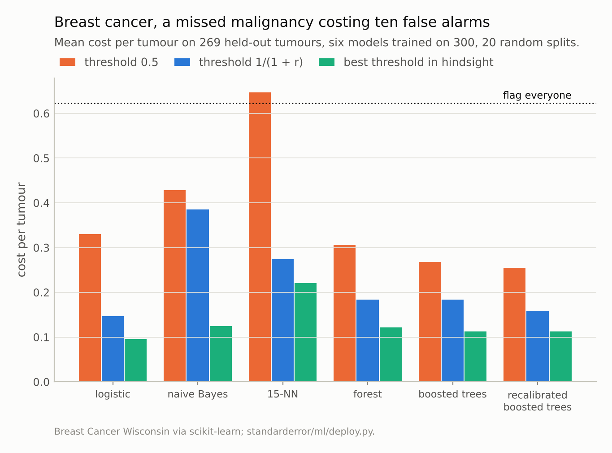

Disclosure: this post was written with the assistance of an AI system (Claude), which wrote the analysis code, ran the experiments and drafted the text. The topic, the constraints, the data choices and the final review are the author's.

*Four verdicts this series measured on simulations, repeated on scikit-learn's bundled real data over 20 random splits. Resampling for a rare class (is a digit an 8?) left the AUC within 0.001 and inflated the mean predicted probability 1.6 to 1.9 times, against eleven times in the simulation. On 200 breast-cancer tumours the best of 64 tuned SVM settings reported 0.005 more than it delivered and matched the untuned default to three decimals. A threshold from a 10:1 cost ratio cut every model's cost, but the default threshold of 0.5 was cheaper than flagging everyone for five of six models, where the simulation found it 2.9 to 4 times dearer. The model with the best AUC was the cheapest at that ratio in 6 of 20 splits.*

Episode 65 of *Machine Learning, Taught Through What Breaks*. The syllabus and the other episodes: https://jongha-jeon-dev.github.io/standarderror/lectures/

## Built to isolate, checked on reality

This series has leaned on simulations, deliberately. A simulation knows the truth, so a method's error can be measured exactly, and it can isolate one mechanism at a time: a planted shortcut, a known cost, a rare class with a known rate. Where scikit-learn's bundled data allowed, episodes replicated on real data. Some verdicts never were. The practitioner reading them is entitled to the question this episode asks of four of them: *a finding measured on a simulation tells you what will happen on real data*.

Morris, White and Crowther's guide to simulation studies makes the case for simulations and states their limit: results apply to the data-generating processes simulated. The Open Science Collaboration's attempt to replicate a hundred psychology studies found effects that were, on average, about half the size of the originals. The analogous question here is narrower, because the four verdicts are about methods, not about the world: does the method behave on real data the way it behaved on simulated data?

The four were chosen because each was measured only on a simulation and each can be re-run on the bundled data with the episode's own models and settings: resampling for a rare class (episode 5), the optimism of a tuned score (35), the threshold for unequal costs (46) and the model with the best AUC (47). Each is repeated over 20 random splits.

## Rare classes: replicated, smaller

Episode 5 found, at a 2% positive rate in a simulation, that oversampling, SMOTE and class weights left a logistic model's AUC unchanged and multiplied its probabilities about elevenfold. The real version asks whether a handwritten digit is an 8, about 10% of the digits, with logistic regression on standardised pixels.

```python
from standarderror.ml import deploy

r = deploy.replicate_imbalance(reps=5)
for m, v in r.items():
    print(f"{m:13s} AUC {v['auc']:.4f}  mean predicted {v['mean_p']:.3f}"
          f"  (actual rate {v['rate']:.3f})  log loss {v['log_loss']:.3f}")
```

```text
plain         AUC 0.9701  mean predicted 0.098  (actual rate 0.100)  log loss 0.120
oversample    AUC 0.9694  mean predicted 0.171  (actual rate 0.100)  log loss 0.178
SMOTE         AUC 0.9704  mean predicted 0.157  (actual rate 0.100)  log loss 0.157
class weights AUC 0.9702  mean predicted 0.182  (actual rate 0.100)  log loss 0.184
```

The AUC moved by at most 0.0009, paired across splits. The plain model's mean prediction matched the actual rate (0.098 against 0.101); the resampled ones predicted 1.6 to 1.9 times too much, and their log loss was 30% to 53% worse. Both the mechanism and its direction carried over. The size did not, for a reason the simulation predicts: balancing a 10% class moves the training prevalence by a factor of 5, balancing a 2% class by a factor of 25, and the inflation grows with that shift, though not in proportion to it.

## Tuning: replicated, a fifth of the size

Episode 35 searched 64 SVM settings by cross-validation on 200 simulated rows and found the best score 0.023 optimistic, with the tuned model no better on fresh data than the default. On 200 breast-cancer tumours with the same grid, the best cross-validated score was 0.974, the tuned model scored 0.969 on the other 369 tumours, and the default 0.969. The optimism was 0.005 (standard error 0.002), and tuning bought +0.000.

The direction replicated exactly: the search's best score overstated what it found, and what it found was the default. The size was a fifth, because the breast-cancer data are easy. When every reasonable setting scores near 97%, there is little spread for the search to exploit; the simulation's task was chosen to be hard, with an error floor of about a quarter, which is where the winner's curse bites. Real problems lie at both ends, so the episode's warning holds and its number does not travel.



*'Smaller': the same direction, a smaller effect than the simulation's.*

## Thresholds and AUC: half, and weaker

Episode 46 set a miss to cost ten false alarms and found that flagging at 0.5 cost 2.9 to 4 times as much as simply flagging everyone, while the threshold 1/(1 + r) came within 0.003 of the best possible for a recalibrated model. On breast cancer, with a missed malignancy costing ten false alarms, the cost-derived threshold lowered every one of the six models' costs, logistic regression's from 0.330 to 0.147 per tumour. But at 0.5, five of six models were already cheaper than flagging everyone (0.623); only 15-nearest-neighbours was not. And the recalibrated model's cost at 1/(1 + r) was 0.158 against 0.112 at the best threshold in hindsight, a gap of 0.046, though a threshold chosen in hindsight on 269 tumours flatters itself. The advice replicated; the drama did not, because a task where the models are 97% accurate leaves little room for any threshold to be catastrophic.

Episode 47 found, in simulation, that the model with the best AUC was never the cheapest when misses cost ten times more. On breast cancer, the AUC winner was boosted trees in 7 of 20 splits and the cheapest at 1/(1 + r) only 2 times; logistic regression, the AUC winner in 4, was cheapest in 11. The same model won both in 6 of 20 splits. Choosing by AUC would usually have chosen a model that was not the cheapest, as the simulation said, but not always. The mechanism is the one episode 47 described: AUC averages a model's ranking over every possible threshold, while a 10:1 cost ratio cares only about the region where malignant tumours might be cleared, and the model that ranks best overall need not rank best there. On a task this easy the top models' AUCs differ in the third decimal, so which one wins in a given split varies from split to split; across 20 splits the cheapest was still most often logistic regression, which won on AUC only 4 times.



*Logistic regression: 0.330 at 0.5, **0.147** at 1/11.*

## Where this breaks

**Two bundled data sets.** The digits and the breast-cancer data are clean, small and easy; most real problems are harder, which on the evidence here would move the replications towards the simulations' larger effects, not away from them.

**Four verdicts of many.** These were chosen because they could be re-run with the episodes' own code. Verdicts about time, people and selection (episodes 36, 37 and 39) need data with that structure, which the bundled sets lack.

**Twenty splits of a small data set.** The splits share most of their rows, so the twenty results are not independent, and their spread understates how a new data set of the same kind could differ.

**The same author on both sides.** The replications reuse the episodes' choices of models and settings; an independent replication would choose its own.

## What to keep

1. Resampling for a rare class left the AUC unchanged on real digits and inflated the probabilities 1.6 to 1.9 times, against eleven in the simulation at a rarer prevalence.

2. Tuning 64 settings on 200 real tumours was 0.005 optimistic and bought nothing over the default; the simulation's optimism was 0.023.

3. A cost-derived threshold cut every model's cost on real data, but 0.5 was not the disaster the simulation found; the best-AUC model was the cheapest in 6 of 20 splits.

4. Trust a simulation for whether and why a method misbehaves. Re-measure how much on data like yours before quoting a number.

## Exercise

Pick one verdict from this series that matters for your work and re-run it on your own data with the episode's code: resampling, tuning optimism, the threshold, a leakage check.

Note whether the direction holds and how the size compares. A direction that fails to replicate is the more important finding, and the one worth writing up.

## Next

Arc XIII ends here. The last arc turns the series' methods on the series itself: episode 66 reruns twelve of its own verdicts that rested on a single random draw, with five new seeds each, to see how many survive.

---

### Data

- UCI optical digits (1,797 images, CC BY 4.0) via scikit-learn: 'is it an 8?', about 10% positive; 1,000 images to train, 797 to test, 20 random splits.
- Breast Cancer Wisconsin (Diagnostic), CC BY 4.0, via scikit-learn: 200 tumours to tune and 369 to test for episode 35; 300 to train and 269 to test, malignant as positive, for episodes 46 and 47; 20 random splits each.
- Machinery: the episodes' own code where it exists (the resampling methods of `standarderror/ml/imbalance.py`, the 64-setting SVM grid of `around.py`, the six models and cost functions of `decide.py`); `standarderror/ml/deploy.py`, tested in `tests/test_ml.py`.
- Where this stops: Open Science Collaboration, "Estimating the reproducibility of psychological science", *Science* (2015); Morris, White and Crowther, "Using simulation studies to evaluate statistical methods", *Statistics in Medicine* (2019); episodes 5, 35, 46 and 47 of this series.

### Reproducibility

- **environment**: standarderror=0.1.0, python=3.13.16, numpy=2.4.4
- **code blocks**: executed at build time; the values the prose quotes are pinned, so drift fails the build
- **determinism**: seeded throughout; about two minutes of CPU

Code: <https://github.com/jongha-jeon-dev/standarderror>
