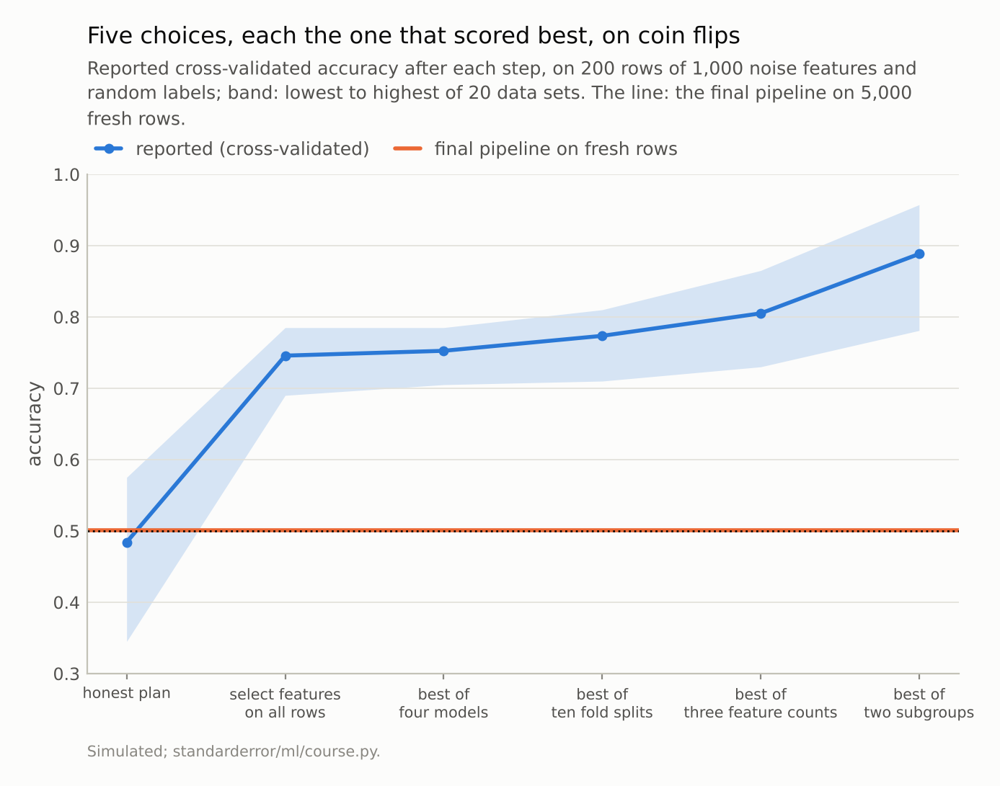
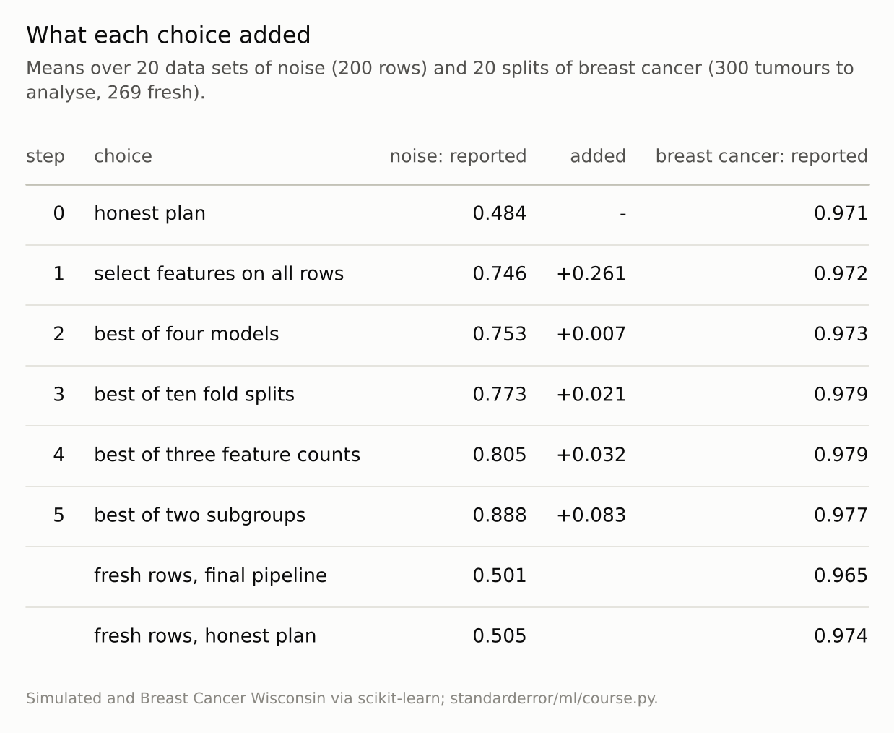

Disclosure: this post was written with the assistance of an AI system (Claude), which wrote the analysis code, ran the experiments and drafted the text. The topic, the constraints, the data choices and the final review are the author's.

*200 rows of 1,000 noise features with random labels, 20 data sets. An honest cross-validated plan scored 0.484. Five choices, each the option that scored best, took the reported score to 0.746 (features selected on all rows), 0.753 (best of four models), 0.773 (best of ten fold splits), 0.805 (best of three feature counts) and 0.888 (the better of two subgroups); the final pipeline scored 0.501 on 5,000 fresh rows. On breast cancer the same walk reported 0.977 and delivered 0.965, less than the honest plan's 0.974.*

Episode 67 of *Machine Learning, Taught Through What Breaks*. The syllabus and the other episodes: https://jongha-jeon-dev.github.io/standarderror/lectures/

## One small choice at a time

Single mistakes are the easy part of this series to teach: fit the scaler inside the folds, do not tune on the test set, do not trust the best of many scores. A real analysis rarely makes one mistake. It makes a sequence of choices, each reasonable, each taken after seeing how the last one turned out, and the series' last arc asks what such a sequence adds up to. Gelman and Loken called the space of such choices the garden of forking paths: an analyst need not try everything for the result to depend on which branch the data happened to favour. The sentence under test is the defence every analyst would make: *if every choice in an analysis is defensible, so is its result*.

The data are built to have nothing in them: 200 rows, 1,000 features of pure noise, labels by coin flip, so the truth is 50% for every model. The analysis starts with an honest plan, fixed in advance: standardise, select the 20 features most associated with the label inside each fold, fit logistic regression, report five-fold cross-validated accuracy. Then five choices are made one after another, each keeping the previous ones and taking whichever option scores best: select the features once on all the rows, because it is simpler; try four model families; try ten random fold assignments; try 10, 20 or 50 features; and report the subgroup, defined by one more column, in which the model works better. Every step is something a careful person has done. In a single run the last step can lower the score, because it picks the better of two halves of the data rather than the better of a half and the whole.

```python
import numpy as np
from standarderror.ml import course

g = np.random.default_rng(0)
X, y = g.normal(size=(200, 1000)), g.integers(0, 2, 200)    # no signal
Xf, yf = g.normal(size=(5000, 1000)), g.integers(0, 2, 5000)
sub, subf = (g.normal(size=200) > 0) * 1, (g.normal(size=5000) > 0) * 1
w = course._forked(X, y, Xf, yf, sub, subf)
for step, score in zip(course.STEPS, w["reported"]):
    print(f"{step:30s} {score:.3f}")
print("choices:", w["choices"], " fresh rows:", round(w["fresh"], 3))
```

```text
honest plan                    0.445
select features on all rows    0.785
best of four models            0.785
best of ten fold splits        0.790
best of three feature counts   0.790
best of two subgroups          0.781
choices: {'model': 'logistic', 'split': 6, 'k': 20, 'subgroup': 1}  fresh rows: 0.508
```

## What it adds up to

Averaged over 20 such data sets, the honest plan reported 0.484, as it should. Selecting features on all rows, the leak of episode 3, added +0.261 by itself. Each later step added a little: +0.007 for the best model, +0.021 for the best fold split, +0.032 for the best feature count and +0.083 for the better subgroup. The final report averaged **0.888**, between 0.781 and 0.957 across the 20 data sets. The pipeline the walk ended with scored 0.501 on 5,000 fresh rows.

No step after the first added more than 0.083, and each has a respectable justification: model choice is what cross-validation is for, the fold split is arbitrary anyway, the number of features is a hyperparameter, and a subgroup effect is a finding. What makes them dangerous is not any one of them but the order: each was taken because of the score it produced, so each spent a little of the data's ability to tell signal from noise, and the reported score is the maximum of a search nobody wrote down. Simmons, Nelson and Simonsohn showed in 2011 that four such freedoms in a psychology experiment can push the false-positive rate from 5% to over 60%; Cawley and Talbot made the machine-learning version of the argument for model selection in 2010.

Which model won depended on the data set: across the 20, the walk chose SVM 10 times, logistic 8 times, forest once, 15-NN once. On noise there is no right answer for the search to find, so it finds whichever wrong one fits this sample best.



*Reported after five choices: **0.888** on average. Delivered: 0.501.*

## On real data the damage is quieter

On breast cancer, where the signal is strong, the same walk looks harmless. The honest plan reported 0.971; the five choices took the report to 0.977, a gain nobody would question. On the held-out tumours in the subgroup the walk chose, tumours that played no part in the analysis, the walk's final pipeline scored 0.965 and the honest plan, scored on the same tumours, **0.974**. The search did not merely inflate the report; it chose a worse model than the plan it replaced, presumably because every choice was made on small differences in a small sample, and with a strong signal those differences are mostly noise.

That is the more common situation, and the harder one to see. On noise the reported 89% is implausible enough to invite a second look; on real data a reported 97.7% is entirely plausible, and only data that played no part in any choice can show that it is not real.

The honest plan cost nothing in either setting. Fixed before any score was seen, it delivered 0.974 on the held-out tumours, 0.008 more than the searched pipeline, and on noise its fresh score was 0.505, as close to a coin as its report. A plan written in advance is often described as a constraint that leaves accuracy on the table; here the table was empty, and the search only moved the report away from the truth. Where a search does find a better model, the way to keep it honest is the one episode 35 measured for tuning: run the whole search, every choice included, inside an outer cross-validation loop, or score its single winner once on data held out from all of it.

The spread matters as much as the average. In the luckiest of the 20 noise data sets the walk reported 0.957, and in the least lucky 0.781; both would pass most reviews, and neither reviewer could tell from the number alone which kind of data set they were looking at.



*Each step keeps the previous steps' choices and picks the best option of its own.*

## Where this breaks

**A greedy walk.** Each step took the best option given the previous ones. A real analyst explores less systematically and sometimes backtracks, which can add more optimism or less.

**Pure noise as the main case.** With no signal every gain is spurious, so the walk measures optimism at its largest. The breast-cancer version shows the other end; most problems sit between.

**Five particular choices.** Others are as common: dropping outliers by residual, transforming the target, choosing the metric. Any choice made after seeing a score belongs on the list.

**Selection on all rows at step one.** Without that leak the later steps would presumably add less, because each would be judged by honest cross-validation; the search would still inflate the maximum, as episode 35 measured for tuning. That variant was not run.

## What to keep

1. On coin-flip labels, an honest plan reported 0.484; five choices, each taken because it scored best, reported 0.888; the result delivered 0.501.

2. After the first leak, no single step added more than 0.083. The optimism was in the sequence, not in any step.

3. On breast cancer the walk reported 0.977 and delivered 0.965, below the honest plan's 0.974.

4. Write the analysis plan before looking at scores, count every choice made after looking, and keep a test set that no choice ever touched; report its score, not the search's.

## Exercise

For your last reported result, list every choice made after the first score was seen: features dropped or added, models tried, settings changed, rows excluded, subgroups examined, metrics switched.

Then count. If the list is longer than two, the reported number is the best of a search, and the honest number is the one from data that never influenced the list. If no such data exist, the next project should set them aside first.

## Next

Several of the problems in this walk shrink when there are more data and some do not. Episode 68 measures seven of the series' problems at growing sample sizes, and sorts them by what more data does to each.

---

### Data

- Simulated (seeds 0-19): 200 rows, 1,000 standard Gaussian features, labels by coin flip, a subgroup defined by the sign of one more noise column; 5,000 fresh rows of the same.
- Breast Cancer Wisconsin (Diagnostic), CC BY 4.0, via scikit-learn: 300 tumours to analyse and 269 fresh, 20 random splits; subgroups above and below the median texture.
- Machinery: scikit-learn pipelines (standardisation, F-test feature selection, logistic regression, RBF SVM, 15-NN, random forest) and 5-fold stratified CV; `standarderror/ml/course.py`, tested in `tests/test_ml.py`.
- Where this stops: Gelman and Loken, "The garden of forking paths" (2013); Simmons, Nelson and Simonsohn, "False-positive psychology", *Psychological Science* (2011); Cawley and Talbot, "On over-fitting in model selection and subsequent selection bias in performance evaluation", *JMLR* (2010); episodes 3, 35, 45 and 66 of this series.

### Reproducibility

- **environment**: standarderror=0.1.0, python=3.13.16, numpy=2.4.4
- **code blocks**: executed at build time; the values the prose quotes are pinned, so drift fails the build
- **determinism**: seeded throughout; about two minutes of CPU

Code: <https://github.com/jongha-jeon-dev/standarderror>
