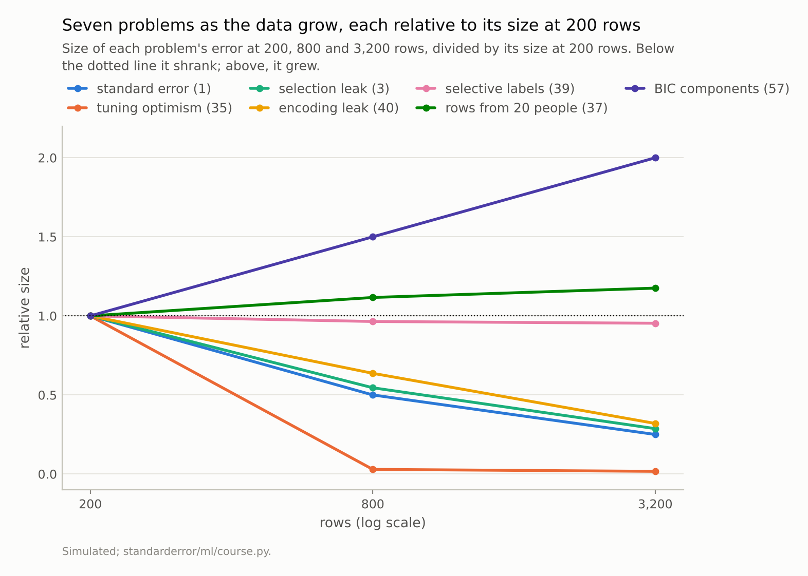
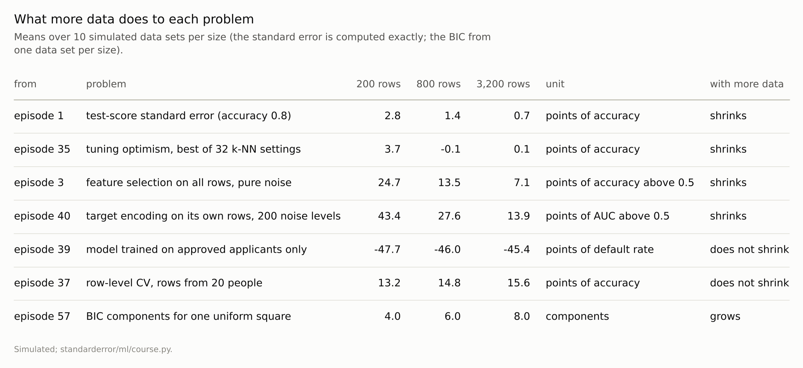

Disclosure: this post was written with the assistance of an AI system (Claude), which wrote the analysis code, ran the experiments and drafted the text. The topic, the constraints, the data choices and the final review are the author's.

*Seven problems from earlier episodes, each measured at 200, 800 and 3,200 rows. A test score's standard error fell from 2.8 to 0.7 points; a tuned score's optimism from 3.7 points to 0.1; the leak from selecting features on all rows from 24.7 to 7.1 points; a target encoding's ranking of its own labels from 43 to 14 points above chance. A model trained on approved applicants underestimated the refused applicants' default rate by 48, 46 and 45 points; row-level cross-validation with rows from 20 people overstated accuracy by 13.2, 14.8 and 15.6. The BIC's count of Gaussians for one square went from 4 to 8.*

Episode 68 of *Machine Learning, Taught Through What Breaks*. The syllabus and the other episodes: https://jongha-jeon-dev.github.io/standarderror/lectures/

## The reassuring answer

Many of the problems in this series were shown on small data: 200 rows, 300 tumours, 1,797 digits. A practitioner with millions of rows is entitled to wonder which of them still apply, and the common reassurance is that most of them fade: *with enough data, these problems go away*. Some do. The question is which, and the answer turns out to follow a simple rule.

Seven problems were chosen to span the series, each rebuilt in a compact version of its episode's setting so that it can be run at 200, 800 and 3,200 rows, ten data sets per size. Each is measured as the size of the error it causes, in its own unit: points of accuracy, of AUC, of a default rate, or a count of components. The question for each is whether a sixteenfold increase in data made it smaller.

```python
from standarderror.ml import course

for n in (200, 3200):
    leak = course._selection_leak(n, reps=5)        # a variance problem
    bias = course._selection_bias(n, reps=5)        # a design problem
    print(f"{n:5d} rows: selection leak {100 * leak:5.1f} points, "
          f"refused-applicant bias {100 * bias:6.1f} points")
```

```text
  200 rows: selection leak  25.2 points, refused-applicant bias  -42.4 points
 3200 rows: selection leak   7.1 points, refused-applicant bias  -45.5 points
```

## Four problems of noise

A test score's standard error, episode 1's error bar, is the textbook case: at an accuracy of 0.8 it was 2.83 points at 200 rows, 1.41 at 800 and 0.71 at 3,200, halving with each fourfold increase.

The optimism of the best of 32 tuned settings, episode 35's winner's curse, was 3.7 points at 200 rows and -0.1 and +0.1 at 800 and 3,200: with more rows each setting's cross-validated score is less noisy, the best of them has less luck to exploit, and the search's reported score converges on what it delivers. Selecting 20 of 1,000 noise features on all rows, episode 3's leak, turned coin flips into 75% accuracy at 200 rows, 63.5% at 800 and 57.1% at 3,200: with more rows the noise features' chance correlation with the label is smaller, so the selection finds less to exploit, though it was still 7.1 points of pure fiction at 3,200. A 200-level noise category encoded by its training-row means, episode 40's leak into training, ranked its own labels at 43 points of AUC above chance with one row per level on average, 28 with four and 14 with sixteen.

All four are the same kind of problem: an estimate fitted to a sample's noise, which shrinks as the sample grows. More data is the cure, at a rate that differs by problem: one over the square root of n for the standard error, faster here for the tuning optimism, roughly in proportion to rows per level for the encoding. With a fixed number of features or categories the cure eventually arrives.



*Absolute sizes, in each problem's own unit, are in the table.*

## Two problems of design, and one that grows

A model trained only on applicants a loan officer approved, where the officer used information the model lacks, episode 39's selective labels, underestimated the refused applicants' default rate by 47.7 points at 200 rows, 46.0 at 800 and 45.4 at 3,200. More approved applicants teach the model more precisely about approved applicants; they say nothing about the refused, because the refused are never in the data. Meng's analysis of big-data surveys makes the same point with a memorable result: a large non-random sample can carry no more information than a small random one, because its bias does not shrink with its size.

Row-level cross-validation with every row from the same 20 people, episode 37, overstated accuracy on new people by 13.2 points at 200 rows, 14.8 at 800 and 15.6 at 3,200. More rows from the same people made the model better at recognising those people, which row-level folds reward and new people do not; the gap grew slightly. The fix is more people, not more rows.

And one problem grew. The BIC, choosing a number of Gaussian components for a single uniform square, chose 4 at 200 rows, 6 at 800 and 8 at 3,200, the same rising count that episode 57 found up to 20,000 points, though not with the same numbers, on a different draw and with fewer starts of the fit. A consistent criterion becomes more confident about a misspecified model's answer as the data grow, and the answer is about the model's shape, not the data's clusters.



*Negative default-rate values: the model predicted fewer defaults among the refused than occurred.*

## The rule

Sorted, the seven fall into the old distinction between variance and bias. The four that shrank were variance: errors that come from fitting a sample's accidents, which average away. The two that stayed were bias in the data's design, who is in the sample and how the rows relate to each other, which no amount of the same data can reveal. The one that grew was bias in the model's assumptions, which more data make more confidently.

For a practitioner with a large data set, the series' problems therefore split in two. Error bars, tuning optimism and leaks from fitting on noise can mostly be retired, though not entirely: a leak that is 7 points at 3,200 rows is still a leak. Selection, grouping, drift, misspecified assumptions and the gap between a metric and its use keep their full force, and often hide better, because a large sample produces narrow error bars around the wrong number.

A practical test separates the two kinds before any data are collected: ask whether the problem would disappear if the sample grew to the whole population it was drawn from. A standard error, a tuned score's luck and a leak from fitting on noise would. A sample of approved applicants, rows from twenty people and a misspecified model would not, because every approved applicant there is still contains no refused ones, and every row from those twenty people still describes only them.

## Where this breaks

**Compact versions.** Each problem was rebuilt in a small simulation; the rates at which the real versions shrink depend on the number of features, categories and settings, which grow with data in real projects.

**Fixed complexity.** With 1,000 noise features held fixed, the selection leak shrank. If the number of features grows with the data, as it often does, the leak need not shrink at all.

**Ten data sets per size.** Enough to separate shrinking from staying; not enough to pin the third digit of any value.

**Seven problems of many.** Problems such as drift (episode 61) and feedback loops (episode 50) depend on time, not sample size, and were not on the list.

## What to keep

1. Four problems shrank with sixteen times the data: the standard error (2.8 to 0.7 points), tuning optimism (3.7 to 0.1), the selection leak (24.7 to 7.1) and the encoding leak (43 to 14).

2. Two did not: selective labels stayed 45 points wrong and row-level CV with 20 people stayed 16 points optimistic. The BIC's count grew from 4 to 8.

3. Noise averages away; the design of the data and the assumptions of the model do not.

4. With a large data set, spend your attention on who is in the data, how rows depend on each other and what the model assumes, not on error bars.

## Exercise

For a model trained on a large data set, list the problems from this series you would have worried about with a small one. Mark each as noise (an estimate fitted to the sample's accidents) or design (who is in the sample, how rows relate, what the model assumes).

Retire the first kind if your sample is large relative to your features and settings. For each of the second kind, name the data you would need to measure it: more people rather than more rows, outcomes for the refused, a period after the drift.

## Next

The series has measured problems one at a time. Episode 69 runs one project from start to finish, breast-cancer diagnosis with a missed malignancy costing ten false alarms, and applies every check the series recommends, in the order a project meets them.

---

### Data

- Simulated, 10 data sets per size (seeds 0-9), compact versions of each episode's setting: episode 4's Gaussian task for tuning (32 odd values of k for k-NN, 5-fold CV, 20,000 test rows); 1,000 noise features with coin-flip labels, 20 selected on all rows; a 200-level noise category encoded by its training-row means; approval on x + 1.5u < 0.5 with u unseen by the model; episode 37's 20 simulated people with signatures; one uniform square for the BIC (1 to 15 components, two starts).
- Machinery: `standarderror/ml/course.py`, tested in `tests/test_ml.py`.
- Where this stops: Meng, "Statistical paradises and paradoxes in big data", *Annals of Applied Statistics* (2018); episodes 1, 3, 35, 37, 39, 40 and 57 of this series.

### Reproducibility

- **environment**: standarderror=0.1.0, python=3.13.16, numpy=2.4.4
- **code blocks**: executed at build time; the values the prose quotes are pinned, so drift fails the build
- **determinism**: seeded throughout; about a minute and a half of CPU

Code: <https://github.com/jongha-jeon-dev/standarderror>
