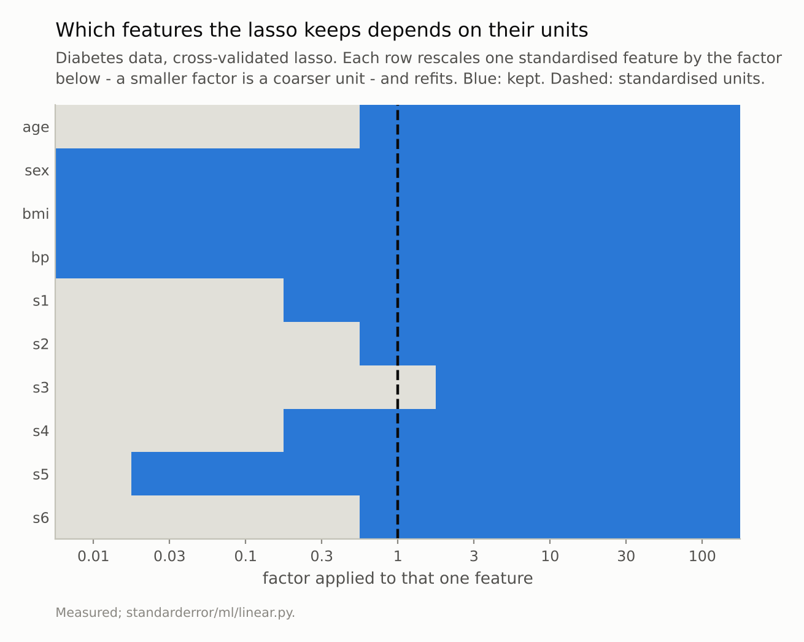
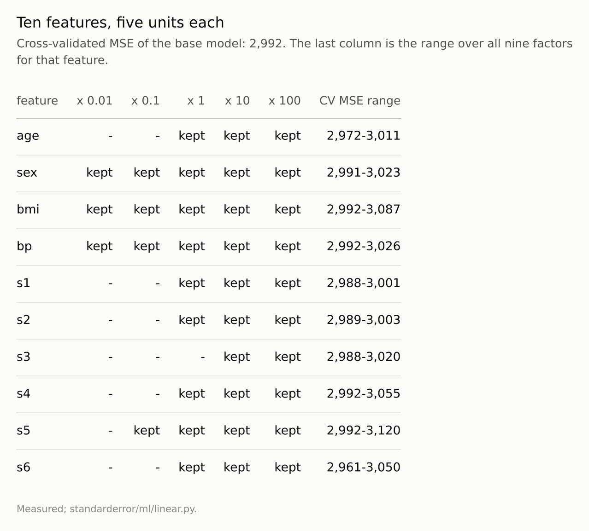
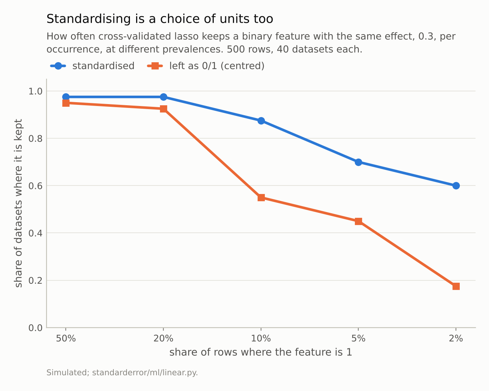

Disclosure: this post was written with the assistance of an AI system (Claude), which wrote the analysis code, ran the experiments and drafted the text. The topic, the constraints, the data choices and the final review are the author's.

*On the diabetes data, re-expressing one feature at a time in units from a hundredth to a hundred times the standardised ones and refitting cross-validated lasso, 7 of 10 features are kept in some units and dropped in others; only sex, bmi, bp survive every choice. The 90 refits' cross-validated errors span 5.3% of the base model's: different selections, near-identical cross-validated error. Standardising does not escape the choice - it is one. A binary feature with the same effect per occurrence is kept in 24 of 40 datasets at 2% prevalence when standardised and 7 of 40 when left as 0/1.*

Episode 7 of *Machine Learning, Taught Through What Breaks*. The syllabus and the other episodes: https://jongha-jeon-dev.github.io/standarderror/lectures/

## A penalty on what?

Episode 6 ended with a penalty as the thing that turns an unanswerable question into one with an answer. This episode asks what the penalty is a penalty *on*.

The lasso fits a linear model while charging λ times the sum of the absolute coefficients. That charge is what makes it select: a feature whose coefficient is not worth its price is set to exactly zero. It is usually taught as a property of the model — λ is "how much regularisation" — with a footnote saying to standardise first.

The footnote is the whole story. The price is per unit of *coefficient*, and a coefficient's size depends on the units of its feature. Measure age in decades instead of years and the coefficient that describes the same effect is ten times bigger, so it costs ten times as much. Nothing about the data or the relationship changed; the bill did.

The arithmetic is one line. Multiply a feature's column by k and the coefficient that gives the same predictions becomes β/k, so its penalty becomes λ|β|/k. A finer unit (k above 1) makes the feature cheaper; a coarser one (k below 1) makes it dearer. Everything else in the objective — the fit to the data, the other features' prices — is unchanged, so moving one feature's units is exactly the same as giving that one feature its own private λ, scaled by 1/k. No one would choose per-feature penalties by consulting the data dictionary's units, but that is what an unstandardised lasso does.

The diabetes data makes this concrete: 442 patients, ten baseline measurements, a disease-progression score, all standardised. Take one feature at a time, multiply its column by a factor from 0.01 to 100 — a coarser or finer unit for that one measurement — and refit cross-validated lasso, which re-chooses λ every time.

```python
from standarderror.ml import linear as ln

u = ln.unit_sweep()     # each feature x 0.01 ... x 100, refit LassoCV
for name, row in zip(u["names"], u["kept"]):
    print(f"{name:4s} " + " ".join("#" if k else "." for k in row))
print("factors " + " ".join(f"{k:g}" for k in u["factors"]))
```

```text
age  . . . . # # # # #
sex  # # # # # # # # #
bmi  # # # # # # # # #
bp   # # # # # # # # #
s1   . . . # # # # # #
s2   . . . . # # # # #
s3   . . . . . # # # #
s4   . . . # # # # # #
s5   . # # # # # # # #
s6   . . . . # # # # #
factors 0.01 0.03 0.1 0.3 1 3 10 30 100
```

A `#` is kept, a `.` dropped; the middle column, factor 1, is the standardised model. **7 of the ten features change status with their units.** Age, for instance, is dropped at every factor up to 0.3 and kept from 1 upward; s3 is out of the standardised model and in it at a factor of 3. Only sex, bmi, bp are kept whatever their units, and they are not simply the strongest: in the standardised fit the largest coefficient belongs to s5 (+31.8), and s5 is dropped at a factor of 0.01. A large coefficient in standard deviations is no protection once a coarse enough unit makes each unit of it expensive.



***7 of 10 features** are in the model in some units and out of it in others. Only sex, bmi, bp survive every choice.*

## Different models, nearly the same error

If the different selections predicted differently, the units would at least be choosing between better and worse models. They are not.

```python
print(f"CV MSE over all 90 refits: {u['cv_mse'].min():,.0f} to "
      f"{u['cv_mse'].max():,.0f}  (base model {u['base_mse']:,.0f})")
```

```text
CV MSE over all 90 refits: 2,961 to 3,120  (base model 2,992)
```

Across all ninety refits the cross-validated error spans 5.3% of the base model's. Within that, the coarse-unit models that drop age actually score a touch *better*. The data cannot tell these models apart; what told them apart was the arbitrary scale each feature happened to be recorded in.

That is the practical risk. A lasso's selected set is routinely reported as a finding — these are the variables that matter — and in fields with mixed units (a dose in milligrams, an age in years, a count, an indicator) the finding partly reflects the units the data dictionary happened to use. The predictive model is fine. The list of "important" variables is not a property of the disease.



*Different models, nearly the same error. The data cannot tell these selections apart; the units chose between them.*

## Standardising does not make it neutral

The standard fix is to standardise every feature to unit variance, which removes the arbitrariness by imposing one specific choice: every feature is measured in its own standard deviations. That is a choice of units like any other, and it has consequences for features whose standard deviation means something odd — binary ones above all, whose standard deviation is sqrt(p(1 - p)) and shrinks as the feature gets rarer.

So: a binary feature with the same effect, 0.3 per occurrence, beside five continuous features, at prevalences from 50% down to 2%. Cross-validated lasso, standardised and with the 0/1 column only centred:

```python
for r in ln.binary_prevalence(effect=0.3, reps=40):
    print(f"prevalence {r['prevalence']:4.0%}  kept: standardised "
          f"{r['kept_standardised']:.2f}   raw 0/1 {r['kept_raw']:.2f}")
```

```text
prevalence  50%  kept: standardised 0.97   raw 0/1 0.95
prevalence  20%  kept: standardised 0.97   raw 0/1 0.93
prevalence  10%  kept: standardised 0.88   raw 0/1 0.55
prevalence   5%  kept: standardised 0.70   raw 0/1 0.45
prevalence   2%  kept: standardised 0.60   raw 0/1 0.17
```

At 50% both versions keep the feature nearly always. At 2%, the standardised lasso keeps it in 24 of 40 datasets and the raw one in 7. Standardising divides a rare indicator by a small standard deviation, which inflates its column, shrinks its coefficient and lowers its price; the raw version charges it per occurrence, and a rare occurrence has little data behind it.

Neither is right. A per-occurrence effect and a per-standard-deviation effect are different questions, and the lasso answers whichever its units ask. Gelman's suggestion to divide continuous inputs by two standard deviations so that they compare with untouched binaries is one principled answer; it is still a choice.



*At 2% prevalence the same feature is kept in **24 of 40** datasets standardised and 7 of 40 as 0/1. Neither is the neutral choice; there isn't one.*

## Where this breaks

**Prediction is barely affected.** Everything here is about *which* features a lasso keeps, not how well it predicts. If the only use of the model is its predictions, the units matter far less — though the coefficients still do not mean what they appear to.

**Ridge has the same dependence, without the drama.** A ridge penalty is also per unit of coefficient, so rescaling a feature changes how much it is shrunk, but ridge never sets anything to zero, so there is no visible flip.

**Cross-validation does not fix it.** Every refit here re-chose λ by cross-validation. The units are not a tuning problem; they change the shape of the penalty, not its strength.

**Weighted penalties make the choice explicit rather than removing it.** The adaptive lasso gives each feature its own penalty weight, usually from a preliminary fit, and group penalties price whole blocks of features together. Both are ways of choosing the per-feature prices on purpose instead of inheriting them from the units; neither makes the prices disappear.

**One dataset and one simulation.** The count of 7 flips belongs to the diabetes data and to factors up to a hundred. A feature that flips at a factor of 100 may never be recorded in a unit that coarse; one that flips at 3 easily could be.

## What to keep

1. A lasso penalty is a price per unit of coefficient, and a coefficient's units are its feature's inverse units. Rescale a feature and its price changes.

2. On the diabetes data, 7 of 10 features are kept or dropped depending on their units alone; only sex, bmi, bp survive every factor from 0.01 to 100.

3. The cross-validated errors of all those models span 5.3%: the data cannot distinguish them.

4. Standardising is a choice of units. A binary feature at 2% prevalence is kept in 24 of 40 datasets standardised and 7 of 40 raw.

5. Report a lasso's selected set as a property of the features *in the units you chose*, or not as a finding at all.

## Exercise

Take a lasso you have fitted and list its features with their units. Pick the two you are least sure about, multiply each column by 10 and by 0.1 in turn, refit with cross-validation, and see whether either changes status. If one does, its presence in your model was partly a unit decision, and a reader of the selected set should be told.

If your model mixes binary and continuous features, refit once with everything standardised and once with binaries left as 0/1 and only the continuous ones standardised. If the selected set changes, decide which question you meant to ask — effect per occurrence or per standard deviation — and say so.

## Next

Episode 8 keeps the units fixed and asks the question a lasso is usually fitted to answer: are the features it keeps the relevant ones? On simulated data where the answer is known, and on bootstrap resamples of the diabetes data where it is not.

---

### Data

- Diabetes data of Efron, Hastie, Johnstone and Tibshirani (2004), as bundled with scikit-learn (`load_diabetes`): 442 patients, 10 baseline variables, a disease-progression score.
- Simulated: a binary feature with effect 0.3 per occurrence beside five continuous features, two of them with effects of 0.5, unit noise, 500 rows per dataset.
- Machinery: `standarderror/ml/linear.py`, tested in `tests/test_ml.py`.
- Where this stops: Tibshirani, "Regression shrinkage and selection via the lasso", *JRSS B* (1996), which standardises and notes why; Gelman, "Scaling regression inputs by dividing by two standard deviations", *Statistics in Medicine* (2008), on binary inputs and standardisation.

### Reproducibility

- **environment**: standarderror=0.1.0, python=3.13.16, numpy=2.4.4
- **code blocks**: executed at build time; the values the prose quotes are pinned, so drift fails the build
- **determinism**: LassoCV with 5 seeded folds and a 60-value alpha grid throughout; simulated datasets from fixed seeds

Code: <https://github.com/jongha-jeon-dev/standarderror>
