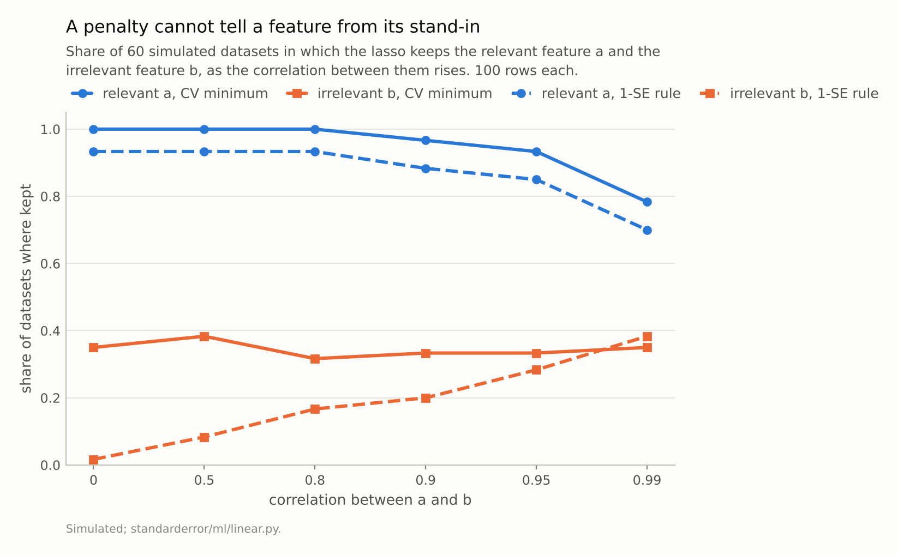
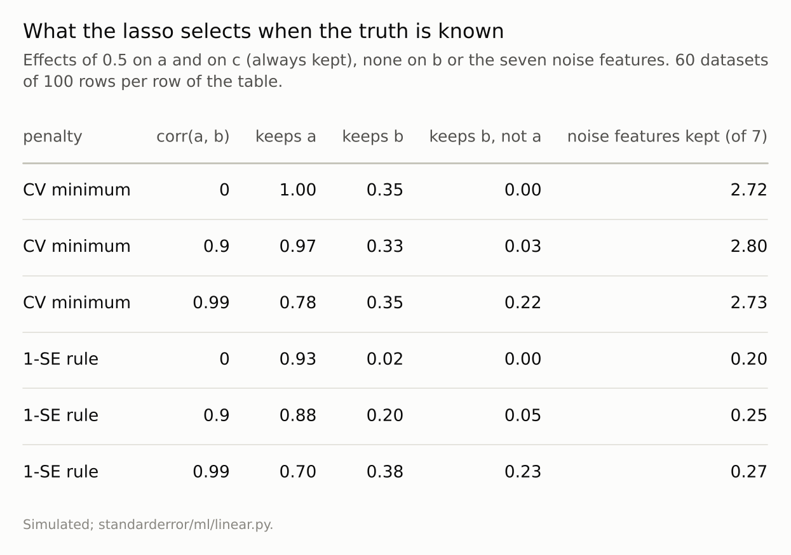
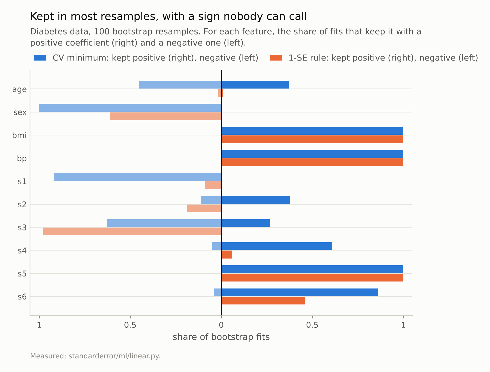

Disclosure: this post was written with the assistance of an AI system (Claude), which wrote the analysis code, ran the experiments and drafted the text. The topic, the constraints, the data choices and the final review are the author's.

*With two real effects, one irrelevant feature correlated with a real one and seven of pure noise, cross-validated lasso keeps both real effects and on average 2.8 of the 7 noise features, and the irrelevant correlated one about 34% of the time at every correlation. The 1-SE rule cuts the noise to 0.2 but not the confusion: at correlation 0.99 it keeps the stand-in 38% of the time and the real feature 70%. On 100 bootstrap resamples of the diabetes data, age is kept in 82% of fits, 37% with a positive sign and 45% negative.*

Episode 8 of *Machine Learning, Taught Through What Breaks*. The syllabus and the other episodes: https://jongha-jeon-dev.github.io/standarderror/lectures/

## Two jobs, one penalty

Episode 7 showed that a lasso's selections depend on the units of its features. This one fixes the units and asks the question the lasso is usually fitted to answer outside prediction: are the features it keeps the ones that matter?

The sentence has theory behind it. Under an *irrepresentable condition* — roughly, irrelevant features must not be too well explained by relevant ones — and with the right penalty, the lasso recovers exactly the true set as the data grow (Zhao and Yu, 2006). In practice the penalty is chosen by cross-validation, and cross-validation chooses it to *predict*.

A simulation where the truth is known separates the two jobs. Ten features, 100 rows. Features a and c have effects of 0.5. Feature b has no effect but is correlated with a at a chosen ρ. The other seven are pure noise.

```python
from standarderror.ml import linear as ln

# a, c: effect 0.5.  b: no effect, corr(a, b) = rho.  7 pure noise.
for r in ln.correlated_pair(rule="min"):
    print(f"rho {r['rho']:4.2f}  keeps a {r['a']:.2f}  b {r['b']:.2f}"
          f"  b-not-a {r['b_only']:.2f}  noise {r['noise_kept']:.2f} of 7")
```

```text
rho 0.00  keeps a 1.00  b 0.35  b-not-a 0.00  noise 2.72 of 7
rho 0.50  keeps a 1.00  b 0.38  b-not-a 0.00  noise 2.78 of 7
rho 0.80  keeps a 1.00  b 0.32  b-not-a 0.00  noise 2.77 of 7
rho 0.90  keeps a 0.97  b 0.33  b-not-a 0.03  noise 2.80 of 7
rho 0.95  keeps a 0.93  b 0.33  b-not-a 0.07  noise 2.77 of 7
rho 0.99  keeps a 0.78  b 0.35  b-not-a 0.22  noise 2.73 of 7
```

The relevant features are kept nearly always, until a and b become near-copies. The rest is not what "selects the relevant features" promises. On average the lasso keeps **2.8 of the 7 noise features**, and the irrelevant b about 34% of the time — at ρ = 0 as much as at ρ = 0.95, because at the cross-validation minimum b is just one more noise feature that gets a small coefficient. At ρ = 0.99 it keeps b *instead of* a in 22% of datasets.

None of this is a malfunction. Prediction loses almost nothing by giving a noise feature a small coefficient, and a slightly smaller penalty fits the real effects a little better, so the CV minimum lands where a few passengers get on.



*At the CV minimum the irrelevant b is kept 35% of the time even when it is uncorrelated with anything. The 1-SE rule fixes that and not the rest: at correlation 0.99 it keeps b **38%** of the time and a only 70%.*

## A stricter penalty, and what it cannot fix

The standard remedy for selection is the one-standard-error rule: take the largest penalty whose cross-validated error is within one standard error of the minimum. It deliberately gives up a little prediction for a sparser model.

```python
for r in ln.correlated_pair(rule="1se"):
    print(f"rho {r['rho']:4.2f}  keeps a {r['a']:.2f}  b {r['b']:.2f}"
          f"  b-not-a {r['b_only']:.2f}  noise {r['noise_kept']:.2f} of 7")
```

```text
rho 0.00  keeps a 0.93  b 0.02  b-not-a 0.00  noise 0.20 of 7
rho 0.50  keeps a 0.93  b 0.08  b-not-a 0.00  noise 0.23 of 7
rho 0.80  keeps a 0.93  b 0.17  b-not-a 0.00  noise 0.23 of 7
rho 0.90  keeps a 0.88  b 0.20  b-not-a 0.05  noise 0.25 of 7
rho 0.95  keeps a 0.85  b 0.28  b-not-a 0.08  noise 0.25 of 7
rho 0.99  keeps a 0.70  b 0.38  b-not-a 0.23  noise 0.27 of 7
```

The passengers mostly get off: 0.2 noise features on average, and b is kept only 2% of the time when it is uncorrelated. But the stand-in problem gets *worse* as the correlation rises: at ρ = 0.99, b is kept 38% of the time and a only 70%. No setting of the penalty can tell two near-identical columns apart, because the data barely can. The lasso keeps one of them, more or less at random, and a report of "the selected features" names whichever it happened to be.

The geometry says why. When two columns are nearly identical, the fitted values depend almost only on the *sum* of their coefficients. The L1 penalty charges |β_a| + |β_b|, which for coefficients of the same sign is also just the sum. Every split of the shared effect between a and b fits about equally well and costs exactly the same penalty, so which corner the solver lands on is decided by the small accidents of the sample. Ridge, whose penalty is β_a² + β_b², strictly prefers an even split and keeps both; the elastic net mixes the two penalties precisely to get that grouping back. Neither tells you which of the two is the real one. With ρ = 0.99 and 100 rows, the data do not contain that information, and no penalty can create it.

The 1-SE rule also costs the relevant feature something even when there is no stand-in: at ρ = 0 it keeps a in 93% of datasets, against 100% at the CV minimum. A larger penalty shrinks every coefficient, and an effect of 0.5 in 100 noisy rows is not always large enough to survive it. Sparser means fewer false positives and more false negatives; there is no setting that gives fewer of both.



*The CV minimum optimises prediction, which tolerates small spurious coefficients. The 1-SE rule trades a little prediction for far fewer, and still cannot separate a feature from a near-copy.*

## On real data: kept, but which way?

On real data nobody knows the truth, but stability can be measured: refit on bootstrap resamples and count. The diabetes data, 100 resamples, each feature's share of fits that keep it with a positive and with a negative coefficient:

```python
# share of 100 bootstrap fits keeping each feature: positive / negative
for rule in ("min", "1se"):
    b = ln.bootstrap_signs(boots=100, rule=rule)
    cells = [f"{n} {p:.2f}/{q:.2f}" for n, p, q in
             zip(b["names"], b["positive"], b["negative"])]
    print(f"{rule:>3}: " + "  ".join(cells[:5]))
    print("     " + "  ".join(cells[5:]))
```

```text
min: age 0.37/0.45  sex 0.00/1.00  bmi 1.00/0.00  bp 1.00/0.00  s1 0.00/0.92
     s2 0.38/0.11  s3 0.27/0.63  s4 0.61/0.05  s5 1.00/0.00  s6 0.86/0.04
1se: age 0.01/0.02  sex 0.00/0.61  bmi 1.00/0.00  bp 1.00/0.00  s1 0.00/0.09
     s2 0.00/0.19  s3 0.00/0.98  s4 0.06/0.00  s5 1.00/0.00  s6 0.46/0.00
```

At the cross-validation minimum, **age is kept in 82% of resamples** — a frequency that would normally be read as robust selection — and its coefficient is positive in 37% and negative in 45%. s3 is kept 90% of the time, split 27% to 63%. Being selected and having a direction are different findings, and the first says little about the second.

Under the 1-SE rule age almost vanishes (3%), and s3 becomes stably negative (98%). But s2 — kept with a positive sign 38% of the time at the CV minimum — is kept, when the stricter rule keeps it at all, with a *negative* sign (19% against 0%). s1 and s2 are correlated at 0.9; which one carries the shared signal, and with what sign, depends on the penalty.



*At the CV minimum age is kept in 82% of resamples, **37% positive and 45% negative**. A selection frequency that high would be read as a finding.*

## Where this breaks

**Prediction is not the casualty.** Everything here concerns the selected set. The CV-minimum lasso is a perfectly good predictor; it is the reading of its non-zero coefficients as a list of real effects that fails.

**Stability selection is the principled fix, and it changes the question.** Meinshausen and Bühlmann's procedure keeps features selected in a large share of subsamples across many penalties, with an error-control guarantee. It is still blind to which of two near-copies is the real one; the guarantee is about noise features, not stand-ins.

**The elastic net groups, it does not choose.** Adding a ridge component (half and half, tuned by the same cross-validation) keeps correlated features together instead of picking one. On this design it does so by keeping the stand-in *more* often: 42% of the time at ρ = 0 and 90% at ρ = 0.99, with 3.6 noise features kept on average. More stable, and no closer to the truth.

**One simulation design.** Ten features, 100 rows, effects of 0.5. With more rows the CV minimum keeps fewer passengers; with more noise features it keeps more. The stand-in problem does not shrink with more rows at a fixed high correlation.

**Bootstrap selection frequencies are themselves estimates.** A hundred resamples resolve a share to about ±5 points; the sign splits quoted are far wider than that.

## What to keep

1. Cross-validation tunes the lasso to predict. At its minimum, the lasso here kept 2.8 of 7 pure-noise features on average.

2. The 1-SE rule drops most of them (0.2) at a small cost in prediction.

3. No penalty separates a feature from a highly correlated stand-in: at ρ = 0.99, the stand-in was kept 38% of the time and the real feature 70%.

4. On the diabetes data, age was kept in 82% of bootstrap fits with its sign split 37% / 45%. Report sign stability, not only selection frequency.

5. Treat a lasso's selected set as a property of the penalty, the units and the sample as much as of the data-generating process.

## Exercise

Refit your lasso on 100 bootstrap resamples and tabulate, for every feature, how often it is kept with each sign. Any feature kept often with both signs is not a finding about its direction. Any pair of features that trade places across resamples — one kept when the other is not — is a single signal the data cannot attribute.

Then refit with the 1-SE rule and compare the two selected sets. The features in both are your most defensible list; the features only in the CV-minimum set are the passengers.

## Next

Episode 9 turns from selection to the most familiar diagram in the course: the U-shaped curve of test error against model complexity, bias falling and variance rising. On simulated data both terms can be computed exactly, for a complexity knob that draws the U and one that does not.

---

### Data

- Simulated: 10 standard-normal features, 100 rows; effects of 0.5 on features a and c; feature b correlated with a at rho and without an effect; unit noise; 60 datasets per correlation.
- Diabetes data of Efron et al. (2004), as bundled with scikit-learn, standardised; 100 bootstrap resamples.
- Machinery: `standarderror/ml/linear.py`, tested in `tests/test_ml.py`.
- Where this stops: Zhao and Yu, "On model selection consistency of lasso", *JMLR* (2006), for the irrepresentable condition; Meinshausen and Buehlmann, "Stability selection", *JRSS B* (2010); Hastie, Tibshirani and Friedman, *The Elements of Statistical Learning* (2009), section 7.10, for the one-standard-error rule.

### Reproducibility

- **environment**: standarderror=0.1.0, python=3.13.16, numpy=2.4.4
- **code blocks**: executed at build time; the values the prose quotes are pinned, so drift fails the build
- **determinism**: simulated datasets from seeds 0 to 59; bootstrap resamples from one seeded generator; 5 seeded CV folds throughout

Code: <https://github.com/jongha-jeon-dev/standarderror>
