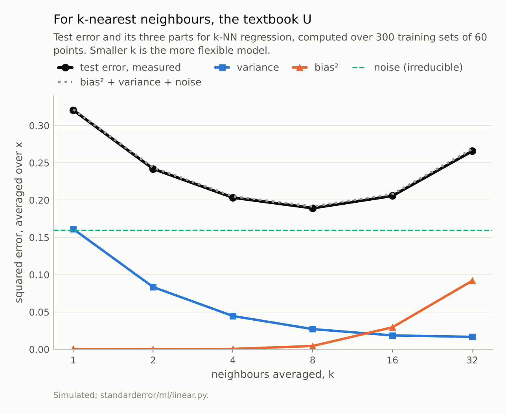
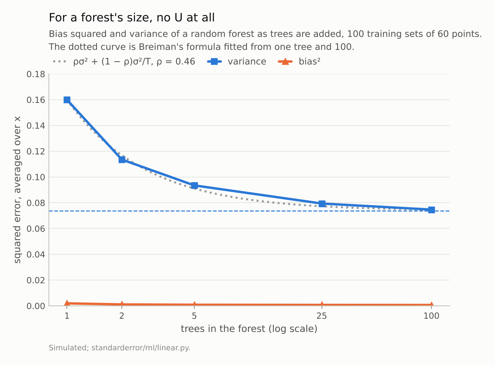
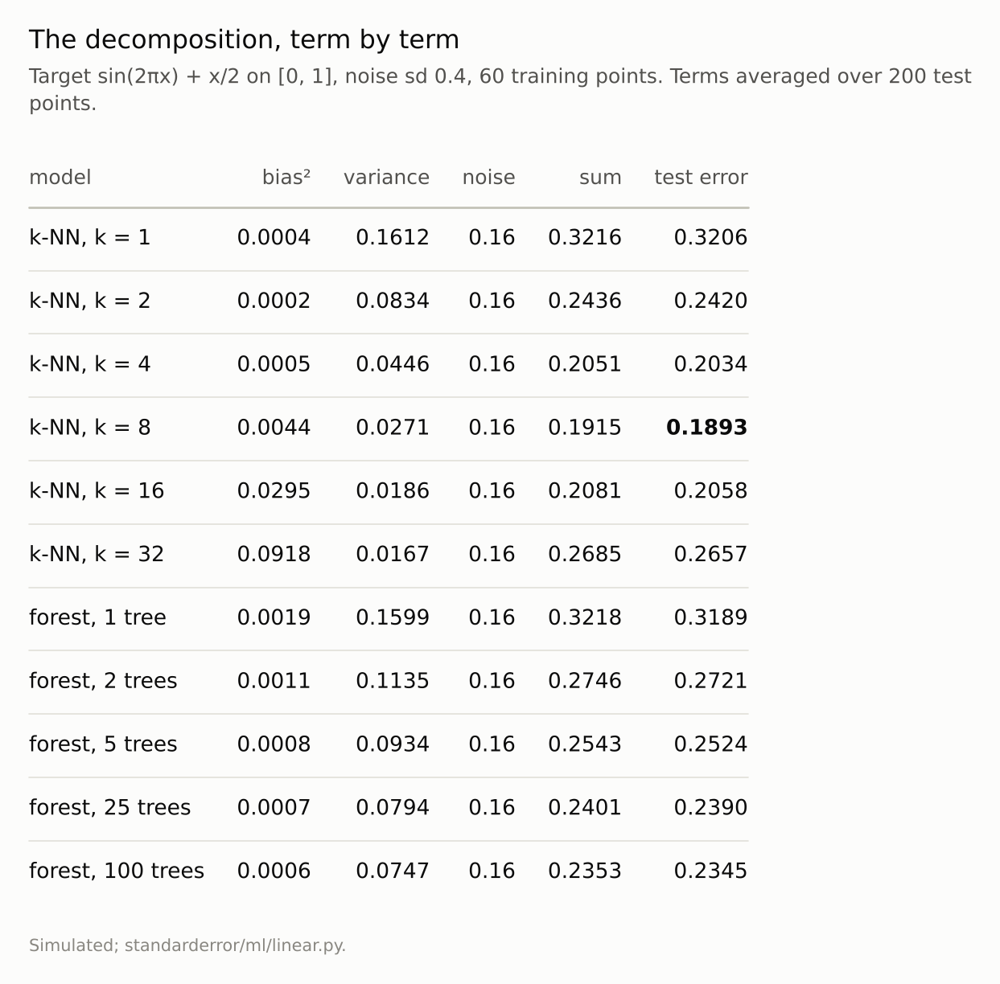

Disclosure: this post was written with the assistance of an AI system (Claude), which wrote the analysis code, ran the experiments and drafted the text. The topic, the constraints, the data choices and the final review are the author's.

*On a simulated regression where bias, variance and noise can be computed exactly, the three add up to the measured test error to within 0.003. For k-nearest neighbours the variance falls from 0.161 at k = 1 to 0.017 at k = 32 while bias squared rises from 0.0004 to 0.092; test error is a U with its bottom at k = 8. For a random forest, adding trees keeps bias near zero (within simulation error) and lowers variance monotonically, from 0.160 to 0.075, towards a floor of 0.074 set by a between-tree correlation of 0.46. There is no U.*

Episode 9 of *Machine Learning, Taught Through What Breaks*. The syllabus and the other episodes: https://jongha-jeon-dev.github.io/standarderror/lectures/

## A diagram worth checking

Few pictures in machine learning are drawn as often as this one: test error against model complexity, a falling bias curve, a rising variance curve, and their sum making a U whose bottom is the model to choose. It is usually drawn, not measured.

On simulated data it can be measured exactly. Fix a target function, draw many training sets from it, fit the model to each and look at its predictions at fixed test points. The average prediction's distance from the truth is the **bias**; the spread of predictions across training sets is the **variance**; the noise in the labels is the floor nobody can beat. For squared error the three add up, exactly, to the expected test error.

The target here is sin(2πx) + x/2 on [0, 1] with noise of standard deviation 0.4, and each training set has 60 points. The first knob is the number of neighbours a k-nearest-neighbours regression averages.

```python
from standarderror.ml import linear as ln

# 300 training sets of 60 points; terms averaged over 200 test x
for r in ln.knn_sweep(ks=(1, 2, 4, 8, 16, 32)):
    print(f"k {r['k']:>2}  bias2 {r['bias2']:.4f}  var {r['variance']:.4f}"
          f"  noise {r['noise']:.2f}  sum {r['total']:.4f}"
          f"  measured {r['mse']:.4f}")
```

```text
k  1  bias2 0.0004  var 0.1612  noise 0.16  sum 0.3216  measured 0.3206
k  2  bias2 0.0002  var 0.0834  noise 0.16  sum 0.2436  measured 0.2420
k  4  bias2 0.0005  var 0.0446  noise 0.16  sum 0.2051  measured 0.2034
k  8  bias2 0.0044  var 0.0271  noise 0.16  sum 0.1915  measured 0.1893
k 16  bias2 0.0295  var 0.0186  noise 0.16  sum 0.2081  measured 0.2058
k 32  bias2 0.0918  var 0.0167  noise 0.16  sum 0.2685  measured 0.2657
```

This is the textbook. At k = 1 the model copies the nearest training label, noise and all: variance 0.161, bias almost nothing. At k = 32 it averages over half the data: variance 0.017, bias squared 0.092. The sum tracks the measured error to within 0.003, and the error has a clean U with its bottom at **k = 8**, where it is 0.189 against the noise floor of 0.16.



*The three parts add up to the measured error to within 0.003. The bottom of the U is k = **8**, test error 0.189 against a noise floor of 0.16.*

## A knob with no U

The second knob is the number of trees in a random forest. More trees is "more model" by any count of parameters, and the U predicts that past some point it should overfit.

```python
sweep = ln.forest_sweep(trees=(1, 2, 5, 25, 100))
for r in sweep:
    print(f"trees {r['trees']:>3}  bias2 {r['bias2']:.4f}"
          f"  var {r['variance']:.4f}  measured {r['mse']:.4f}")
print(f"implied correlation between trees: {ln.forest_rho(sweep):.3f}")
```

```text
trees   1  bias2 0.0019  var 0.1599  measured 0.3189
trees   2  bias2 0.0011  var 0.1135  measured 0.2721
trees   5  bias2 0.0008  var 0.0934  measured 0.2524
trees  25  bias2 0.0007  var 0.0794  measured 0.2390
trees 100  bias2 0.0006  var 0.0747  measured 0.2345
implied correlation between trees: 0.462
```

It does not. Bias squared is below 0.0019 at every size; its slight fall from one tree to a hundred is about the size of the simulation's own error in estimating it, which is the variance divided by the number of training sets (0.0016 for one tree). Variance falls at every step, from 0.160 with one tree to 0.075 with a hundred, and the measured error falls with it. More trees never hurt.

The variance does not fall to zero either. The textbook formula for an average of correlated predictors gives the reason (Hastie, Tibshirani and Friedman, section 15.2; Breiman's 2001 bound for an infinite forest has the same shape): the average of T trees, each with variance σ² and pairwise correlation ρ, has variance ρσ² + (1 − ρ)σ²/T. Averaging removes the part the trees do not share and leaves the part they do. Fitting ρ from one tree and from a hundred gives **ρ = 0.46**: whatever the number of trees, this forest's variance cannot go below 0.074. The dotted curve in the figure is that formula, and the intermediate forest sizes sit on it.

None of this makes the forest a good model of this target. At a hundred trees its test error is 0.235, worse than k-NN at its best (0.189). Fully grown trees on one input copy their training labels almost as k = 1 does, and averaging a hundred of them removes only the unshared half of that variance. What would help is a knob on each tree — a minimum number of points per leaf, a maximum depth — which, like k, should trade bias for variance and draw a U; that was not measured here.

To lower the floor one must make the trees *less alike* — fewer features per split, smaller bootstrap samples — and that is a knob that does trade bias for variance, because decorrelated trees are individually worse.



*Bias stays near zero. Variance falls from 0.160 with one tree to 0.075 with 100 and would not go below **0.074** with any number: averaging removes only the part of the variance the trees do not share.*

## What the U is about

The two sweeps disagree because their knobs do different things. The number of neighbours changes *what each prediction is*: a wider average is smoother and less faithful to the target. That is a trade, and a trade has an optimum. The number of trees changes only *how many independent-ish copies of the same kind of prediction are averaged*. Averaging cannot add bias, so there is nothing to trade.

So "test error is U-shaped in complexity" is a claim about a particular knob, not about complexity as such. Depth of a single tree, the penalty of a ridge regression, the degree of a polynomial and k in k-NN all trade bias for variance, and below the point where the model interpolates its training data each typically draws a U; only k was measured here. Ensemble size, the number of bootstrap draws and the number of random restarts averaged do not. In practice the U is found by cross-validation, which estimates the sum and never its parts; the decomposition explains the shape of the curve but is not how anyone tunes a model on real data. The next episode adds a third kind: the number of features in a model that interpolates its training data, where the curve goes up, then down again.



*The sum column and the measured column agree row by row: the decomposition is an identity in expectation, and the small gaps are simulation error. What differs between the two knobs is which terms move.*

## Where this breaks

**Squared error only.** The clean additive split into bias, variance and noise belongs to squared error. For 0-1 loss there are several competing decompositions, and in none of them does variance simply add.

**One target, one sample size.** Theory says that with more training points the k-NN U should move to larger k, and with a rougher target to smaller k; neither was measured here. The forest's floor depends on the target too. The shapes, not the numbers, are the finding.

**The decomposition needs many training sets.** On real data there is one. The bootstrap gives a rough stand-in, but it estimates variance from resamples that overlap heavily, and bias cannot be computed at all without the true function.

**Not the whole story past interpolation.** A 1-nearest-neighbour fit reproduces its training labels exactly, a fully grown tree those of its bootstrap sample, and both sit at the high-variance end here. Episode 10 shows a family of interpolating models whose error falls again as they grow, which the U has no room for.

**Forest defaults.** scikit-learn's regression forest considers every feature at each split by default. With one input feature here that makes no difference, but on wide data the setting changes ρ, and with it the floor.

## What to keep

1. For squared error, bias squared, variance and noise add up exactly to the expected test error; here they matched the measured error to within 0.003.

2. k in k-NN trades bias for variance, and test error had a U with its bottom at k = 8.

3. Adding trees to a random forest kept bias near zero, moving only within simulation error, and lowered variance every time, from 0.160 to 0.075. No U.

4. The variance of an average of correlated models has a floor of ρσ²; for this forest ρ = 0.46. Lower it by decorrelating the members, not by adding more.

5. Before drawing a U, ask whether the knob changes the predictor or only averages copies of it.

## Exercise

Pick a model you tune and a knob you tune it with. On a simulated version of your problem — same number of rows and features, a target you choose — run the decomposition: 100 training sets, predictions at fixed test points, bias squared and variance averaged over them. Does your knob draw a U, or only a descending curve?

Then do the same for the number of members in your ensemble, and estimate ρ from one member and many. If your ensemble is already near ρσ², adding members is wasted compute.

## Next

Episode 10 takes the U past the point where the model fits its training data exactly. With random features and the minimum-norm fit, test error rises to a peak where the number of features equals the number of rows — and then falls again. Whether the second descent is a free lunch is the measurement.

---

### Data

- Simulated: x uniform on [0, 1], y = sin(2πx) + x/2 plus normal noise of sd 0.4; 60 training points; 300 training sets for k-NN and 100 for the forests; terms averaged over 200 evenly spaced test points.
- Machinery: `standarderror/ml/linear.py`, tested in `tests/test_ml.py`; scikit-learn's KNeighborsRegressor and RandomForestRegressor at their defaults.
- Where this stops: Geman, Bienenstock and Doursat, "Neural networks and the bias/variance dilemma", *Neural Computation* (1992); Breiman, "Random forests", *Machine Learning* (2001), whose bound on a forest's error by the mean correlation between its trees is the infinite-forest form of the same idea; Hastie, Tibshirani and Friedman, *The Elements of Statistical Learning* (2009), sections 7.3 and 15.2, for the decomposition and the variance of an average of correlated trees.

### Reproducibility

- **environment**: standarderror=0.1.0, python=3.13.16, numpy=2.4.4
- **code blocks**: executed at build time; the values the prose quotes are pinned, so drift fails the build
- **determinism**: training sets from seeds 0 to 299; noisy test labels from seed 999; forests with random_state 0

Code: <https://github.com/jongha-jeon-dev/standarderror>
